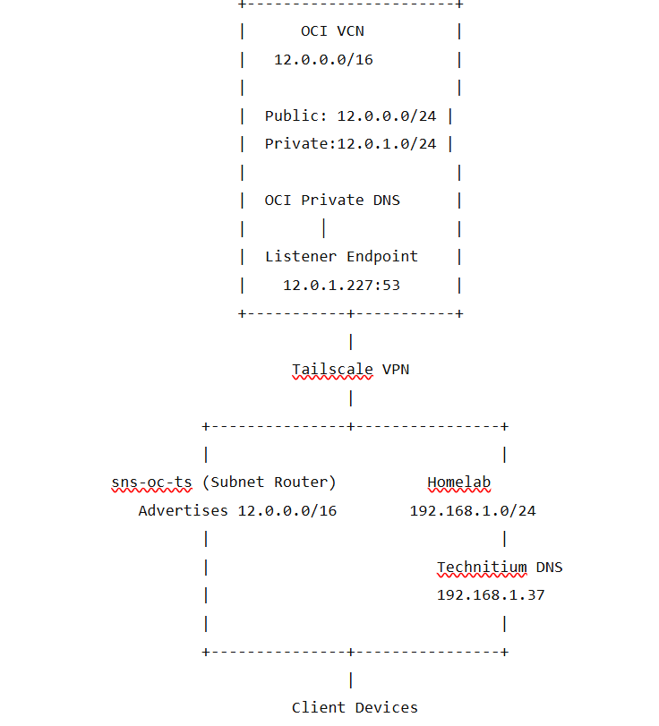
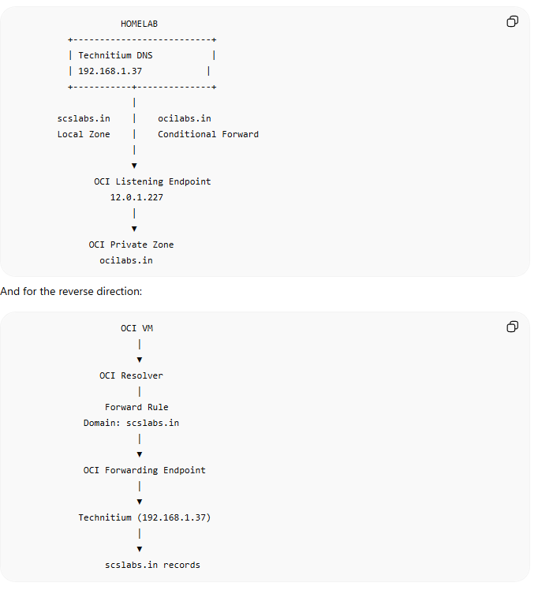

# Hybrid DNS Between OCI Private DNS and Homelab Technitium DNS Using Tailscale

## Overview

This guide explains how to integrate Oracle Cloud Infrastructure (OCI) Private DNS with a homelab running Technitium DNS over a Tailscale network. The objective is to have:

- `*.scslabs.in` resolved locally by Technitium
- `*.ocilabs.in` resolved by OCI Private DNS
- No duplicate DNS records
- OCI as the authoritative source for OCI resources
- Technitium as the central DNS server for the homelab

| Requirement                          | OCI Endpoint Type          | Purpose                                                              |
|--------------------------------------|----------------------------|----------------------------------------------------------------------|
| **Homelab → OCI DNS (`ocilabs.in`)** | ✅ **Listening Endpoint**  | Accepts DNS queries from external clients (Technitium, homelab, VPN) |
| **OCI → Homelab DNS (`scslabs.in`)** | ✅ **Forwarding Endpoint** | Allows OCI Resolver to forward queries to your Technitium DNS        |

## Home Lab to OCI DNS:

### Network Topology



## Environment

### Homelab

- Network: `192.168.1.0/24`
- Domain: `scslabs.in`
- Technitium DNS
- Tailscale subnet router

### OCI

- VCN: `12.0.0.0/16`
- Public subnet: `12.0.0.0/24`
- Private subnet: `12.0.1.0/24`
- Domain: `ocilabs.in`
- OCI Private DNS

# Step 1: Create OCI Private DNS Zone

Navigate to:

``` wp-block-code
Networking
→ DNS Management
→ Private Zones
→ Create Zone
```

Create:

``` wp-block-code
Zone Name:
ocilabs.in
```

Example records:

``` wp-block-code
lnxjmpsr    A    12.0.0.5
ocitss01    A    12.0.1.5
```

# Step 2: Associate the Zone

Associate the Private Zone with the VCN using a Private View.

``` wp-block-code
Private View
    ↓
Associate with
LAB-VCN
```

# Step 3: Create a DNS Listening Endpoint

Navigate:

``` wp-block-code
Networking
→ DNS Management
→ Private Resolver
→ Endpoints
→ Create Endpoint
```

Choose:

``` wp-block-code
Listening Endpoint
```

Example:

``` wp-block-code
Name:
homelab

Subnet:
Private Subnet

Assigned IP:
12.0.1.227
```

This endpoint becomes the DNS server for `ocilabs.in`.

# Step 4: Configure OCI Security

Allow DNS access.

Ingress:

|       |          |      |
|-------|----------|------|
| ource | Protocol | Port |

|                |     |     |
|----------------|-----|-----|
| 192.168.1.0/24 | UDP | 53  |

|                |     |     |
|----------------|-----|-----|
| 192.168.1.0/24 | TCP | 53  |

opional to route is using tailscal dns:

|               |     |     |
|---------------|-----|-----|
| 100.64.0.0/10 | UDP | 53  |

|               |     |     |
|---------------|-----|-----|
| 100.64.0.0/10 | TCP | 53  |

# Step 5: Verify Connectivity

From homelab:

``` wp-block-code
Test-NetConnection 12.0.1.227 -Port 53
```

Expected:

``` wp-block-code
TcpTestSucceeded : True
```

Test DNS:

``` wp-block-code
nslookup lnxjmpsr.ocilabs.in 12.0.1.227
```

Expected:

``` wp-block-code
Name: lnxjmpsr.ocilabs.in
Address: 12.0.0.5
```

# Step 6: Configure Technitium

Go to:

``` wp-block-code
Zones
→ Add Zone
```

Select:

``` wp-block-code
Conditional Forwarder Zone
```

Configure:

``` wp-block-code
Zone:
ocilabs.in
```

Forwarder:

``` wp-block-code
12.0.1.227
```

Protocol:

``` wp-block-code
DNS over UDP
```

Disable:

``` wp-block-code
DNSSEC Validation
```

Result:

``` wp-block-code
ocilabs.in
        ↓
12.0.1.227
```

# Step 7: Configure Technitium as Primary DNS

Point clients to Technitium.

Example:

``` wp-block-code
Windows DNS
127.0.0.1
```

or

``` wp-block-code
192.168.1.37
```

Verify:

``` wp-block-code
nslookup lnxjmpsr.ocilabs.in
```

Result:

``` wp-block-code
12.0.0.5
```

# Final DNS Flow

``` wp-block-code
Client
    │
    ▼
Technitium
    │
    ├── scslabs.in
    │      │
    │      ▼
    │   Local Records
    │
    └── ocilabs.in
           │
           ▼
     OCI DNS Listener
           │
           ▼
     OCI Private Zone
```

if not already configured

# Tailscale Subnet Router Configuration

OCI router:

``` wp-block-code
tailscale up \
  --advertise-routes=12.0.0.0/16
```

Homelab router:

``` wp-block-code
tailscale up \
  --advertise-routes=192.168.1.0/24
```

Approve routes in the Tailscale admin console.

Verify:

``` wp-block-code
tailscale status --json
```

Expected:

``` wp-block-code
PrimaryRoutes:
12.0.0.0/16
```

# Common Troubleshooting

## 1. `nslookup` returns public IP instead of private IP

Symptom:

``` wp-block-code
91.195.240.94
```

Cause:

Client is using ISP DNS instead of Technitium.

Fix:

``` wp-block-code
Set-DnsClientServerAddress
```

Point DNS to Technitium.

------------------------------------------------------------------------

## 2. `nslookup` works with 127.0.0.1 but not normally

Example:

``` wp-block-code
nslookup host 127.0.0.1
```

works.

``` wp-block-code
nslookup host
```

fails.

Cause:

Windows is using another DNS server.

Fix:

Configure Wi-Fi adapter DNS to Technitium.

------------------------------------------------------------------------

## 3. `nslookup 12.0.1.5` fails

``` wp-block-code
*** Non-existent domain
```

Reason:

Reverse PTR records do not exist.

Solution:

Create reverse zones or PTR records if required.

------------------------------------------------------------------------

## 4. `ping 12.0.1.5` works but `ping 12.0.1.227` fails

Cause:

OCI DNS Listener may reject packets sourced from non-VCN addresses when subnet routing is configured without SNAT.

If using:

``` wp-block-code
--snat-subnet-routes=false
```

the listener sees:

``` wp-block-code
Source:
192.168.x.x
```

instead of

``` wp-block-code
12.0.x.x
```

Enable SNAT or use Technitium as the single DNS proxy.

------------------------------------------------------------------------

## 5. `Test-NetConnection` succeeds but `nslookup` times out

Check:

- Security Lists
- NSGs
- UDP 53
- TCP 53
- Listener Endpoint configuration

------------------------------------------------------------------------

## 6. Verify subnet routes

``` wp-block-code
tailscale status --json
```

Should contain:

``` wp-block-code
PrimaryRoutes:
12.0.0.0/16
```

Linux:

``` wp-block-code
ip route show table 52
```

Expected:

``` wp-block-code
12.0.0.0/16 dev tailscale0
```

------------------------------------------------------------------------

## 7. Verify DNS Listener

``` wp-block-code
Test-NetConnection 12.0.1.227 -Port 53
```

``` wp-block-code
nslookup host 12.0.1.227
```

------------------------------------------------------------------------

# Recommended Architecture

``` wp-block-code
                   +--------------------+
                   | Technitium DNS     |
                   | 192.168.1.37       |
                   +---------+----------+
                             |
          +------------------+------------------+
          |                                     |
          ▼                                     ▼
  Local Zone (scslabs.in)          Conditional Forwarder
                                           │
                                           ▼
                                   OCI DNS Listener
                                     12.0.1.227
                                           │
                                           ▼
                                  OCI Private Zone
                                     ocilabs.in
```

This design provides:

- Single DNS server for all clients
- No duplicated records
- OCI remains authoritative for cloud resources
- Automatic propagation of new OCI records
- Simple troubleshooting
- Scalable hybrid DNS architecture

## OCI → Homelab DNS

To resolve `scslabs.in` from OCI

## Step 1: Create a Forwarding Endpoint

Go to:

``` wp-block-code
Networking→ DNS Management→ Private Resolver→ Endpoints→ Create Endpoint
```

Select:

``` wp-block-code
Forwarding
```

For example:

``` wp-block-code
Name: homelab-forwarderSubnet: 12.0.1.0/24IP: 12.0.1.228
```

The IP will be assigned from your subnet.

## Step 2: Create a Resolver Rule

Go to:

``` wp-block-code
Resolver→ Rules→ Create Rule
```

Configure:

``` wp-block-code
Rule Type:Forward
```

``` wp-block-code
Domain:scslabs.in
```

``` wp-block-code
Destination:192.168.1.37
```

(Your Technitium DNS server)

Port:

``` wp-block-code
53
```

Associate the rule with the **Forwarding Endpoint** you created.

## Final architecture



# End-to-end result

| Query Origin | Query                 | Resolved By                                     |
|--------------|-----------------------|-------------------------------------------------|
| Homelab      | `proxmox.scslabs.in`  | Technitium (local)                              |
| Homelab      | `lnxjmpsr.ocilabs.in` | Technitium → OCI Listening Endpoint             |
| OCI VM       | `lnxjmpsr.ocilabs.in` | OCI Private DNS                                 |
| OCI VM       | `proxmox.scslabs.in`  | OCI Resolver → Forwarding Endpoint → Technitium |

## Recommended production design

For your environment:

- **Technitium (`192.168.1.37`)** is authoritative for `scslabs.in`.
- **OCI Private DNS** is authoritative for `ocilabs.in`.
- **OCI Listening Endpoint (`12.0.1.227`)** is used by Technitium to resolve `ocilabs.in`.
- **OCI Forwarding Endpoint + Resolver Rule** forwards `scslabs.in` queries from OCI to Technitium.

This creates a clean bidirectional hybrid DNS setup with no duplicate records and each environment remaining the source of truth for its own domain.
