

<a href="../index.html" class="back-home">← All articles</a>

Azure networking · AZ-900 / AZ-104 · Hands-on lab

# Azure Hub-and-Spoke with a VPN Gateway: Peering Two Spokes and Connecting from Windows with Point-to-Site VPN

This lab builds a small hub-and-spoke network: `VNET-HUB` with a VPN
gateway, peered to `VNET-SP1` and `VNET-SP2`. It then adds point-to-site
(P2S) VPN with certificate authentication so a Windows laptop can join
the network privately. Every step is a screenshot from the real build,
including the errors along the way: the first ping to a spoke VM timed
out, and section 6 shows how to diagnose and fix it.

Sunke NithinNovember 2026~20 min read + ~90 min lab (most of it waiting
for the gateway)

[1. What we're building](#design) [2. VPN gateway basics](#gateway) [3.
Point-to-site and certificates](#p2s) [4. Peering and gateway
transit](#transit) [5. Lab, phase by phase](#lab) [6. Reach the spoke:
troubleshooting](#verify) [7. Two more things to fix](#fixes) [8. CLI
reference](#cli) [9. Cost and clean-up](#cost) [10. Quiz](#quiz) [11.
Key takeaways](#takeaways)

## 1. What we're building

In a **hub-and-spoke** design, shared services such as VPN gateways,
firewalls and Bastion live once in a central **hub** VNet. Each workload
gets its own **spoke** VNet, peered to the hub. Spokes stay isolated
from each other, but all of them can use the hub's services. This saves
money because you pay for one gateway, not one per workload, and it
keeps security rules in one place.

<figure>

<img
src="" />

<figcaption>Figure 1. The lab network. All three VNets are in
Network-RG, West US 3.</figcaption>
</figure>

## 2. VPN gateway basics

An **Azure VPN gateway** (resource type *virtual network gateway*,
gateway type *VPN*) is a pair of managed VMs that Azure runs in a
special subnet of your VNet. It terminates encrypted tunnels over the
public internet. One gateway can serve three kinds of connection:

| Connection              | Connects                                          | Typical use                                                  |
|-------------------------|---------------------------------------------------|--------------------------------------------------------------|
| **Site-to-site (S2S)**  | An on-premises VPN device ↔ Azure, over IPsec/IKE | Office or datacenter network to Azure                        |
| **Point-to-site (P2S)** | Individual computers ↔ Azure                      | Admins and remote workers; this lab                          |
| **VNet-to-VNet**        | Two Azure VPN gateways                            | Encrypted links between regions (peering is usually simpler) |

- **GatewaySubnet:** the gateway must live in a subnet named exactly
  `GatewaySubnet`, with nothing else in it. Microsoft recommends `/27`
  or larger; this lab used a `/24`. The portal's *Subnet purpose →
  Virtual Network Gateway* option fills in the name for you.
- **SKU:** sets throughput, tunnel counts and features. SKUs ending in
  **AZ**, such as `VpnGw1AZ`, are **zone-redundant**: the gateway
  instances are spread across availability zones. The Basic SKU is
  legacy, lacks most P2S options and isn't recommended.
- **VPN type:** **Route-based** is the default and the one you want; P2S
  needs it.
- **Public IP:** a Standard, static public IP is created with the
  gateway. Clients and on-premises devices connect to it.
- **Active-active** and **BGP** are optional. They matter for resilient
  site-to-site designs, and the lab leaves both disabled.
- **It takes time:** creating a gateway typically takes 20–45 minutes.

**Coming from OCI?** An Azure VPN gateway does the job of OCI's DRG plus
its IPSec connection. A hub VNet with gateway transit is like a DRG hub
with spoke VCN attachments. Azure point-to-site has no direct OCI
equivalent; in OCI you'd usually run your own VPN server, such as
OpenVPN Access Server, from the Marketplace.

## 3. Point-to-site and certificates

Point-to-site lets a single computer dial into the VNet. Three settings
define it:

| Setting            | Options                                                                                                                                                                           | Lab choice                              |
|--------------------|-----------------------------------------------------------------------------------------------------------------------------------------------------------------------------------|-----------------------------------------|
| **Address pool**   | A private range that doesn't overlap any VNet *or* the client's own network. Each connected client gets one address from it.                                                      | `192.168.1.0/24` (see section 7, fix 1) |
| **Tunnel type**    | **OpenVPN** (TLS on 443, works through most firewalls; needs the Azure VPN Client or an OpenVPN client), **IKEv2** (native in Windows and macOS), **SSTP** (Windows only, legacy) | IKEv2 and OpenVPN                       |
| **Authentication** | **Azure certificate**, **Microsoft Entra ID** (OpenVPN only; supports MFA and Conditional Access), **RADIUS**                                                                     | Azure certificate                       |

With **certificate authentication**, you upload the *public* part of a
**root certificate** to the gateway. Any client presenting a **child
(client) certificate** signed by that root, together with its private
key, is allowed in. To cut off one device, add its child certificate's
thumbprint to the **revoked certificates** list.

<figure>

<figcaption>Figure 2. The gateway trusts the root; clients prove
themselves with a child certificate signed by it.</figcaption>
</figure>

## 4. Peering and gateway transit

Peering connects two VNets, but it doesn't automatically let a spoke use
the hub's VPN gateway. That takes **gateway transit**, which is two
checkboxes on the peering:

- On the **hub side**: *Allow gateway or route server in 'VNET-HUB' to
  forward traffic to 'VNET-SPx'* (this is called `allowGatewayTransit`).
- On the **spoke side**: *Enable 'VNET-SPx' to use 'VNET-HUB's' remote
  gateway or route server* (`useRemoteGateways`).

<figure>

<figcaption>Figure 3. Gateway transit is what lets spokes share the
hub's VPN gateway.</figcaption>
</figure>

Even with transit, **SP1 still can't reach SP2**, because peering
doesn't pass traffic on to a third VNet. Spoke-to-spoke traffic needs a
router in the hub: Azure Firewall or a network virtual appliance, plus
route tables in the spokes. Alternatively, peer SP1 and SP2 directly.

## 5. Lab, phase by phase

**Starting point:** `VNET-SP1` with `SUBNET1`, `nsg1` and VM
`vnet1srv01`, built in the
[VNet](../azure-vnet-private-subnet-lab/azure-vnet-private-subnet-lab.html)
and
[NSG](../azure-network-security-groups-nsg/azure-network-security-groups-nsg.html)
posts. You also need a Windows 10/11 or Windows Server PC for the
certificates and the VPN client.

Phase 1 · The three VNets

### Create the hub and the second spoke

Create `VNET-HUB` (`12.0.0.0/16`, see section 7, fix 2) and `VNET-SP2`
in `Network-RG`, West US 3, the same way as VNET-SP1 in the VNet post.
Peering also works across regions, but keeping everything in one region
keeps the lab simple.

<figure class="shot">
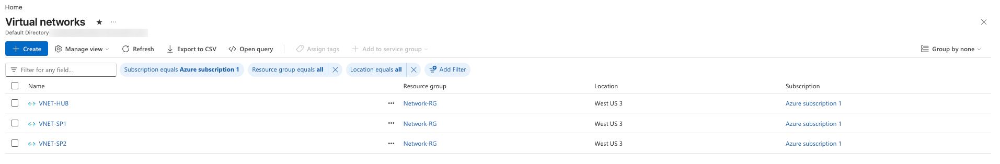
<figcaption>Three VNets, one resource group.</figcaption>
</figure>

<figure class="shot">
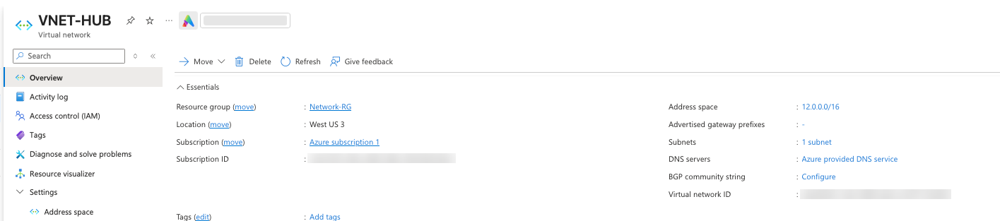
<figcaption>VNET-HUB: 12.0.0.0/16, Azure-provided DNS.</figcaption>
</figure>

<figure class="shot">
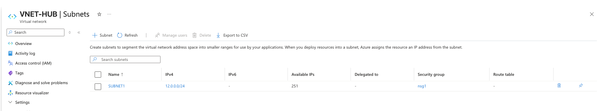
<figcaption>Hub SUBNET1 has 251 free IPs: a /24 minus 5
reserved.</figcaption>
</figure>

<figure class="shot">
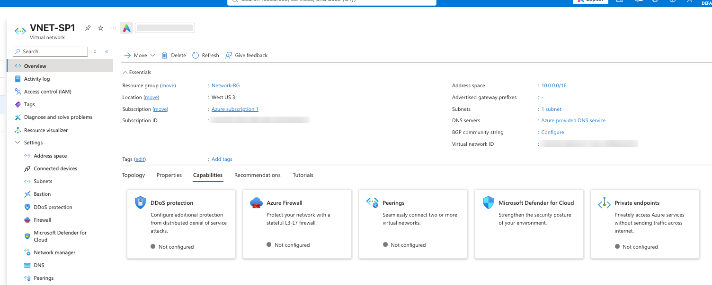
<figcaption>SP1's Capabilities tab: peerings not configured
yet.</figcaption>
</figure>

<figure class="shot">
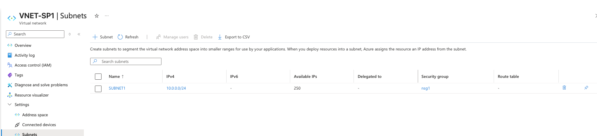
<figcaption>SP1 SUBNET1 shows 250 free IPs because the VM's NIC uses
one.</figcaption>
</figure>

Phase 2 · GatewaySubnet and the VPN gateway

### Add GatewaySubnet to the hub

VNET-HUB → **Subnets → + Subnet**. Set **Subnet purpose** to *Virtual
Network Gateway*, and the name becomes `GatewaySubnet` automatically.
Use starting address `12.0.1.0`, size `/24` (a `/27` is enough), and
leave the NSG and route table at None. Don't attach an NSG to
GatewaySubnet; it can break the gateway.

<figure class="shot">
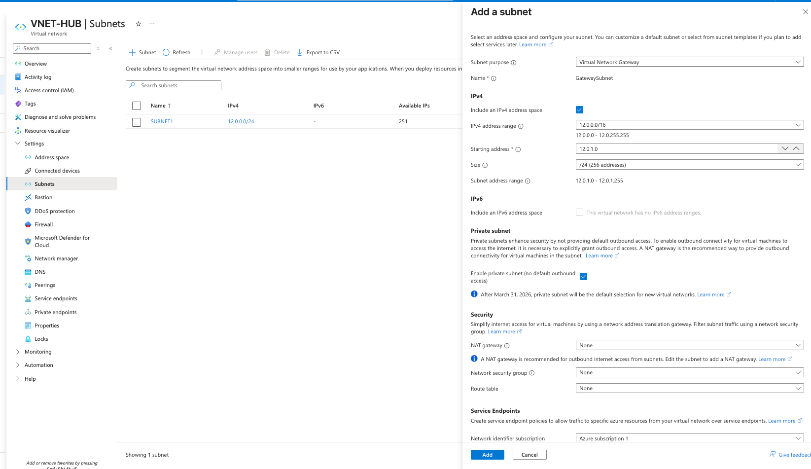
<figcaption>The purpose dropdown sets the required name.</figcaption>
</figure>

### Create the virtual network gateway

Search **VPN gateways → + Create**:

- **Name:** `vpn-gateway`, **Region:** West US 3
- **Gateway type:** VPN, **SKU:** `VpnGw1AZ`, **Virtual network:**
  `VNET-HUB`. The resource group and GatewaySubnet are picked up
  automatically.
- **Public IP:** create new, `vpn-ip` (Standard, Static)
- **Active-active:** Disabled, **BGP:** Disabled

Then **Review + create**, and wait 20–45 minutes.

<figure class="shot">
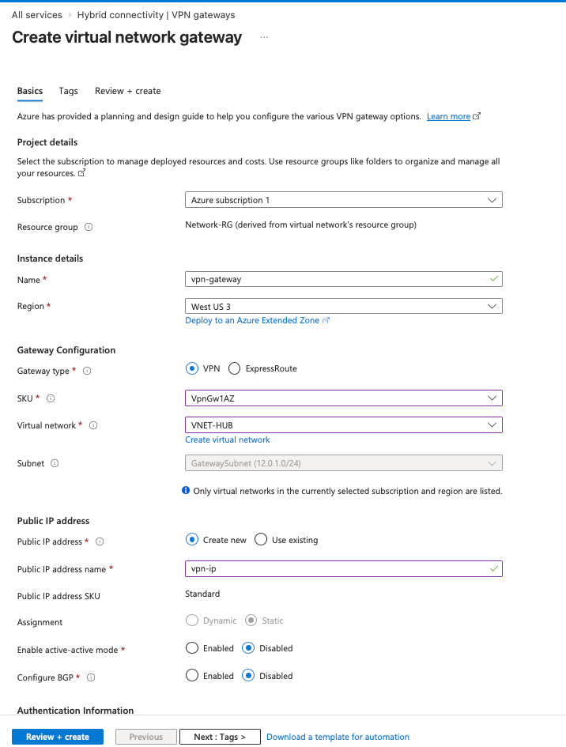
<figcaption>Only VNets in the selected subscription and region are
listed.</figcaption>
</figure>

<figure class="shot">
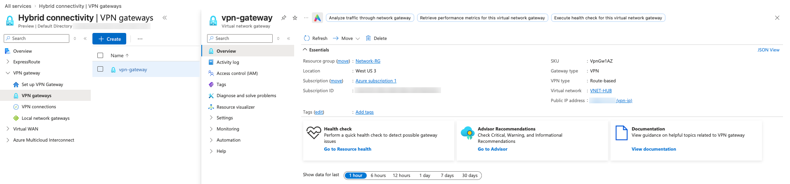
<figcaption>Deployed: route-based VPN on VNET-HUB with its public
IP.</figcaption>
</figure>

Phase 3 · Peer the spokes to the hub

### Add the SP1 peering

VNET-HUB → **Peerings → + Add**. One form creates **both directions**:
the "remote" link (from SP1's side) and the "local" link (from the hub's
side). The lab names were `hub-sp1` for the remote link and `SP1-HUB`
for the local one. *Allow access* and *Allow forwarded traffic* are
ticked on both sides. The two gateway checkboxes were left unticked
here. That's why the first ping to the spoke VM failed, and section 6
walks through the fix. If you're building this fresh, tick them now as
described there.

<figure class="shot">
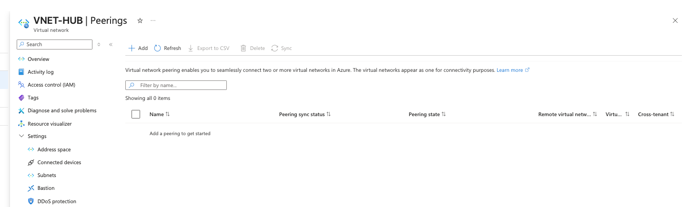
<figcaption>No peerings yet.</figcaption>
</figure>

<figure class="shot">
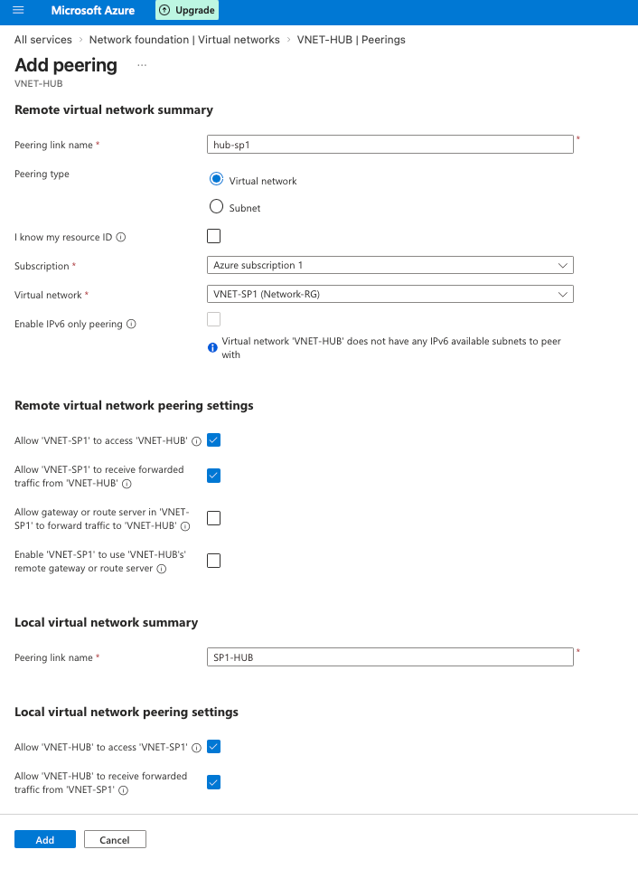
<figcaption>One form, two peering links.</figcaption>
</figure>

<figure class="shot">
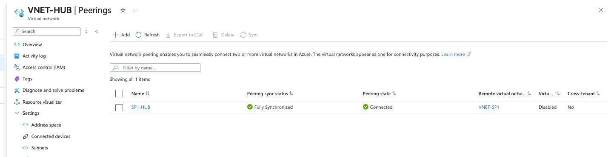
<figcaption><strong>Fully Synchronized</strong> and
<strong>Connected</strong> mean both sides agree.</figcaption>
</figure>

### Add the SP2 peering

Repeat for `VNET-SP2` with the local link name `SP2-HUB`. The address
ranges of all three VNets must not overlap, or Azure rejects the
peering.

<figure class="shot">
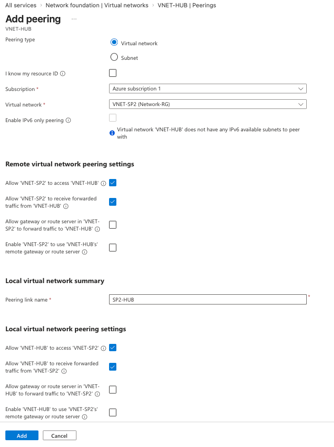
<figcaption>Same settings for the second spoke.</figcaption>
</figure>

<figure class="shot">
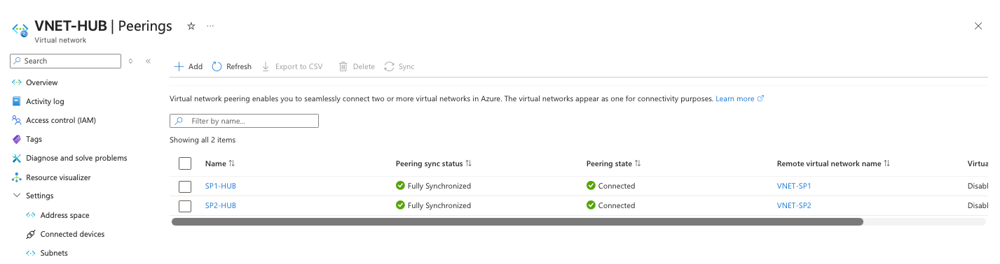
<figcaption>Both spokes peered to the hub.</figcaption>
</figure>

Phase 4 · Certificates

### Start point-to-site, and see why certificates come first

vpn-gateway → **Point-to-site configuration → Configure now**. Enter the
address pool and choose *Azure certificate*. The page refuses to save:
*"At least one valid root certificate must be configured if Azure
Certificate Authentication type is selected."* So, on to the
certificates.

<figure class="shot">
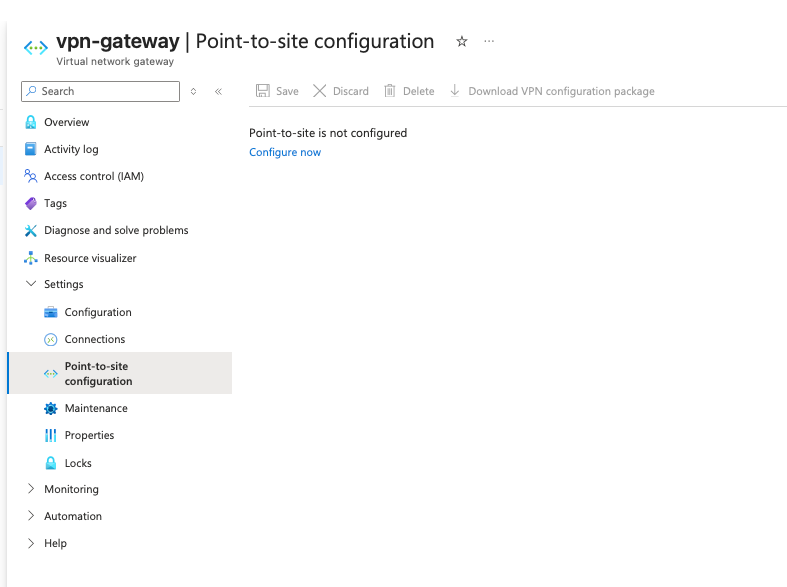
<figcaption>P2S is off by default.</figcaption>
</figure>

<figure class="shot">
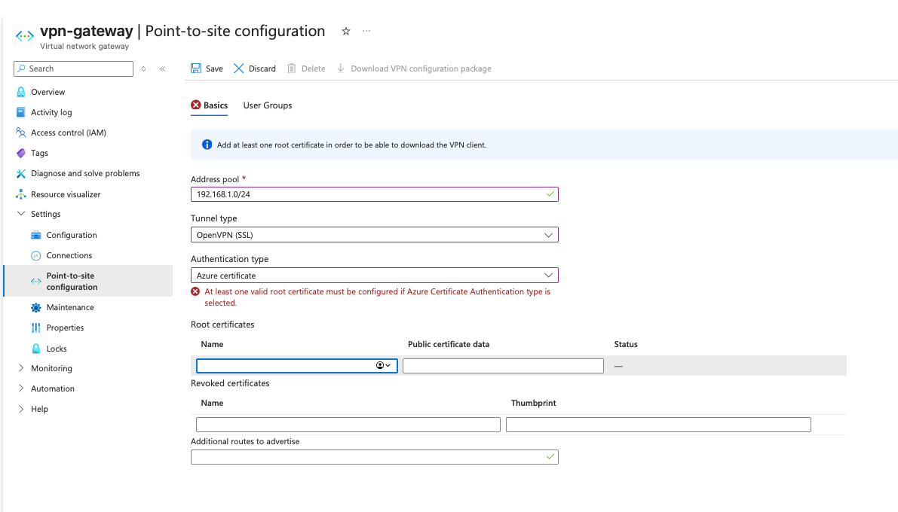
<figcaption>Certificate auth needs a root certificate before
saving.</figcaption>
</figure>

### Create the root and child certificates in PowerShell

On the Windows PC, open **PowerShell as administrator** and run the two
commands from Microsoft's P2S certificate guide. The first creates a
self-signed root that can sign other certificates; the second creates a
client certificate signed by it, with the Client Authentication EKU
(`1.3.6.1.5.5.7.3.2`). Both land in *Current User → Personal*.

    # Root certificate
    $params = @{
        Type = 'Custom'
        Subject = 'CN=P2SRootCert'
        KeySpec = 'Signature'
        KeyExportPolicy = 'Exportable'
        KeyUsage = 'CertSign'
        KeyUsageProperty = 'Sign'
        KeyLength = 2048
        HashAlgorithm = 'sha256'
        NotAfter = (Get-Date).AddMonths(24)
        CertStoreLocation = 'Cert:\CurrentUser\My'
    }
    $cert = New-SelfSignedCertificate @params

    # Client (child) certificate, signed by the root
    $params = @{
        Type = 'Custom'
        Subject = 'CN=P2SChildCert'
        DnsName = 'P2SChildCert'
        KeySpec = 'Signature'
        KeyExportPolicy = 'Exportable'
        KeyLength = 2048
        HashAlgorithm = 'sha256'
        NotAfter = (Get-Date).AddMonths(18)
        CertStoreLocation = 'Cert:\CurrentUser\My'
        Signer = $cert
        TextExtension = @('2.5.29.37={text}1.3.6.1.5.5.7.3.2')
    }
    New-SelfSignedCertificate @params

<figure class="shot">
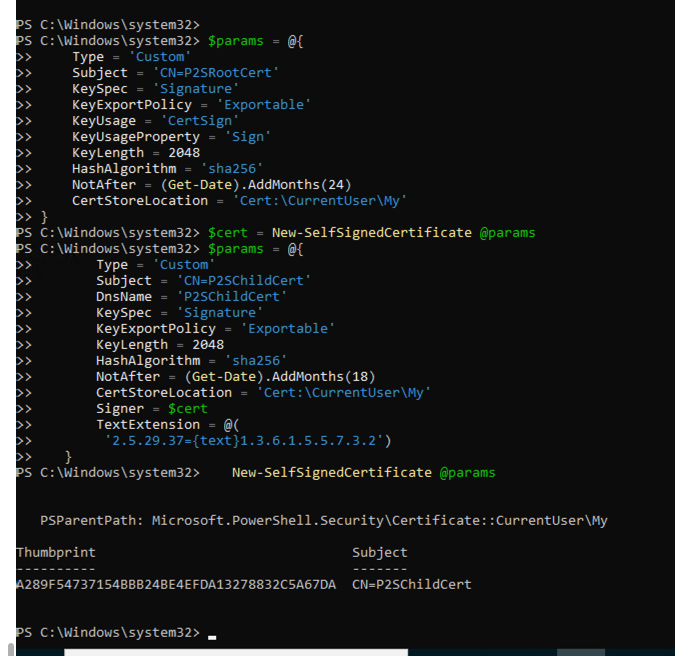
<figcaption>Root, then child signed by <code>$cert</code>.</figcaption>
</figure>

<figure class="shot">
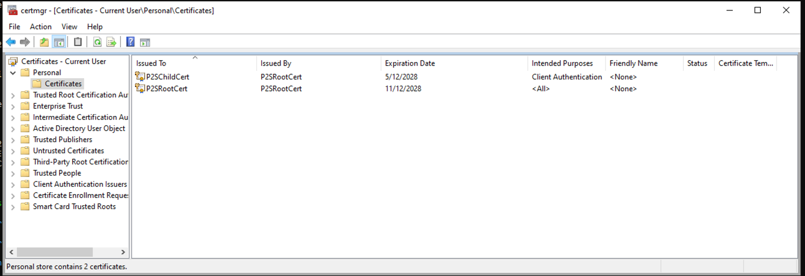
<figcaption><code>certmgr.msc</code>: child issued by root, expiring 18
and 24 months out.</figcaption>
</figure>

**If you closed PowerShell** before creating the child certificate,
`$cert` is gone. Look up the root's thumbprint and load it again:

    Get-ChildItem -Path "Cert:\CurrentUser\My"
    $cert = Get-ChildItem -Path "Cert:\CurrentUser\My\<root-thumbprint>"

<figure class="shot">
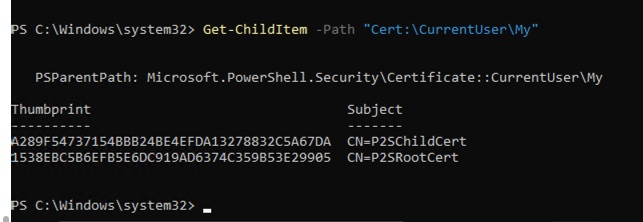
<figcaption>Find the root by its subject, then reuse its
thumbprint.</figcaption>
</figure>

### Export the root (public key) and the child (with private key)

In `certmgr.msc`, right-click a certificate → **All Tasks → Export**:

- **P2SRootCert:** *No, do not export the private key* → **Base-64
  encoded X.509 (.CER)** → `rootcert.cer`. This file goes to Azure.
- **P2SChildCert:** *Yes, export the private key* → **PFX**, include all
  certificates in the path, set a password → `childcert.pfx`. You only
  need this to install the client certificate on *other* computers; keep
  it private.

<figure class="shot">
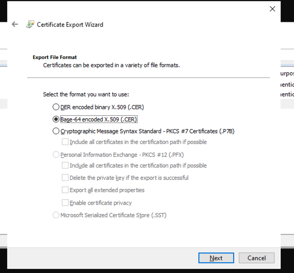
<figcaption>Root: Base-64 .cer, no private key.</figcaption>
</figure>

<figure class="shot">
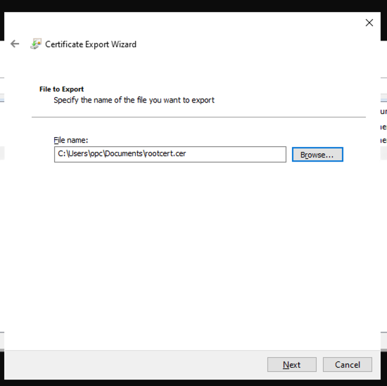
<figcaption>Saved as rootcert.cer.</figcaption>
</figure>

<figure class="shot">
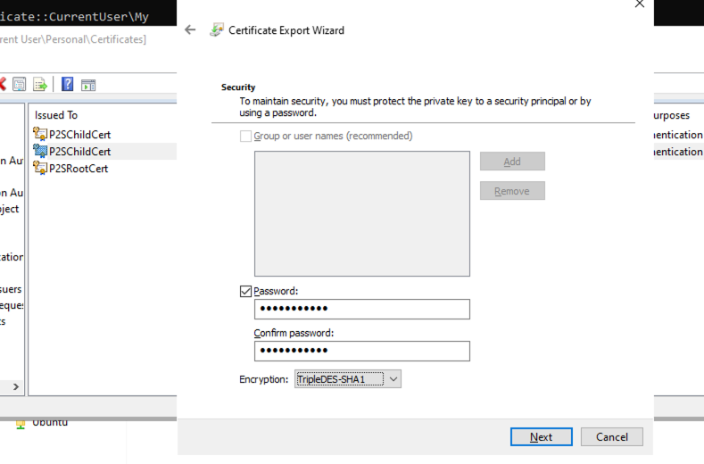
<figcaption>Child: protect the .pfx with a password.</figcaption>
</figure>

<figure class="shot">
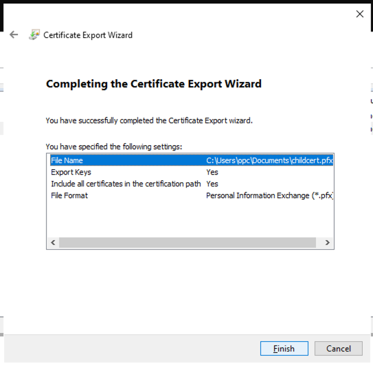
<figcaption>childcert.pfx with private key and chain.</figcaption>
</figure>

Phase 5 · Configure point-to-site

### Upload the root certificate

Open `rootcert.cer` in Notepad and copy the text **between**
`-----BEGIN CERTIFICATE-----` and `-----END CERTIFICATE-----`, without
those two lines. Back on Point-to-site configuration, add a root
certificate (the lab named it `azure`; `P2SRootCert` would be clearer),
paste the data, set the tunnel type to **IKEv2 and OpenVPN (SSL)**, and
click **Save**. The gateway shows *Updating…* for a few minutes, and the
certificate status changes to **Valid**.

<figure class="shot">
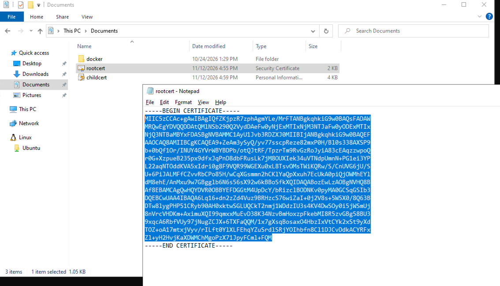
<figcaption>Copy only the Base-64 body.</figcaption>
</figure>

<figure class="shot">
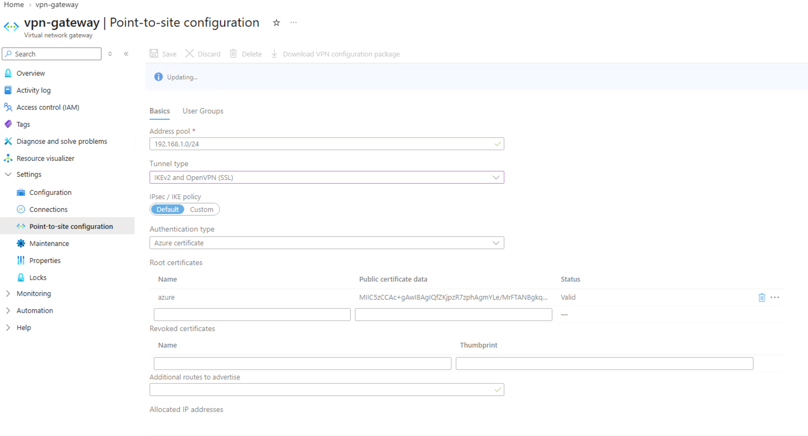
<figcaption>Root certificate accepted.</figcaption>
</figure>

A shortcut that skips the export wizard: in the PowerShell session where
`$cert` is the root, run `[Convert]::ToBase64String($cert.RawData)` and
paste the output.

Phase 6 · Connect from Windows

### Download and install the VPN client

Click **Download VPN configuration package**. The zip has a folder per
client type. For the native Windows client (IKEv2/SSTP), run
`WindowsAmd64\VpnClientSetupAmd64.exe`. Windows SmartScreen flags it
because the package isn't signed with a well-known publisher; it came
straight from your own gateway, so **More info → Run anyway** is fine
here. For OpenVPN, import the profile from the `AzureVPN` or `OpenVPN`
folder into the Azure VPN Client instead.

<figure class="shot">
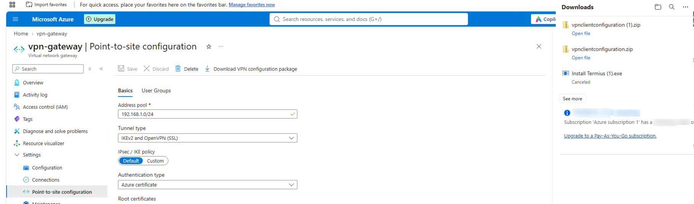
<figcaption>The package is generated for this gateway.</figcaption>
</figure>

<figure class="shot">
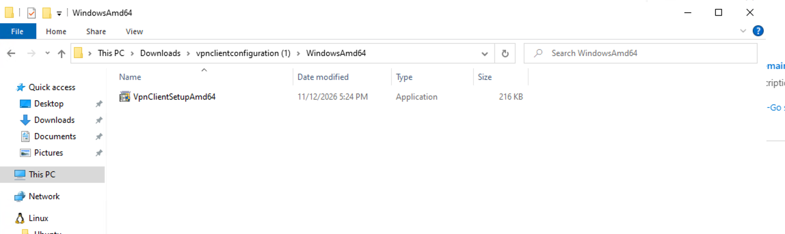
<figcaption>Native Windows client installer.</figcaption>
</figure>

<figure class="shot">
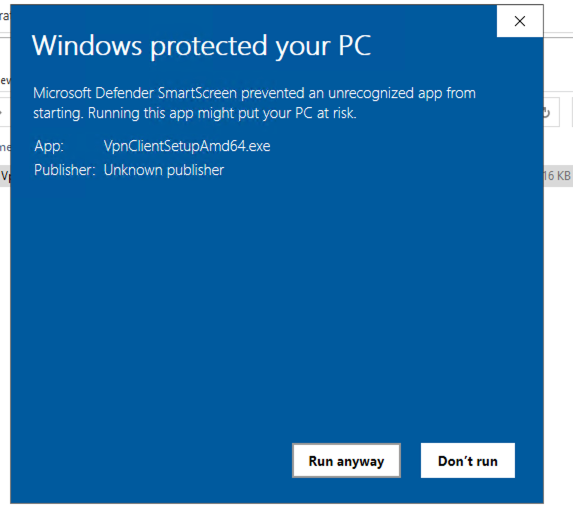
<figcaption>Expected warning for the generated installer.</figcaption>
</figure>

### Connect

**Settings → Network & Internet → VPN** now lists **VNET-HUB**. Click
**Connect**, then **Connect** in the Azure VPN dialog. Windows asks for
elevation for `CMROUTE.DLL`, which adds the routes for the VNet ranges
to your routing table. Click **Continue**. The status changes to
**Connected**.

<figure class="shot">
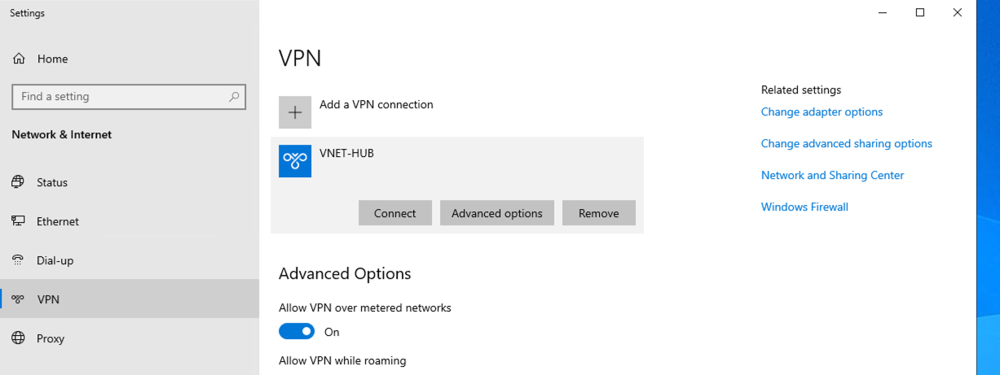
<figcaption>The installer added a VPN profile named after the
VNet.</figcaption>
</figure>

<figure class="shot">
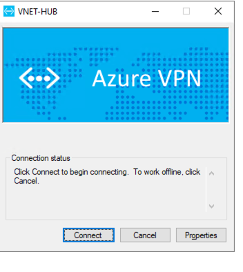
<figcaption>Connection Manager dialog.</figcaption>
</figure>

<figure class="shot">
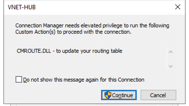
<figcaption>CMROUTE installs routes to the VNets.</figcaption>
</figure>

<figure class="shot">
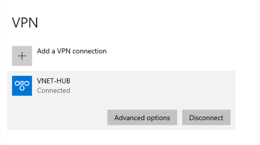
<figcaption>Connected.</figcaption>
</figure>

## 6. Reach the spoke: troubleshooting the first ping

With the VPN connected, the real test is reaching a VM by its private
IP. The VM is `vnet1srv01` at `10.0.0.4` in **VNET-SP1**. The first
attempt failed:

<figure class="shot">
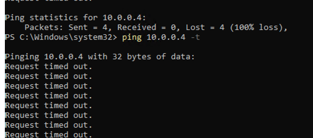
<figcaption>Connected to the VPN, but every ping to the spoke VM timed
out.</figcaption>
</figure>

### Step 1: check the client's routes

A timeout over a VPN usually means the laptop doesn't send that traffic
into the tunnel at all. Check which Azure ranges the VPN client
installed:

    route print | findstr "10.0.0.0 12.0.0.0"

             12.0.0.0      255.255.0.0         On-link       192.168.1.2     43

Only the hub's `12.0.0.0/16` was there, reached through the laptop's VPN
address `192.168.1.2`. There was **no route for SP1's `10.0.0.0/16`**,
so pings to `10.0.0.4` went out through the normal internet connection
and disappeared.

### Step 2: understand why

The gateway only advertises VNets it is allowed to carry traffic for.
VNET-SP1 is peered to the hub, but the two **gateway transit** settings
were off (section 4). So the gateway told clients about the hub only,
and SP1 had no route back to the VPN address pool either.

### Step 3: enable gateway transit on both sides of the peering

**Hub side:** VNET-HUB → **Peerings → SP1-HUB** → tick *Allow gateway or
route server in 'VNET-HUB' to forward traffic to 'VNET-SP1'* → **Save**.
Leave *Enable 'VNET-HUB' to use 'VNET-SP1's' remote gateway* unticked,
because SP1 has no gateway.

<figure class="shot">
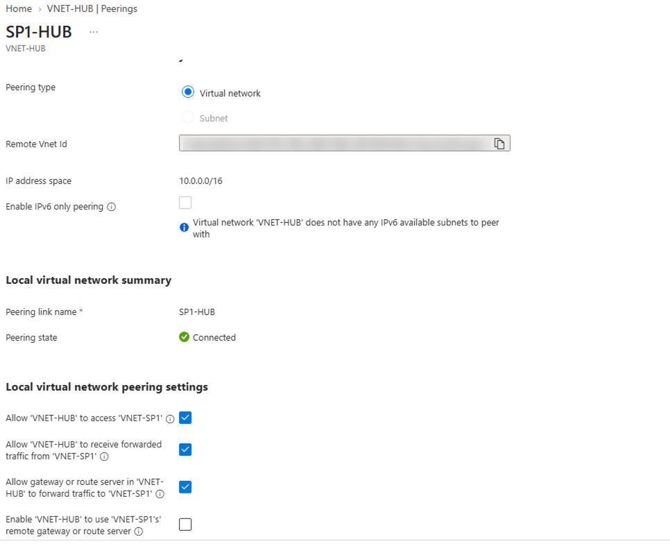
<figcaption>Hub side: gateway transit allowed for VNET-SP1.</figcaption>
</figure>

**Spoke side:** VNET-SP1 → **Peerings** → the link to the hub
(`hub-sp1`) → tick *Enable 'VNET-SP1' to use 'VNET-HUB's' remote gateway
or route server* → **Save**. Wait for the peering state to show
**Connected** again. Repeat both sides for VNET-SP2 if you want VPN
access there too.

The same in Cloud Shell:

    az network vnet peering update -g Network-RG --vnet-name VNET-HUB -n SP1-HUB \
      --set allowGatewayTransit=true

    # Find the spoke-side peering name, then enable remote gateway use
    az network vnet peering list -g Network-RG --vnet-name VNET-SP1 --query "[].name" -o tsv
    az network vnet peering update -g Network-RG --vnet-name VNET-SP1 -n hub-sp1 \
      --set useRemoteGateways=true

### Step 4: reinstall the VPN client

The Windows client gets its route list when it's installed, so a client
installed earlier never learns about SP1. Disconnect, download the VPN
configuration package again, run the new
`WindowsAmd64\VpnClientSetupAmd64.exe`, reconnect, and click
**Continue** on the CMROUTE prompt.

### Step 5: test again

    route print | findstr "10.0.0.0 12.0.0.0"   :: now shows both 12.0.0.0 and 10.0.0.0, on-link via 192.168.1.x
    ping 10.0.0.4                                :: Reply from 10.0.0.4
    ssh nsunke@10.0.0.4                          :: SSH over the VPN, no public IP needed

The ping gets replies and SSH to `10.0.0.4` works. In the portal,
vpn-gateway → Point-to-site configuration → **Allocated IP addresses**
lists the laptop's VPN address. Since the VM is now reachable privately,
you can remove its public IP and the internet-facing `ssh` rule from the
[NSG
post](../azure-network-security-groups-nsg/azure-network-security-groups-nsg.html).

### If it still times out

| Check             | How                                                   | What to look for                                                                                                                                |
|-------------------|-------------------------------------------------------|-------------------------------------------------------------------------------------------------------------------------------------------------|
| Client route      | `route print`                                         | A line for the spoke's range. If it's missing, transit isn't on or the client wasn't reinstalled.                                               |
| VM route back     | VM → Networking → NIC → **Effective routes**          | The P2S pool (`192.168.1.0/24`) with next hop *Virtual network gateway*. If it's missing, *useRemoteGateways* on the spoke peering didn't save. |
| Address overlap   | `ipconfig`                                            | Your Wi-Fi or Ethernet adapter must not be in the P2S pool's range (see fix 1).                                                                 |
| VM running        | Portal → VM overview                                  | Status *Running*, not *Stopped (deallocated)*.                                                                                                  |
| NSG / OS firewall | NIC → **Effective security rules**; `sudo ufw status` | The default *AllowVnetInBound* covers VPN clients; check that no custom Deny rule blocks them. Ubuntu answers ping by default.                  |

NSGs still apply to VPN traffic. Traffic from the P2S address pool
arrives through the gateway and is normally matched by the
`VirtualNetwork` service tag, so `nsg1`'s default *AllowVnetInBound*
rule lets VPN clients in. To restrict them, add rules with the pool as
the source.

## 7. Two more things to fix

Gateway transit was the fix that got the ping working (section 6). Two
other choices in this lab work, but are worth correcting before you
reuse the design.

### Fix 1: change the address pool if it clashes with your LAN

`192.168.1.0/24` is the default LAN range on many home routers. If
`ipconfig` shows your Wi-Fi or Ethernet adapter on `192.168.1.x`, the
VPN and local routes will conflict. Change the pool to an unused range,
such as `172.16.201.0/24`, save, then download and install the client
package again.

### Fix 2: use a private range for the hub

`12.0.0.0/16` isn't in the RFC 1918 private ranges; it's real internet
address space owned by another company. Azure allows it, but resources
in the hub and VPN clients can no longer reach those public addresses.
In a real design, use something like `10.100.0.0/16` for the hub. A
subnet in use can't be renumbered, so changing it means rebuilding the
hub's subnets.

## 8. CLI reference

    RG=Network-RG; LOC=westus3

    # Hub with GatewaySubnet
    az network vnet create -g $RG -n VNET-HUB -l $LOC --address-prefixes 10.100.0.0/16 \
      --subnet-name SUBNET1 --subnet-prefixes 10.100.0.0/24
    az network vnet subnet create -g $RG --vnet-name VNET-HUB -n GatewaySubnet \
      --address-prefixes 10.100.1.0/27

    # Gateway (runs 20–45 minutes; --no-wait returns immediately)
    az network public-ip create -g $RG -n vpn-ip --sku Standard --zone 1 2 3
    az network vnet-gateway create -g $RG -n vpn-gateway -l $LOC \
      --vnet VNET-HUB --public-ip-addresses vpn-ip \
      --gateway-type Vpn --vpn-type RouteBased --sku VpnGw1AZ --no-wait

    # Peerings with gateway transit (after the gateway exists)
    az network vnet peering create -g $RG -n HUB-to-SP1 --vnet-name VNET-HUB \
      --remote-vnet VNET-SP1 --allow-vnet-access --allow-forwarded-traffic --allow-gateway-transit
    az network vnet peering create -g $RG -n SP1-to-HUB --vnet-name VNET-SP1 \
      --remote-vnet VNET-HUB --allow-vnet-access --allow-forwarded-traffic --use-remote-gateways

    # Point-to-site with certificate auth
    az network vnet-gateway update -g $RG -n vpn-gateway \
      --address-prefixes 172.16.201.0/24 --client-protocol IkeV2 OpenVPN
    az network vnet-gateway root-cert create -g $RG --gateway-name vpn-gateway \
      -n P2SRootCert --public-cert-data "$(sed '1d;$d' rootcert.cer | tr -d '\r\n')"

    # Client package URL
    az network vnet-gateway vpn-client generate -g $RG -n vpn-gateway -o tsv

## 9. Cost and clean-up

**The VPN gateway is the expensive part of this lab.** A VpnGw1AZ
gateway and its public IP are billed every hour they exist, whether or
not anyone is connected, and on a free account that uses up credit
quickly. VNets, subnets, peerings (apart from data transfer) and NSGs
cost little or nothing. Delete the gateway as soon as you finish
testing.

    # Remove the gateway and its IP, keeping the VNets
    az network vnet-gateway delete -g Network-RG -n vpn-gateway
    az network public-ip delete -g Network-RG -n vpn-ip

    # Or remove the whole lab
    az group delete -n Network-RG --yes --no-wait

On the PC, remove the VNET-HUB VPN profile, and delete the certificates
from `certmgr.msc` if you don't need them again. Keep `childcert.pfx`
somewhere safe or delete it; anyone with it and its password could
connect while the gateway exists.

## 10. Quiz: test yourself

Pick an answer to see whether it's right and why.

Reset quiz

## 11. Key takeaways

- **Hub-and-spoke** puts shared services in one hub VNet and workloads
  in peered spokes. Spokes don't reach each other through peering alone.
- A VPN gateway lives in a subnet named exactly **GatewaySubnet** (/27
  or larger, no NSG). **AZ** SKUs are zone-redundant, and creation takes
  20–45 minutes.
- **Point-to-site** connects single computers. Choose a non-overlapping
  **address pool**, a tunnel type (OpenVPN, IKEv2, SSTP) and
  authentication (certificate, Entra ID, RADIUS).
- With certificate auth, the gateway holds the **root's public key**;
  each client holds a **child certificate with its private key**.
- Spokes use the hub's gateway only with **gateway transit**:
  *allowGatewayTransit* on the hub side, *useRemoteGateways* on the
  spoke side. Without it, the client gets no route to the spoke and
  pings time out. Check with `route print`, and reinstall the client
  after changing peerings.
- Delete the gateway when you're done; it's billed hourly.

**Next in the series:** switching P2S to Microsoft Entra ID
authentication with MFA, and adding Azure Firewall to route
spoke-to-spoke traffic.

Written by Sunke Nithin while learning Azure. Lab performed on an Azure
free account; subscription IDs, network IDs, the directory name, the
gateway's public IP and the credit balance in the screenshots are
blurred.

