

<a href="../index.html" class="back-home">← All articles</a>

Azure fundamentals · AZ-900 · Hands-on lab

# Azure Network Security Groups (NSG): Why SSH Timed Out and How One Rule Fixed It

I deployed an Ubuntu VM with a public IP into `SUBNET1`, tried to SSH
in, and the connection timed out. This post explains why, then walks
through creating an NSG, attaching it to the subnet and adding an SSH
rule. Along the way it covers how NSG rules are evaluated, the default
rules, service tags, application security groups and how to
troubleshoot.

Sunke NithinNovember 2026~15 min read + 15 min lab

[1. The problem: SSH timed out](#problem) [2. What is an NSG?](#what)
[3. Anatomy of a rule](#rule) [4. The six default rules](#defaults) [5.
How rules are evaluated](#order) [6. Subnet NSG or NIC NSG?](#where) [7.
Service tags and ASGs](#tags) [8. Lab: fix SSH with an NSG](#lab) [9.
The same lab with Azure CLI](#cli) [10. Lock it down properly](#harden)
[11. Troubleshooting toolkit](#troubleshoot) [12. Quiz](#quiz) [13. Key
takeaways](#takeaways)

## 1. The problem: SSH timed out

The setup was simple: VM `vnet1srv01` (Ubuntu 26.04 LTS) in
`VNET-SP1 / SUBNET1` with private IP `10.0.0.4` and a public IP. The
VM's **Network settings** page showed *Network security group: –* and
*Effective security rules: 0*. With no NSG anywhere, you might expect
everything to be open. Instead, SSH to the public IP on port 22 failed
with *"connection timed out"*.

The reason: the VM's public IP uses the **Standard SKU**, and Standard
public IPs are **secure by default**. Inbound traffic is blocked unless
a network security group explicitly allows it. With no NSG there was
nothing to allow port 22, so packets were silently dropped. A *timeout*
(rather than "connection refused") is the typical sign of traffic being
dropped by a filter before it reaches the VM.

<figure>

<figcaption>Figure 1. A Standard public IP needs an NSG that allows the
traffic. Adding nsg1 with one rule opened SSH.</figcaption>
</figure>

**Two things that are easy to mix up.** The *private subnet* setting on
SUBNET1 (from the [VNet
post](../azure-vnet-private-subnet-lab/azure-vnet-private-subnet-lab.html))
controls *outbound* internet access for VMs *without* a public IP. It
has nothing to do with this problem. Inbound SSH was blocked by the
Standard public IP's secure-by-default behaviour, and an NSG is what
opens it.

## 2. What is an NSG?

A **network security group (NSG)** is Azure's built-in, distributed
firewall for traffic in and out of a virtual network. It is a list of
**allow and deny rules** that Azure enforces at the network interface of
each VM, so there is no appliance to size, patch or pay for. NSGs are
free.

- An NSG is a regional resource in a resource group (here `nsg1` in
  `Network-RG`, West US 3). It can only be attached to subnets and NICs
  in the same region.
- You attach it to a **subnet**, a **network interface (NIC)**, or both.
  One NSG can be reused on many subnets and NICs.
- NSGs are **stateful**: if an inbound rule allows a connection in, the
  reply traffic is allowed back out automatically, and vice versa. You
  never write a rule for return traffic.
- They filter at layers 3 and 4 (IP addresses, ports, protocols). For
  URL filtering, TLS inspection or threat intelligence you need Azure
  Firewall or a third-party appliance.

**Coming from OCI?** An Azure NSG combines what OCI splits into security
lists (attached to a subnet) and network security groups (attached to
VNICs). Like OCI rules, Azure rules are stateful by default; unlike OCI,
Azure rules have a **priority** and can explicitly **deny**.

## 3. Anatomy of a rule

This is the rule from the lab, with every field explained:

| Field                          | Lab value    | What it means                                                                                         |
|--------------------------------|--------------|-------------------------------------------------------------------------------------------------------|
| **Priority**                   | `100`        | 100 to 4096. Lower numbers are checked first. Must be unique per direction within the NSG.            |
| **Name**                       | `ssh`        | Unique within the NSG. Name rules by purpose, for example `allow-ssh-from-home`.                      |
| **Source**                     | Any          | Any, an IP or CIDR range, "My IP address", a **service tag** or an **application security group**.    |
| **Source port ranges**         | `*`          | Almost always `*`: clients pick a random source port.                                                 |
| **Destination**                | Any          | Any, IP/CIDR, service tag or ASG. "Any" here means any address the NSG protects.                      |
| **Service / destination port** | Custom, `22` | A single port, a range (`8000-8100`) or a list (`80,443`). Presets like SSH, RDP, HTTPS fill this in. |
| **Protocol**                   | Any          | TCP, UDP, ICMPv4, ICMPv6 or Any. SSH only needs **TCP**, so TCP would be tighter.                     |
| **Action**                     | Allow        | Allow or Deny.                                                                                        |

The portal showed a **warning triangle** next to the `ssh` rule. That's
Azure flagging that port 22 is open to the whole internet. Bots scan
every Azure public IP for SSH and RDP within minutes, so section 10
tightens this rule.

## 4. The six default rules

A new NSG isn't empty. It has six default rules at priorities 65000 and
above. You can't delete them, but you can override them with your own
rules at lower numbers. This is exactly what `nsg1` showed straight
after creation:

| Dir. | Priority | Name                          | Source → Destination            | Action |
|------|----------|-------------------------------|---------------------------------|--------|
| In   | 65000    | AllowVnetInBound              | VirtualNetwork → VirtualNetwork | Allow  |
| In   | 65001    | AllowAzureLoadBalancerInBound | AzureLoadBalancer → Any         | Allow  |
| In   | 65500    | DenyAllInBound                | Any → Any                       | Deny   |
| Out  | 65000    | AllowVnetOutBound             | VirtualNetwork → VirtualNetwork | Allow  |
| Out  | 65001    | AllowInternetOutBound         | Any → Internet                  | Allow  |
| Out  | 65500    | DenyAllOutBound               | Any → Any                       | Deny   |

In plain words: **inside the VNet, everything can talk to everything**;
Azure load balancer health probes are allowed in; **nothing from the
internet gets in**; and **outbound to the internet is allowed**. The
`VirtualNetwork` tag covers the VNet's address space plus peered VNets
and connected on-premises ranges.

So attaching `nsg1` with only the defaults would still have blocked SSH,
because *DenyAllInBound* would catch it. The custom rule at priority 100
is what let it through.

## 5. How rules are evaluated

For each new connection, Azure checks the rules for that direction **in
priority order, lowest number first**. The **first rule that matches**
decides the result and evaluation stops. Rules with higher numbers are
never looked at.

<figure>

<figcaption>Figure 2. First match wins. Leave gaps between priorities
(100, 110, 120…) so you can insert rules later.</figcaption>
</figure>

A common mistake is a broad Deny at a low number above a narrow Allow at
a higher number. For example, *Deny Any at 100* and *Allow 443 at 200*
blocks HTTPS, because rule 100 matches first.

## 6. Subnet NSG or NIC NSG?

You can attach NSGs at two levels, and when both exist, traffic must be
allowed by **both**:

<figure>

<figcaption>Figure 3. Inbound traffic meets the subnet NSG first;
outbound traffic meets the NIC NSG first.</figcaption>
</figure>

- **Prefer subnet-level NSGs.** One NSG protects every VM in the subnet,
  which is easier to audit. That's what the lab does: `nsg1` on
  `SUBNET1`.
- **Use NIC-level NSGs sparingly**, for a VM that needs an exception.
  Having both levels on every VM is the most common reason "I allowed it
  but it still doesn't work".
- When you create a VM in the portal with "Basic" NIC security, Azure
  quietly creates a NIC NSG for it. If you manage security at the
  subnet, remove that NIC NSG or keep it in sync.

## 7. Service tags and application security groups

**Service tags** are Microsoft-maintained names for groups of IP ranges,
so you never hard-code Azure addresses. Useful ones:

| Tag                              | Covers                                                                  |
|----------------------------------|-------------------------------------------------------------------------|
| `VirtualNetwork`                 | Your VNet, peered VNets and connected on-premises ranges                |
| `Internet`                       | Public IP space outside Azure's VNets                                   |
| `AzureLoadBalancer`              | The source of load balancer health probes (168.63.129.16)               |
| `Storage`, `Sql`, `AzureMonitor` | Azure service endpoints; regional variants like `Storage.WestUS3` exist |
| `AzureCloud`                     | All Azure public IP ranges                                              |

**Application security groups (ASGs)** let you write rules by *role*
instead of by IP. Put the web servers' NICs in `asg-web` and the
database NICs in `asg-db`, then write one rule: *allow asg-web → asg-db
on 1521*. When you add a new web server, you only add its NIC to
`asg-web`; the rule doesn't change.

<figure>

<figcaption>Figure 4. ASGs group NICs by role, so rules survive scaling
and IP changes.</figcaption>
</figure>

## 8. Lab: fix SSH with an NSG

**Starting point:** `VNET-SP1` with private subnet `SUBNET1` (from the
VNet post), and an Ubuntu VM `vnet1srv01` in that subnet with a Standard
public IP and no NSG. **Goal:** create `nsg1`, attach it to SUBNET1,
allow SSH, and log in. NSGs are free.

STEP 1

### Check the subnet: no NSG

Open VNET-SP1 → **Subnets** → **SUBNET1**. The address prefix is now
greyed out with *"cannot be updated because the subnet is in use"*,
since the VM's NIC lives here. Private subnet is enabled, and **Network
security group** is *None*.

<figure class="shot">
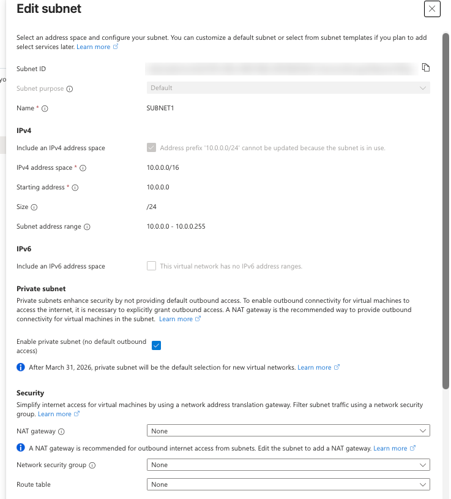
<figcaption>A subnet in use can't change its range, and it has no NSG
yet.</figcaption>
</figure>

STEP 2

### Check the VM's network settings

Open the VM → **Networking → Network settings**. It sits in
`VNET-SP1 / SUBNET1` with private IP `10.0.0.4` (the first usable
address, as the VNet post predicted) and a public IP. **Network security
group** shows *–*, **Effective security rules** shows *0*, and the page
says *No port rules to display*.

<figure class="shot">
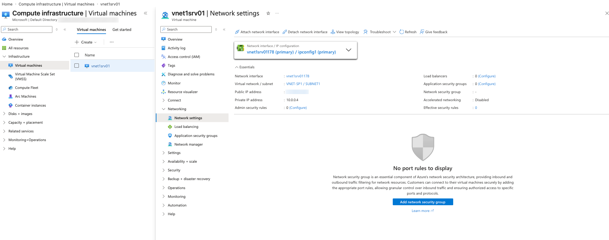
<figcaption>No NSG on the subnet or the NIC.</figcaption>
</figure>

STEP 3

### Try SSH: it times out

Connect with your SSH client (Termius here) to `<public-ip>:22`. Address
resolution works, then *"Connection failed: connection timed out"*. The
Standard public IP drops inbound traffic that no NSG allows (section 1).

<figure class="shot">
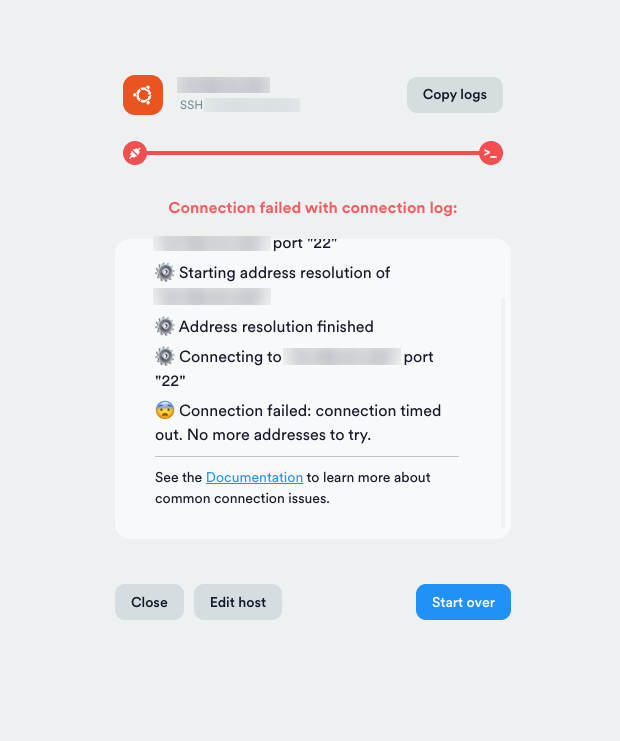
<figcaption>A timeout means the packets were dropped, not
refused.</figcaption>
</figure>

STEP 4

### Create the NSG

Search **Network security groups** → **+ Create**. Choose `Network-RG`,
name it `nsg1`, and pick **West US 3**, which must match the VNet's
region. Then **Review + create → Create**.

<figure class="shot">
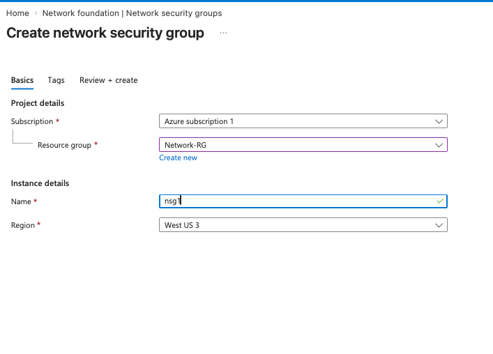
<figcaption>Only a name and a region are required.</figcaption>
</figure>

STEP 5

### Look at the default rules

Open `nsg1`. **Custom security rules: 0 inbound, 0 outbound** and
**Associated with: 0 subnets, 0 network interfaces**. Below are the six
default rules from section 4. An NSG that isn't associated with anything
does nothing.

<figure class="shot">
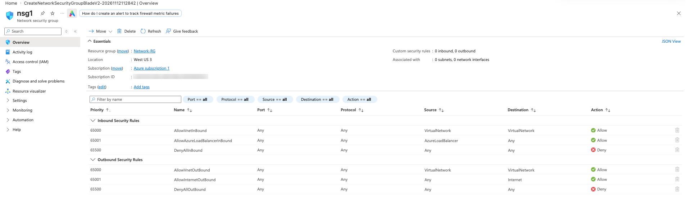
<figcaption>Three inbound and three outbound defaults.</figcaption>
</figure>

STEP 6

### Associate the NSG with SUBNET1

In `nsg1` go to **Settings → Subnets** → **+ Associate**. Choose virtual
network `VNET-SP1 (Network-RG)` and subnet `SUBNET1`, then click **OK**.
You can do the same from the subnet's edit panel in step 1.

<figure class="shot">
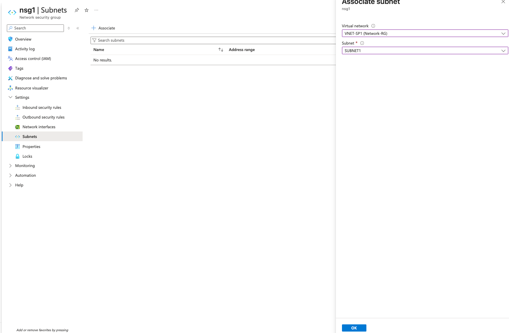
<figcaption>One NSG can be associated with many subnets.</figcaption>
</figure>

STEP 7

### Confirm the association

The Subnets list now shows `SUBNET1 · 10.0.0.0/24 · VNET-SP1`.

<figure class="shot">
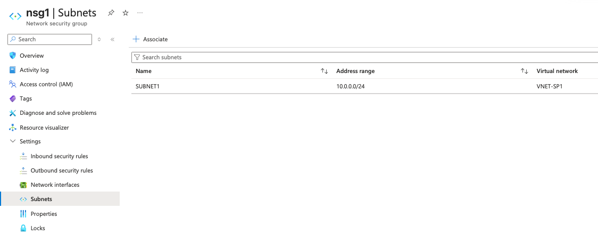
<figcaption>nsg1 now protects every NIC in SUBNET1.</figcaption>
</figure>

STEP 8

### See the NSG from the VM's side

Back on the VM's **Network settings**, a new panel reads *Network
security group nsg1 (attached to subnet: SUBNET1) · Impacts 1 subnets, 0
network interfaces*, with the three inbound default rules. SSH would
still fail now, because *DenyAllInBound* (65500) catches port 22.

<figure class="shot">
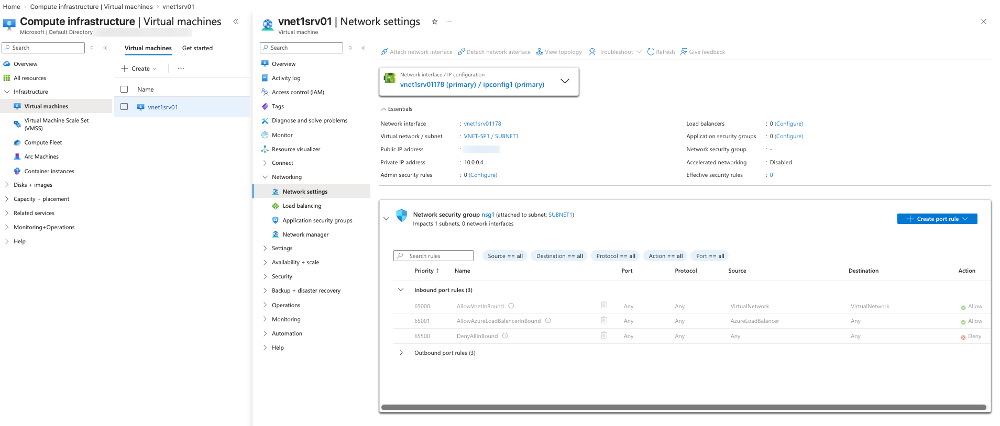
<figcaption>The defaults alone still deny internet traffic.</figcaption>
</figure>

STEP 9

### Start a new inbound rule

Click **Create port rule → Inbound port rule**. Creating it from the VM
page adds it to whichever NSG applies, here the subnet's `nsg1`.

<figure class="shot">
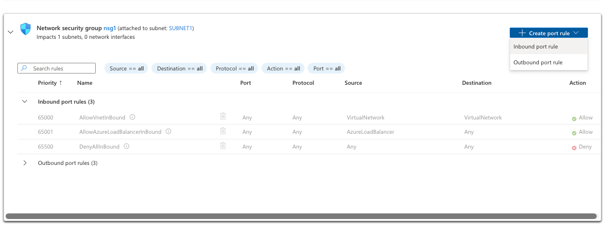
<figcaption>Rules can be added from the VM or from the NSG
itself.</figcaption>
</figure>

STEP 10

### Allow SSH on port 22

Fill in **Source** Any, **Source port ranges** `*`, **Destination** Any,
**Service** Custom, **Destination port ranges** `22`, **Protocol** Any,
**Action** Allow, **Priority** `100`, **Name** `ssh`, then **Add**.
Section 10 shows how to tighten Source and Protocol, which you should do
for anything beyond a short lab.

<figure class="shot">
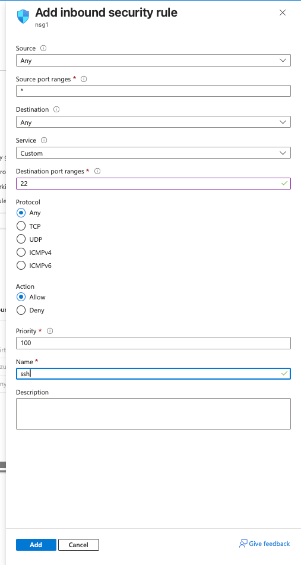
<figcaption>One rule at priority 100 sits above all the
defaults.</figcaption>
</figure>

STEP 11

### Check the rule list

Inbound port rules now show four entries, with
`100 ssh 22 Any Any Any Allow` on top. Note the **warning triangle**:
Azure flags any rule that opens a management port such as 22 or 3389 to
the whole internet.

<figure class="shot">
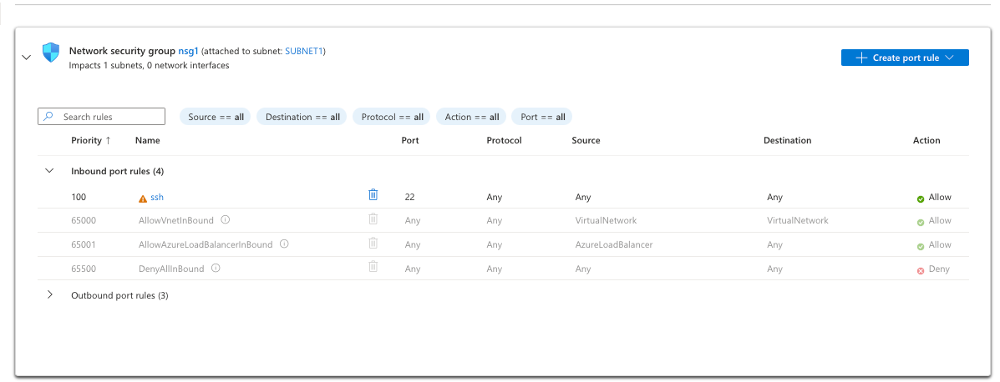
<figcaption>The custom rule is evaluated first.</figcaption>
</figure>

STEP 12

### SSH again: it works

Retry the connection. The Ubuntu 26.04.1 LTS welcome banner appears.
`hostname -f` returns
`vnet1srv01.<unique-id>.phxx.internal.cloudapp.net`, the VM's name in
Azure's internal DNS (provided by 168.63.129.16), which other VMs in the
VNet can resolve.

<figure class="shot">
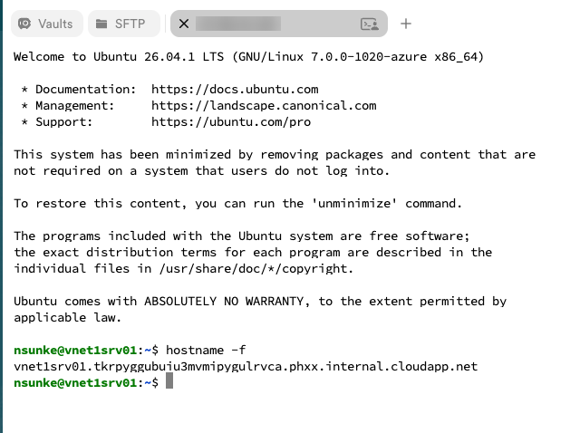
<figcaption>One allow rule was all it took.</figcaption>
</figure>

## 9. The same lab with Azure CLI

    RG=Network-RG

    # 1. Create the NSG
    az network nsg create -g $RG -n nsg1 -l westus3

    # 2. Associate it with SUBNET1
    az network vnet subnet update -g $RG --vnet-name VNET-SP1 -n SUBNET1 \
      --network-security-group nsg1

    # 3. Allow SSH, but only from your own public IP and only over TCP
    MYIP=$(curl -s https://ifconfig.me)
    az network nsg rule create -g $RG --nsg-name nsg1 -n allow-ssh-from-home \
      --priority 100 --direction Inbound --access Allow \
      --protocol Tcp --source-address-prefixes $MYIP/32 \
      --source-port-ranges '*' --destination-port-ranges 22

    # 4. List the rules, including the defaults
    az network nsg rule list -g $RG --nsg-name nsg1 --include-default \
      --query "[].{prio:priority, name:name, dir:direction, port:destinationPortRange, src:sourceAddressPrefix, access:access}" -o table

    # 5. Effective rules on the VM's NIC (the VM must be running)
    NIC=$(az vm show -g $RG -n vnet1srv01 --query "networkProfile.networkInterfaces[0].id" -o tsv)
    az network nic list-effective-nsg --ids $NIC -o table

If you run this in Cloud Shell, `ifconfig.me` returns Cloud Shell's IP,
not your laptop's. Run step 3 from your own terminal, or look up your IP
in a browser and paste it in.

## 10. Lock it down properly

The lab rule opens SSH to the entire internet. That's fine for a few
minutes of testing, but do one of these before you leave the VM running:

### Option A: restrict the source to your IP (quick)

Edit the `ssh` rule: set **Source** to *My IP address* (the portal fills
it in) and **Protocol** to *TCP*. The warning triangle disappears. If
your home IP changes, update the rule.

    az network nsg rule update -g Network-RG --nsg-name nsg1 -n ssh \
      --source-address-prefixes <your-ip>/32 --protocol Tcp

### Option B: no public SSH at all (best)

- **Azure Bastion** gives browser-based SSH and RDP through the portal,
  so the VM needs no public IP and no inbound 22 rule. It's paid, and
  the Developer SKU is the cheapest way to try it.
- **Just-in-time VM access** (Microsoft Defender for Servers) adds a
  temporary allow rule for your IP when you request access and removes
  it afterwards.
- **Site-to-site VPN or a mesh VPN** such as Tailscale lets you SSH to
  the private IP `10.0.0.4` directly.

When you're done with the lab, either delete the `ssh` rule or stop
(deallocate) the VM so it isn't sitting on the internet with port 22
open.

## 11. Troubleshooting toolkit

| Tool                         | Where                                                    | What it tells you                                                                                                                                                |
|------------------------------|----------------------------------------------------------|------------------------------------------------------------------------------------------------------------------------------------------------------------------|
| **Effective security rules** | VM → Network settings, or NIC → Effective security rules | The combined result of subnet and NIC NSGs for that NIC                                                                                                          |
| **IP flow verify**           | Network Watcher                                          | Whether a given packet (IP, port, protocol, direction) is allowed or denied, and by *which rule*                                                                 |
| **Connection troubleshoot**  | VM → Troubleshoot, or Network Watcher                    | Tests an actual connection end to end and reports where it fails                                                                                                 |
| **VNet flow logs**           | Network Watcher                                          | Logs every allowed and denied flow to a storage account. Microsoft is retiring the older NSG flow logs in favour of VNet flow logs, so use those for new setups. |

**Quick checklist when a port won't open:**

1.  Is there an NSG on the subnet *and* on the NIC? Both must allow it.
2.  Does a lower-numbered Deny rule match first?
3.  Is the protocol right (TCP vs UDP)?
4.  Is the service actually listening inside the VM (`sudo ss -tlnp`)
    and is the OS firewall (`ufw`, `firewalld`, Windows Firewall) open?
5.  Timeout usually means a filter dropped it; "connection refused"
    usually means it reached the VM and nothing was listening.

## 12. Quiz: test yourself

Pick an answer to see whether it's right and why.

Reset quiz

## 13. Key takeaways

- A **Standard public IP is closed by default**; with no NSG allowing
  it, inbound traffic is dropped and SSH times out.
- An **NSG** is a free, stateful layer 3–4 firewall attached to subnets
  and/or NICs in the same region.
- Rules are checked **lowest priority number first**, and the **first
  match wins**.
- The **defaults** allow traffic inside the VNet and outbound to the
  internet, and deny inbound from the internet.
- With NSGs on both subnet and NIC, traffic must pass **both**. Prefer
  subnet-level NSGs.
- Use **service tags** and **ASGs** instead of hard-coded IPs, and never
  leave SSH or RDP open to Any; use your IP, Bastion or JIT.

**Next in the series:** Azure Bastion, so we can remove the public IP
and the SSH rule altogether.

Written by Sunke Nithin while learning Azure for AZ-900. Lab performed
on an Azure free account; the subscription ID, directory name and public
IP in the screenshots are blurred.

