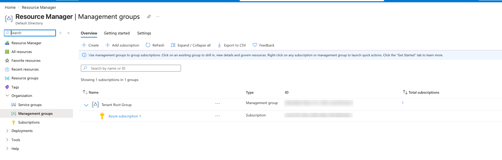
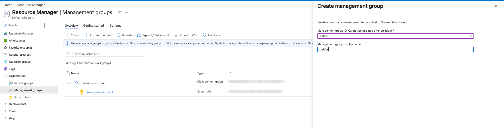
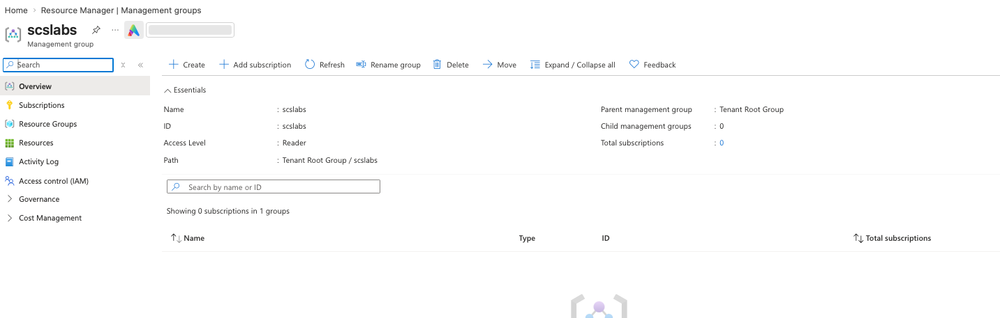
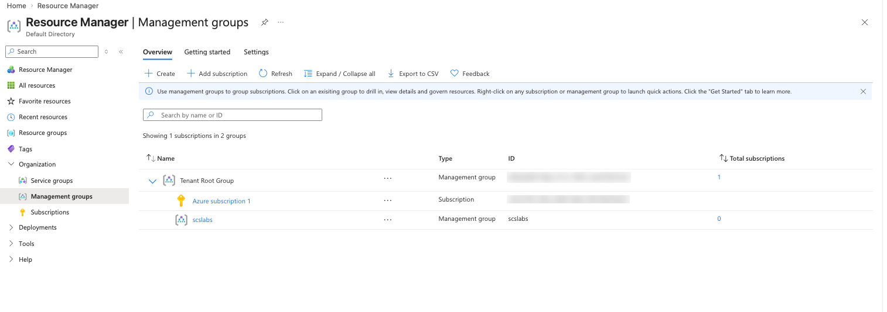
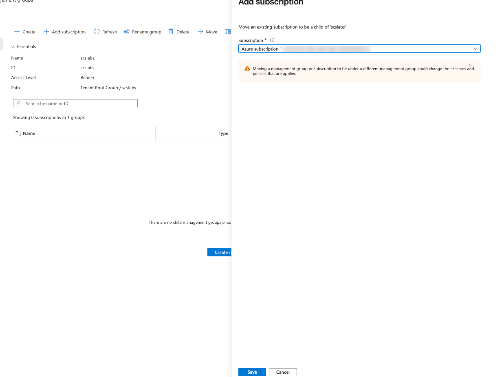
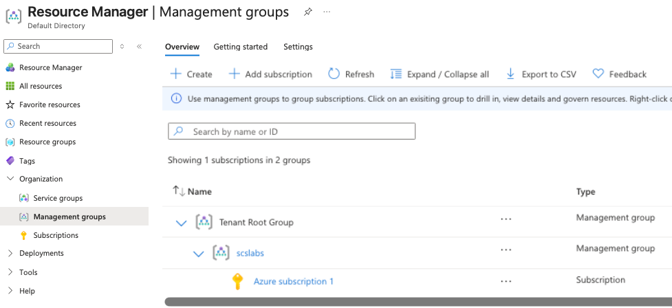
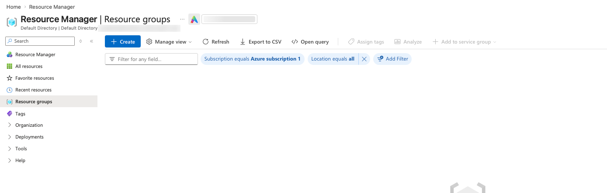
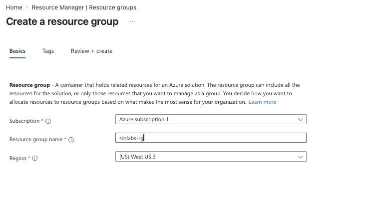
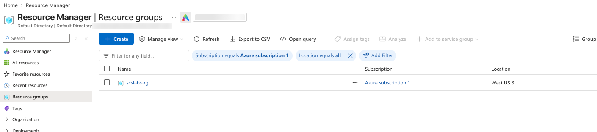

Azure fundamentals · AZ-900 · Hands-on lab

# Azure Resource Hierarchy: Tenant, Management Groups, Subscriptions, Resource Groups and Resources

Before you deploy a single VM in Azure, you should know where it will
live, who controls it and who pays for it. All three answers come from
the same five-level hierarchy. This post explains each level, then walks
through building it in the Azure portal.

Nithin SunkeNovember 2026~15 min read + 15 min lab

[1. The big picture](#big-picture) [2. Tenant](#tenant) [3. Management
groups](#mg) [4. Subscriptions](#sub) [5. Resource groups](#rg) [6.
Resources](#res) [7. How settings flow down](#inherit) [8. Lab: build it
in the portal](#lab) [9. The same lab with Azure CLI](#cli) [10.
Real-world design](#real) [11. Quiz](#quiz) [12. Key
takeaways](#takeaways)

## 1. The big picture

Azure organizes everything in a tree. Each level sits inside the one
above it:

1.  **Tenant**: your organization's identity
    directory (Microsoft Entra ID).
2.  **Management groups**: folders that group
    subscriptions so you can apply governance once.
3.  **Subscriptions**: the billing and access
    boundary where resources are paid for.
4.  **Resource groups**: logical containers
    for resources that share a lifecycle.
5.  **Resources**: the things you actually
    run, such as VMs, storage accounts and databases.

<figure>

<img
src="data:image/svg+xml;base64,PHN2ZyB2aWV3Ym94PSIwIDAgNzIwIDQ3MCIgcm9sZT0iaW1nIiBhcmlhLWxhYmVsbGVkYnk9ImQxdCI+CiAgPHRpdGxlIGlkPSJkMXQiPkF6dXJlIGhpZXJhcmNoeTogdGVuYW50IGNvbnRhaW5zIHRoZSB0ZW5hbnQgcm9vdCBncm91cCwgd2hpY2ggY29udGFpbnMgbWFuYWdlbWVudCBncm91cHMsIHdoaWNoIGNvbnRhaW4gc3Vic2NyaXB0aW9ucywgd2hpY2ggY29udGFpbiByZXNvdXJjZSBncm91cHMsIHdoaWNoIGNvbnRhaW4gcmVzb3VyY2VzLjwvdGl0bGU+CiAgPGRlZnM+PG1hcmtlciBpZD0iYWgiIHZpZXdib3g9IjAgMCAxMCAxMCIgcmVmeD0iOSIgcmVmeT0iNSIgbWFya2Vyd2lkdGg9IjciIG1hcmtlcmhlaWdodD0iNyIgb3JpZW50PSJhdXRvIj48cGF0aCBkPSJNMCwwIEwxMCw1IEwwLDEwIHoiIHN0eWxlPSJmaWxsOnZhcigtLW11dGVkKSI+PC9wYXRoPjwvbWFya2VyPjwvZGVmcz4KICA8IS0tIHRlbmFudCBmcmFtZSAtLT4KICA8cmVjdCB4PSIxMCIgeT0iMTAiIHdpZHRoPSI3MDAiIGhlaWdodD0iNDUwIiByeD0iMTIiIHN0eWxlPSJmaWxsOm5vbmU7c3Ryb2tlOnZhcigtLWwtdGVuYW50KTtzdHJva2Utd2lkdGg6MjtzdHJva2UtZGFzaGFycmF5OjYgNSI+PC9yZWN0PgogIDx0ZXh0IHg9IjI4IiB5PSIzNiIgY2xhc3M9InN2LXQiIHN0eWxlPSJmaWxsOnZhcigtLWwtdGVuYW50KSI+VGVuYW50IChNaWNyb3NvZnQgRW50cmEgSUQpPC90ZXh0PgogIDx0ZXh0IHg9IjI4IiB5PSI1NCIgY2xhc3M9InN2LXMiPnVzZXJzIMK3IGdyb3VwcyDCtyBhcHBzIMK3IHlvdXJuYW1lLm9ubWljcm9zb2Z0LmNvbTwvdGV4dD4KICA8IS0tIHJvb3QgLS0+CiAgPHJlY3QgeD0iMjUwIiB5PSI3MiIgd2lkdGg9IjIyMCIgaGVpZ2h0PSI1MCIgcng9IjgiIGNsYXNzPSJzdi1ib3giIHN0eWxlPSJzdHJva2U6dmFyKC0tbC1tZykiPjwvcmVjdD4KICA8dGV4dCB4PSIzNjAiIHk9Ijk0IiB0ZXh0LWFuY2hvcj0ibWlkZGxlIiBjbGFzcz0ic3YtdCI+VGVuYW50IFJvb3QgR3JvdXA8L3RleHQ+CiAgPHRleHQgeD0iMzYwIiB5PSIxMTEiIHRleHQtYW5jaG9yPSJtaWRkbGUiIGNsYXNzPSJzdi1zIj5jcmVhdGVkIGF1dG9tYXRpY2FsbHk8L3RleHQ+CiAgPCEtLSBjaGlsZCBNR3MgLS0+CiAgPHJlY3QgeD0iOTAiIHk9IjE2MCIgd2lkdGg9IjIwMCIgaGVpZ2h0PSI0NiIgcng9IjgiIGNsYXNzPSJzdi1ib3giIHN0eWxlPSJzdHJva2U6dmFyKC0tbC1tZykiPjwvcmVjdD4KICA8dGV4dCB4PSIxOTAiIHk9IjE4OCIgdGV4dC1hbmNob3I9Im1pZGRsZSIgY2xhc3M9InN2LXQiPk1HOiBzY3NsYWJzPC90ZXh0PgogIDxyZWN0IHg9IjQzMCIgeT0iMTYwIiB3aWR0aD0iMjAwIiBoZWlnaHQ9IjQ2IiByeD0iOCIgY2xhc3M9InN2LWJveCIgc3R5bGU9InN0cm9rZTp2YXIoLS1sLW1nKSI+PC9yZWN0PgogIDx0ZXh0IHg9IjUzMCIgeT0iMTg4IiB0ZXh0LWFuY2hvcj0ibWlkZGxlIiBjbGFzcz0ic3YtdCI+TUc6IFByb2R1Y3Rpb248L3RleHQ+CiAgPHBhdGggZD0iTTM2MCAxMjIgVjE0MCBIMTkwIFYxNTgiIGNsYXNzPSJzdi1saW5lIiBtYXJrZXItZW5kPSJ1cmwoI2FoKSI+PC9wYXRoPgogIDxwYXRoIGQ9Ik0zNjAgMTQwIEg1MzAgVjE1OCIgY2xhc3M9InN2LWxpbmUiIG1hcmtlci1lbmQ9InVybCgjYWgpIj48L3BhdGg+CiAgPCEtLSBzdWJzIC0tPgogIDxyZWN0IHg9IjkwIiB5PSIyNDQiIHdpZHRoPSIyMDAiIGhlaWdodD0iNDYiIHJ4PSI4IiBjbGFzcz0ic3YtYm94IiBzdHlsZT0ic3Ryb2tlOnZhcigtLWwtc3ViKSI+PC9yZWN0PgogIDx0ZXh0IHg9IjE5MCIgeT0iMjcyIiB0ZXh0LWFuY2hvcj0ibWlkZGxlIiBjbGFzcz0ic3YtdCI+QXp1cmUgc3Vic2NyaXB0aW9uIDE8L3RleHQ+CiAgPHJlY3QgeD0iNDMwIiB5PSIyNDQiIHdpZHRoPSIyMDAiIGhlaWdodD0iNDYiIHJ4PSI4IiBjbGFzcz0ic3YtYm94IiBzdHlsZT0ic3Ryb2tlOnZhcigtLWwtc3ViKSI+PC9yZWN0PgogIDx0ZXh0IHg9IjUzMCIgeT0iMjcyIiB0ZXh0LWFuY2hvcj0ibWlkZGxlIiBjbGFzcz0ic3YtdCI+UHJvZCBzdWJzY3JpcHRpb248L3RleHQ+CiAgPHBhdGggZD0iTTE5MCAyMDYgVjI0MiIgY2xhc3M9InN2LWxpbmUiIG1hcmtlci1lbmQ9InVybCgjYWgpIj48L3BhdGg+CiAgPHBhdGggZD0iTTUzMCAyMDYgVjI0MiIgY2xhc3M9InN2LWxpbmUiIG1hcmtlci1lbmQ9InVybCgjYWgpIj48L3BhdGg+CiAgPCEtLSBSR3MgLS0+CiAgPHJlY3QgeD0iNDAiIHk9IjMyOCIgd2lkdGg9IjE1MCIgaGVpZ2h0PSI0NCIgcng9IjgiIGNsYXNzPSJzdi1ib3giIHN0eWxlPSJzdHJva2U6dmFyKC0tbC1yZykiPjwvcmVjdD4KICA8dGV4dCB4PSIxMTUiIHk9IjM1NSIgdGV4dC1hbmNob3I9Im1pZGRsZSIgY2xhc3M9InN2LXQiPnNjc2xhYnMtcmc8L3RleHQ+CiAgPHJlY3QgeD0iMjAwIiB5PSIzMjgiIHdpZHRoPSIxNTAiIGhlaWdodD0iNDQiIHJ4PSI4IiBjbGFzcz0ic3YtYm94IiBzdHlsZT0ic3Ryb2tlOnZhcigtLWwtcmcpIj48L3JlY3Q+CiAgPHRleHQgeD0iMjc1IiB5PSIzNTUiIHRleHQtYW5jaG9yPSJtaWRkbGUiIGNsYXNzPSJzdi10Ij5uZXR3b3JrLXJnPC90ZXh0PgogIDxyZWN0IHg9IjQ1NSIgeT0iMzI4IiB3aWR0aD0iMTUwIiBoZWlnaHQ9IjQ0IiByeD0iOCIgY2xhc3M9InN2LWJveCIgc3R5bGU9InN0cm9rZTp2YXIoLS1sLXJnKSI+PC9yZWN0PgogIDx0ZXh0IHg9IjUzMCIgeT0iMzU1IiB0ZXh0LWFuY2hvcj0ibWlkZGxlIiBjbGFzcz0ic3YtdCI+YXBwLXByb2Qtcmc8L3RleHQ+CiAgPHBhdGggZD0iTTE5MCAyOTAgVjMxMCBIMTE1IFYzMjYiIGNsYXNzPSJzdi1saW5lIiBtYXJrZXItZW5kPSJ1cmwoI2FoKSI+PC9wYXRoPgogIDxwYXRoIGQ9Ik0xOTAgMzEwIEgyNzUgVjMyNiIgY2xhc3M9InN2LWxpbmUiIG1hcmtlci1lbmQ9InVybCgjYWgpIj48L3BhdGg+CiAgPHBhdGggZD0iTTUzMCAyOTAgVjMyNiIgY2xhc3M9InN2LWxpbmUiIG1hcmtlci1lbmQ9InVybCgjYWgpIj48L3BhdGg+CiAgPCEtLSByZXNvdXJjZXMgLS0+CiAgPGcgc3R5bGU9ImZvbnQtc2l6ZToxMnB4Ij4KICA8cmVjdCB4PSIzMCIgeT0iNDA4IiB3aWR0aD0iNzgiIGhlaWdodD0iMzQiIHJ4PSI2IiBjbGFzcz0ic3YtYm94IiBzdHlsZT0ic3Ryb2tlOnZhcigtLWwtcmVzKSI+PC9yZWN0Pjx0ZXh0IHg9IjY5IiB5PSI0MzAiIHRleHQtYW5jaG9yPSJtaWRkbGUiIGNsYXNzPSJzdi1tIj5WTTwvdGV4dD4KICA8cmVjdCB4PSIxMTYiIHk9IjQwOCIgd2lkdGg9Ijc4IiBoZWlnaHQ9IjM0IiByeD0iNiIgY2xhc3M9InN2LWJveCIgc3R5bGU9InN0cm9rZTp2YXIoLS1sLXJlcykiPjwvcmVjdD48dGV4dCB4PSIxNTUiIHk9IjQzMCIgdGV4dC1hbmNob3I9Im1pZGRsZSIgY2xhc3M9InN2LW0iPlN0b3JhZ2U8L3RleHQ+CiAgPHJlY3QgeD0iMjM2IiB5PSI0MDgiIHdpZHRoPSI3OCIgaGVpZ2h0PSIzNCIgcng9IjYiIGNsYXNzPSJzdi1ib3giIHN0eWxlPSJzdHJva2U6dmFyKC0tbC1yZXMpIj48L3JlY3Q+PHRleHQgeD0iMjc1IiB5PSI0MzAiIHRleHQtYW5jaG9yPSJtaWRkbGUiIGNsYXNzPSJzdi1tIj5WTmV0PC90ZXh0PgogIDxyZWN0IHg9IjQ0NiIgeT0iNDA4IiB3aWR0aD0iNzgiIGhlaWdodD0iMzQiIHJ4PSI2IiBjbGFzcz0ic3YtYm94IiBzdHlsZT0ic3Ryb2tlOnZhcigtLWwtcmVzKSI+PC9yZWN0Pjx0ZXh0IHg9IjQ4NSIgeT0iNDMwIiB0ZXh0LWFuY2hvcj0ibWlkZGxlIiBjbGFzcz0ic3YtbSI+QXBwIFN2YzwvdGV4dD4KICA8cmVjdCB4PSI1MzIiIHk9IjQwOCIgd2lkdGg9Ijc4IiBoZWlnaHQ9IjM0IiByeD0iNiIgY2xhc3M9InN2LWJveCIgc3R5bGU9InN0cm9rZTp2YXIoLS1sLXJlcykiPjwvcmVjdD48dGV4dCB4PSI1NzEiIHk9IjQzMCIgdGV4dC1hbmNob3I9Im1pZGRsZSIgY2xhc3M9InN2LW0iPlNRTCBEQjwvdGV4dD4KICA8L2c+CiAgPHBhdGggZD0iTTExNSAzNzIgVjM5MCBINjkgVjQwNiIgY2xhc3M9InN2LWxpbmUiIG1hcmtlci1lbmQ9InVybCgjYWgpIj48L3BhdGg+CiAgPHBhdGggZD0iTTExNSAzOTAgSDE1NSBWNDA2IiBjbGFzcz0ic3YtbGluZSIgbWFya2VyLWVuZD0idXJsKCNhaCkiPjwvcGF0aD4KICA8cGF0aCBkPSJNMjc1IDM3MiBWNDA2IiBjbGFzcz0ic3YtbGluZSIgbWFya2VyLWVuZD0idXJsKCNhaCkiPjwvcGF0aD4KICA8cGF0aCBkPSJNNTMwIDM3MiBWMzkwIEg0ODUgVjQwNiIgY2xhc3M9InN2LWxpbmUiIG1hcmtlci1lbmQ9InVybCgjYWgpIj48L3BhdGg+CiAgPHBhdGggZD0iTTUzMCAzOTAgSDU3MSBWNDA2IiBjbGFzcz0ic3YtbGluZSIgbWFya2VyLWVuZD0idXJsKCNhaCkiPjwvcGF0aD4KPC9zdmc+" />

<figcaption>Figure 1. The five levels. The left branch matches what we
build in the lab; the right branch shows how a production environment
would sit beside it.</figcaption>
</figure>

A simple way to remember it: the **tenant** answers *who* (identities),
the **subscription** answers *who pays*, the **resource group** answers
*what belongs together*, and **management groups** let you set rules for
many subscriptions at once.

**Coming from OCI?** The closest match is: tenant ≈ OCI tenancy,
management groups and resource groups ≈ nested compartments,
subscription ≈ a billing account inside the tenancy. The difference is
that Azure separates billing (subscription) from grouping (resource
group), while OCI uses compartments for both access and grouping.

## 2. Tenant

A **tenant** is a dedicated instance of **Microsoft Entra ID** (formerly
Azure Active Directory) that represents one organization. It is created
automatically when you sign up for Azure, Microsoft 365 or another
Microsoft cloud service. In the portal it appears as the *Directory*,
for example "Default Directory".

The tenant holds identities, not workloads:

- **Users and groups** who sign in to Azure.
- **App registrations and service principals** used by applications and
  automation.
- **Domains**: every tenant gets a default `<name>.onmicrosoft.com`
  domain, and you can add your own custom domain.
- A unique **Tenant ID** (a GUID).

**1 → many**One tenant can own many subscriptions.

**1 only**Each subscription trusts exactly one tenant at a time.

**Root group**Every tenant gets one Tenant Root Group, whose ID is the
tenant ID.

Because the subscription trusts the tenant, only identities from that
tenant (plus invited guest users) can be given access to its resources.

## 3. Management groups

A **management group** is a container for subscriptions and other
management groups. You use it when you have more than a couple of
subscriptions and want to apply **Azure Policy** and **role-based access
control (RBAC)** once instead of repeating them on every subscription.

Every tenant has a single top-level management group called the **Tenant
Root Group**. All management groups and subscriptions fold up into it,
so a policy assigned at the root applies to everything in the directory.

**6 levels**Maximum depth below the root, not counting the root or the
subscription level.

**10,000**Management groups supported in one directory.

**1 parent**Each management group or subscription has exactly one
parent.

Things to know before you create one:

- The **management group ID** cannot be changed after creation. The
  display name can.
- New subscriptions land under the root group by default, unless you
  change the default management group in its settings.
- Moving a subscription to a different management group changes which
  policies and role assignments it inherits. The portal warns you about
  this (you will see it in the lab).
- Management groups cost nothing.

## 4. Subscriptions

A **subscription** is an agreement with Microsoft to use Azure services,
and every resource you create is billed to one. It is the level most
people touch first: the free account you sign up with creates "Azure
subscription 1".

A subscription is three kinds of boundary at once:

| Boundary          | What it means                                                                                                                             |
|-------------------|-------------------------------------------------------------------------------------------------------------------------------------------|
| **Billing**       | Costs are reported and invoiced per subscription. Teams often get separate subscriptions so their costs stay apart.                       |
| **Access**        | RBAC roles such as Owner, Contributor or Reader can be assigned at subscription scope and apply to everything inside.                     |
| **Scale / quota** | Limits such as vCPU quota per region apply per subscription. Large workloads are sometimes split across subscriptions to stay under them. |

Common subscription types: **Free trial**, **Pay-As-You-Go**,
**Enterprise Agreement**, **Microsoft Customer Agreement** and **CSP**
(bought through a partner). A typical company separates environments
into subscriptions, such as Dev, Test and Prod, or by business unit.

## 5. Resource groups

A **resource group** is a logical container inside a subscription for
resources that belong to the same solution and share a lifecycle. If you
deploy them together, update them together and delete them together,
they belong in the same resource group.

- Every resource must be in **exactly one** resource group.
- Resource groups **cannot be nested**.
- A resource group has a **region**, but that is only where its metadata
  is stored. Resources inside it can be in other regions.
- **Deleting a resource group deletes every resource in it.** This is
  very handy for cleaning up a lab, and very dangerous in production.
  Use *resource locks* (CanNotDelete or ReadOnly) to protect important
  groups.
- Most resources can be moved between resource groups, and between
  subscriptions.
- Tags, RBAC, policies, locks and budgets can all be applied at resource
  group scope.

Two common ways to divide resources into groups: **by application**
(everything for the payroll app in `payroll-prod-rg`) or **by function**
(all shared networking in `network-rg`). Most organizations mix both.

## 6. Resources

A **resource** is any manageable item you create in Azure: a virtual
machine, a disk, a storage account, a virtual network, a public IP, an
Azure SQL database, a Key Vault. Each resource is created by a
**resource provider** (for example `Microsoft.Compute` for VMs or
`Microsoft.Storage` for storage accounts), and all requests pass through
**Azure Resource Manager (ARM)**, the deployment and management layer
behind the portal, CLI, PowerShell and templates.

Every resource has a unique **resource ID**, and its path shows exactly
where the resource sits in the hierarchy:

<figure>

<figcaption>Figure 2. A resource ID reads like a file path through the
hierarchy.</figcaption>
</figure>

## 7. How settings flow down

The reason the hierarchy matters is **inheritance**. Anything you assign
at one level, whether an RBAC role, an Azure Policy or a budget, applies
to every level below it.

<figure>

<figcaption>Figure 3. Assign once at a high level and every child
inherits it. A policy set at a higher level cannot be removed or
overridden by someone who only has rights lower down.</figcaption>
</figure>

| Scope                                       | Typical things to assign there                                                                  |
|---------------------------------------------|-------------------------------------------------------------------------------------------------|
| Management group | Company-wide policies (allowed regions, required tags), security baselines, platform team roles |
| Subscription     | Budgets and cost alerts, environment owners, Defender for Cloud plans                           |
| Resource group   | Application team access, resource locks, tags for cost allocation                               |
| Resource         | Very specific access, for example one person allowed to read one Key Vault                      |

## 8. Lab: build the hierarchy in the portal

**Goal:** create a management group called `scslabs`, move the free
subscription under it, and create a resource group called `scslabs-rg`
in West US 3.

**You need:** an Azure free account (or any subscription) and a user who
is Owner of the subscription. Everything in this lab is free.

STEP 1

### Open Management groups and look at the default tree

In the portal search bar, type **Management groups** (it lives under
*Resource Manager → Organization*). Out of the box you see one
**Tenant Root Group** with your
**Azure subscription 1** directly under it.
You never created the root group; Azure made it for the tenant.

<figure class="shot">

<figcaption>The default hierarchy: 1 subscription in 1
group.</figcaption>
</figure>

STEP 2

### Create the management group

Click **+ Create**. Enter `scslabs` as the **Management group ID** and
`scslabs` as the **display name**, then submit. Notice the label "Cannot
be updated after creation" next to the ID, so pick IDs carefully in real
environments. The panel also confirms the new group will be a child of
the Tenant Root Group.

<figure class="shot">

<figcaption>Management group ID is permanent; display name can be
changed later.</figcaption>
</figure>

STEP 3

### Check the new group's details

Open **scslabs**. The Essentials section shows the **Path**
`Tenant Root Group / scslabs`, the parent group, and **0** subscriptions
and child groups. The left menu shows that a management group has its
own **Access control (IAM)**, **Governance** (policy) and **Cost
Management**, which is where you would assign the inherited settings
from section 7.

<figure class="shot">

<figcaption>The new management group is empty.</figcaption>
</figure>

STEP 4

### Confirm the tree now has two groups

Back on the Management groups list, the tree shows "1 subscriptions in 2
groups". At this point `scslabs` and the subscription are siblings, both
directly under the root.

<figure class="shot">

<figcaption>scslabs exists but has no subscriptions yet.</figcaption>
</figure>

STEP 5

### Move the subscription into scslabs

Open **scslabs** and click **+ Add subscription**. Choose **Azure
subscription 1** and click **Save**. Read the warning: moving a
subscription under a different management group can change the access
and policies applied to it. That is inheritance at work.

<figure class="shot">

<figcaption>"Add subscription" moves an existing subscription; it does
not create a new one.</figcaption>
</figure>

STEP 6

### Verify the new hierarchy

Refresh the list. The tree is now **Tenant Root Group → scslabs → Azure
subscription 1**. Any policy or role assigned on `scslabs` now applies
to the subscription and everything in it.

<figure class="shot">

<figcaption>The subscription now sits one level deeper.</figcaption>
</figure>

STEP 7

### Open Resource groups

Search for **Resource groups**. The list is filtered to *Subscription
equals Azure subscription 1* and is empty, because a new subscription
has no resource groups.

<figure class="shot">

<figcaption>No resource groups yet.</figcaption>
</figure>

STEP 8

### Create the resource group

Click **+ Create** and fill in the **Basics** tab:

- **Subscription:** Azure subscription 1
- **Resource group name:** `scslabs-rg`
- **Region:** (US) West US 3

Optionally add tags such as `env=lab` and `owner=nithin` on the **Tags**
tab, then **Review + create → Create**. Remember the region here only
decides where the group's metadata is stored.

<figure class="shot">

<figcaption>Three required fields: subscription, name and
region.</figcaption>
</figure>

STEP 9

### Verify the resource group

`scslabs-rg` now appears in the list, in Azure subscription 1, location
West US 3. The full chain is in place: Tenant
→ Tenant Root Group →
scslabs → Azure
subscription 1 → scslabs-rg.

<figure class="shot">

<figcaption>The resource group is ready for resources.</figcaption>
</figure>

STEP 10

### Add a resource (try it yourself)

To complete the last level, open `scslabs-rg` → **+ Create** → **Storage
account**. Use a globally unique lowercase name such as
`scslabsst<yourinitials>01`, region West US 3, **Standard** performance
and **LRS** redundancy. After deployment, open the storage account →
**Properties** (or **JSON View**) and compare its **Resource ID** with
Figure 2.

### Clean up

Delete `scslabs-rg` (this also deletes the storage account). If you
don't want to keep the management group, move the subscription back to
the Tenant Root Group first, then delete `scslabs`. A management group
can only be deleted when it has no children.

## 9. The same lab with Azure CLI

Everything above can be scripted, which is the first step toward the
automation you will want later. Run these in **Azure Cloud Shell**
(Bash) or a local Azure CLI after `az login`.

    # Find your subscription ID
    az account show --query "{name:name, id:id, tenant:tenantId}" -o table

    # 1. Create the management group
    az account management-group create --name scslabs --display-name scslabs

    # 2. Move the subscription under it
    az account management-group subscription add \
      --name scslabs --subscription "<subscription-id>"

    # 3. View the hierarchy
    az account management-group show --name scslabs --expand -o jsonc

    # 4. Create the resource group
    az group create --name scslabs-rg --location westus3 --tags env=lab

    # 5. Create a resource inside it
    az storage account create --name scslabsst01xyz \
      --resource-group scslabs-rg --location westus3 \
      --sku Standard_LRS --kind StorageV2

    # 6. Show the resource ID
    az storage account show -n scslabsst01xyz -g scslabs-rg --query id -o tsv

Clean up:

    az group delete --name scslabs-rg --yes --no-wait
    az account management-group subscription remove \
      --name scslabs --subscription "<subscription-id>"
    az account management-group delete --name scslabs

## 10. Real-world design: a growing company

Imagine a mid-size company, "Northwind Health" (a made-up name), moving
its workloads to Azure. It has a central platform team, two business
apps, and developers who want somewhere to experiment. A management
group layout based on Microsoft's Cloud Adoption Framework landing zone
pattern could look like this:

<figure>

<figcaption>Figure 4. Management groups split by purpose, with one
subscription per workload and environment.</figcaption>
</figure>

| Management group    | What goes in it                                 | Example policies / roles                                                             |
|---------------------|-------------------------------------------------|--------------------------------------------------------------------------------------|
| **Northwind** (top) | Everything the company owns                     | Allowed regions = Central India, South India; tags `costcenter` and `owner` required |
| **Platform**        | Shared services: identity, hub network, logging | Only the platform team has Contributor                                               |
| **Landing Zones**   | Business application subscriptions              | No public IPs on VMs; diagnostics must go to central Log Analytics                   |
| **Sandbox**         | Developer experiments                           | Low budget alerts; no connection to the corporate network                            |
| **Decommissioned**  | Subscriptions being retired                     | Deny all new deployments                                                             |

Inside `sub-claims-prod`, resource groups follow the application's
lifecycle: `claims-web-rg` (App Service, Front Door), `claims-data-rg`
(Azure SQL, storage, with a delete lock) and `claims-monitor-rg`. When
the dev team needs a fresh environment, they deploy into
`sub-claims-dev`, where the same company policies already apply because
they are inherited from the top.

The result: finance sees cost per subscription, security sets rules once
at the top, and application teams get Contributor on only their own
resource groups.

## 11. Quiz: test yourself

Pick an answer to see whether it's right and why.

Reset quiz

## 12. Key takeaways

- The order is **Tenant → Management groups → Subscriptions → Resource
  groups → Resources**.
- The **tenant** is your Microsoft Entra ID directory: identities, not
  workloads.
- **Management groups** apply policy and RBAC across many subscriptions;
  up to 6 levels below the root, and the ID is permanent.
- A **subscription** is the billing, access and quota boundary, and
  trusts exactly one tenant.
- A **resource group** holds resources with a shared lifecycle; it can't
  be nested, and deleting it deletes everything inside.
- Assignments **inherit downward**, so assign broad rules high and
  specific access low.

**Next in the series:** Azure RBAC and Azure Policy, assigning both on
the `scslabs` management group we built today.

Written by Nithin Sunke while learning Azure for AZ-900. Lab performed
on an Azure free account; subscription and tenant IDs in the screenshots
are blurred.

