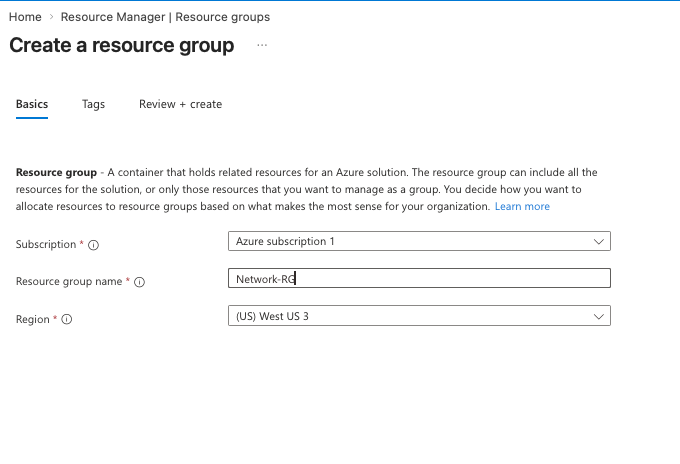
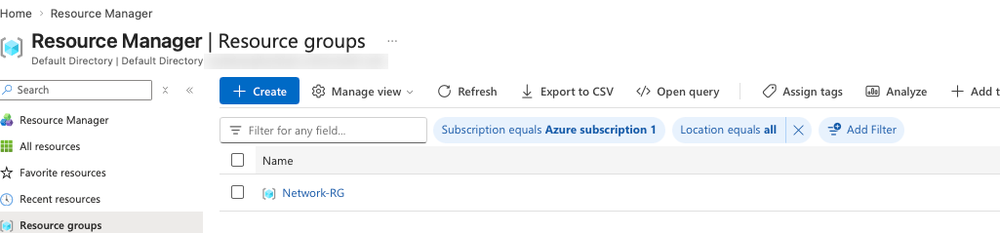
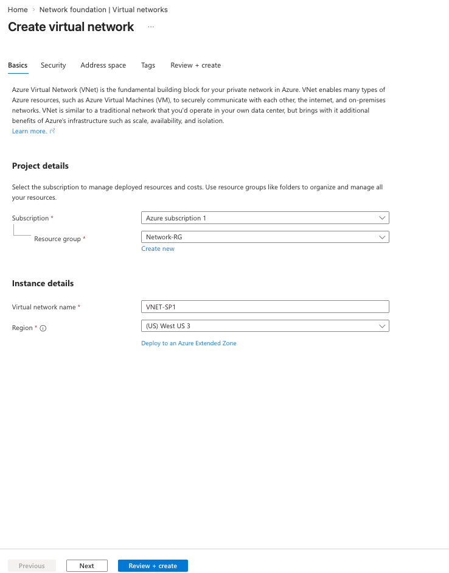
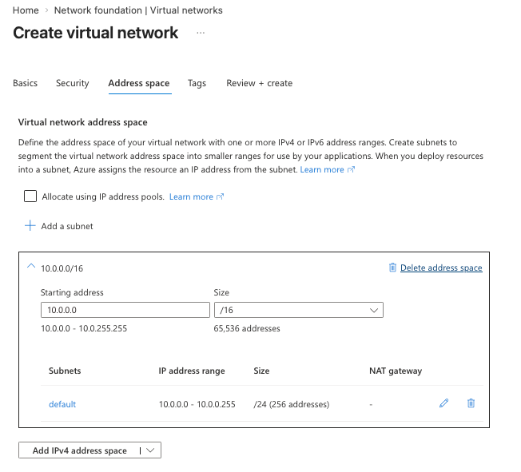
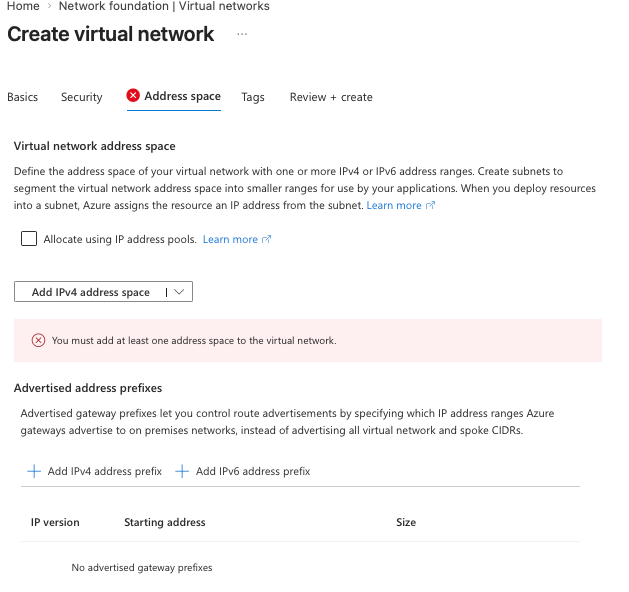
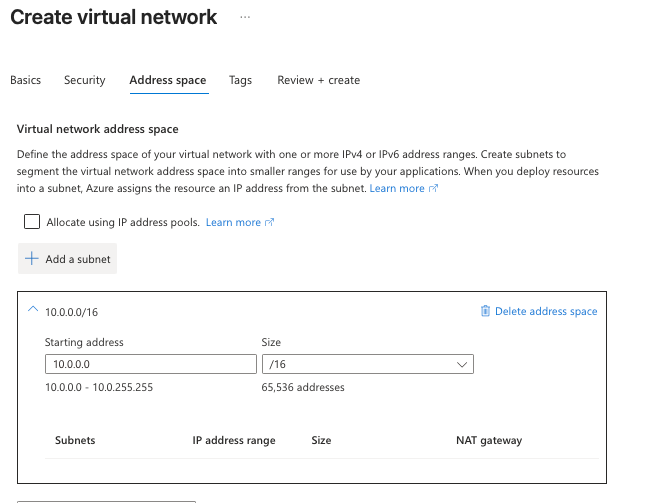
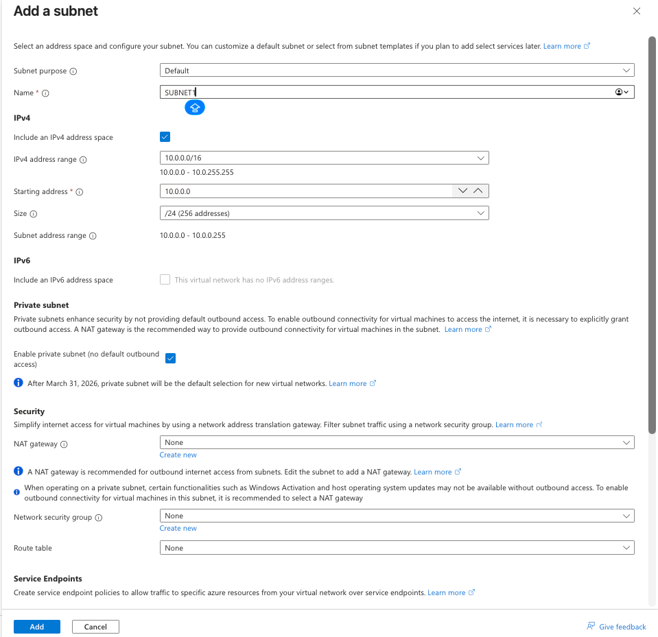
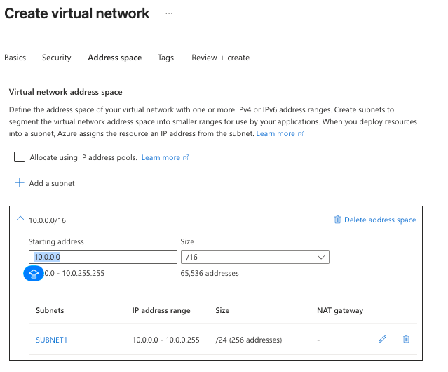
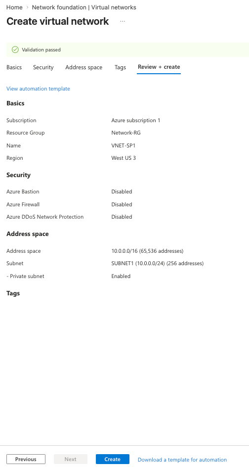
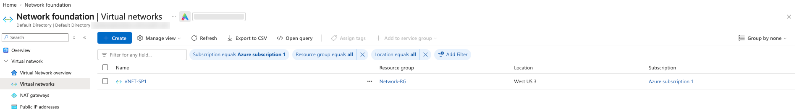

Azure fundamentals · AZ-900 · Hands-on lab

# Azure Virtual Network (VNet): Address Spaces, Private Subnets and a Hands-On Portal Lab

Every VM, private endpoint and internal load balancer in Azure needs a
virtual network to live in. This post explains how a VNet and its
subnets work, what changed with private subnets in 2026, and then builds
`VNET-SP1` step by step in the portal and again with the Azure CLI.

Sunke NithinNovember 2026~15 min read + 20 min lab

[1. What is a VNet?](#what) [2. Address space and subnets](#address) [3.
The 5 reserved IPs](#reserved) [4. Private subnets and outbound
access](#outbound) [5. Filtering traffic: NSGs and routes](#security)
[6. Connecting VNets and on-premises](#connect) [7. Lab: build VNET-SP1
in the portal](#lab) [8. The same lab with Azure CLI](#cli) [9. Extend
the lab](#extend) [10. Limits and gotchas](#gotchas) [11. Quiz](#quiz)
[12. Key takeaways](#takeaways)

## 1. What is a VNet?

An **Azure Virtual Network (VNet)** is your own private, isolated
network inside Azure. Resources in the same VNet talk to each other over
private IP addresses, and nothing outside can reach them unless you
allow it. It works much like the network in your own datacenter, except
there are no switches or cables to manage.

- A VNet belongs to **one subscription** and **one region**, and lives
  in a resource group (here, `Network-RG` in West US 3).
- It spans **all availability zones** in that region, so you don't need
  a separate VNet per zone.
- VNets and subnets themselves are **free**. You pay for things attached
  to them: NAT gateways, public IPs, VPN gateways, peering data
  transfer, Bastion and so on.

<figure>

<img
src="data:image/svg+xml;base64,PHN2ZyB2aWV3Ym94PSIwIDAgNzIwIDMzMCIgcm9sZT0iaW1nIiBhcmlhLWxhYmVsbGVkYnk9ImYxdCI+CiAgPHRpdGxlIGlkPSJmMXQiPlZORVQtU1AxIHdpdGggYWRkcmVzcyBzcGFjZSAxMC4wLjAuMC8xNiBjb250YWluaW5nIFNVQk5FVDEgMTAuMC4wLjAvMjQgKHByaXZhdGUpIGFuZCBTVUJORVQyIDEwLjAuMS4wLzI0IHdpdGggYW4gTlNHIGFuZCBhIE5BVCBnYXRld2F5IGZvciBvdXRib3VuZCBpbnRlcm5ldC48L3RpdGxlPgogIDxkZWZzPjxtYXJrZXIgaWQ9ImExIiB2aWV3Ym94PSIwIDAgMTAgMTAiIHJlZng9IjkiIHJlZnk9IjUiIG1hcmtlcndpZHRoPSI3IiBtYXJrZXJoZWlnaHQ9IjciIG9yaWVudD0iYXV0byI+PHBhdGggZD0iTTAsMCBMMTAsNSBMMCwxMCB6IiBzdHlsZT0iZmlsbDp2YXIoLS1tdXRlZCkiPjwvcGF0aD48L21hcmtlcj48L2RlZnM+CiAgPHJlY3QgeD0iMTAiIHk9IjEwIiB3aWR0aD0iNzAwIiBoZWlnaHQ9IjMxMCIgcng9IjEyIiBzdHlsZT0iZmlsbDpub25lO3N0cm9rZTp2YXIoLS1saW5lKTtzdHJva2Utd2lkdGg6MjtzdHJva2UtZGFzaGFycmF5OjYgNSI+PC9yZWN0PgogIDx0ZXh0IHg9IjI2IiB5PSIzNCIgY2xhc3M9InN2LXMiPlJlZ2lvbjogV2VzdCBVUyAzIMK3IFJlc291cmNlIGdyb3VwOiBOZXR3b3JrLVJHPC90ZXh0PgogIDxyZWN0IHg9IjMwIiB5PSI0OCIgd2lkdGg9IjQ4MCIgaGVpZ2h0PSIyNTYiIHJ4PSIxMiIgc3R5bGU9ImZpbGw6bm9uZTtzdHJva2U6dmFyKC0tYy12bmV0KTtzdHJva2Utd2lkdGg6Mi41Ij48L3JlY3Q+CiAgPHRleHQgeD0iNDYiIHk9Ijc0IiBjbGFzcz0ic3YtdCIgc3R5bGU9ImZpbGw6dmFyKC0tYy12bmV0KSI+Vk5FVC1TUDE8L3RleHQ+CiAgPHRleHQgeD0iNDYiIHk9IjkyIiBjbGFzcz0ic3YtbSI+YWRkcmVzcyBzcGFjZSAxMC4wLjAuMC8xNiDCtyA2NSw1MzYgYWRkcmVzc2VzPC90ZXh0PgogIDxyZWN0IHg9IjUwIiB5PSIxMDgiIHdpZHRoPSIyMTAiIGhlaWdodD0iMTc2IiByeD0iMTAiIGNsYXNzPSJzdi1ib3giIHN0eWxlPSJzdHJva2U6dmFyKC0tYy1zdWIpIj48L3JlY3Q+CiAgPHRleHQgeD0iNjQiIHk9IjEzMiIgY2xhc3M9InN2LXQiIHN0eWxlPSJmb250LXNpemU6MTRweCI+U1VCTkVUMTwvdGV4dD4KICA8dGV4dCB4PSI2NCIgeT0iMTUwIiBjbGFzcz0ic3YtbSI+MTAuMC4wLjAvMjQ8L3RleHQ+CiAgPHRleHQgeD0iNjQiIHk9IjE2OCIgY2xhc3M9InN2LXMiPnByaXZhdGUgc3VibmV0IChubyBkZWZhdWx0PC90ZXh0PgogIDx0ZXh0IHg9IjY0IiB5PSIxODMiIGNsYXNzPSJzdi1zIj5vdXRib3VuZCBpbnRlcm5ldCk8L3RleHQ+CiAgPHJlY3QgeD0iNjQiIHk9IjIwMCIgd2lkdGg9IjgwIiBoZWlnaHQ9IjM0IiByeD0iNiIgY2xhc3M9InN2LWJveCIgc3R5bGU9InN0cm9rZTp2YXIoLS1tdXRlZCkiPjwvcmVjdD48dGV4dCB4PSIxMDQiIHk9IjIyMiIgdGV4dC1hbmNob3I9Im1pZGRsZSIgY2xhc3M9InN2LW0iPkRCIFZNPC90ZXh0PgogIDx0ZXh0IHg9IjE1MCIgeT0iMjIyIiBjbGFzcz0ic3YtbSIgc3R5bGU9ImZvbnQtc2l6ZToxMXB4Ij4xMC4wLjAuNDwvdGV4dD4KICA8cmVjdCB4PSIyODAiIHk9IjEwOCIgd2lkdGg9IjIxMCIgaGVpZ2h0PSIxNzYiIHJ4PSIxMCIgY2xhc3M9InN2LWJveCIgc3R5bGU9InN0cm9rZTp2YXIoLS1jLXN1YikiPjwvcmVjdD4KICA8dGV4dCB4PSIyOTQiIHk9IjEzMiIgY2xhc3M9InN2LXQiIHN0eWxlPSJmb250LXNpemU6MTRweCI+U1VCTkVUMiAobGFiIMKnOSk8L3RleHQ+CiAgPHRleHQgeD0iMjk0IiB5PSIxNTAiIGNsYXNzPSJzdi1tIj4xMC4wLjEuMC8yNDwvdGV4dD4KICA8cmVjdCB4PSIyOTQiIHk9IjE2MiIgd2lkdGg9IjEyMCIgaGVpZ2h0PSIyNiIgcng9IjUiIHN0eWxlPSJmaWxsOm5vbmU7c3Ryb2tlOnZhcigtLWMtc2VjKTtzdHJva2Utd2lkdGg6MS41Ij48L3JlY3Q+CiAgPHRleHQgeD0iMzU0IiB5PSIxODAiIHRleHQtYW5jaG9yPSJtaWRkbGUiIGNsYXNzPSJzdi1tIiBzdHlsZT0iZmlsbDp2YXIoLS1jLXNlYyk7Zm9udC1zaXplOjExcHgiPk5TRzogYWxsb3cgNDQzPC90ZXh0PgogIDxyZWN0IHg9IjI5NCIgeT0iMjAwIiB3aWR0aD0iODAiIGhlaWdodD0iMzQiIHJ4PSI2IiBjbGFzcz0ic3YtYm94IiBzdHlsZT0ic3Ryb2tlOnZhcigtLW11dGVkKSI+PC9yZWN0Pjx0ZXh0IHg9IjMzNCIgeT0iMjIyIiB0ZXh0LWFuY2hvcj0ibWlkZGxlIiBjbGFzcz0ic3YtbSI+V2ViIFZNPC90ZXh0PgogIDx0ZXh0IHg9IjM4MCIgeT0iMjIyIiBjbGFzcz0ic3YtbSIgc3R5bGU9ImZvbnQtc2l6ZToxMXB4Ij4xMC4wLjEuNDwvdGV4dD4KICA8cGF0aCBkPSJNMTQ2IDIxNyBIMjkyIiBjbGFzcz0ic3YtbGluZSIgbWFya2VyLWVuZD0idXJsKCNhMSkiPjwvcGF0aD4KICA8dGV4dCB4PSIxNjgiIHk9IjI1NiIgY2xhc3M9InN2LXMiPlNVQk5FVDEg4oaUIFNVQk5FVDI6IHByaXZhdGU8L3RleHQ+CiAgPHRleHQgeD0iMTY4IiB5PSIyNzEiIGNsYXNzPSJzdi1zIj50cmFmZmljIGFsbG93ZWQgYnkgZGVmYXVsdDwvdGV4dD4KICA8cmVjdCB4PSI1NTAiIHk9IjE1MCIgd2lkdGg9IjE0MCIgaGVpZ2h0PSI1MCIgcng9IjgiIGNsYXNzPSJzdi1ib3giIHN0eWxlPSJzdHJva2U6dmFyKC0tYy1vdXQpIj48L3JlY3Q+CiAgPHRleHQgeD0iNjIwIiB5PSIxNzIiIHRleHQtYW5jaG9yPSJtaWRkbGUiIGNsYXNzPSJzdi10IiBzdHlsZT0iZm9udC1zaXplOjEzcHgiPk5BVCBnYXRld2F5PC90ZXh0PgogIDx0ZXh0IHg9IjYyMCIgeT0iMTg5IiB0ZXh0LWFuY2hvcj0ibWlkZGxlIiBjbGFzcz0ic3YtcyI+c3RhdGljIHB1YmxpYyBJUDwvdGV4dD4KICA8cGF0aCBkPSJNMTU1IDI4NCBWMjk2IEg1MzAgVjE5MCBINTQ4IiBjbGFzcz0ic3YtbGluZSIgc3R5bGU9InN0cm9rZTp2YXIoLS1jLW91dCkiIG1hcmtlci1lbmQ9InVybCgjYTEpIj48L3BhdGg+CiAgPHRleHQgeD0iNTM2IiB5PSIyOTIiIGNsYXNzPSJzdi1zIj5TVUJORVQxIG91dGJvdW5kIChsYWIgOWIpPC90ZXh0PgogIDxwYXRoIGQ9Ik02MjAgMTQ4IFY5NiIgY2xhc3M9InN2LWxpbmUiIG1hcmtlci1lbmQ9InVybCgjYTEpIj48L3BhdGg+CiAgPHRleHQgeD0iNjIwIiB5PSI4NiIgdGV4dC1hbmNob3I9Im1pZGRsZSIgY2xhc3M9InN2LXQiIHN0eWxlPSJmb250LXNpemU6MTNweCI+SW50ZXJuZXQ8L3RleHQ+Cjwvc3ZnPg==" />

<figcaption>Figure 1. A VNet is carved into subnets. Resources in any
subnet reach each other privately; internet access is something you
add.</figcaption>
</figure>

**Coming from OCI?** A VNet is an OCI VCN. Azure subnets are always
regional (OCI also has AD-specific subnets), a NAT gateway works the
same way, and an NSG covers what OCI splits between security lists and
NSGs. Azure has no Internet Gateway resource: internet routing is built
into the VNet's system routes.

## 2. Address space and subnets

The **address space** is the range of private IPs the whole VNet can
use, written in CIDR notation. `10.0.0.0/16` means the first 16 bits are
fixed, which leaves 65,536 addresses from `10.0.0.0` to `10.0.255.255`.
Use the private RFC 1918 ranges: `10.0.0.0/8`, `172.16.0.0/12` or
`192.168.0.0/16`.

A **subnet** is a slice of that address space. Every resource with a
network interface goes into a subnet, and subnets are where you attach
NSGs, route tables and NAT gateways.

| CIDR  | Addresses | Usable in Azure | Typical use                                                |
|-------|-----------|-----------------|------------------------------------------------------------|
| `/16` | 65,536    | VNet only       | A whole VNet                                               |
| `/24` | 256       | 251             | A normal workload subnet                                   |
| `/26` | 64        | 59              | Minimum for `AzureBastionSubnet` and `AzureFirewallSubnet` |
| `/27` | 32        | 27              | Recommended for `GatewaySubnet`                            |
| `/29` | 8         | 3               | Smallest IPv4 subnet Azure allows                          |

**Plan before you build.** Address spaces of VNets you want to peer or
connect to on-premises must not overlap. If your office uses
`10.0.0.0/16`, pick something else for Azure, such as `10.20.0.0/16`.
Leave gaps so subnets can grow later.

## 3. The 5 reserved IPs in every subnet

Azure keeps five addresses in every subnet, which is why a `/24` gives
you 251 usable IPs instead of 256. That's also why the first VM you
deploy into `10.0.0.0/24` gets `10.0.0.4`.

<figure>

<figcaption>Figure 2. Five reserved addresses per subnet.</figcaption>
</figure>

## 4. Private subnets and outbound internet access

For years, a VM in Azure without a public IP could still reach the
internet through a hidden, Microsoft-owned IP. This is called **default
outbound access**. It was convenient, but the IP could change without
notice, you couldn't control or log it, and workloads ended up with
internet access nobody had planned for.

Azure is moving away from it. A **private subnet** has default outbound
access turned off, and as the portal notes in step 7 of the lab, **after
31 March 2026 private subnet is the default for new virtual networks**.
Your `SUBNET1` was created this way.

In a private subnet, a VM can still reach other private IPs and Azure
services over private endpoints, but it can't reach the internet until
you add one of these explicit methods:

| Method                           | How it works                                                                        | When to use it                                                 |
|----------------------------------|-------------------------------------------------------------------------------------|----------------------------------------------------------------|
| **NAT gateway** (recommended)    | Attached to the subnet; all outbound traffic leaves through its static public IP(s) | Many VMs need outbound access, like OS updates or calling APIs |
| **Public IP on the VM**          | That VM uses its own IP for inbound and outbound traffic                            | A single VM that must also be reachable from the internet      |
| **Load balancer outbound rules** | VMs behind a Standard public load balancer share its frontend IP                    | Already using a public load balancer                           |
| **Azure Firewall / NVA**         | A route table sends `0.0.0.0/0` to a firewall in a hub VNet                         | Enterprise hub-and-spoke with central inspection               |

As the portal warns, in a private subnet with no outbound method,
Windows activation and OS updates can fail. For a lab VM, either add a
public IP or attach a NAT gateway (section 9); a NAT gateway is billed
per hour plus data processed.

## 5. Filtering traffic: NSGs and routes

A **network security group (NSG)** is a stateful firewall made of
allow/deny rules. Each rule matches on source, destination, port and
protocol and has a **priority** from 100 to 4096; lower numbers are
evaluated first and the first match wins. You can attach an NSG to a
**subnet**, to a **network interface**, or to both, in which case
traffic must pass both.

Every NSG starts with default rules you can't delete but can override
with higher-priority ones:

| Direction | Default rule                                              | Effect                                                    |
|-----------|-----------------------------------------------------------|-----------------------------------------------------------|
| Inbound   | AllowVNetInBound (65000)                                  | Anything inside the VNet (and peered VNets) can reach you |
| Inbound   | AllowAzureLoadBalancerInBound (65001)                     | Health probes work                                        |
| Inbound   | DenyAllInBound (65500)                                    | Everything else from outside is blocked                   |
| Outbound  | AllowVNetOutBound, AllowInternetOutBound, DenyAllOutBound | Outbound is open unless you restrict it                   |

**Routing** happens automatically. Azure adds **system routes** so all
subnets in a VNet can reach each other, plus routes for peered VNets and
gateways. A **route table** (user-defined routes) overrides them, for
example to send all traffic through a firewall. The portal's *Add a
subnet* panel in step 7 has fields for an NSG, a NAT gateway and a route
table; we left them empty and add an NSG in section 9.

Two more subnet features you'll see in that panel: **service endpoints**
let a subnet reach services like Storage over Azure's backbone, and
**private endpoints** go further by giving the service a private IP
inside your subnet.

## 6. Connecting VNets and on-premises

The name `VNET-SP1` fits a common pattern: **hub-and-spoke**. Shared
services such as a firewall, VPN gateway and Bastion sit in a hub VNet,
and each workload gets its own spoke VNet peered to the hub.

<figure>

<figcaption>Figure 3. Spokes peer to the hub. Spoke-to-spoke traffic
must go through the hub firewall or have its own peering.</figcaption>
</figure>

- **VNet peering** joins two VNets over Microsoft's backbone with low
  latency, in the same region or across regions (global peering).
  Address spaces must not overlap, and peering is **not transitive**: if
  SP1 peers with the hub and the hub with SP2, SP1 still can't reach SP2
  directly.
- **VPN Gateway** connects a VNet to on-premises over encrypted IPsec
  tunnels across the internet. It needs a subnet named exactly
  `GatewaySubnet`.
- **ExpressRoute** is a private circuit through a connectivity provider,
  with no internet path, higher bandwidth and more predictable latency.
- **Azure Bastion** lets you RDP or SSH to VMs from the portal without
  public IPs on them. It needs a subnet named `AzureBastionSubnet`, at
  least `/26`. This is the *Azure Bastion* option on the VNet wizard's
  **Security** tab, along with Azure Firewall and DDoS Protection.

## 7. Lab: build VNET-SP1 in the portal

**Goal:** create the resource group `Network-RG`, then the VNet
`VNET-SP1` (`10.0.0.0/16`) with one private subnet `SUBNET1`
(`10.0.0.0/24`) in West US 3. Everything in this part of the lab is
free.

STEP 1

### Create the resource group

Search for **Resource groups** → **+ Create**. Choose your subscription,
enter `Network-RG` and pick **(US) West US 3**, then **Review + create →
Create**. Keeping network resources in their own resource group is
common practice: the network team can own it while application teams get
their own groups.

<figure class="shot">

<figcaption>A dedicated resource group for networking.</figcaption>
</figure>

STEP 2

### Confirm the resource group

`Network-RG` now appears in the Resource groups list.

<figure class="shot">

<figcaption>The resource group is ready.</figcaption>
</figure>

STEP 3

### Start the VNet wizard: Basics

Search for **Virtual networks** → **+ Create**. On **Basics**, pick the
subscription and `Network-RG`, name it `VNET-SP1` and use the same
region, **West US 3**. A VNet can only hold resources from its own
region, so choose the region your VMs will use.

<figure class="shot">

<figcaption>Name and region are fixed once the VNet is
created.</figcaption>
</figure>

Leave the **Security** tab at its defaults (Bastion, Firewall and DDoS
Protection off) for this lab. All three are paid services.

STEP 4

### Look at the default address space

On **Address space**, the portal proposes `10.0.0.0/16` with a subnet
called `default` (`10.0.0.0/24`). We'll replace it with our own naming.

<figure class="shot">

<figcaption>The wizard's suggested layout.</figcaption>
</figure>

STEP 5

### See what happens with no address space

If you click **Delete address space**, the tab shows the error *"You
must add at least one address space to the virtual network."* A VNet
can't exist without one. This tab also has **Advertised address
prefixes**, which control which ranges a gateway in this VNet advertises
to on-premises; leave it empty.

<figure class="shot">

<figcaption>At least one address space is required.</figcaption>
</figure>

STEP 6

### Add the address space back

Click **Add IPv4 address space**, enter starting address `10.0.0.0` and
size `/16` (65,536 addresses). The subnet list is now empty.

<figure class="shot">

<figcaption>An address space with no subnets yet.</figcaption>
</figure>

STEP 7

### Add SUBNET1 as a private subnet

Click **+ Add a subnet** and set:

- **Subnet purpose:** Default. Other options set up special subnets such
  as Bastion or Firewall.
- **Name:** `SUBNET1`
- **Starting address:** `10.0.0.0`, **Size:** `/24` (range
  10.0.0.0–10.0.0.255)
- **Enable private subnet (no default outbound access):** ticked, as
  recommended (see section 4)
- **NAT gateway, Network security group, Route table:** None for now

Then click **Add**. Note the two information messages: private subnet
becomes the default for new VNets after 31 March 2026, and a NAT gateway
is the recommended way to give it internet access.

<figure class="shot">

<figcaption>Everything a subnet can carry is set in this one
panel.</figcaption>
</figure>

STEP 8

### Check the subnet layout

`SUBNET1` now sits in `10.0.0.0/16` with 256 addresses, of which 251 are
usable. The rest of the `/16` is free for future subnets such as
`10.0.1.0/24`.

<figure class="shot">

<figcaption>One subnet in, room for 255 more /24s.</figcaption>
</figure>

STEP 9

### Review and create

Open **Review + create**. Validation passes and the summary confirms the
name, region, address space, `SUBNET1` and **Private subnet: Enabled**.
Before clicking **Create**, click **View automation template** to see
the ARM template the portal generated; you can save it to recreate the
VNet later.

<figure class="shot">

<figcaption>Validation passed.</figcaption>
</figure>

STEP 10

### Verify the VNet

After a few seconds, `VNET-SP1` appears under **Virtual networks** in
`Network-RG`, West US 3. Open it and look at **Subnets**, **Connected
devices** (empty until you deploy a VM) and **Peerings**.

<figure class="shot">

<figcaption>VNET-SP1 is created.</figcaption>
</figure>

## 8. The same lab with Azure CLI

Run these in Cloud Shell (Bash). They build exactly what the portal
built.

    RG=Network-RG
    LOCATION=westus3

    # 1. Resource group
    az group create --name $RG --location $LOCATION

    # 2. VNet with its address space and SUBNET1
    az network vnet create -g $RG -n VNET-SP1 -l $LOCATION \
      --address-prefixes 10.0.0.0/16 \
      --subnet-name SUBNET1 --subnet-prefixes 10.0.0.0/24

    # 3. Make SUBNET1 a private subnet (no default outbound access)
    az network vnet subnet update -g $RG --vnet-name VNET-SP1 -n SUBNET1 \
      --default-outbound-access false

    # 4. Verify
    az network vnet show -g $RG -n VNET-SP1 \
      --query "{name:name, space:addressSpace.addressPrefixes, location:location}" -o jsonc
    az network vnet subnet list -g $RG --vnet-name VNET-SP1 \
      --query "[].{name:name, prefix:addressPrefix, defaultOutbound:defaultOutboundAccess}" -o table

The subnet list shows `SUBNET1 10.0.0.0/24 False`. If your CLI doesn't
recognise `--default-outbound-access`, update it with `az upgrade`.

## 9. Extend the lab

### 9a. Add SUBNET2 with an NSG (free)

    # NSG that allows HTTPS from the internet
    az network nsg create -g $RG -n NSG-SUBNET2
    az network nsg rule create -g $RG --nsg-name NSG-SUBNET2 \
      -n allow-https --priority 100 --direction Inbound \
      --access Allow --protocol Tcp --destination-port-ranges 443

    # Second subnet in the free part of the address space, with the NSG attached
    az network vnet subnet create -g $RG --vnet-name VNET-SP1 -n SUBNET2 \
      --address-prefixes 10.0.1.0/24 \
      --network-security-group NSG-SUBNET2 \
      --default-outbound-access false

    # See the NSG's rules, including the defaults
    az network nsg rule list -g $RG --nsg-name NSG-SUBNET2 --include-default -o table

In the portal, VNET-SP1 → **Subnets** shows SUBNET1 and SUBNET2, with
`NSG-SUBNET2` in the security group column for SUBNET2.

### 9b. Give SUBNET1 outbound internet with a NAT gateway (paid)

    az network public-ip create -g $RG -n PIP-NATGW --sku Standard --allocation-method Static
    az network nat gateway create -g $RG -n NATGW-SP1 \
      --public-ip-addresses PIP-NATGW --idle-timeout 4
    az network vnet subnet update -g $RG --vnet-name VNET-SP1 -n SUBNET1 \
      --nat-gateway NATGW-SP1

    # The public IP every VM in SUBNET1 will use for outbound traffic
    az network public-ip show -g $RG -n PIP-NATGW --query ipAddress -o tsv

A VM in SUBNET1 without its own public IP can now run
`curl ifconfig.me`, and the address it prints is the NAT gateway's IP.

The NAT gateway and its public IP are billed hourly. Remove them when
you're done:
`az network vnet subnet update -g $RG --vnet-name VNET-SP1 -n SUBNET1 --remove natGateway`,
then `az network nat gateway delete -g $RG -n NATGW-SP1` and
`az network public-ip delete -g $RG -n PIP-NATGW`.

### 9c. Peer a second spoke (data transfer is billed, the peering itself is free)

    az network vnet create -g $RG -n VNET-SP2 -l $LOCATION \
      --address-prefixes 10.1.0.0/16 --subnet-name SUBNET1 --subnet-prefixes 10.1.0.0/24

    # Peering is created in both directions
    az network vnet peering create -g $RG -n SP1-to-SP2 \
      --vnet-name VNET-SP1 --remote-vnet VNET-SP2 --allow-vnet-access
    az network vnet peering create -g $RG -n SP2-to-SP1 \
      --vnet-name VNET-SP2 --remote-vnet VNET-SP1 --allow-vnet-access

    az network vnet peering list -g $RG --vnet-name VNET-SP1 \
      --query "[].{name:name, state:peeringState}" -o table

The state shows `Connected`. Try creating a third VNet with
`10.0.0.0/16` and peering it to SP1: Azure rejects it because the
address spaces overlap.

**Clean up:** `az group delete --name Network-RG --yes --no-wait`
removes the VNets, subnets, NSG, NAT gateway, public IP and peerings.

## 10. Limits and gotchas

- **Region is permanent.** You can't move a VNet to another region; you
  recreate it there.
- **Changing address spaces is possible but limited.** You can add or
  resize address ranges, but a subnet's range can't be changed while
  resources are using it, and a peered VNet's peering must be synced
  after a change.
- **Overlapping ranges block peering and VPN.** Plan your IP scheme
  across Azure, other clouds and on-premises before building.
- **Special subnet names are exact.** `GatewaySubnet`,
  `AzureBastionSubnet` and `AzureFirewallSubnet` must be spelled exactly
  like that and must not have other resources in them.
- **Azure's DNS is at `168.63.129.16`.** VMs use it by default for name
  resolution; don't block it in NSGs or the guest firewall.
- **Private subnets need a planned outbound path.** Decide on NAT
  gateway, a firewall or public IPs before deploying VMs that need
  updates.

## 11. Quiz: test yourself

Pick an answer to see whether it's right and why.

Reset quiz

## 12. Key takeaways

- A VNet is a private network in **one region** and one subscription,
  and spans all zones in that region.
- The **address space** is the VNet's IP range; **subnets** are slices
  of it where resources, NSGs, NAT gateways and route tables attach.
- Azure reserves **5 IPs per subnet**, so a /24 gives 251 usable
  addresses and the first VM gets `.4`.
- **Private subnets** (the default for new VNets after 31 March 2026)
  have no default outbound internet; add a **NAT gateway** or another
  explicit method.
- **NSGs** filter traffic by priority; lower numbers win. **Peering**
  connects VNets, needs non-overlapping ranges and isn't transitive.

**Next in the series:** deploying a VM into `SUBNET1` and reaching it
securely with Azure Bastion.

Written by Sunke Nithin while learning Azure for AZ-900. Lab performed
on an Azure free account; the directory name in the screenshots is
blurred.

