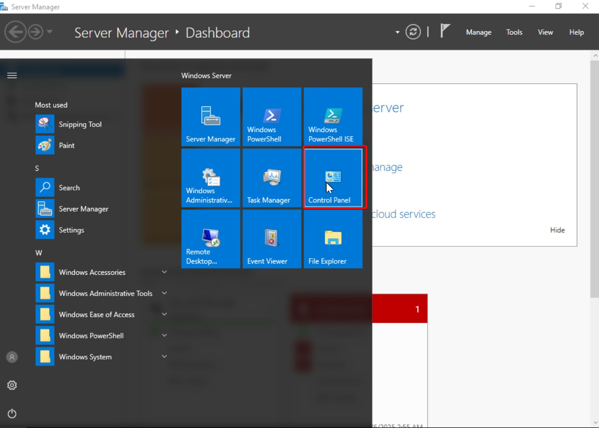
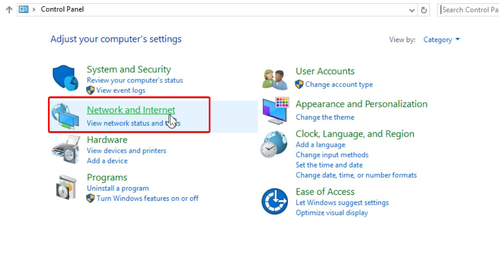
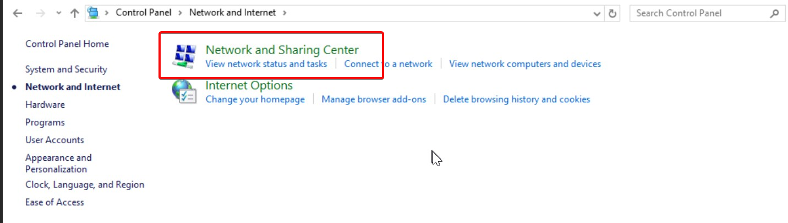
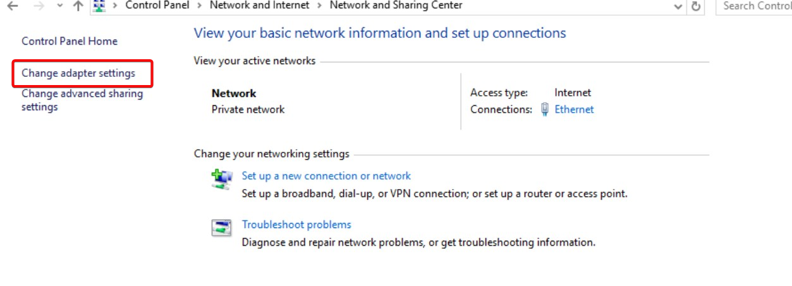
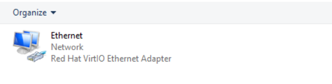
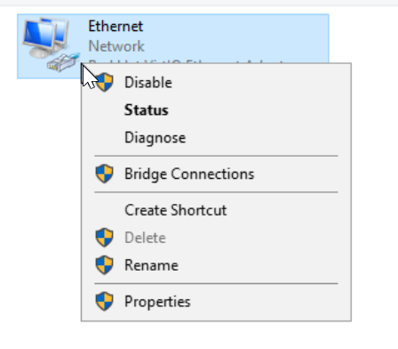
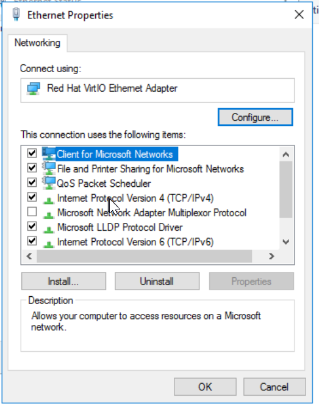
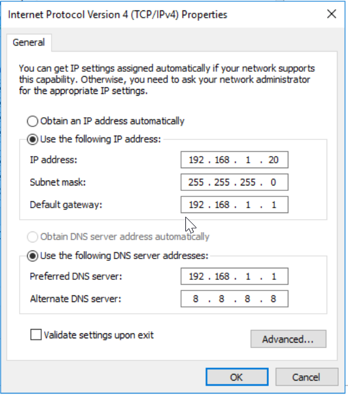
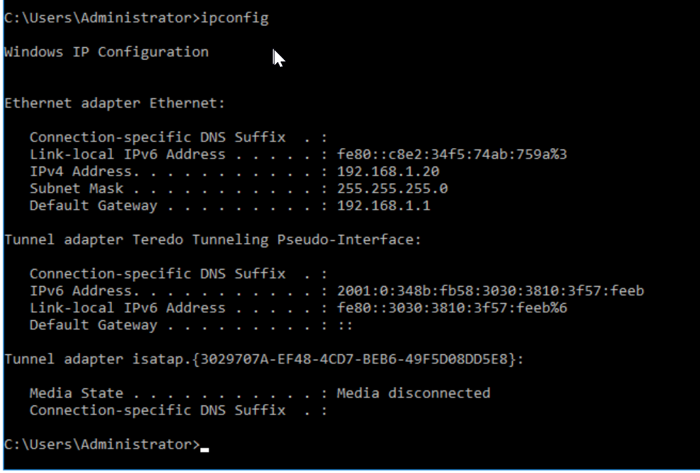

# Task3-Set static IP address for the server

Setting a static IP address for a Windows Server 2016 is an essential step in network configuration, especially for servers that need to maintain a constant IP address. Follow the steps below to configure a static IP address on your Windows Server 2016:

**Step 1: Open Network and Sharing Center**

1.  **Click on the Start Menu** and type Control Panel. Open the **Control Panel**.
2.  Under **Network and Internet**, click **Network and Sharing Center**.

**Step 2: Access Network Connections**

In the left pane, click on **Change adapter settings**.

Locate the network adapter you want to configure (e.g., **Ethernet** or **Local Area Connection**).

Right-click on the adapter and select **Properties**.

**Step 3: Configure the Static IP Address**

In the **Properties** window, scroll down and select **Internet Protocol Version 4 (TCP/IPv4)**.

Double Click on  **Internet Protocol Version 4 (TCP/IPv4)**.

**Step 4: Set the Static IP**

1.  Select the **Use the following IP address** option.
2.  Enter the following details:
    - **IP address**: Enter your desired static IP address (e.g., 192.168.1.10).
    - **Subnet mask**: This is typically 255.255.255.0 for most networks.
    - **Default gateway**: Enter the gateway IP address (e.g., 192.168.1.1).
3.  Under **Use the following DNS server addresses**:
    - **Preferred DNS server**: Enter your preferred DNS server IP address (e.g., 8.8.8.8 for Google DNS or your local DNS server IP).
    - **Alternate DNS server**: Enter a secondary DNS server IP (e.g., 8.8.4.4 for Google DNS or your own secondary DNS).
4.  Click **OK** to save the settings.

**Step 5: Verify the Static IP Configuration**

To ensure that the static IP configuration was applied successfully:

1.  Open **Command Prompt** (cmd).
2.  Type ipconfig and press Enter.
3.  Check that the **IPv4 Address** shows the IP address you configured.

**Final Thoughts:**

- If you're working in a **homelab** or a small network, it’s a good idea to reserve the static IP address in your router’s DHCP settings to avoid conflicts with other devices.
- Always ensure the IP address is within the correct subnet range to avoid network issues.
