# Task4-Install Active Directory Domain Services (AD DS) role

Active Directory Domain Services (AD DS) is a crucial feature for organizations that need centralized management of users, computers, and other network resources. Whether you’re setting up a new domain or promoting a server to be a Domain Controller (DC), this guide will walk you through the steps to install the AD DS role on Windows Server 2016.

**Why Install AD DS?**

Active Directory provides a central point of authentication and authorization for all network resources. By installing the AD DS role, you can:

- Create and manage **user accounts** and **group policies**.
- Implement **Domain Controllers (DC)** for centralized management.
- Enhance security through **role-based access** and **group policies**.
- Manage resources in a networked environment (e.g., file shares, printers).

**Prerequisites**

Before installing AD DS, ensure the following:

- **Static IP Address**: The server should have a **static IP address**.
- **DNS Setup**: It’s recommended to configure **DNS** on the server, as AD DS relies on it for name resolution.
- **Administrator Access**: You’ll need **administrator privileges** to perform the installation.

**Steps to Install the AD DS Role on Windows Server 2016**

**Step 1: Open Server Manager**

1.  **Log in to your server** with an administrator account.
2.  Open **Server Manager** from the Start Menu. You should see the Server Manager dashboard.

**Step 2: Add Roles and Features**

1.  In **Server Manager**, click on **Manage** (top-right corner) and select **Add Roles and Features**.
2.  Click **Next** until you reach the **Select server role** page.

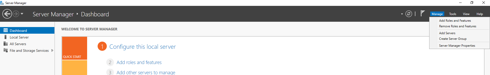

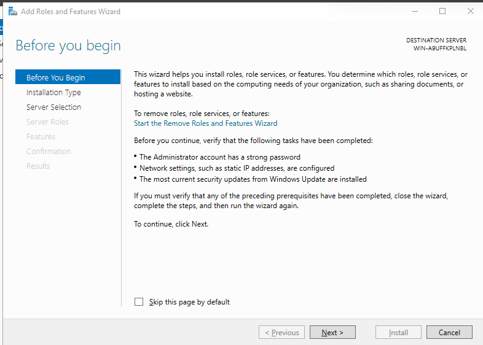

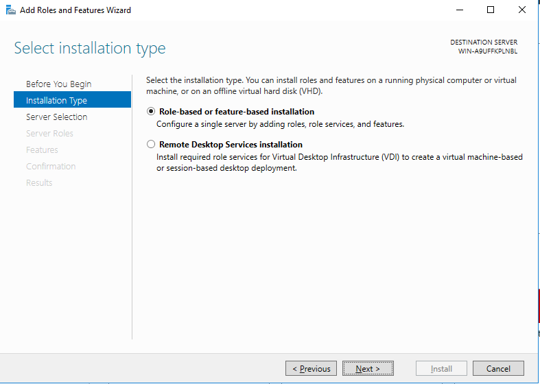

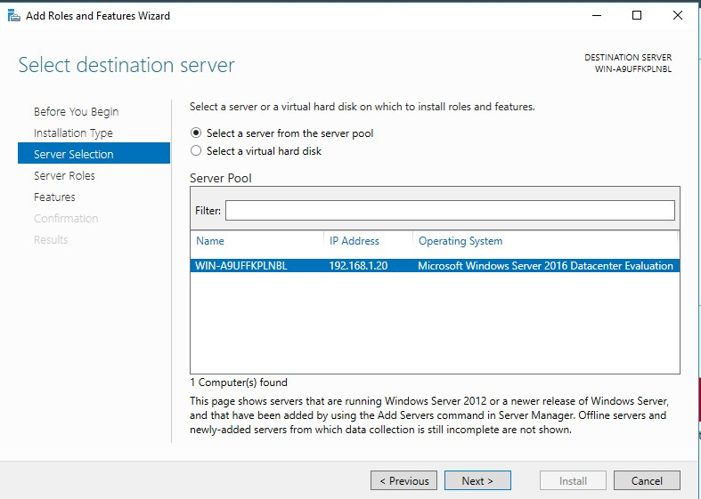

**Step 3: Install the AD DS Role**

In the **Select server roles** section, scroll down and select **Active Directory Domain Services**.

A prompt will appear asking to add additional features required for AD DS. Click **Add Features**.

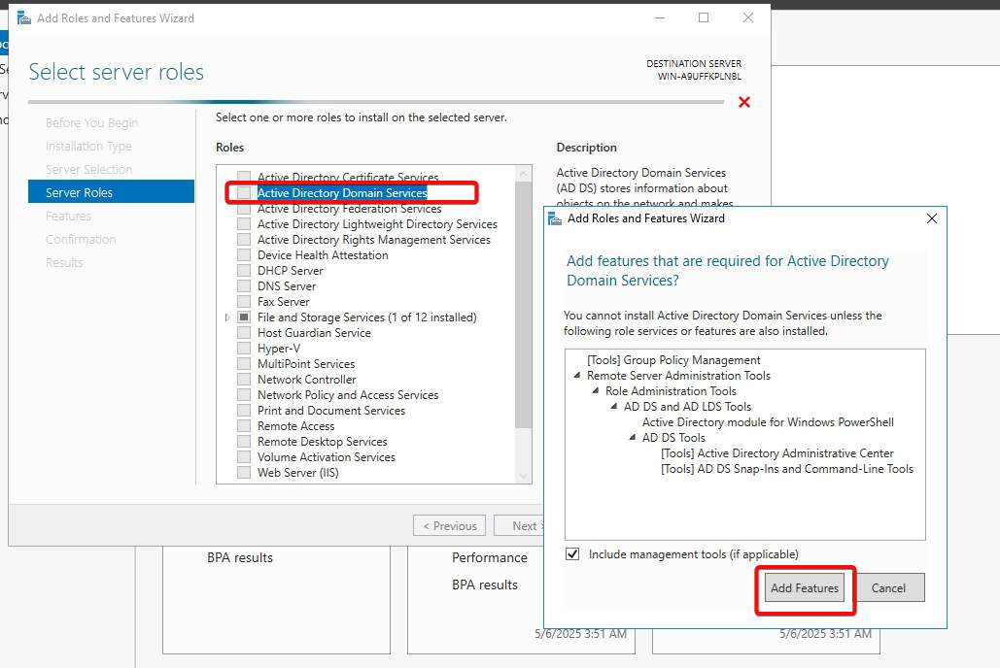

Click **Next** and continue through the wizard until you reach the **Confirm installation selections** page.

Review your selections and click **Install**. The installation process will begin.

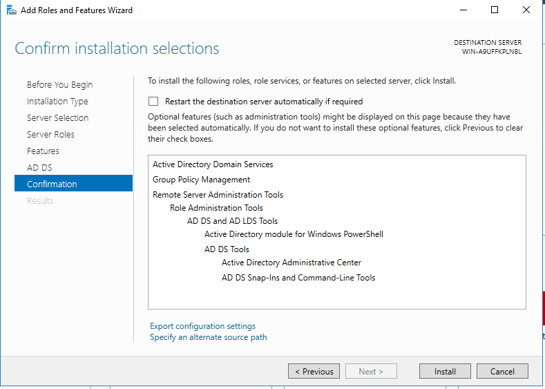

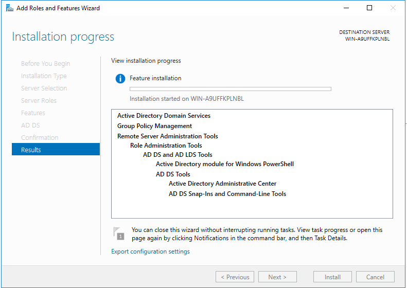

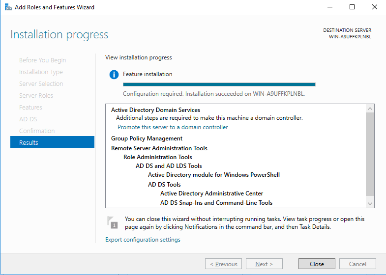

**Step 4: Promote the Server to a Domain Controller**

After the AD DS role has been installed, you need to promote the server to a **Domain Controller (DC)**.

In **Server Manager**, a notification will appear saying **"Promote this server to a domain controller"**. Click on the link to open the **Active Directory Domain Services Configuration Wizard**.

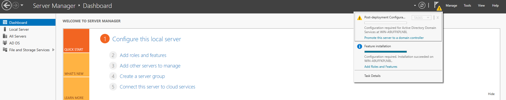

In the wizard, choose whether you want to **add a new forest** or **join an existing domain**.

**Create a new forest**: If this is your first Domain Controller, select **Add a new forest** and enter a **Root domain name** (e.g., homelab.corp).

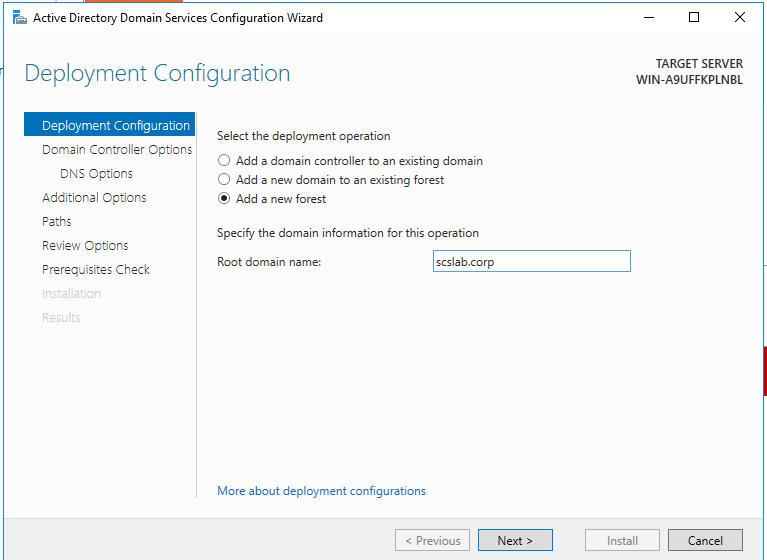

Click **Next** and proceed through the wizard. Configure the following settings:

**Domain Controller Options**: Set the **Forest Functional Level** and **Domain Functional Level** (usually leave at default settings unless specific needs require otherwise).

**DNS Server**: Select **DNS server** to install the DNS role (recommended).

**Directory Services Restore Mode (DSRM) password**: Enter and confirm a password for **DSRM**, which is needed for recovery purposes.

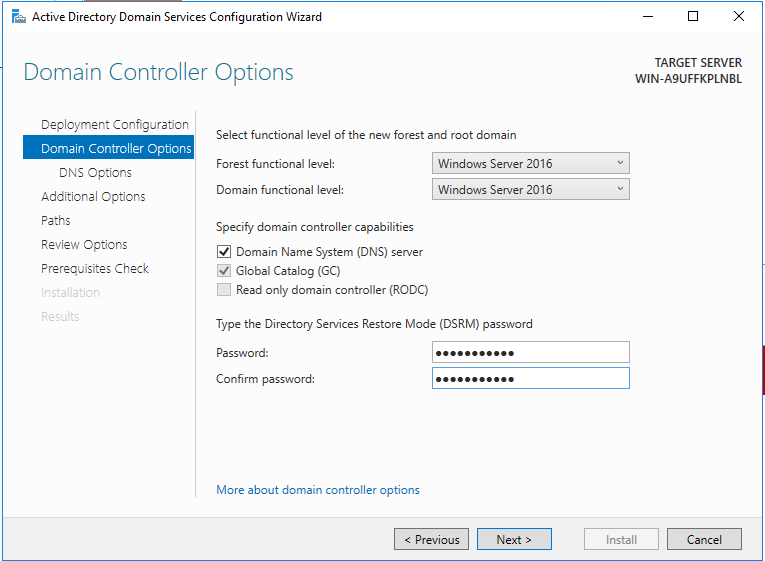

Click **Next** until you reach the **Prerequisite Check** page. The wizard will run a check to ensure your server meets the necessary requirements.

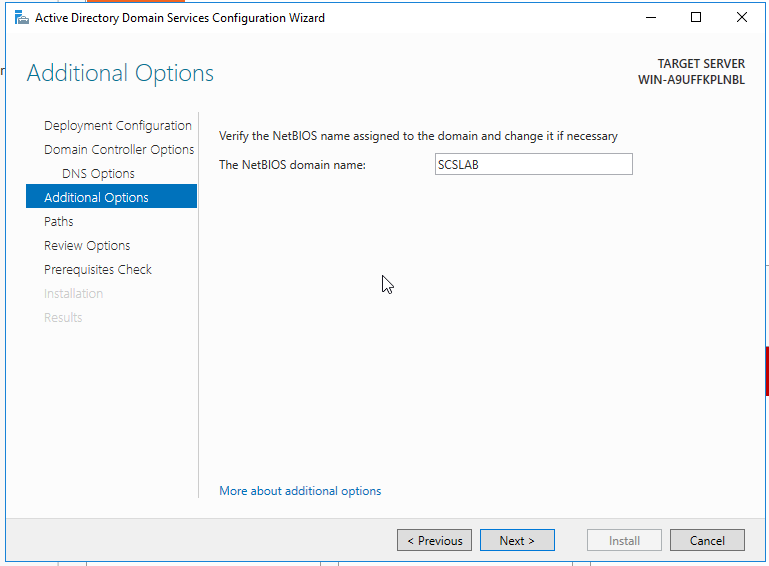

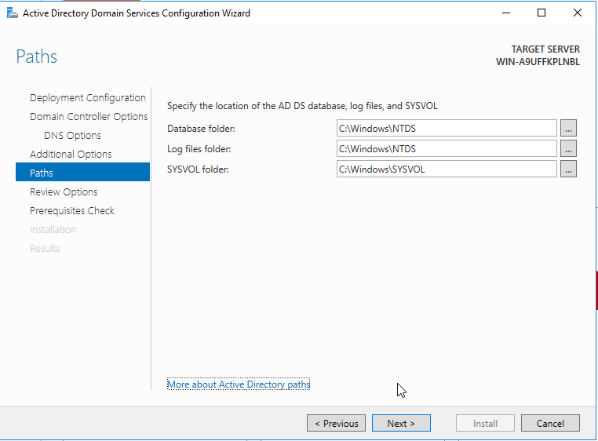

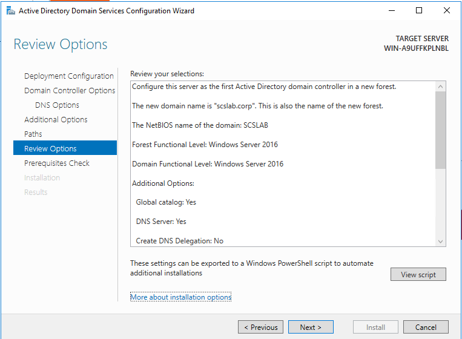

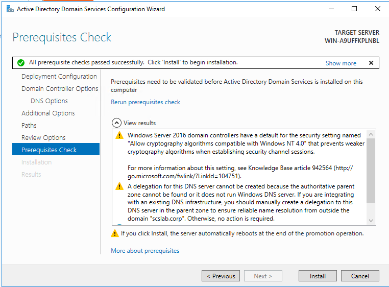

 If there are no issues, click **Install**.

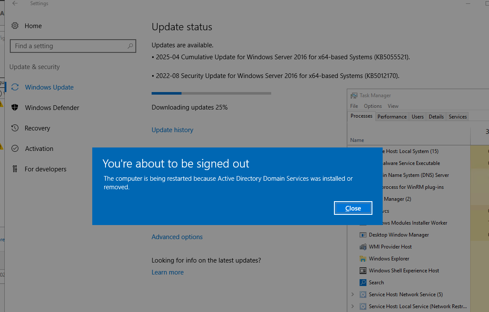

The server will begin promoting to a Domain Controller. This process may take a few minutes.

Once the process completes, the server will automatically reboot.

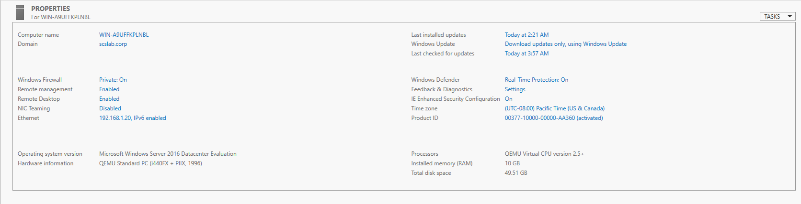
