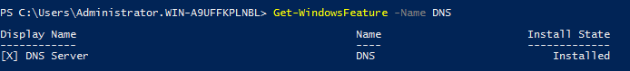
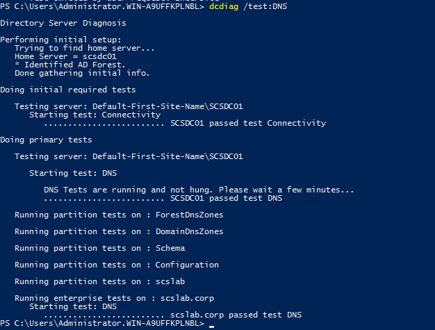

# Task 5- Install and verify DNS server

In a Windows Server domain environment, the **DNS (Domain Name System)** role is vital for name resolution. Active Directory depends heavily on DNS to locate services like domain controllers and other resources. Whether you're setting up a homelab or a production domain, ensuring the DNS role is correctly installed and configured is a key step.

In this guide, we’ll walk through how to install and verify the DNS Server role on Windows Server 2016.

**Why DNS Is Critical for Windows Server Environments**

- Enables **name-to-IP resolution** for clients and servers.
- Supports **Active Directory services**, including domain controller location and replication.
- Facilitates **Group Policy delivery**, **network logons**, and **remote desktop** connections.
- Required when setting up **Active Directory Domain Services (AD DS)**.

**Prerequisites**

Before proceeding:

- Make sure you have **administrator privileges**.
- Your server should be assigned a **static IP address**.
- If DNS wasn’t installed during AD DS setup, follow this guide.

**Step 1: Check if DNS is Installed**

**Using Server Manager:**

1.  Open **Server Manager**.
2.  Navigate to **Manage \> Add Roles and Features**.
3.  Click through to the **Server Roles** screen.
4.  If **DNS Server** is checked, it is already installed.

**Using PowerShell:**

Get-WindowsFeature -Name DNS

In our case it is already installed during Active Directory Role installation.

**Step 2: Install DNS Server Role (If Not Already Installed)**

**Via Server Manager:**

1.  Open **Server Manager**.
2.  Go to **Manage \> Add Roles and Features**.
3.  Select your server.
4.  Under **Server Roles**, check **DNS Server**.
5.  Click **Next** and finish the wizard.
6.  Restart if prompted.

**Via PowerShell (Preferred for Automation):**

Install-WindowsFeature -Name DNS -IncludeManagementTools

**Step 3: Verify DNS Installation**

**Open DNS Manager:**

1.  Press Win + R, type dnsmgmt.msc, and press Enter.
2.  You should see your server listed with **Forward Lookup Zones** and **Reverse Lookup Zones**.

**Verify with dcdiag:**

cmd

dcdiag /test:DNS /v

This checks for:

- DNS registration
- Proper delegation
- Forwarders
- Root hints

