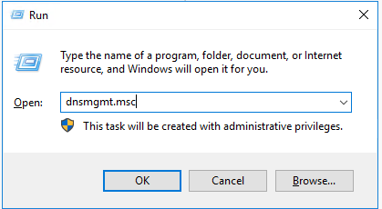
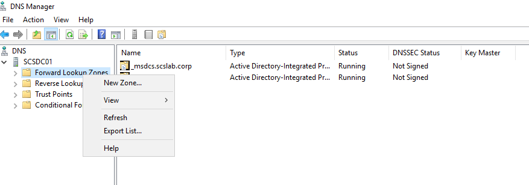
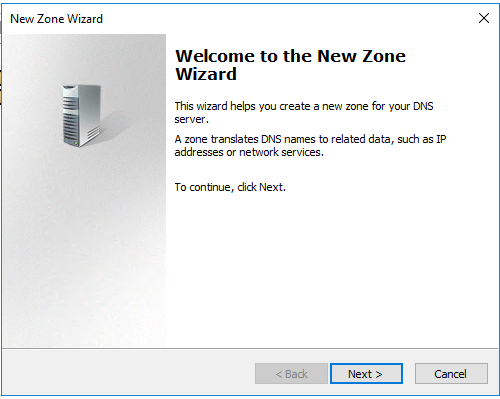
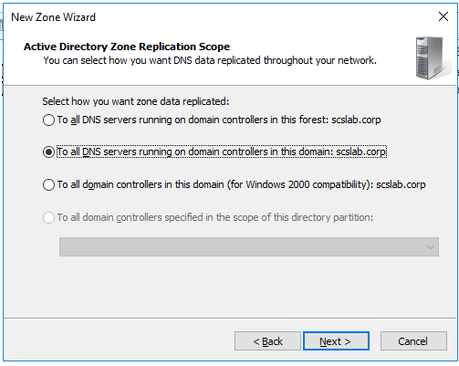
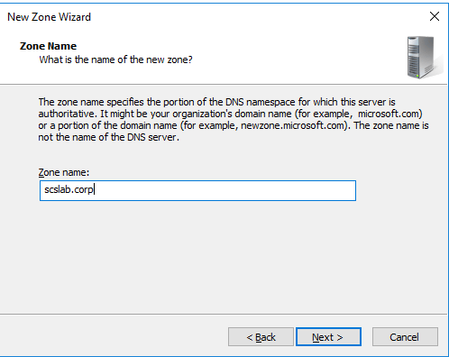
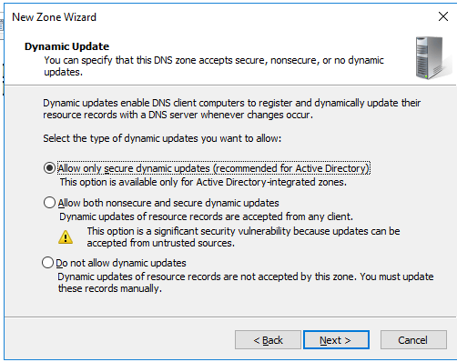

# Task 6- Set up forward lookup zone

A **forward lookup zone** allows DNS to translate **hostnames into IP addresses**, which is fundamental for client connectivity, domain logins, resource access, and Active Directory services.

This guide walks through setting up a forward lookup zone using **DNS Manager** in Windows Server 2016 (works for 2019 and 2022 too).

**Prerequisites**

- The **DNS Server role** must be installed.
- The server must have a **static IP address**.
- You should be logged in as a **Domain Administrator or equivalent**.

**Steps to Create a Forward Lookup Zone**

**Using DNS Manager GUI**

**Open DNS Manager**

- Press Win + R, type dnsmgmt.msc, and press **Enter**.

**Expand the Server Node**

- In the left pane, expand your DNS server name.

**Right-click “Forward Lookup Zones”**

- Select **“New Zone…”** to launch the wizard.

**Choose Zone Type**

- Select **Primary zone**.
- Ensure “Store the zone in Active Directory” is checked if it’s an AD-integrated zone.
- 

**Replication Scope**

- Choose:
  - **To all DNS servers in the forest**
  - **To all DNS servers in the domain** (recommended for most setups)

**Name the Zone**

- Enter your **domain name** (e.g., homelab.local).

**Dynamic Updates**

- Select:
  - **Allow only secure dynamic updates** (recommended in AD)
  - Or **Do not allow** for static setups

**Finish the Wizard**

- Click **Finish** to create the zone.

**Verifying the Forward Lookup Zone**

- In **DNS Manager**, under **Forward Lookup Zones**, your new zone (e.g., homelab.local) should appear.
- It will contain default records like:
  - SOA (Start of Authority)
- NS (Name Server)

You can now manually add **A records**, or let domain-joined devices register themselves automatically if dynamic updates are allowed.

**Note**: if you are following my blog tasks the forward lookup zone is automatically created during AD configuration.

**Example: Add a Manual A Record**

1.  Right-click your new zone \> **New Host (A or AAAA)…**
2.  Name: fileserver
3.  IP address: 192.168.1.20
4.  Click **Add Host**

Now fileserver.scslab.corp will resolve to 192.168.1.20.

**Best Practices**

- **Secure dynamic updates** help prevent unauthorized record changes.
- Use consistent **naming conventions** for hostnames.
- Always configure **reverse lookup zones** alongside forward zones for full DNS functionality.

Setting up a forward lookup zone is a foundational task for DNS and Active Directory. It ensures that name resolution works properly across your network and allows systems to find each other and authenticate effectively.
