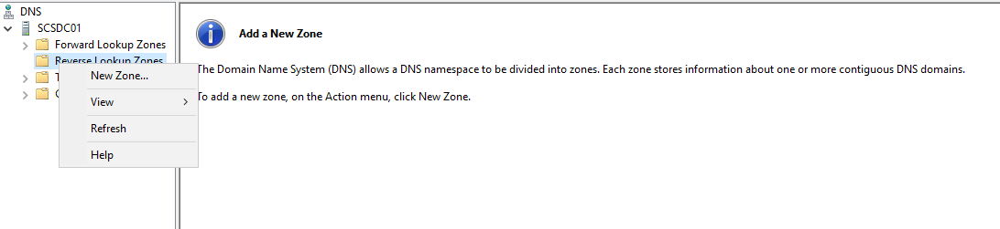
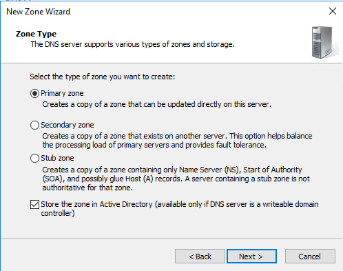
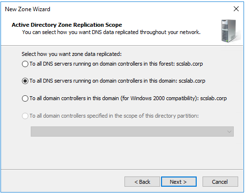
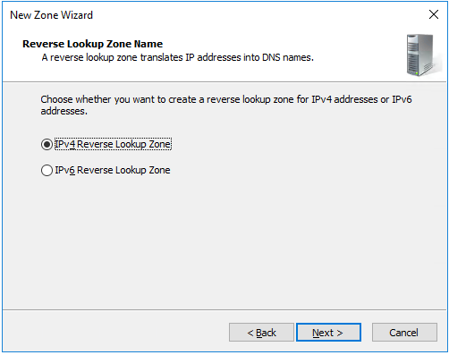
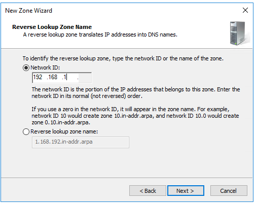
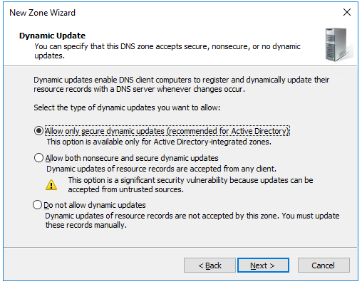
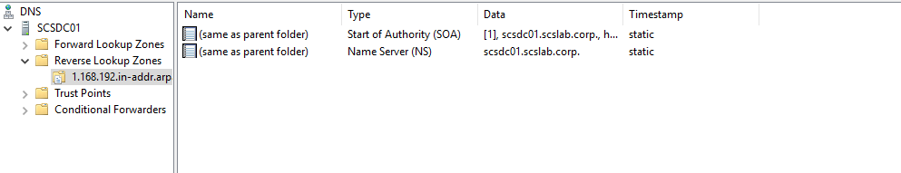

# Task 7- Set up reverse lookup zone

While **Forward Lookup Zones** resolve hostnames to IP addresses, **Reverse Lookup Zones** do the opposite—they map IP addresses back to hostnames. This is especially useful in diagnostics, logging, and verifying system identities in Active Directory environments.

**Why Use a Reverse Lookup Zone?**

- Enables **PTR (Pointer) records** for reverse DNS resolution.
- Improves **network diagnostics** and monitoring.
- Some systems and services (e.g., SMTP servers) require reverse lookups.
- **DCDIAG** and **Event Viewer** logs become more informative with names instead of raw IPs.

**Prerequisites**

- DNS Server role must be installed.
- Static IP addresses should be assigned to servers.
- You should be logged in with administrative privileges.

**Create a Reverse Lookup Zone**

**Using DNS Manager (GUI)**

**Open DNS Manager**

- Press Win + R, type dnsmgmt.msc, and hit **Enter**.

**Expand Your DNS Server Node**

- Expand the tree and right-click **“Reverse Lookup Zones”**.

**Select “New Zone…”**

This opens the **New Zone Wizard**.

**Choose Zone Type**

- Select **Primary Zone**.
- If part of Active Directory, check **“Store the zone in Active Directory”**.

**Replication Scope (if AD-integrated)**

- Choose appropriate replication (e.g., domain-wide or forest-wide).

**Choose Zone Type**

- Choose **IPv4 Reverse Lookup Zone**.

**Enter Network ID**

- For example:
  - If your subnet is 192.168.1.x, enter 192.168.1
- The zone name will become 1.168.192.in-addr.arpa.

**Dynamic Updates**

- Select **Allow only secure dynamic updates** (recommended in AD).

**Finish the Wizard**

