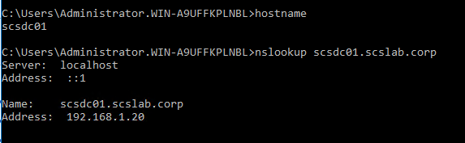
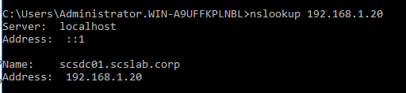
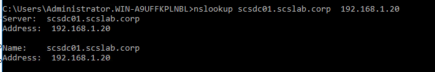

# Task 8 - Test DNS resolution with nslookup

After setting up DNS on a Windows Server — especially in an Active Directory environment — it’s essential to verify that your DNS infrastructure resolves names and IPs correctly. The nslookup command is a simple yet effective tool for that.

**What Is nslookup?**

nslookup (Name Server Lookup) is a command-line utility used to query DNS servers and troubleshoot DNS issues by:

- Resolving **hostnames to IP addresses**
- Performing **reverse lookups** (IP to hostname)
- Testing queries to **specific DNS servers**

**Common nslookup Commands for DNS Testing**

**1. Test Forward DNS Resolution (Hostname** **➜** **IP)**

nslookup scsdc01.scslab.corp

Expected output:

Verifies your DNS server is resolving internal hostnames correctly.

**2. Test Reverse DNS Resolution (IP** **➜** **Hostname)**

nslookup 192.168.1.20

Expected output:

Requires a PTR record in your reverse lookup zone.

**3. Query a Specific DNS Server**

nslookup scsdc01.scslab.corp  192.168.1.20

Useful for testing specific servers when multiple DNS servers are in use.

**4. Check Default DNS Server Used by the Client**

nslookup

Then you can type a hostname at the prompt to test lookups interactively.

**Advanced Testing Tips**

- Use set type=MX or set type=SRV to test specific record types.  
    
  nslookup  
  \> set type=SRV  
  \> \_ldap.\_tcp.dc.\_msdcs.scslab.corp
- 

&nbsp;

- Troubleshooting delayed logons? Test AD-specific SRV records to ensure clients can locate domain controllers.

**Troubleshooting With nslookup**

- **No response or timeout?**
  - Check if the DNS service is running: services.msc → DNS Server
  - Verify the server has a static IP and DNS is configured properly.
- **Wrong IP returned?**
  - Flush cache on client: ipconfig /flushdns
  - Ensure records in the DNS zone are up-to-date.

**Conclusion**

Using nslookup is a fast and effective way to verify your DNS setup on Windows Server. It helps pinpoint resolution issues, test both forward and reverse zones, and ensure your Active Directory environment is functioning correctly.

Tip: Run dcdiag /test:DNS for a complete DNS health check on your domain controller.
