# Task 9 - Install DHCP Server role

In a well-designed Windows Server environment—whether in a homelab or enterprise—separating server roles like **DHCP**, **Active Directory (AD)**, and **DNS** enhances performance, security, and fault tolerance. This post covers how to install the **DHCP Server role** on a separate server (not on your Domain Controller or DNS server).

**Prerequisites**

Before installing the DHCP Server role:

- A new vm installed.
- Ensure the server has a **static IP address**.
- The server must be **joined to the domain** if you want to authorize DHCP.
- Log in with **Domain Admin** rights to authorize the server in AD.

**Step 1: Install DHCP Server Role**

**Server Manager GUI**

1.  Open **Server Manager** on the target server.
2.  Go to **Manage \> Add Roles and Features**.
3.  Proceed through the wizard to the **Server Roles** page.
4.  Check **DHCP Server**.
5.  Click **Next** until you reach the **Confirmation** page, then click **Install**.
6.  After installation, click **Complete DHCP Configuration**.

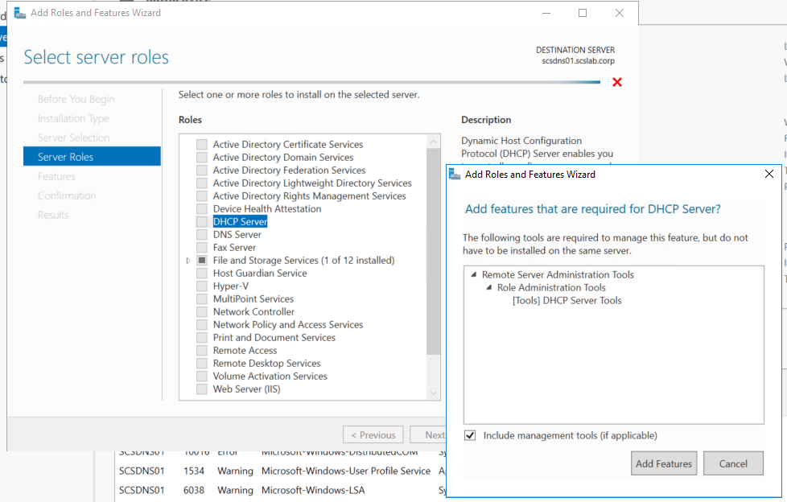

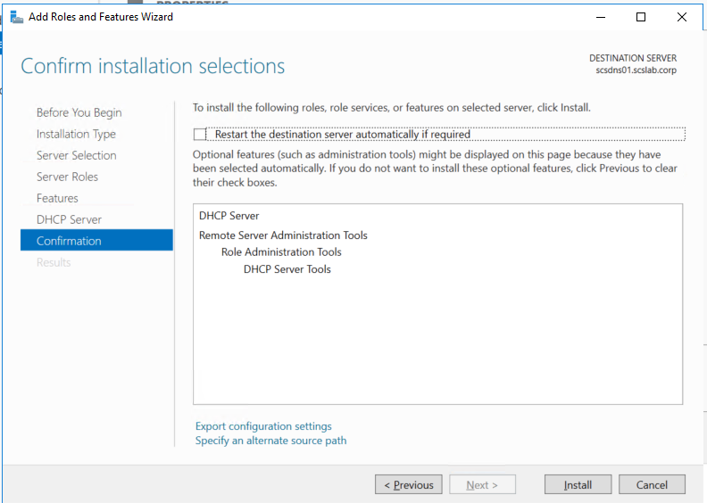

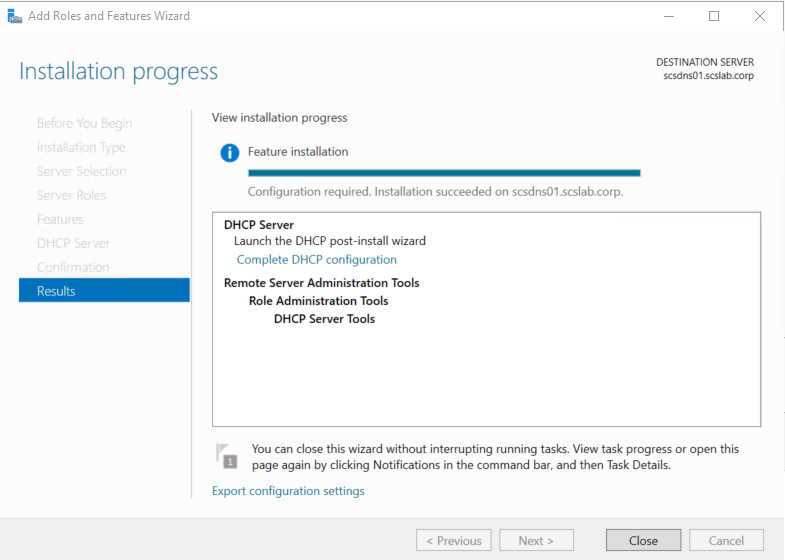

**Step 2: Authorize DHCP Server in AD**

A domain-joined DHCP server must be **authorized** in Active Directory.

**GUI Method:**

Open **DHCP Manager** (dhcpmgmt.msc).

Right-click the server \> **Authorize**.

Wait a few moments, then refresh to see the green check mark.

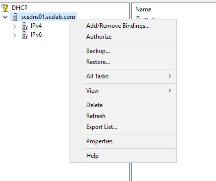

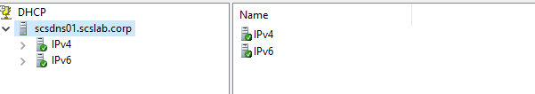

**Step 3: Create a New DHCP Scope**

**GUI Method:**

In **DHCP Manager**, expand the server node.

Right-click **IPv4** \> **New Scope**.

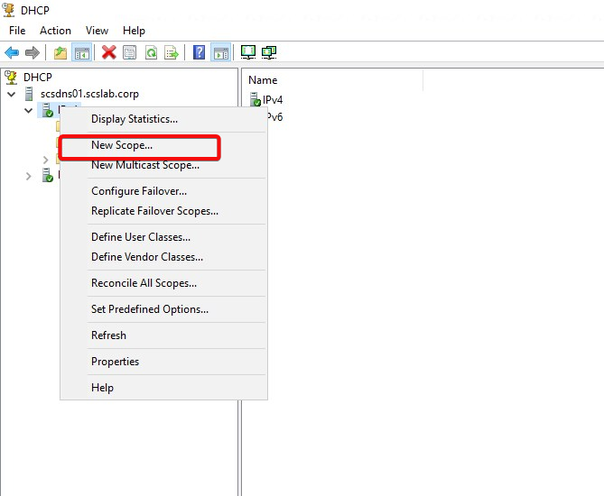

Name your scope (e.g., LAN-Scope).

Define:

- **Start IP**: 192.168.1.100
- **End IP**: 192.168.1.200
- **Subnet Mask**: /24 = 255.255.255.0

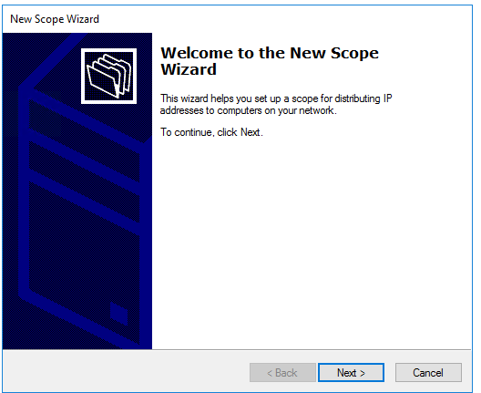

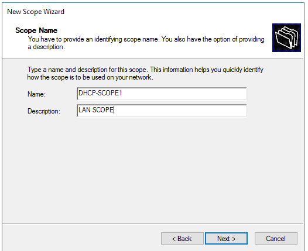

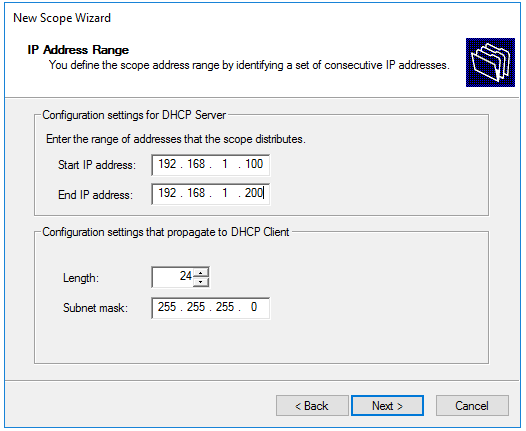

Add exclusions if needed.

Set lease duration (default is 8 days).

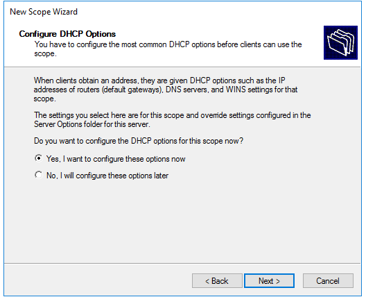

Provide:

**Default Gateway**: 192.168.1.1

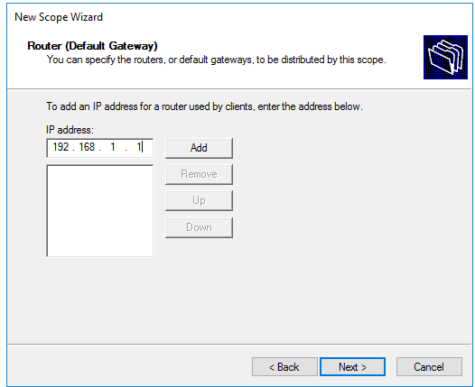

**DNS Server**: e.g., 192.168.1.10 (your DC/DNS)

**Domain Name**: scslab.corp

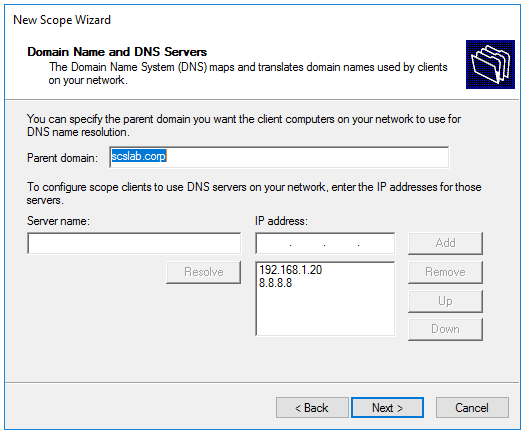

Activate the scope when done.

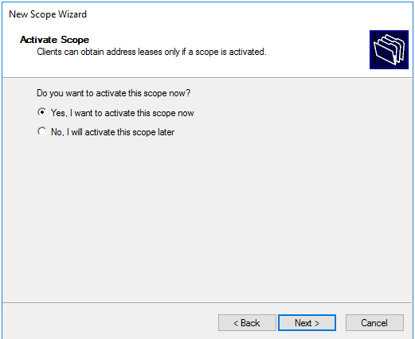

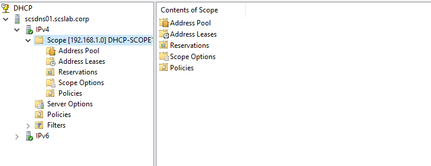

**🔍** **Step 4: Test DHCP Functionality**

- Connect a client VM to the network.
- Ensure it obtains an IP from your defined DHCP range.
- Use ipconfig /all to verify:
  - IP address
  - DHCP server
  - DNS server
  - Lease duration

**🧠** **Tips and Best Practices**

- Use **reservations** for servers or critical devices.
- Always configure **DNS and Gateway options** in the scope.
- Periodically review **DHCP leases and logs**.
- Secure the DHCP role by limiting **admin access**.

**✅** **Conclusion**

Installing DHCP on a separate server provides a modular, scalable network setup and aligns with industry best practices. Whether you're building a production environment or testing in a homelab, separating DHCP from AD/DNS improves manageability and flexibility.
