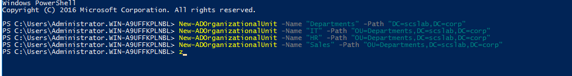
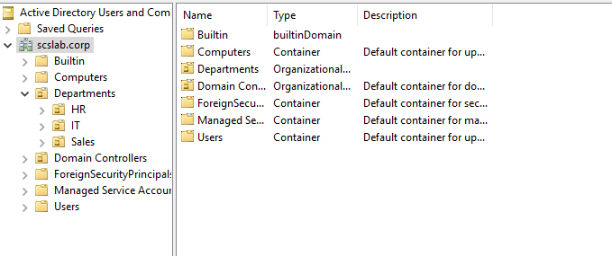
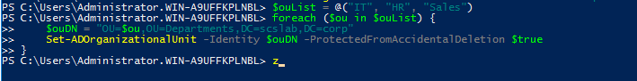

# Task 10 - Create Organizational Units (OUs) for departments

Organizational Units (OUs) are like folders in Active Directory that help you organize and manage users, computers, and groups more efficiently. Creating department-based OUs makes it easier to apply Group Policies, delegate admin tasks, and maintain a clean AD structure.

You can create an OU hierarchy like this:

``` wp-block-code
scslab.corp

├── Departments

│   ├── IT

│   ├── HR

│   └── Sales
```

**Step-by-Step: Creating OUs**

**✅** **Method 1: Using Active Directory Users and Computers (ADUC GUI)**

1.  Open **Server Manager** on your Domain Controller.
2.  Go to **Tools \> Active Directory Users and Computers**.
3.  Right-click your domain (e.g., scslab.corp) \> **New \> Organizational Unit**.
4.  Name the OU (e.g., IT) and check **Protect container from accidental deletion**.
5.  Click **OK**.

**Method 2: Using PowerShell (Fast & Scriptable)**

Open PowerShell as Administrator on your DC:

``` wp-block-code
New-ADOrganizationalUnit -Name "Departments" -Path "DC=scslab,DC=corp"

New-ADOrganizationalUnit -Name "IT" -Path "OU=Departments,DC=scslab,DC=corp"

New-ADOrganizationalUnit -Name "HR" -Path "OU=Departments,DC=scslab,DC=corp"

New-ADOrganizationalUnit -Name "Sales" -Path "OU=Departments,DC=scslab,DC=corp"
```





**Add deletion protection to each OU**

\$ouList = @("IT", "HR", "Sales")

foreach (\$ou in \$ouList) {

    \$ouDN = "OU=\$ou,OU=Departments,DC=scslab,DC=corp"

    Set-ADOrganizationalUnit -Identity \$ouDN -ProtectedFromAccidentalDeletion \$true

}



**Conclusion**

Creating department-based Organizational Units in Active Directory is a foundational step in building a well-structured, scalable, and secure domain environment. Whether for a homelab or enterprise, organizing by function or role will save you time and prevent chaos as your environment grows.
