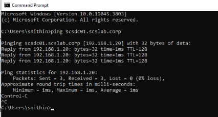
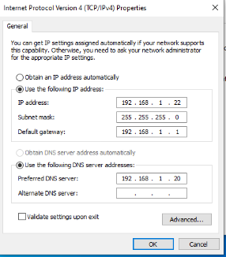
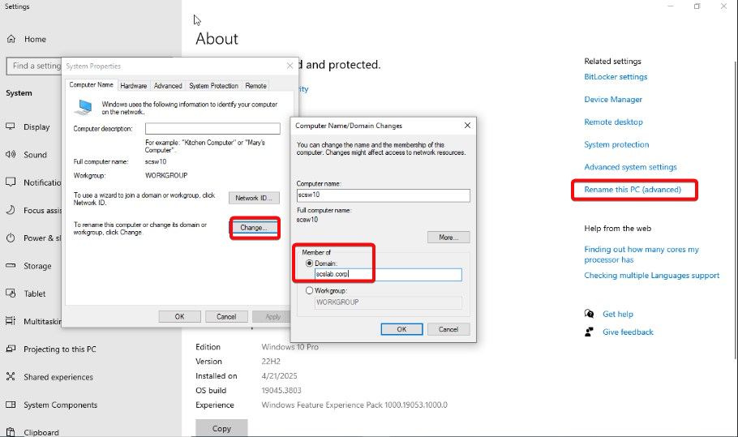
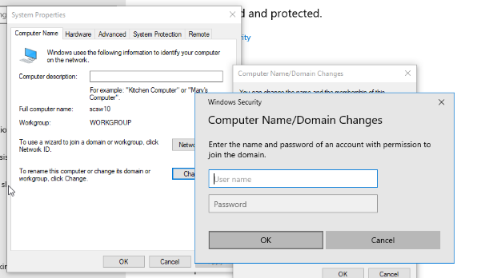
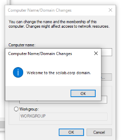
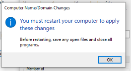

# Task 12- create a client machine and join domain for testing

Joining a **client machine (e.g., Windows 10/11)** to your domain (scslab.corp) is a core part of testing Active Directory, Group Policy, and login behaviors. Here's a step-by-step guide on **creating a client VM** and **joining it to the domain** in your homelab setup.

You can use **Windows 10 or Windows 11** ISO. Here's a recommended setup for Proxmox or VMware Workstation:

|             |           |
|-------------|-----------|
| **Setting** | **Value** |

|            |                   |
|------------|-------------------|
| OS Version | Windows 10/11 Pro |

|      |     |
|------|-----|
| vCPU | 2   |

|     |     |
|-----|-----|
| RAM | 4GB |

|      |      |
|------|------|
| Disk | 40GB |

|         |                                             |
|---------|---------------------------------------------|
| Network | Bridged  (same subnet as domain controller) |

**Important:** Ensure the client can **ping the domain controller** (e.g., ping scsdc01.scslab.corp).

**2. Set the DNS Server to Domain Controller**

On the client machine:

Go to **Network and Sharing Center**

Click **Change adapter settings**

Right-click your adapter → **Properties**

Select **Internet Protocol Version 4 (TCP/IPv4)** → **Properties**

Under "Use the following DNS server address", enter:  
Preferred DNS server: \<IP address of your Domain Controller\>

Click OK and restart the network.

🔍 This ensures the client uses **AD-integrated DNS** to find domain services.

**3. Join the Domain**

Once DNS is set correctly:

Open **System Properties  
**Right-click **This PC** → **Properties** → Click **Rename this PC (advanced)**

Click **Change...** next to “To rename this computer or change its domain...”

Select **Domain**, enter:  
scslab.corp

Click OK

When prompted, enter domain credentials (e.g., administrator)

✅ You should see:

**“Welcome to the scslab.corp domain.”**

1.  Restart the computer when prompted

**Test Domain Login**

Login in to windows 10 client using domain users and validate

**Summary**

You now have a Windows client VM joined to your scslab.corp domain — ready to test logins, GPOs, security groups, and shared resources. This is a crucial part of validating your ADDS environment.
