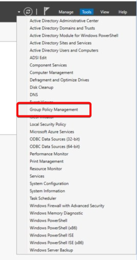
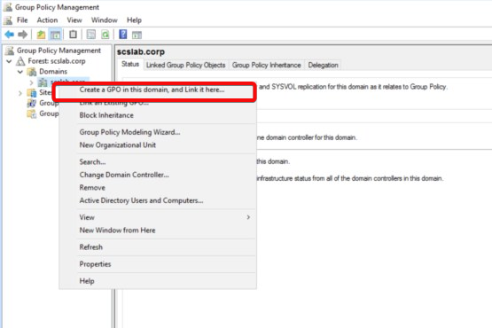
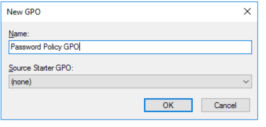
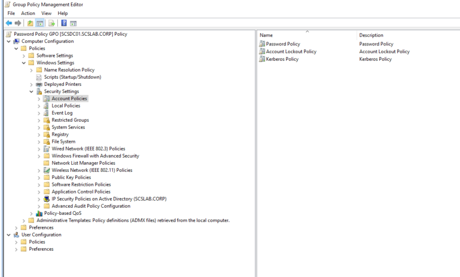
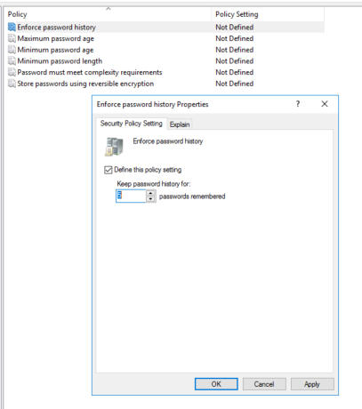
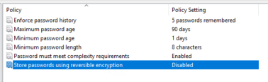
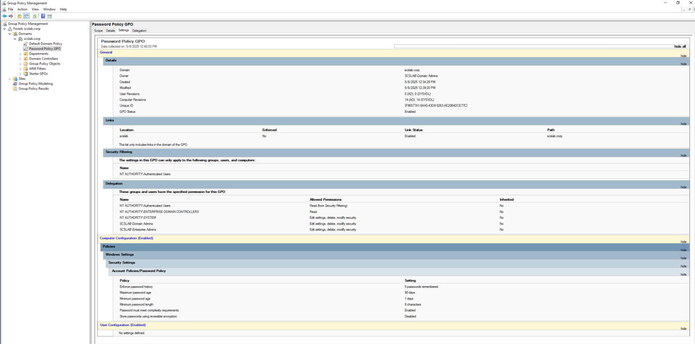
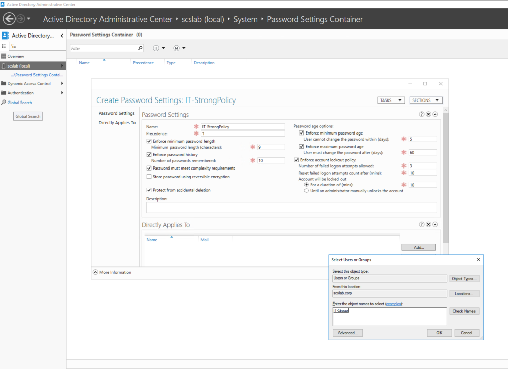
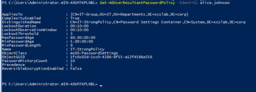

# Task 13- Create GPO for password policy

Password policies help enforce account security by setting rules for complexity, length, and change frequency. In this guide, we'll configure a **domain-wide GPO** to manage password settings centrally.

**Where Should the GPO Be Applied?**

For domain-wide password policies, **apply the GPO at the domain level**:

scslab.corp (Root of the domain)

***Note:*** *Only the Default Domain Policy or a GPO linked to the domain root will control password policy. GPOs linked to OUs won't apply to password policies.*

**Create GPO for Password Policy**

**Open Group Policy Management**

- Log in to your Domain Controller
- Open **Group Policy Management Console (GPMC)**:  
  Start → Administrative Tools → Group Policy Management  
   

**Create a New GPO**

- Right-click on your domain (scslab.corp)
- Click **“Create a GPO in this domain, and Link it here…”**
- Name it something like Password Policy GPO

**Edit the GPO**

- Right-click your new GPO → **Edit**

**Navigate to:**

Computer Configuration  
  └── Policies  
      └── Windows Settings  
          └── Security Settings  
              └── Account Policies  
                  └── Password Policy

**Configure Password Policy Settings**

|                                                 |                        |
|-------------------------------------------------|------------------------|
| **Setting**                                     | **Recommended Value**  |
| **Enforce password history**                    | 5 passwords remembered |
| **Maximum password age**                        | 60 days                |
| **Minimum password age**                        | 1 day                  |
| **Minimum password length**                     | 8 characters           |
| **Password must meet complexity**               | Enabled (✔️)           |
| **Store passwords using reversible encryption** | Disabled (❌)          |

Double-click each setting to configure it.

**Verify Policy Application**

Run on a client machine or DC:

gpresult /h gp.html

Open the gp.html file in a browser and verify the policy is listed under **Computer Settings**.

**Fine-Grained Password Policies (FGPP) in Active Directory**

**Why Use FGPP?**

- Different password lengths/complexity for IT vs. HR
- Stronger rules for admins or remote access users
- Apply lockout thresholds only to specific groups

**Note:**  FGPPs **do not use Group Policy** — they’re configured via Active Directory objects and **apply only to users or global security groups** (not OUs).

**Requirements**

- Domain functional level must be **Windows Server 2008 or higher**
- You must be a **Domain Admin**
- Use either **Active Directory Administrative Center (ADAC)** or **PowerShell**

**Create FGPP via ADAC (GUI)**

1.  Open **Active Directory Administrative Center  
    **(dsac.exe or search for “Active Directory Administrative Center”)
2.  In the left pane, click your domain (scslab.corp)
3.  Under **System → Password Settings Container**
4.  Click **New → Password Settings**

**Fill in details like:**

|                         |                                    |
|-------------------------|------------------------------------|
| **Field**               | **Example**                        |
| **Name**                | IT-StrongPolicy                    |
| **Precedence**          | 1 (lower number = higher priority) |
| **Min Password Length** | 12                                 |
| **Complexity**          | Enabled                            |
| **Password Age**        | Max: 45 days, Min: 1 day           |
| **Lockout Threshold**   | 5 attempts                         |
| **Applies To**          | IT-Group                           |

Click **OK** to save.

**Verify FGPP Application**

Check which policy applies to a user:

Get-ADUserResultantPasswordPolicy -Identity \<username\>

You should see IT-StrongPolicy if the user is in IT-Group.

**Tips**

- **Precedence:** If a user is in multiple groups with different FGPPs, the policy with the **lowest precedence number** wins.
- **OUs are ignored** — FGPPs work only via **direct or group-based assignment**.
- You can assign the same FGPP to multiple groups/users.

**Summary**

Fine-Grained Password Policies give you advanced control over password rules for different groups. Use them when a one-size-fits-all GPO isn’t sufficient — especially in enterprises or tiered access environments.
