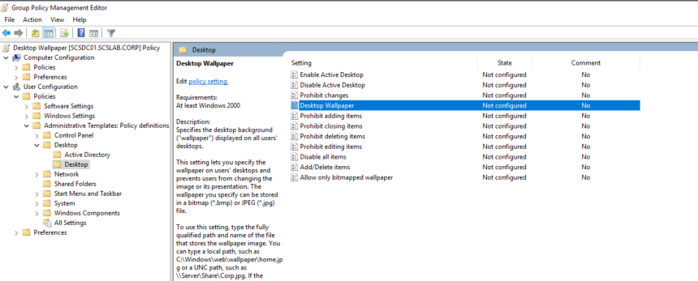
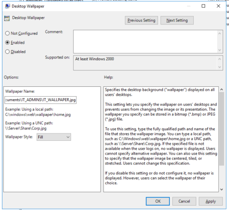
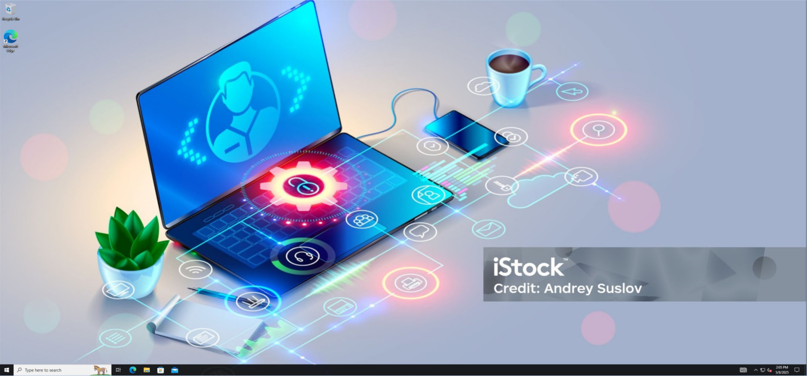

# Task 14- How to Apply GPOs to OUs (Desktop Wallpaper & Screen Lock Example)

**Scenario Example**

You have the following OUs:

- OU=IT,OU=Departments,DC=scslab,DC=corp
- OU=HR,OU=Departments,DC=scslab,DC=corp

And you want:

- A **desktop wallpaper** GPO for IT
- A **screen lock timeout** GPO for HR

**Step-by-Step: Create and Link GPOs**

**1. Open Group Policy Management (GPMC)**

- Run: gpmc.msc
- Navigate to: scslab.corp → Departments → IT  

**2. Create GPO for Desktop Wallpaper (IT OU)**

Right-click OU=IT → **Create a GPO in this domain, and Link it here**

Name it IT - Desktop Wallpaper

1.  

Right-click the GPO → **Edit**

Navigate to:

User Configuration  
  └─ Policies  
     └─ Administrative Templates  
        └─ Desktop  
           └─ Desktop  

Double-click **Desktop Wallpaper**:

- Set to **Enabled**
- Wallpaper Name: [\\scsdc01\netlogon\wallpapers\it-wallpaper.jpg](//scs-dc01/netlogon/wallpapers/it-wallpaper.jpg) *(make sure the file exists)*
- Wallpaper Style: **Fill**

💡 Tip: Store wallpapers in the [\\scsdc01\netlogon shared folder for easy access](//scs-dc01/netlogon%20shared%20folder%20for%20easy%20access).

**Create GPO for Screen Lock Timeout (HR OU)**

1.  Right-click OU=HR → Create new GPO → Name it HR - Screen Lock
2.  Right-click the GPO → Edit

Navigate to:

User Configuration  
  └─ Policies  
     └─ Administrative Templates  
        └─ Control Panel  
           └─ Personalization  

Double-click **Screen saver timeout**:

- Set to **Enabled**
- Time: 900 (15 minutes)

Also set:

- **Enable Screen Saver** → Enabled
- **Force specific screen saver** → e.g., scrnsave.scr
- **Password protect the screen saver** → Enabled

**Test and Verify**

- Login as a user from IT → Check if wallpaper applies

- Login as a user from HR → Wait 15 minutes for screen lock
