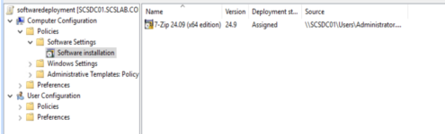
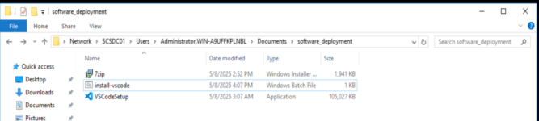
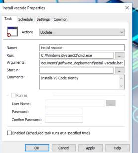
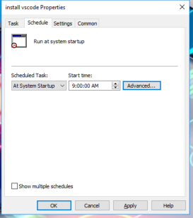
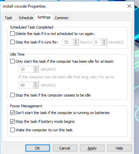
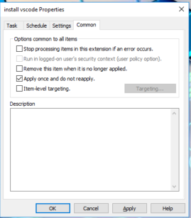
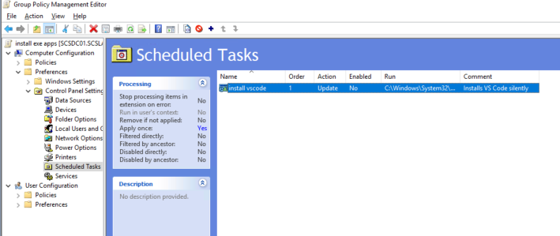

# Task 15- Configure Software Deployment via GPO in Active Directory

Configuring **Software Deployment via Group Policy (GPO)** is a powerful way to automatically install applications (e.g., antivirus, Office tools, custom apps) on domain-joined client machines.

Below is a complete, step-by-step guide to deploy software using GPO in your scslab.corp domain.

**Requirements**

- Software installer must be in **.MSI format** (or wrapped .exe via third-party tool)
- Software share must be on a **network-accessible UNC path**
- Client machines must be **in the target OU**

**1.  Create a Network Share for MSI Files**

On a file server or DC:

1.  Create folder: C:\SoftwareDeployment
2.  Share it as: [\\scsdc01\SoftwareDeployment](//scsdc01/SoftwareDeployment)
3.  Set **Read permissions** for **Domain Computers** group

Example path: [\\scsdc01\SoftwareDeployment\7zip.msi](//scsdc01/SoftwareDeployment/7zip.msi)

**2.  Create and Link a New GPO**

1.  Open **Group Policy Management** (gpmc.msc)
2.  Right-click your target OU → **Create a GPO in this domain and Link it here**
3.  Name it: Software Deployment - 7zip

**3. Edit the GPO to Deploy the Software**

1.  Right-click the GPO → **Edit**
2.  Navigate to:  
      
    Computer Configuration  
      └─ Policies  
         └─ Software Settings  
            └─ Software Installation  
3.  Right-click **Software Installation** → **New → Package**
4.  Browse to: [\\scs-dc01\SoftwareDeployment\7zip.msi](//scs-dc01/SoftwareDeployment/7zip.msi)  
    *(Do NOT use a local drive like C:\\*
5.  Choose **Assigned** → Click OK



**Force Group Policy Update**

On a client PC in the OU:

**gpupdate /force**

Then reboot the PC.

Upon startup, the MSI will install automatically **before login**.

**Deploy .exe Applications via GPO in Active Directory** (One-Time Install)

Deploying .exe applications silently across multiple Windows clients in a domain environment can be efficiently done using Group Policy with Scheduled Tasks. This guide walks you through deploying any .exe application (e.g., installers like Notepad++, Chrome, VLC) as a **one-time install** using Group Policy.

**Why Use GPO with Scheduled Tasks?**

Group Policy's Scheduled Task feature allows you to:

- Deploy applications **once** (prevents reinstallation on every boot)
- Run installers with **SYSTEM privileges**
- Support **silent installation parameters**
- Log installation results for troubleshooting

**Step 1: Prepare Your Installer and Script**

**🔗** **Choose a Shared Network Location**

Store your .exe installer and batch script in a shared folder accessible by domain computers:

[\\scs-dc01\SoftwareDeployment\vscode.exe](//scs-dc01/SoftwareDeployment/vscode.exe)

**Create the Batch Script**

Example: **install-vscode.bat**

``` wp-block-code
@echo off

SET "logfile=%SystemRoot%\Temp\vscode-install.log"

IF EXIST "C:\Program Files\Microsoft VS Code\Code.exe" (

    echo VS Code already installed. >> "%logfile%"

    exit /b

)

echo Installing VS Code... >> "%logfile%"

\\SCSDC01\Users\Administrator.WIN-A9UFFKPLNBL\Documents\software_deployment\VSCodeSetup.exe /VERYSILENT /NORESTART >> "%logfile%" 2>&1

echo Install completed at %DATE% %TIME% >> "%logfile%"
```

Modify the silent parameters (/S, /SILENT, /VERYSILENT, etc.) as per the application documentation.



**Step 2: Create GPO for Scheduled Task**

**✉️** **Open Group Policy Management**

1.  Open gpmc.msc
2.  Right-click your client PCs OU (e.g., ClientPCs) \> **Create a GPO and Link it Here**
3.  Name it: Install VS Code (One-Time Task)
4.  Right-click the GPO \> **Edit**

**⚖️** **Navigate to Scheduled Tasks**

Computer Configuration  
  └─ Preferences  
      └─ Control Panel Settings  
          └─ Scheduled Tasks

**✍️** **Configure New Task**

- **New \> Scheduled Task (At least Windows 7)**

**General Tab:**

- Name: InstallVSCode
- Run whether user is logged on or not
- Run with highest privileges
- User: SYSTEM

**Triggers Tab:**

- Begin task: At startup
- Optional: Delay 30 seconds

**Actions Tab:**

- Action: Start a program
- Program/script: cmd.exe
- Arguments:  
  /c [\\scs-dc01\SoftwareDeployment\install-vscode.bat](//scs-dc01/SoftwareDeployment/install-vscode.bat)

**Settings Tab:**

- Enable: Run as soon as possible if missed
- Enable: Do not start a new instance if running











**🚪** **Step 3: Apply and Test**

1.  Ensure a client machine is in the target OU
2.  Run on client:  
    gpupdate /force  
    shutdown /r /t 0
3.  During boot, the task runs and installs VS Code silently
4.  Check for:
    - C:\Program Files\Microsoft VS Code\Code.exe
    - Log: C:\Windows\Temp\vscode-install.log
    - Task Scheduler: task disappears after running

**✅** **Summary**

|                  |                                                                                                        |
|------------------|--------------------------------------------------------------------------------------------------------|
| **Component**    | **Value**                                                                                              |
| Installer Path   | [\\scs-dc01\SoftwareDeployment\VSCodeSetup-x64.exe](//scs-dc01/SoftwareDeployment/VSCodeSetup-x64.exe) |
| Script Name      | install-vscode.bat                                                                                     |
| Deployment Type  | GPO \> Scheduled Task (One-time)                                                                       |
| Run As           | SYSTEM                                                                                                 |
| Logging Location | C:\Windows\Temp\vscode-install.log                                                                     |

By using a scheduled task in Group Policy, you ensure a professional and efficient deployment of Visual Studio Code in your environment. This approach keeps your startup clean, avoids redundant installs, and provides full automation.
