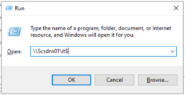
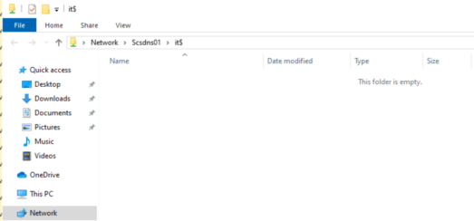
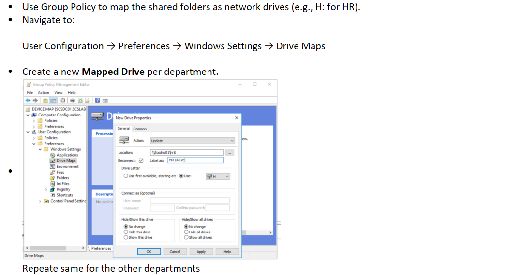

# Task 16- Create and configure shared folders for departments

A step-by-step guide to **create and configure shared folders for departments** in a Windows Server domain environment — ideal for your homelab setup with AD DS and organizational units.

Create and Configure Shared Folders for Departments

#### Step 1: Create Department Folders

&nbsp;

- Log in to your **file server** (e.g., scsdns01 in your lab).
- Create a parent folder (e.g., D:\DeptShares).
- Inside that, create subfolders for each department:

D:\DeptShares\HR

D:\DeptShares\IT

**Step 2: Set NTFS Permissions**

1.  Right-click each folder → **Properties** → **Security** tab.
2.  Click **Edit** → **Add**, and assign permissions:

|               |                        |
|---------------|------------------------|
| **Group**     | **Permissions**        |
| HR_Group      | Modify (for HR folder) |
| IT_Group      | Modify (for IT folder) |
| Domain Admins | Full Control           |

- Remove Everyone or Authenticated Users if not needed.

**Step 3: Share the Folders**

1.  Go to the **Sharing** tab → **Advanced Sharing**.
2.  Check **“Share this folder”**.
3.  Share name example: HR\$ (adding \$ hides the share).
4.  Click **Permissions** and allow access only to the matching group:
    - Remove Everyone.
    - Add HR_Group → Allow: Full Control or Change.
    - Add Domain Admins → Full Control.

Repeat this for each department folder.

**Test Access from Client Machine**

1.  Log in as a test user from the appropriate department.
2.  Press Win + R, enter:  
      
    [\\Scsdns01\it\$](//Scsdns01/it$)
3.  The user should have access only to their own department's folder.

Optional: Map Network Drives via GPO

