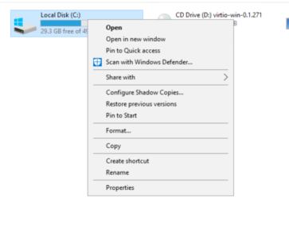
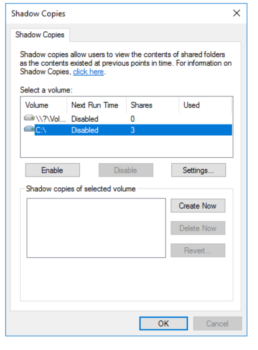
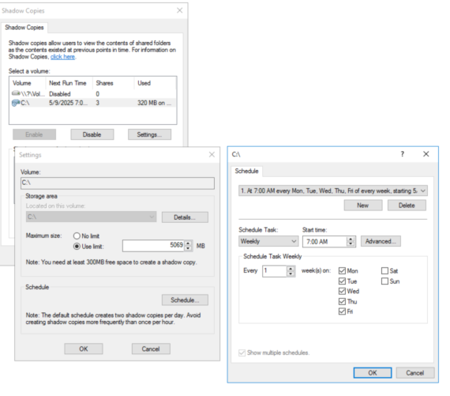
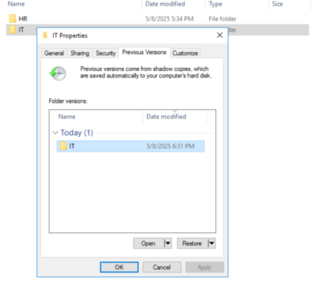

# Task 17 - Enable Volume Shadow Copy

Enabling **Volume Shadow Copy** on a Windows Server allows users to restore previous versions of files stored in shared folders—an excellent feature for file servers in a homelab or production environment.

**How to Enable Volume Shadow Copy on Windows Server**

**Prerequisites:**

- The folder must be on an **NTFS-formatted volume**.
- Ensure the volume (e.g., D:) has **enough free space** for shadow copies.

**Step-by-Step Guide:**

**Open File Explorer  
**Right-click the volume where your shared folders reside (e.g., C:) → Click **Properties**.

**Go to the “Shadow Copies” Tab  
**(If you don’t see it, install the **File Server role** via Server Manager.)

Configure the shadow copies

Select the Volume (e.g., D:) → Click **Enable**.

Confirm the prompt to enable shadow copies.

Click **Settings** to customize:

- **Storage Area**: Choose where the snapshots will be stored (default: same volume).
- **Maximum Size**: Limit how much space is used for snapshots.
- **Schedule**: Set automatic snapshots (e.g., every 12 hours or once a day).

Click **OK** to apply and close.

**What Happens Next?**

- Windows will take automatic snapshots based on your schedule.
- Users can access **previous versions** of files via:  
    
  Right-click file/folder → Properties → Previous Versions

You can also create **manual snapshots** using:

vssadmin create shadow /for=D:
