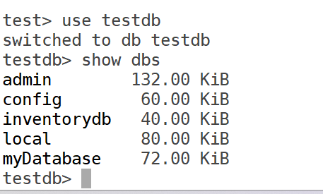
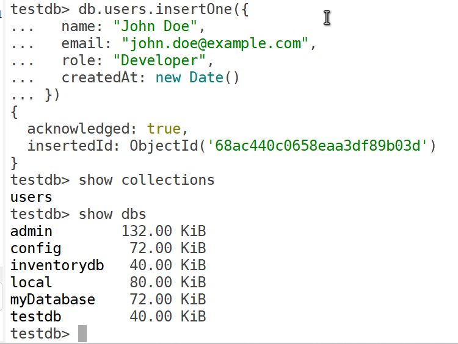
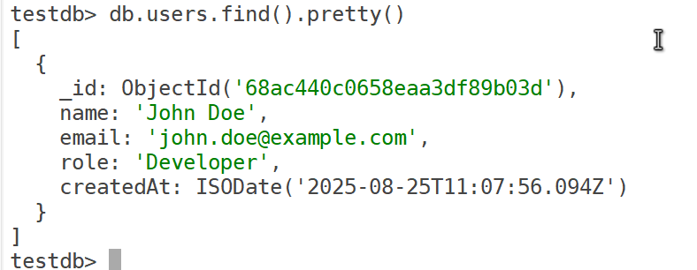
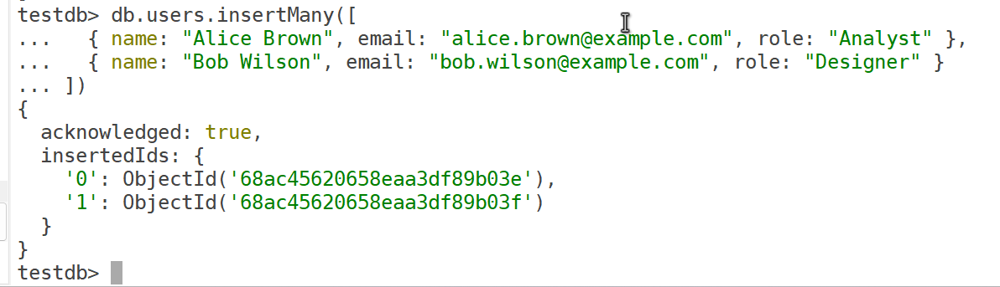
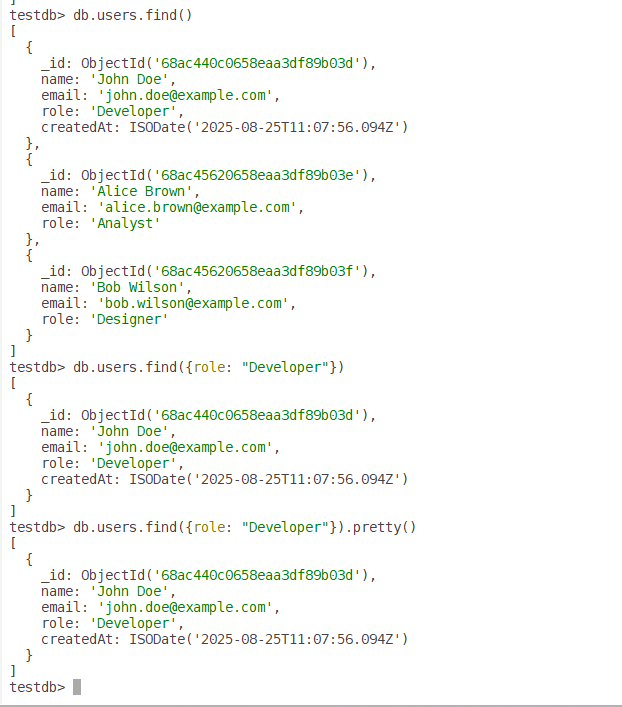

# Creating a Database in MongoDB

In our previous blog posts, we covered installing MongoDB on Oracle Enterprise Linux 8 (OEL 8) (How to Install MongoDB on OEL 8) and connecting to it using the shell and GUI (Connecting to MongoDB on OEL 8). Now, we’ll walk through creating a database in MongoDB 8.0 Community Edition on OEL 8, adding collections, and performing basic operations using mongosh shell We’ll use the admin user (mongoadmin) created earlier for authentication.

## Prerequisites

- MongoDB 8.0 Community Edition installed.
- Admin user (mongoadmin) with a secure password and readWriteAnyDatabase role.
- MongoDB service running (sudo systemctl status mongod).
- mongosh installed (included with mongodb-org package).
- MongoDB Compass installed (optional, for GUI method).
- For remote access: MongoDB configured with bindIp: 0.0.0.0 in /etc/mongod.conf and port 27017 open in the firewall.
- Basic familiarity with MongoDB concepts (databases, collections, documents).

### Creating a Database Using the MongoDB Shell (mongosh)

MongoDB creates databases implicitly when you first store data in them. Let’s create a database and collection using mongosh.

#### Connect to MongoDB

Connect using the mongoadmin user:

``` wp-block-code
mongosh -u mongoadmin -p --authenticationDatabase admin
```

Enter the password when prompted. You’ll see the admin\> prompt.

#### Create a Database

Switch to a new database (e.g., testdb). MongoDB creates it when data is first inserted:

``` wp-block-code
use testdb
```

The use command switches to testdb. If it doesn’t exist, it’s staged for creation.



it created database but it will not listed in above command. Database will be displayed once we created at least one collection.

#### Create a Collection and Insert Data

MongoDB stores data in collections (like tables in relational databases). Create a collection (e.g., users) by inserting a document:

``` wp-block-code
db.users.insertOne({
  name: "John Doe",
  email: "john.doe@example.com",
  role: "Developer",
  createdAt: new Date()
})
```



- db.users: Refers to the users collection in testdb.
- insertOne: Adds a single document (a JSON-like object).
- The database and collection are created automatically upon insertion.

**Verify the insertion:**

``` wp-block-code
db.users.find().pretty()
```



## Additional Operations

### Insert Multiple Documents

you can insert multiple documents at once using below command

``` wp-block-code
db.users.insertMany([
  { name: "Alice Brown", email: "alice.brown@example.com", role: "Analyst" },
  { name: "Bob Wilson", email: "bob.wilson@example.com", role: "Designer" }
])
```



#### Query Data

``` wp-block-code
db.users.find()
db.users.find({role: "Developer"})
db.users.find({ role: "Developer" }).pretty()
```



### Update Data

In mongosh:

``` wp-block-code
db.users.updateOne(
  { email: "john.doe@example.com" },  // Query (filter)
  { $set: { role: "Senior Developer" } } // Update action
)
```

**`updateOne()`**  
Updates **a single document** in the collection that matches the given filter.

- If multiple documents match, only the **first match** will be updated.
- If no document matches, nothing happens.

#### Delete Data

``` wp-block-code
db.users.deleteOne({ email: "john.doe@example.com" })
```

### Explanation:

1.  **`db.users`**  
    Refers to the `users` collection in the current database.
2.  **`deleteOne()`**  
    Deletes **a single document** that matches the given filter.
    - If multiple documents match, only the **first match** is deleted.
    - If no document matches, nothing happens.
3.  **Filter (`{ email: "john.doe@example.com" }`)**  
    Specifies the condition to find the document.  
    Here, MongoDB will delete the document where `email` equals `"john.doe@example.com"`.

## Best Practices

- Use meaningful database and collection names (e.g., inventory, orders).
- Index fields for faster queries (e.g., db.users.createIndex({ email: 1 })).
- Back up data regularly using mongodump.
- For production, enable TLS/SSL and restrict bindIp to trusted IPs.

## Conclusion

We created a MongoDB database (myDatabase) and collection (users) on OEL 8 using mongosh. These method allow you to manage data efficiently, with the shell suited for automation. For advanced topics like indexing or backups, refer to the MongoDB Documentation.
