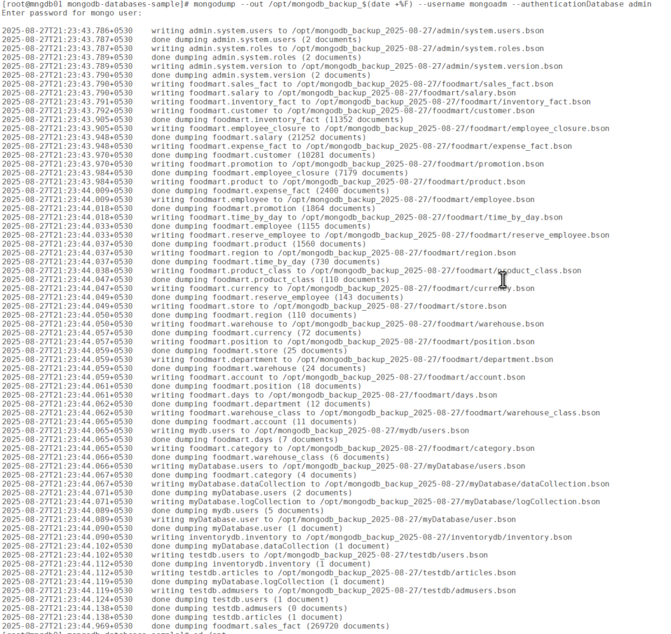
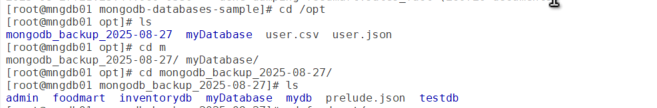
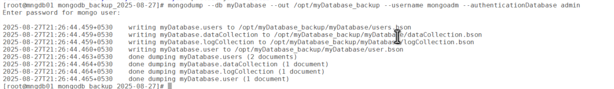
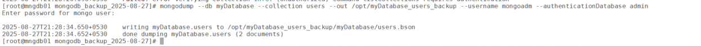
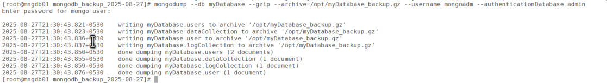
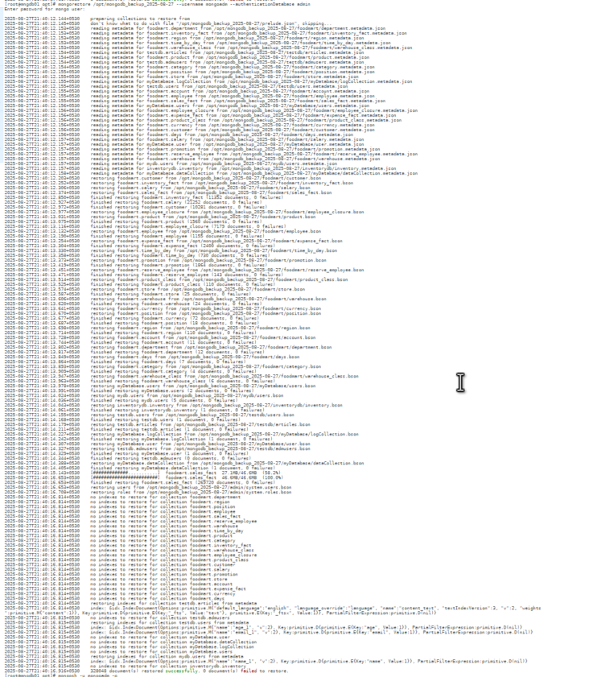
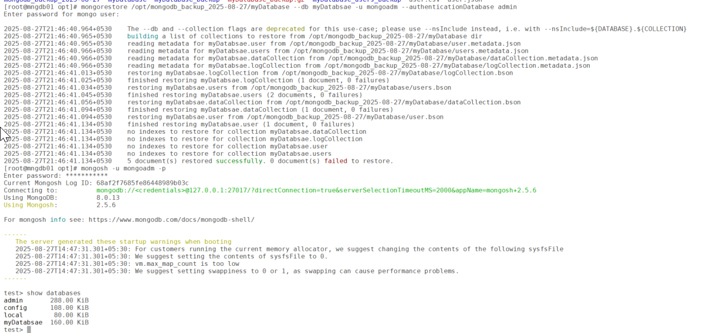

# Database Backup and Restore Using mongodump and mongorestore in MongoDB

Backing up and restoring a MongoDB database is a critical task for ensuring data integrity and availability, whether for disaster recovery, migrations, or testing. MongoDB provides two powerful command-line utilities, mongodump and mongorestore, for logical backups and restores. These tools export and import data in BSON format, preserving the database’s structure, including collections, indexes, and metadata. In this blog post, we’ll walk through how to use mongodump and mongorestore, explore their use cases, provide step-by-step examples, and highlight best practices and limitations to help you manage your MongoDB backups effectively.

## What Are mongodump and mongorestore?

- **mongodump**: A utility that creates a binary export of MongoDB data in BSON format, capturing entire databases, specific collections, or filtered data. It’s ideal for logical backups and supports point-in-time recovery for replica sets.
- **mongorestore**: A utility that restores BSON data created by mongodump into a MongoDB instance, recreating databases, collections, and indexes.

These tools are part of the MongoDB Database Tools package and are well-suited for small to medium-sized deployments, migrations, and disaster recovery.

## Step-by-Step Guide to Using mongodump and mongorestore

### Prerequisites

- **MongoDB Installation**: Ensure MongoDB and the Database Tools package are installed. Download from MongoDB’s official site if needed.
- **Access Permissions**: Have find privileges for mongodump (e.g., backup role) and insert, createCollection privileges for mongorestore (e.g., restore role).
- **MongoDB Instance**: A running MongoDB instance (local or remote) with sample data for testing.
- **Disk Space**: Ensure sufficient disk space for backup files, especially for large databases.

### Steps for mongodump

**Backup All Databases**:

``` wp-block-code
mongodump --out /backup/mongodb_backup_$(date +%F)
```





**Backup a Specific Database**:

``` wp-block-code
mongodump --db myDatabase --out /opt/myDatabase_backup --username mongoadm --authenticationDatabase admin
```



**Backup a Specific Collection**:

``` wp-block-code
mongodump --db myDatabase --collection users --out /opt/myDatabase_users_backup --username mongoadm --authenticationDatabase admin
```



**Backup with Compression**:

``` wp-block-code
mongodump --db myDatabase --gzip --archive=/opt/myDatabase_backup.gz --username mongoadm --authenticationDatabase admin
```



## Steps for mongorestore

#### **Restore All Databases**:

``` wp-block-code
mongorestore /opt/mongodb_backup_2025-08-27 --username mongoadm --authenticationDatabase admin
```



**Restore a Specific Database**:

``` wp-block-code
mongorestore /opt/mongodb_backup_2025-08-27/myDatabase --db myDatabsae -u mongoadm --authenticationDatabase admin
```



**Restore a Specific Collection**:

``` wp-block-code
mongorestore --db mydb --collection users /backup/users_backup/mydb/users.bson -u mongoadm --authenticationDatabase admin
```

**Restore with Drop**:

``` wp-block-code
mongorestore --db mydb --drop /backup/mydb_backup/mydb -u mongoadm --authenticationDatabase admin
```

Explanation: Drops the existing mydb database before restoring to avoid duplicates.

**Restore from Compressed Archive**:

``` wp-block-code
mongorestore --gzip --archive=/backup/mydb_backup.gz -u mongoadm --authenticationDatabase admin
```

Explanation: Restores from a compressed .gz archive.

**Restore with No Index Creation**:

``` wp-block-code
mongorestore --noIndexRestore --db mydb /backup/mydb_backup/mydb -u mongoadm --authenticationDatabase admin
```

Explanation: Skips index creation, useful for manual index management or performance optimization.

### Common Options

- --out, --archive: Specify output directory or archive file for mongodump.
- --gzip: Enable compression for backups/restores.
- --oplog, --oplogReplay: Enable point-in-time recovery for replica sets.
- --drop: Drop target collections/databases before restoring.
- --host, --port, --uri: Connect to local or remote MongoDB instances.
- --ssl: Use SSL/TLS for secure connections.
- --nsInclude, --nsExclude: Filter namespaces (databases/collections) for backup/restore.

## Use Cases for mongodump and mongorestore

1.  **Disaster Recovery**:
    - Create regular backups of critical databases to recover from data loss due to hardware failures, human errors, or corruption.
    - Example: Back up a production database nightly and restore it to a new instance after a crash.
2.  **Database Migration**:
    - Move databases between servers, environments (e.g., dev to prod), or MongoDB versions.
    - Example: Migrate mydb from an on-premises server to a cloud-hosted MongoDB instance.
3.  **Testing and Development**:
    - Create snapshots of production data for testing or development environments.
    - Example: Restore a production backup to a staging server for QA testing.
4.  **Point-in-Time Recovery**:
    - Restore replica sets to a specific point in time using oplog entries, minimizing data loss.
    - Example: Recover a database to its state before an accidental data deletion.
5.  **Archiving**:
    - Archive historical data in BSON format for compliance or auditing purposes.
    - Example: Back up a transactions collection for regulatory retention.

## Limitations of mongodump and mongorestore

1.  **Performance Impact on Large Deployments**:
    - **Issue**: mongodump can strain resources on running mongod instances, especially for large datasets.
    - **Impact**: May cause slowdowns in production environments.
    - **Workaround**: Run backups during low-traffic periods or use tools like MongoDB Atlas for managed backups.
2.  **No Atomicity for Sharded Clusters with Transactions**:
    - **Issue**: For MongoDB 4.2+ sharded clusters with in-progress transactions, mongodump cannot guarantee atomicity.
    - **Impact**: Inconsistent backups for distributed systems.
    - **Alternative**: Use MongoDB Atlas, Cloud Manager, or Percona Backup for MongoDB for sharded clusters.
3.  **Excludes** local **Database**:
    - **Issue**: mongodump skips the local database (containing oplog for replica sets) unless explicitly included.
    - **Impact**: Manual inclusion of oplog via --oplog is required for point-in-time recovery.
    - **Workaround**: Always use --oplog for replica set backups.
4.  **Manual Handling of Users and Roles**:
    - **Issue**: mongodump doesn’t back up user/role configurations in the admin database by default.
    - **Impact**: Authentication settings must be recreated or explicitly backed up.
    - **Workaround**: Include --db admin in mongodump to capture user data.
5.  **Resource Requirements**:
    - **Issue**: Backups require significant disk space and memory, especially without --gzip.
    - **Impact**: Large databases may strain storage systems.
    - **Workaround**: Use --gzip or --archive for compression.
6.  **No Incremental Backups**:
    - **Issue**: mongodump creates full backups each time, unlike incremental backup solutions.
    - **Impact**: Increased storage and time for frequent backups.
    - **Alternative**: Use MongoDB Atlas or Percona Backup for incremental options.

## Best Practices for mongodump and mongorestore

1.  **Automate Backups**:
    - Use cron jobs or automation tools (e.g., cron on Linux) to schedule regular mongodump runs:`0 2 * * * mongodump --db mydb --gzip --archive=/backup/mydb_$(date +%F).gz`
    - Example: Runs daily at 2 AM.
2.  **Enable Compression**:
    - Use --gzip or --archive to reduce backup file sizes and save storage.
3.  **Use Point-in-Time Recovery**:
    - Always include --oplog for replica set backups and --oplogReplay for restores to ensure consistency.
4.  **Test Restores**:
    - Periodically restore backups to a sandbox environment to verify integrity and practice recovery procedures.
5.  **Secure Backups**:
    - Use --ssl for secure connections and encrypt backup files (e.g., with AES-256) for sensitive data.
    - Store backups in secure, off-site locations (e.g., AWS S3, Google Cloud Storage).
6.  **Monitor and Validate**:

- Monitor backup processes for errors and validate restored data using MongoDB shell queries:

``` wp-block-code
db.users.countDocuments()
db.users.getIndexes()
```

## Conclusion

mongodump and mongorestore are robust tools for logical backups and restores in MongoDB, offering flexibility for disaster recovery, migrations, and testing. Their ability to preserve data types, indexes, and oplogs (for replica sets) makes them more comprehensive than mongoexport/mongoimport. However, limitations like performance impacts on large deployments and lack of atomicity for sharded clusters mean they’re best suited for small to medium-sized setups. For enterprise-grade or sharded environments, consider MongoDB Atlas, Ops Manager, or Percona Backup for MongoDB.
