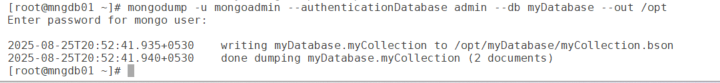
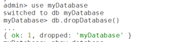
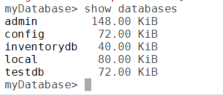

# Dropping a Database in MongoD

This guide explains how to drop (delete) a MongoDB database using the mongosh shell. We’ll use the myDatabase database created previously and the mongoadmin user for authentication. Dropping a database is a destructive action, so proceed with caution.

## Prerequisites

- MongoDB 8.0 Community Edition installed.
- Admin user (mongoadmin) with readWriteAnyDatabase and userAdminAnyDatabase roles.
- MongoDB service running (sudo systemctl status mongod).
- mongosh installed (included with mongodb-org).
- MongoDB Compass installed (optional, for GUI method).
- For remote access: MongoDB configured with bindIp: 0.0.0.0 in /etc/mongod.conf and port 27017 open.
- Backup any critical data before dropping a database (e.g., using mongodump).

## Important Warning

Dropping a database permanently deletes it and all its collections and documents. Always create a backup before proceeding:

``` wp-block-code
mongodump -u mongoadmin --authenticationDatabase admin --db myDatabase --out /path-to-backup
```



#### Dropping a Database Using the MongoDB Shell (mongosh)

The mongosh shell provides a straightforward command to drop a database.

#### Connect to MongoDB

Connect using the mongoadmin user:

``` wp-block-code
mongosh -u mongoadmin -p --authenticationDatabase admin
```

Enter the password when prompted. You’ll see the admin\> prompt.

Verify the Database Existance

List available databases to confirm the target database exists:

``` wp-block-code
show databases
```

#### Drop the Database

Switch to the database you want to delete (e.g., myDatabase):

``` wp-block-code
use myDatabase
```

Drop the database:

``` wp-block-code
db.dropDatabase()
```

This deletes myDatabase and all its collections.



#### Confirm Deletion

``` wp-block-code
show databases
```

myDatabase should no longer appear.



**Exit the Shell**

``` wp-block-code
exit
```

## Troubleshooting

- **Permission Denied**: Ensure the mongoadmin user has readWriteAnyDatabase privileges. If not, recreate the user with proper roles:

``` wp-block-code
test> use myDatabase
switched to db myDatabase
myDatabase> db.dropDatabase()
MongoServerError[Unauthorized]: not authorized on myDatabase to execute command { dropDatabase: 1, lsid: { id: UUID("c0782ad2-d8d6-40f4-b661-dc8478569459") }, $db: "myDatabase" }
```

existing privilleges to mongoadmin

``` wp-block-code
myDatabase> db.runCommand({ connectionStatus: 1 })
...
{
  authInfo: {
    authenticatedUsers: [ { user: 'mongoadmin', db: 'admin' } ],
    authenticatedUserRoles: [
      { role: 'readWriteAnyDatabase', db: 'admin' },
      { role: 'userAdminAnyDatabase', db: 'admin' }
    ]
  },
  ok: 1
}
```

##### Grant the right role

Switch to `admin` database and grant your user the right privilege:

``` wp-block-code
use admin
db.grantRolesToUser(
  "mongoadmin",
  [ { role: "dbAdmin", db: "myDatabase" } ]
)
```

or if you want full access:

``` wp-block-code
db.grantRolesToUser(
  "mongoadmin",
  [ { role: "readWrite", db: "myDatabase" }, { role: "dbAdmin", db: "myDatabase" } ]
)
```

## Best Practices

- **Backup First**: Always back up critical databases using mongodump before dropping:

``` wp-block-code
mongodump -u mongoadmin --authenticationDatabase admin --db myDatabase --out /path/to/backup
```

- **Double-Check Database Name**: Ensure you’re dropping the correct database, as the action is irreversible.
- **Restrict Access**: Use specific users with limited roles for non-admin tasks to prevent accidental deletions.
- **Audit Logs**: Enable MongoDB auditing to track database operations for accountability.

## Conclusion

You’ve learned how to drop a MongoDB database (myDatabase) using mongosh. This is a critical operation, so always verify the database name and back up data beforehand. For further details on database management, refer to the MongoDB Documentation.
