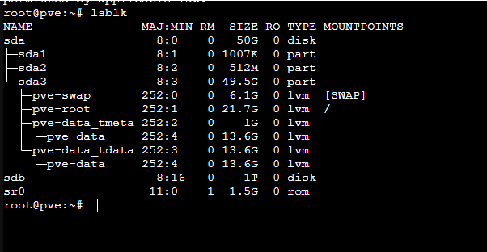
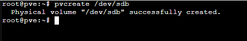
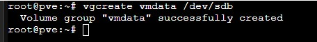
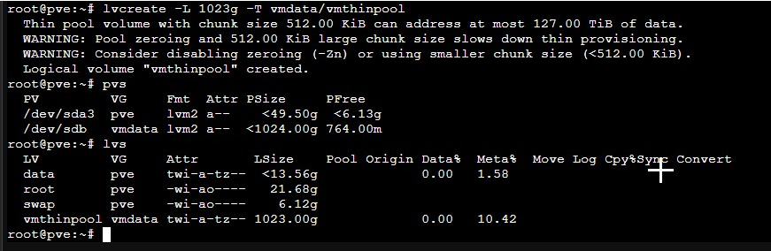
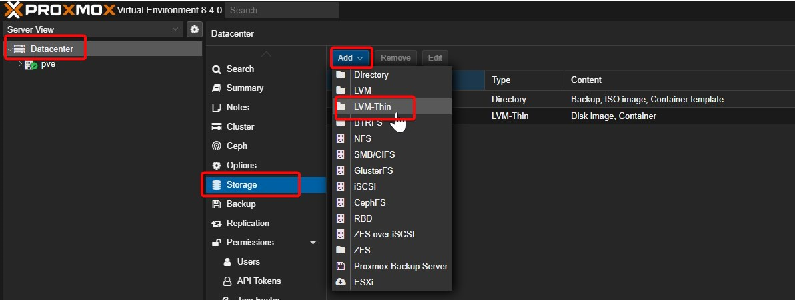
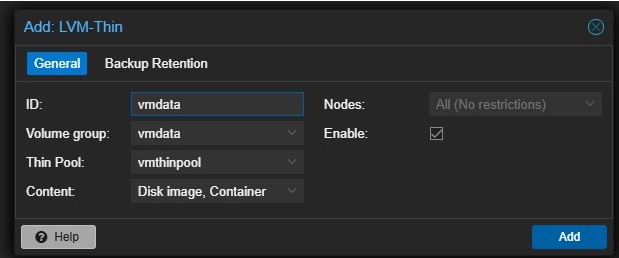
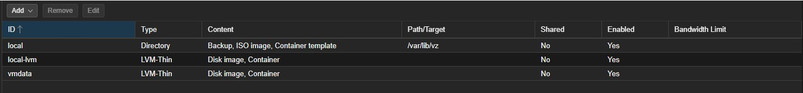

# 📖 How to Add Additional Storage Disks to Proxmox VE

Once you’ve got your **Proxmox VE server** up and running, adding extra storage disks for your VMs, backups, or ISO images is often one of the next important steps. Whether you’re using a physical bare-metal server or a VM, Proxmox makes disk management straightforward.

This guide walks you through adding and configuring extra storage disks in Proxmox VE.

------------------------------------------------------------------------

## 📦 Prerequisites

- A running **Proxmox VE** installation
- Additional disk(s) attached to your server (physical or virtual)
- Basic Linux shell access (via the Proxmox web GUI terminal or SSH)

------------------------------------------------------------------------

🔍 Step 1: Identify the New Disk

Login to your Proxmox shell and run:

``` wp-block-code
lsblk
```



Here, `sdb` is your new unformatted disk.

## 📝 Step 2: Create a Physical Volume (PV)



**Step 3: Create a Volume Group (VG)**

Create a volume group for this disk:



**Step 4: Create a Thin Pool Logical Volume (LV)**



**Step 5: Add the Thin Pool to Proxmox**

Now, head to the **Proxmox Web UI**:

- Go to **Datacenter \> Storage**
- Click **Add \> LVM-Thin**
- Set:
  - **ID:** e.g., vmdata
  - **Volume group:** vmdata
  - **Thin Pool:** vmthinpool
  - Select **Content types** (Disk images, etc.)
- Click **Add**







Your new storage should now appear in the **Storage View**!

## 🎉 That’s It!

You’ve successfully added a new disk to your **Proxmox VE server**. You can now start using it to host VMs, store ISOs, or back up your virtual machines.

## 💡 Bonus Tip:

To add multiple disks, just repeat Steps 1–7 for each new disk.
