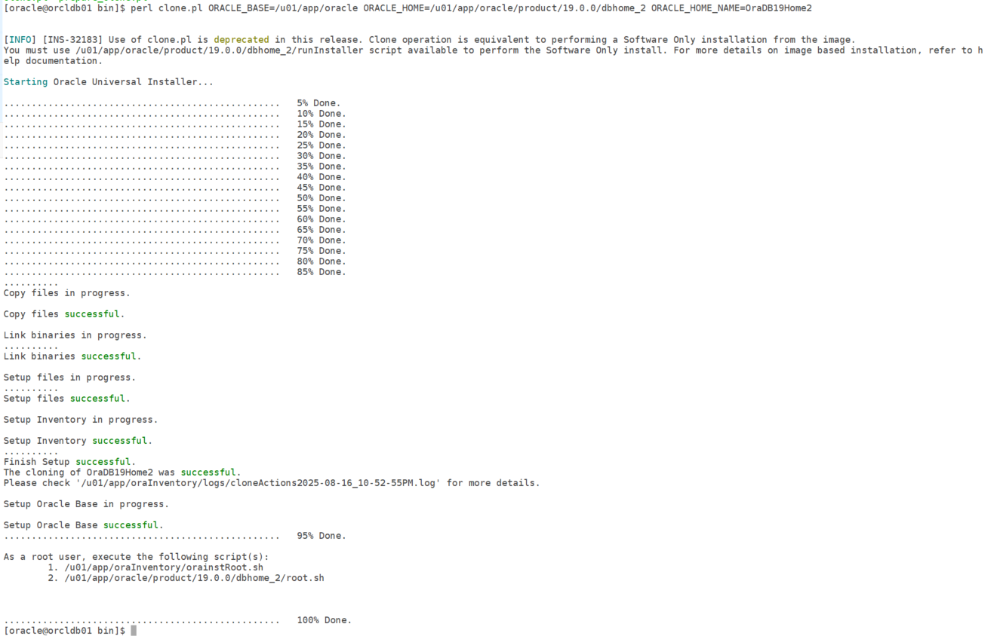

# How to Clone an Oracle 19c Oracle Home

Cloning an Oracle Home is one of the quickest ways to provision a new Oracle software environment without going through a full installation process. This is especially useful when you need multiple Oracle homes on the same server or want to replicate a working Oracle home across different servers.

In this post, I’ll walk you through the **step-by-step process of cloning an Oracle Database 19c Oracle Home**.

## Why Clone an Oracle Home?

- Save time by avoiding a full installation.
- Ensure consistency across environments (Dev → Test → Prod).
- Apply patches once and reuse the patched home elsewhere.
- Quickly provision homes for testing or upgrades.

### Steps to Clone an Oracle 19c Home

#### Prepare the Source Oracle Home

Before cloning, make sure your source Oracle home is healthy:

``` wp-block-code
$ORACLE_HOME/OPatch/opatch lsinventory
```

- Verify patch levels.
- Stop databases and listeners running from this home (if needed).

#### Copy Oracle Home to Target Location

Clone the Oracle home by copying the directory.

``` wp-block-code
cp -pr /u01/app/oracle/product/19.0.0/dbhome_1 \
      /u01/app/oracle/product/19.0.0/dbhome_2
```

#### Run the Clone Utility

Once the directory is copied, reconfigure it with the clone script:

``` wp-block-code
cd /u01/app/oracle/product/19.0.0/dbhome_2/clone/bin

perl clone.pl ORACLE_BASE=/u01/app/oracle \
              ORACLE_HOME=/u01/app/oracle/product/19.0.0/dbhome_2 \
              ORACLE_HOME_NAME=OraDB19Home2
```

**Parameters explained:**

- `ORACLE_BASE` → Base Oracle directory.
- `ORACLE_HOME` → Path of the cloned home.
- `ORACLE_HOME_NAME` → Unique inventory name for this Oracle home.



## Notes & Best Practices

- Always ensure the **source and target servers** have the same OS, patch level, and prerequisites before cloning.
- Use cloning in combination with **OPatch** to simplify patch management across multiple environments.

## Conclusion

Cloning an Oracle 19c home is a powerful technique to save time, ensure consistency, and reduce administrative effort. Whether you’re setting up a new environment, preparing for upgrades, or simply testing patches, cloning provides a quick and reliable solution.
