# How to Configure VMware ESXi to Use PFSense

f you’re running a **home lab** or managing a virtualized environment with **VMware ESXi**, setting up **PFSense as a virtual firewall** is a fantastic way to manage network traffic, VPN, and firewall rules within your virtual infrastructure.

Let’s walk through the steps to deploy and configure **PFSense on VMware ESXi**.

i have a esxi running on vmware workstation. i have attached the host-only network that is configured from the previous blog post.

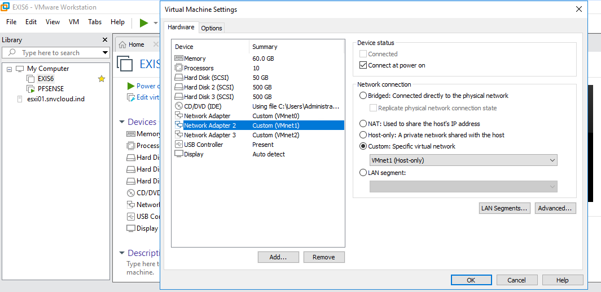

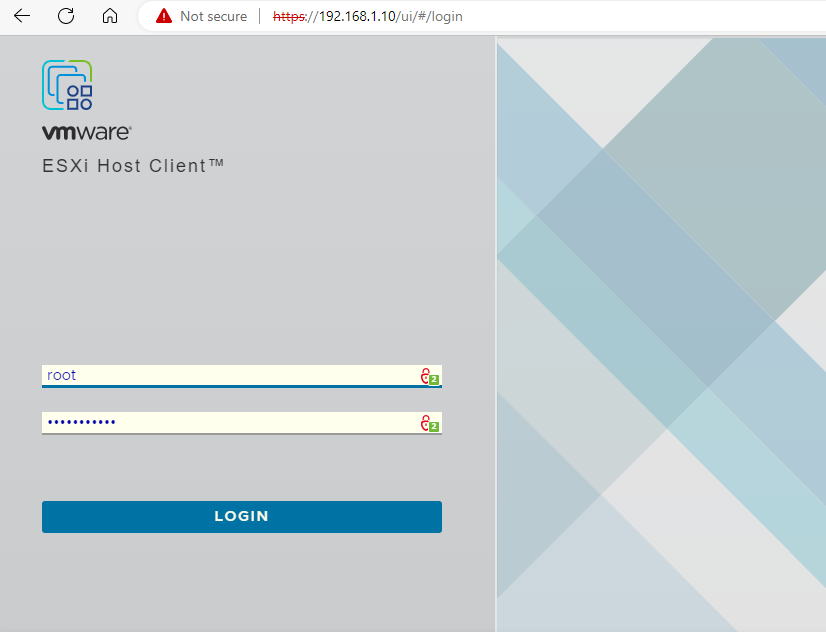

we have 3 physical NIC's

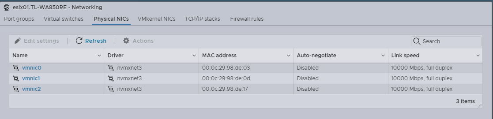

create a virtual switch and assign a vnic as uplink

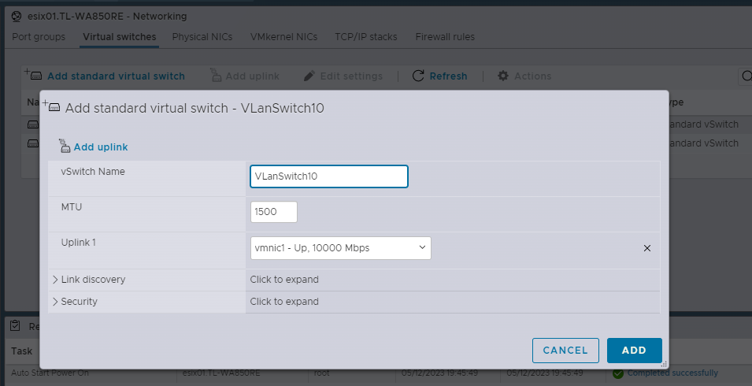

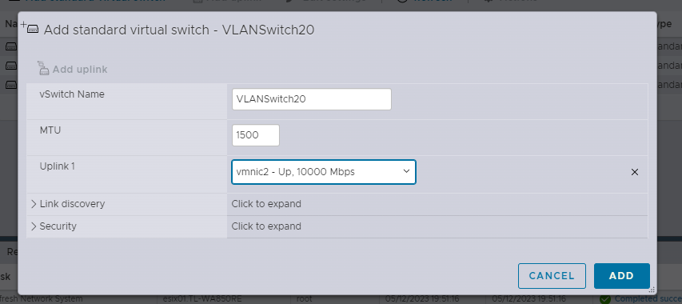

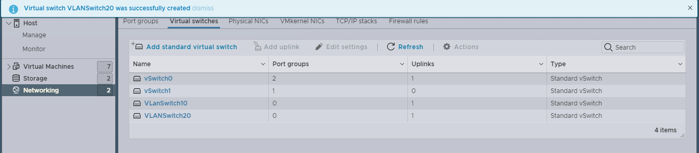

now create port group and attach virtual switch to it.

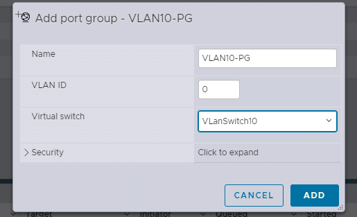

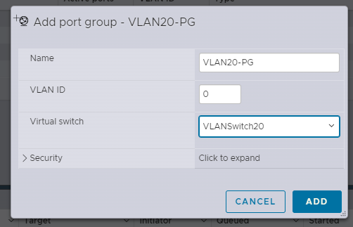

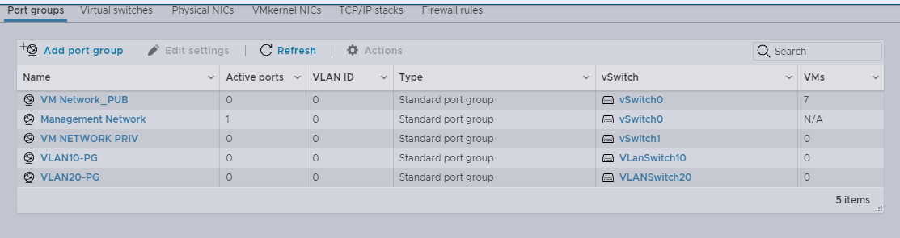

for this blog post i have created a windows vm and attached vlan 10 network adapter.

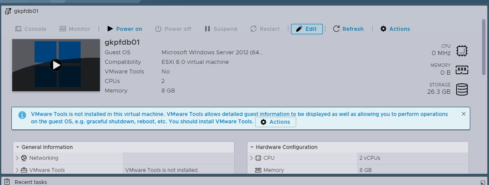

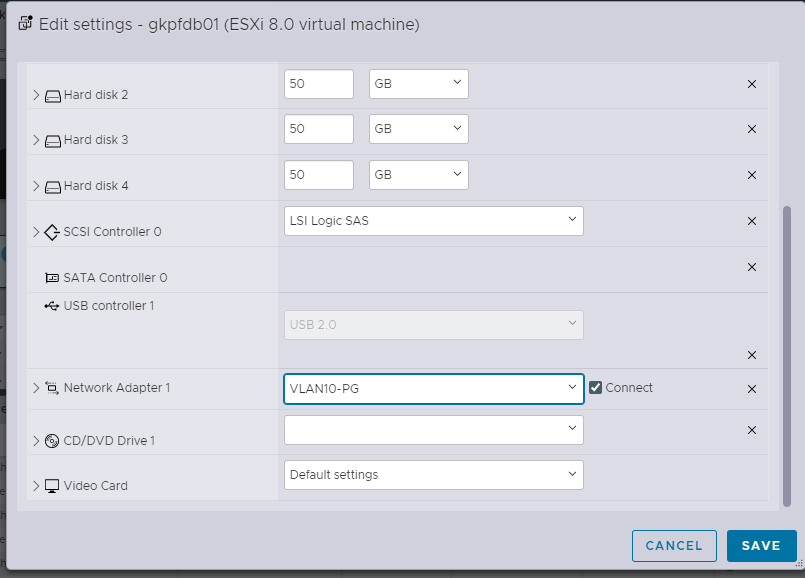

configured static ip address

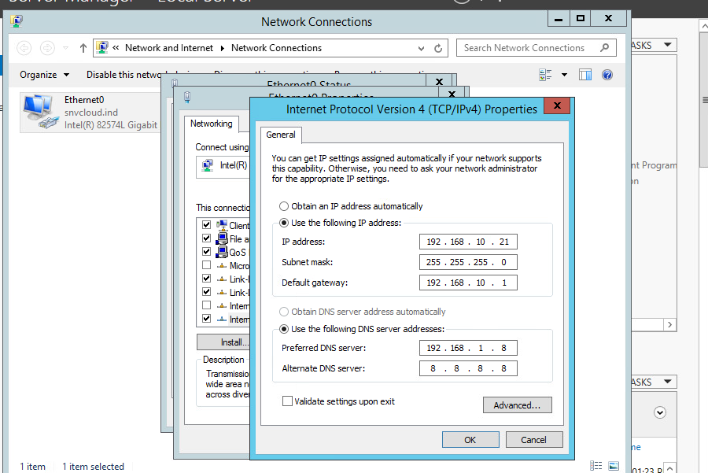

i have able to access the internet using pfsense network which we are using as vlans

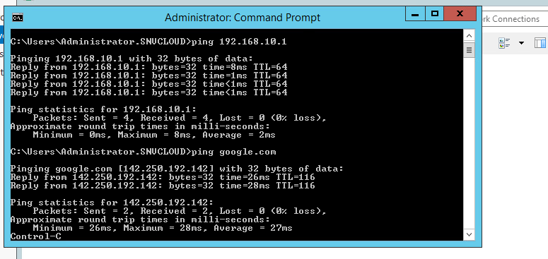

## Isolate Test Networks

Create isolated vSwitches within ESXi for test VMs, DMZ zones, or VPN-only networks, and let PFSense manage traffic between them — perfect for homelabs and security testing.
