# How to Create a Linux Virtual Machine (VM) in Proxmox VE

Once you’ve got your **Proxmox VE server** installed and configured, one of the first things you’ll want to do is spin up a **Linux VM**. Proxmox VE makes this process intuitive with its powerful web-based management interface.

This step-by-step guide will walk you through creating a Linux VM in Proxmox VE.

## 📦 Prerequisites

- A running **Proxmox VE server**
- Linux ISO image (Ubuntu, CentOS, Debian, Rocky Linux, etc.) uploaded to Proxmox  
  *(You can upload ISOs via the **Datacenter → local → ISO Images** section)*

------------------------------------------------------------------------

## 📝 Step 1: Download and Upload a Linux ISO

1.  Download your preferred Linux distribution ISO from its official website.
2.  In the **Proxmox Web GUI**:
    - Go to **Datacenter → (Your Node) → local (storage) → ISO Images**
    - Click **Upload**
    - Choose your downloaded ISO and click **Upload**

## 🖥️ Step 2: Create a New VM

1.  In the **Proxmox Web GUI**, click **Create VM** in the top-right.
2.  Fill in the **General** tab:
    - **Node:** Select your Proxmox node
    - **VM ID:** Auto-generated or enter a custom ID
    - **Name:** Enter a name for your VM (e.g., `ubuntu-server`)

Click **Next**

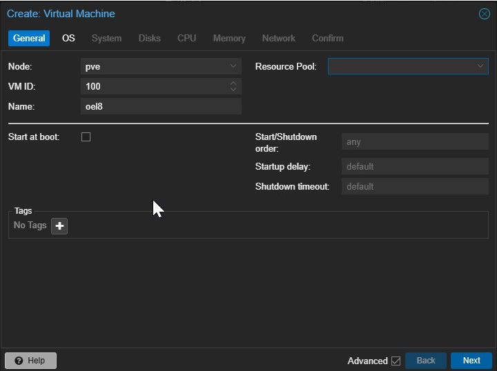

## Step 3: Choose the ISO Image

In the **OS** tab:

- **ISO Image:** Select the uploaded Linux ISO
- **Guest OS Type:** Choose **Linux**
- **Version:** Select appropriate version if listed (optional)

Click **Next**

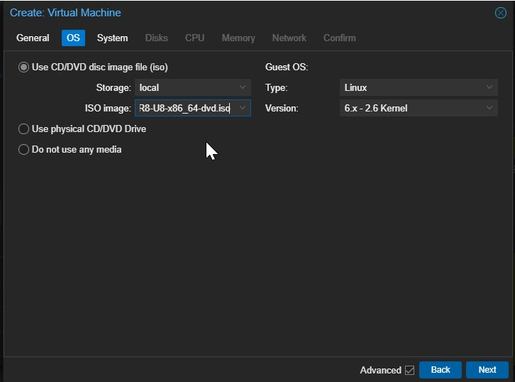

## Step 4: Configure System Settings

- BIOS: Choose **OVMF (UEFI)** or **SeaBIOS** (default)
- Machine: Leave as default
- Graphics card: Default
- SCSI Controller: Default (or select **VirtIO SCSI** for performance)

Click **Next**

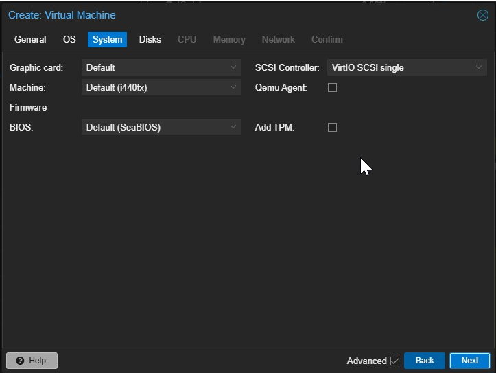

## Step 5: Set Hard Disk Parameters

- **Bus/Device:** Usually **SCSI**
- **Disk Size:** Enter desired disk size (e.g., `20 GiB`)
- **Cache:** Default
- **Discard:** Tick if using SSD storage

Click **Next**

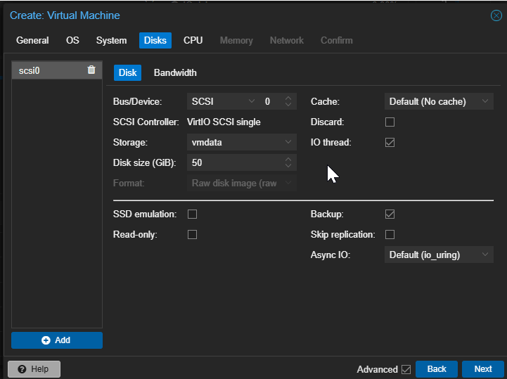

## Step 6: Configure CPU Settings

- **Sockets:** 1 (or more)
- **Cores per Socket:** e.g., 2
- **Type:** Leave default (or set to **host** for maximum performance)

Click **Next**

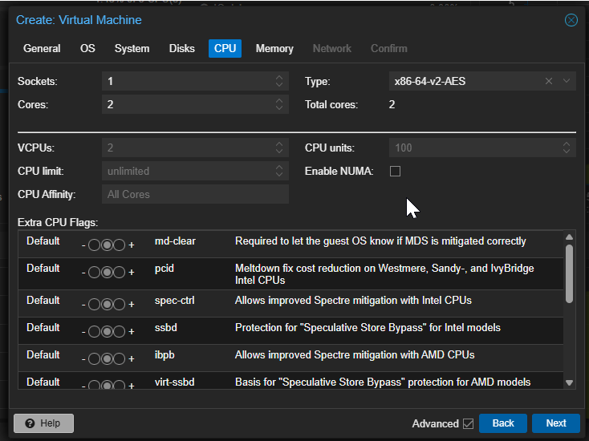

## Step 7: Configure Memory

- **Memory (MB):** e.g., 2048 MB (2 GB)

You can optionally set minimum memory if ballooning is enabled.

Click **Next**

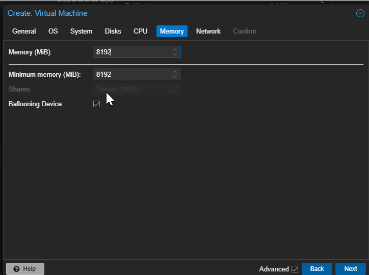

## Step 8: Configure Network

- **Bridge:** Select `vmbr0`
- **Model:** `VirtIO (paravirtualized)` for better performance

Click **Next**

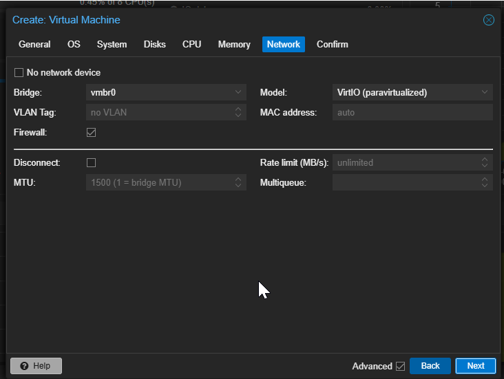

## Step 9: Confirm and Create VM

Review your settings and click **Finish**.

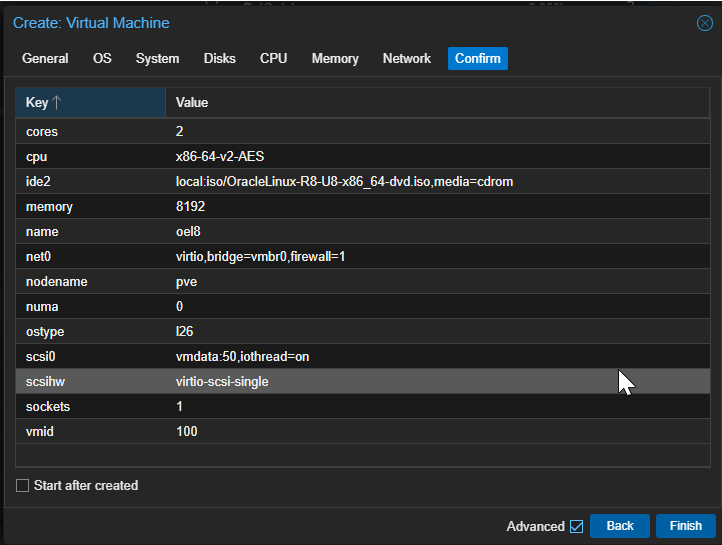

## Step 10: Start and Install the VM

1.  Click on your new VM in the left panel.
2.  Go to **Console** tab.
3.  Click **Start**
4.  Follow the Linux OS installation process as usual.

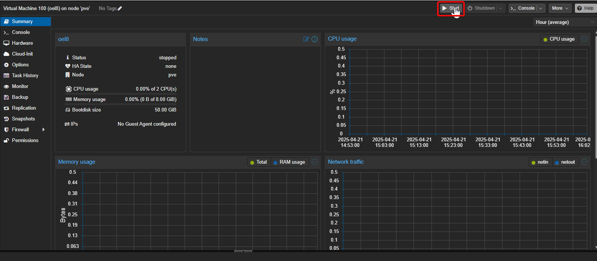

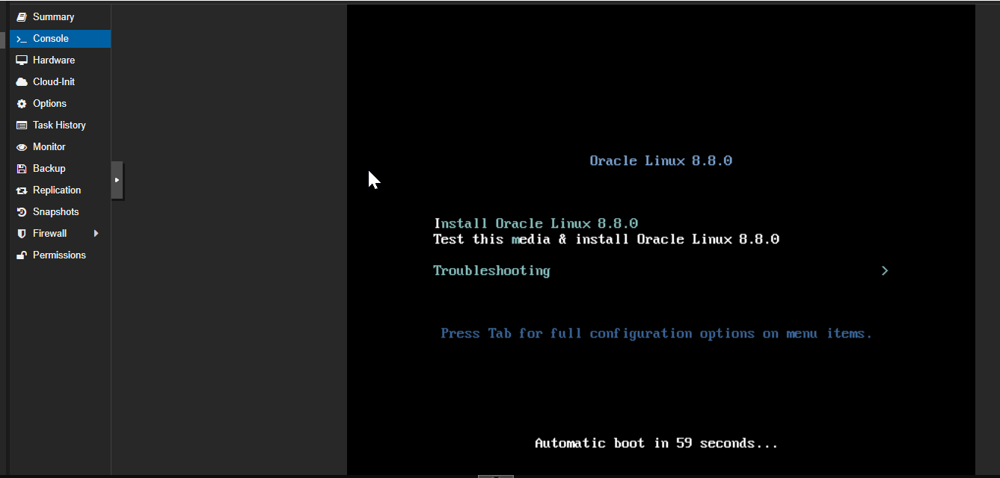

Convert to template for later use and easy deployment

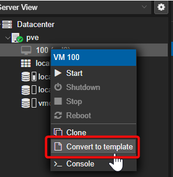

## 🎉 Done!

That’s it — you’ve successfully created and started a **Linux VM in Proxmox VE**! You can now install your applications, configure networking, and manage your VM directly via Proxmox’s GUI.

## 💡 Bonus Tip:

To improve performance:

- Use **VirtIO drivers** for disk and network interfaces
- Enable **ballooning** for dynamic memory management
- Install **QEMU guest agent** inside your VM for enhanced integration
