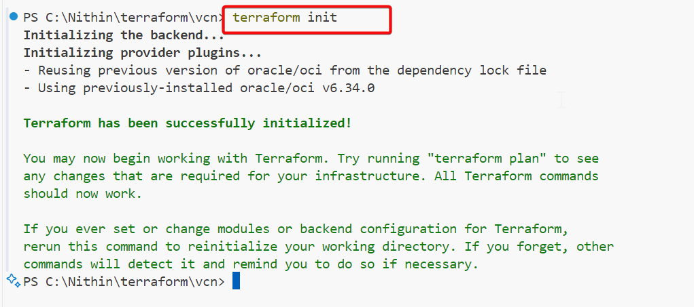
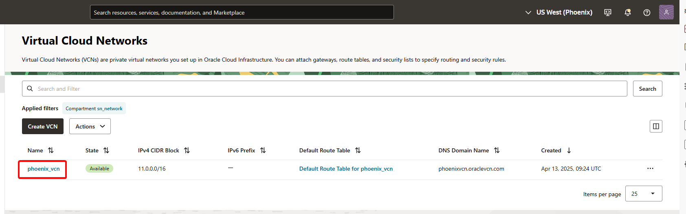
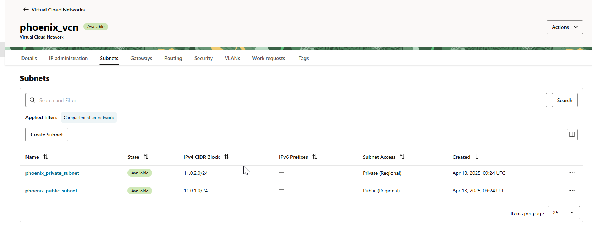
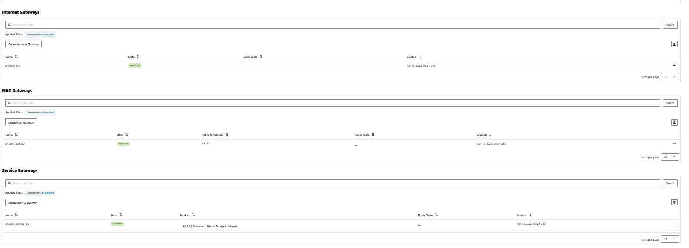
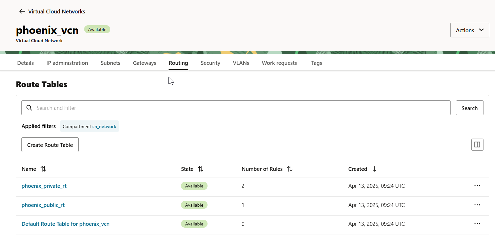
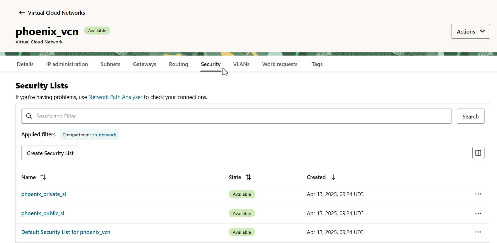

# How to Create a VCN in OCI Using Terraform

Virtual Cloud Networks (VCNs) are the foundation of cloud networking in Oracle Cloud Infrastructure (OCI). In this guide, we'll walk through how to create a VCN using **Terraform**, a powerful Infrastructure as Code (IaC) tool, so you can automate your OCI deployments with confidence and clarity.

## 🚀 Why Use Terraform for OCI?

Terraform helps manage infrastructure in a **declarative and version-controlled** way. Using Terraform with OCI allows you to:

- Automate repetitive tasks
- Maintain reusable templates
- Track infrastructure changes
- Integrate with CI/CD pipelines

## 🧱 Prerequisites

Before getting started:

- An Oracle Cloud account
- OCI CLI installed and configured
- Terraform installed
- A user with necessary permissions (VCN creation, compartments, networking)

### Step 1: `main.tf` – Define the VCN

``` wp-block-code
terraform {
  required_providers {
    oci = {
      source = "oracle/oci"
    }
  }
}

provider "oci" {
  region              = var.region
  config_file_profile = var.config_file_profile
}

# VCN
resource "oci_core_vcn" "phoenix_vcn" {
  cidr_block     = var.cidr_block
  display_name   = "phoenix_vcn"
  compartment_id = var.compartment_id
  dns_label      = var.dns_label
}

# Internet Gateway
resource "oci_core_internet_gateway" "phoenix_igw" {
  display_name   = "phoenix_igw"
  vcn_id         = oci_core_vcn.phoenix_vcn.id
  compartment_id = var.compartment_id
  enabled        = true
}

# NAT Gateway
resource "oci_core_nat_gateway" "phoenix_nat_gw" {
  display_name   = "phoenix_nat_gw"
  vcn_id         = oci_core_vcn.phoenix_vcn.id
  compartment_id = var.compartment_id
}

# Public Route Table
resource "oci_core_route_table" "phoenix_public_rt" {
  display_name   = "phoenix_public_rt"
  vcn_id         = oci_core_vcn.phoenix_vcn.id
  compartment_id = var.compartment_id

  route_rules {
    destination       = "0.0.0.0/0"
    destination_type  = "CIDR_BLOCK"
    network_entity_id = oci_core_internet_gateway.phoenix_igw.id
  }
}

# Private Route Table
resource "oci_core_route_table" "phoenix_private_rt" {
  display_name   = "phoenix_private_rt"
  vcn_id         = oci_core_vcn.phoenix_vcn.id
  compartment_id = var.compartment_id

  route_rules {
    destination       = "0.0.0.0/0"
    destination_type  = "CIDR_BLOCK"
    network_entity_id = oci_core_nat_gateway.phoenix_nat_gw.id
  }
   # Route rule for Service Gateway
  route_rules {
    destination       = "all-phx-services-in-oracle-services-network"
    destination_type  = "SERVICE_CIDR_BLOCK"
    network_entity_id = oci_core_service_gateway.phoenix_service_gw.id
  }
}

# Public Subnet
resource "oci_core_subnet" "phoenix_public_subnet" {
  cidr_block                 = var.public_cidr_block
  display_name               = "phoenix_public_subnet"
  vcn_id                     = oci_core_vcn.phoenix_vcn.id
  compartment_id             = var.compartment_id
  route_table_id             = oci_core_route_table.phoenix_public_rt.id
  security_list_ids          = [oci_core_security_list.phoenix_public_sl.id]
  prohibit_public_ip_on_vnic = false
  dns_label                  = "publicsubnet"
}

# Private Subnet
resource "oci_core_subnet" "phoenix_private_subnet" {
  cidr_block                 = var.private_cidr_block
  display_name               = "phoenix_private_subnet"
  vcn_id                     = oci_core_vcn.phoenix_vcn.id
  compartment_id             = var.compartment_id
  route_table_id             = oci_core_route_table.phoenix_private_rt.id
  security_list_ids          = [oci_core_security_list.phoenix_private_sl.id]
  prohibit_public_ip_on_vnic = true
}

# Security Lists
# Public Security List
resource "oci_core_security_list" "phoenix_public_sl" {
  display_name   = "phoenix_public_sl"
  vcn_id         = oci_core_vcn.phoenix_vcn.id
  compartment_id = var.compartment_id

  ingress_security_rules {
    protocol    = "all"
    source      = "<your-public-ip>/32"
    source_type = "CIDR_BLOCK"
  }
      egress_security_rules {
    protocol    = "all"
    destination = "0.0.0.0/0"
    destination_type = "CIDR_BLOCK"
  }
}

# Private Security List
resource "oci_core_security_list" "phoenix_private_sl" {
  display_name   = "phoenix_private_sl"
  vcn_id         = oci_core_vcn.phoenix_vcn.id
  compartment_id = var.compartment_id

  ingress_security_rules {
    protocol    = "all"
    source      = "10.0.0.0/16"
    source_type = "CIDR_BLOCK"
  }

    egress_security_rules {
    protocol    = "all"
    destination = "0.0.0.0/0"
    destination_type = "CIDR_BLOCK"
  }
}

resource "oci_core_service_gateway" "phoenix_service_gw" {
  compartment_id = var.compartment_id
  vcn_id         = oci_core_vcn.phoenix_vcn.id
  display_name   = "phoenix_service_gw"

  services {
    # Dynamically fetch the service ID for Oracle Services Network
    service_id = data.oci_core_services.services.services[0].id
  }
}

data "oci_core_services" "services" {
  # Fetch all available services in the region
}
```

### 📄 Step 2: `variables.tf` – Define Variables

``` wp-block-code
# This file contains the variables used in the VCN module.
variable "config_file_profile" {
  description = "profile name"
  type        = string
  default     = "DEFAULT"
}

variable "region" {
  description = "OCI region"
  type        = string
  default     = "us-phoenix-1"
}

variable "compartment_id" {
  description = "Compartment OCID"
  type        = string
  default     = "ocid1.compartment.oc1......"
}

variable "my_ip" {
  description = "Your public IP address"
  type        = string
  default     = "<your public ip address>"
}

variable "vcn_name" {
  description = "Name of the VCN"
  type        = string
  default     = "phoenix_vcn"
}
variable "cidr_block" {
  description = "CIDR block for the VCN"
  type        = string
  default     = "11.0.0.0/16"
}

variable "public_cidr_block" {
  description = "CIDR block for the VCN"
  type        = string
  default     = "11.0.1.0/24"
}

variable "private_cidr_block" {
  description = "CIDR block for the VCN"
  type        = string
  default     = "11.0.2.0/24"
}

variable "dns_label" {
  description = "DNS label for the VCN"
  type        = string
  default     = "phoenixvcn"
}
variable "display_name" {
  description = "Display name for the VCN"
  type        = string
  default     = "phoenixvcn"
}
```

### ▶️ Step 4: Run Terraform

initialize terraform



run terraform plan

``` wp-block-code
PS C:\Nithin\terraform\vcn> terraform plan
data.oci_core_services.services: Reading...
data.oci_core_services.services: Read complete after 5s [id=CoreServicesDataSource-0]

Terraform used the selected providers to generate the following execution plan. Resource actions are indicated with the following symbols:
  + create

Terraform will perform the following actions:

  # oci_core_internet_gateway.phoenix_igw will be created
  + resource "oci_core_internet_gateway" "phoenix_igw" {
      + compartment_id = "ocid1.compartment.oc1..<redacted>"
      + defined_tags   = (known after apply)
      + display_name   = "phoenix_igw"
      + enabled        = true
      + freeform_tags  = (known after apply)
      + id             = (known after apply)
      + route_table_id = (known after apply)
      + state          = (known after apply)
      + time_created   = (known after apply)
      + vcn_id         = (known after apply)
    }

  # oci_core_nat_gateway.phoenix_nat_gw will be created
  + resource "oci_core_nat_gateway" "phoenix_nat_gw" {
      + block_traffic  = (known after apply)
      + compartment_id = "ocid1.compartment.oc1..<redacted>"
      + defined_tags   = (known after apply)
      + display_name   = "phoenix_nat_gw"
      + freeform_tags  = (known after apply)
      + id             = (known after apply)
      + nat_ip         = (known after apply)
      + public_ip_id   = (known after apply)
      + route_table_id = (known after apply)
      + state          = (known after apply)
      + time_created   = (known after apply)
      + vcn_id         = (known after apply)
    }

  # oci_core_route_table.phoenix_private_rt will be created
  + resource "oci_core_route_table" "phoenix_private_rt" {
      + compartment_id = "ocid1.compartment.oc1..<redacted>"
      + defined_tags   = (known after apply)
      + display_name   = "phoenix_private_rt"
      + freeform_tags  = (known after apply)
      + id             = (known after apply)
      + state          = (known after apply)
      + time_created   = (known after apply)
      + vcn_id         = (known after apply)

      + route_rules {
          + cidr_block        = (known after apply)
          + description       = (known after apply)
          + destination       = "0.0.0.0/0"
          + destination_type  = "CIDR_BLOCK"
          + network_entity_id = (known after apply)
          + route_type        = (known after apply)
        }
      + route_rules {
          + cidr_block        = (known after apply)
          + description       = (known after apply)
          + destination       = "all-phx-services-in-oracle-services-network"
          + destination_type  = "SERVICE_CIDR_BLOCK"
          + network_entity_id = (known after apply)
          + route_type        = (known after apply)
        }
    }

  # oci_core_route_table.phoenix_public_rt will be created
  + resource "oci_core_route_table" "phoenix_public_rt" {
      + compartment_id = "ocid1.compartment.oc1..<redacted>"
      + defined_tags   = (known after apply)
      + display_name   = "phoenix_public_rt"
      + freeform_tags  = (known after apply)
      + id             = (known after apply)
      + state          = (known after apply)
      + time_created   = (known after apply)
      + vcn_id         = (known after apply)

      + route_rules {
          + cidr_block        = (known after apply)
          + description       = (known after apply)
          + destination       = "0.0.0.0/0"
          + destination_type  = "CIDR_BLOCK"
          + network_entity_id = (known after apply)
          + route_type        = (known after apply)
        }
    }

  # oci_core_security_list.phoenix_private_sl will be created
  + resource "oci_core_security_list" "phoenix_private_sl" {
      + compartment_id = "ocid1.compartment.oc1..<redacted>"
      + defined_tags   = (known after apply)
      + display_name   = "phoenix_private_sl"
      + freeform_tags  = (known after apply)
      + id             = (known after apply)
      + state          = (known after apply)
      + time_created   = (known after apply)
      + vcn_id         = (known after apply)

      + egress_security_rules {
          + description      = (known after apply)
          + destination      = "0.0.0.0/0"
          + destination_type = "CIDR_BLOCK"
          + protocol         = "all"
          + stateless        = (known after apply)
        }

      + ingress_security_rules {
          + description = (known after apply)
          + protocol    = "all"
          + source      = "10.0.0.0/16"
          + source_type = "CIDR_BLOCK"
          + stateless   = false
        }
    }

  # oci_core_security_list.phoenix_public_sl will be created
  + resource "oci_core_security_list" "phoenix_public_sl" {
      + compartment_id = "ocid1.compartment.oc1..<redacted>"
      + defined_tags   = (known after apply)
      + display_name   = "phoenix_public_sl"
      + freeform_tags  = (known after apply)
      + id             = (known after apply)
      + state          = (known after apply)
      + time_created   = (known after apply)
      + vcn_id         = (known after apply)

      + egress_security_rules {
          + description      = (known after apply)
          + destination      = "0.0.0.0/0"
          + destination_type = "CIDR_BLOCK"
          + protocol         = "all"
          + stateless        = (known after apply)
        }

      + ingress_security_rules {
          + description = (known after apply)
          + protocol    = "all"
          + source      = "<your-public-ip>/32"
          + source_type = "CIDR_BLOCK"
          + stateless   = false
        }
    }

  # oci_core_service_gateway.phoenix_service_gw will be created
  + resource "oci_core_service_gateway" "phoenix_service_gw" {
      + block_traffic  = (known after apply)
      + compartment_id = "ocid1.compartment.oc1..<redacted>"
      + defined_tags   = (known after apply)
      + display_name   = "phoenix_service_gw"
      + freeform_tags  = (known after apply)
      + id             = (known after apply)
      + route_table_id = (known after apply)
      + state          = (known after apply)
      + time_created   = (known after apply)
      + vcn_id         = (known after apply)

      + services {
          + service_id   = "ocid1.service.oc1.phx.aaaaaaaasgvxtsqcj2jkt2xppos637xym4ab5qqqptgwjd4guj7v3d26t7oa"
          + service_name = (known after apply)
        }
    }

  # oci_core_subnet.phoenix_private_subnet will be created
  + resource "oci_core_subnet" "phoenix_private_subnet" {
      + availability_domain        = (known after apply)
      + cidr_block                 = "11.0.2.0/24"
      + compartment_id             = "ocid1.compartment.oc1..<redacted>"
      + defined_tags               = (known after apply)
      + dhcp_options_id            = (known after apply)
      + display_name               = "phoenix_private_subnet"
      + dns_label                  = (known after apply)
      + freeform_tags              = (known after apply)
      + id                         = (known after apply)
      + ipv6cidr_block             = (known after apply)
      + ipv6cidr_blocks            = (known after apply)
      + ipv6virtual_router_ip      = (known after apply)
      + prohibit_internet_ingress  = (known after apply)
      + prohibit_public_ip_on_vnic = true
      + route_table_id             = (known after apply)
      + security_list_ids          = (known after apply)
      + state                      = (known after apply)
      + subnet_domain_name         = (known after apply)
      + time_created               = (known after apply)
      + vcn_id                     = (known after apply)
      + virtual_router_ip          = (known after apply)
      + virtual_router_mac         = (known after apply)
    }

  # oci_core_subnet.phoenix_public_subnet will be created
  + resource "oci_core_subnet" "phoenix_public_subnet" {
      + availability_domain        = (known after apply)
      + cidr_block                 = "11.0.1.0/24"
      + compartment_id             = "ocid1.compartment.oc1..<redacted>"
      + defined_tags               = (known after apply)
      + dhcp_options_id            = (known after apply)
      + display_name               = "phoenix_public_subnet"
      + dns_label                  = "publicsubnet"
      + freeform_tags              = (known after apply)
      + id                         = (known after apply)
      + ipv6cidr_block             = (known after apply)
      + ipv6cidr_blocks            = (known after apply)
      + ipv6virtual_router_ip      = (known after apply)
      + prohibit_internet_ingress  = (known after apply)
      + prohibit_public_ip_on_vnic = false
      + route_table_id             = (known after apply)
      + security_list_ids          = (known after apply)
      + state                      = (known after apply)
      + subnet_domain_name         = (known after apply)
      + time_created               = (known after apply)
      + vcn_id                     = (known after apply)
      + virtual_router_ip          = (known after apply)
      + virtual_router_mac         = (known after apply)
    }

  # oci_core_vcn.phoenix_vcn will be created
  + resource "oci_core_vcn" "phoenix_vcn" {
      + byoipv6cidr_blocks               = (known after apply)
      + cidr_block                       = "11.0.0.0/16"
      + cidr_blocks                      = (known after apply)
      + compartment_id                   = "ocid1.compartment.oc1..<redacted>"
      + default_dhcp_options_id          = (known after apply)
      + default_route_table_id           = (known after apply)
      + default_security_list_id         = (known after apply)
      + defined_tags                     = (known after apply)
      + display_name                     = "phoenix_vcn"
      + dns_label                        = "phoenixvcn"
      + freeform_tags                    = (known after apply)
      + id                               = (known after apply)
      + ipv6cidr_blocks                  = (known after apply)
      + ipv6private_cidr_blocks          = (known after apply)
      + is_ipv6enabled                   = (known after apply)
      + is_oracle_gua_allocation_enabled = (known after apply)
      + security_attributes              = (known after apply)
      + state                            = (known after apply)
      + time_created                     = (known after apply)
      + vcn_domain_name                  = (known after apply)

      + byoipv6cidr_details (known after apply)
    }

Plan: 10 to add, 0 to change, 0 to destroy.

──────────────────────────────────────────────────────────────────────────────────────────────────────────────────────────────────────────────────────────── 

Note: You didn't use the -out option to save this plan, so Terraform can't guarantee to take exactly these actions if you run "terraform apply" now.
PS C:\Nithin\terraform\vcn> 
```

to apply the plan run terraform apply

``` wp-block-code
PS C:\Nithin\terraform\vcn> terraform plan
data.oci_core_services.services: Reading...
data.oci_core_services.services: Read complete after 5s [id=CoreServicesDataSource-0]

Terraform used the selected providers to generate the following execution plan. Resource actions are indicated with the following symbols:
  + create

Terraform will perform the following actions:

  # oci_core_internet_gateway.phoenix_igw will be created
  + resource "oci_core_internet_gateway" "phoenix_igw" {
      + compartment_id = "ocid1.compartment.oc1..<redacted>"
      + defined_tags   = (known after apply)
      + display_name   = "phoenix_igw"
      + enabled        = true
      + freeform_tags  = (known after apply)
      + id             = (known after apply)
      + route_table_id = (known after apply)
      + state          = (known after apply)
      + time_created   = (known after apply)
      + vcn_id         = (known after apply)
    }

  # oci_core_nat_gateway.phoenix_nat_gw will be created
  + resource "oci_core_nat_gateway" "phoenix_nat_gw" {
      + block_traffic  = (known after apply)
      + compartment_id = "ocid1.compartment.oc1..<redacted>"
      + defined_tags   = (known after apply)
      + display_name   = "phoenix_nat_gw"
      + freeform_tags  = (known after apply)
      + id             = (known after apply)
      + nat_ip         = (known after apply)
      + public_ip_id   = (known after apply)
      + route_table_id = (known after apply)
      + state          = (known after apply)
      + time_created   = (known after apply)
      + vcn_id         = (known after apply)
    }

  # oci_core_route_table.phoenix_private_rt will be created
  + resource "oci_core_route_table" "phoenix_private_rt" {
      + compartment_id = "ocid1.compartment.oc1..<redacted>"
      + defined_tags   = (known after apply)
      + display_name   = "phoenix_private_rt"
      + freeform_tags  = (known after apply)
      + id             = (known after apply)
      + state          = (known after apply)
      + time_created   = (known after apply)
      + vcn_id         = (known after apply)

      + route_rules {
          + cidr_block        = (known after apply)
          + description       = (known after apply)
          + destination       = "0.0.0.0/0"
          + destination_type  = "CIDR_BLOCK"
          + network_entity_id = (known after apply)
          + route_type        = (known after apply)
        }
      + route_rules {
          + cidr_block        = (known after apply)
          + description       = (known after apply)
          + destination       = "all-phx-services-in-oracle-services-network"
          + destination_type  = "SERVICE_CIDR_BLOCK"
          + network_entity_id = (known after apply)
          + route_type        = (known after apply)
        }
    }

  # oci_core_route_table.phoenix_public_rt will be created
  + resource "oci_core_route_table" "phoenix_public_rt" {
      + compartment_id = "ocid1.compartment.oc1..<redacted>"
      + defined_tags   = (known after apply)
      + display_name   = "phoenix_public_rt"
      + freeform_tags  = (known after apply)
      + id             = (known after apply)
      + state          = (known after apply)
      + time_created   = (known after apply)
      + vcn_id         = (known after apply)

      + route_rules {
          + cidr_block        = (known after apply)
          + description       = (known after apply)
          + destination       = "0.0.0.0/0"
          + destination_type  = "CIDR_BLOCK"
          + network_entity_id = (known after apply)
          + route_type        = (known after apply)
        }
    }

  # oci_core_security_list.phoenix_private_sl will be created
  + resource "oci_core_security_list" "phoenix_private_sl" {
      + compartment_id = "ocid1.compartment.oc1..<redacted>"
      + defined_tags   = (known after apply)
      + display_name   = "phoenix_private_sl"
      + freeform_tags  = (known after apply)
      + id             = (known after apply)
      + state          = (known after apply)
      + time_created   = (known after apply)
      + vcn_id         = (known after apply)

      + egress_security_rules {
          + description      = (known after apply)
          + destination      = "0.0.0.0/0"
          + destination_type = "CIDR_BLOCK"
          + protocol         = "all"
          + stateless        = (known after apply)
        }

      + ingress_security_rules {
          + description = (known after apply)
          + protocol    = "all"
          + source      = "10.0.0.0/16"
          + source_type = "CIDR_BLOCK"
          + stateless   = false
        }
    }

  # oci_core_security_list.phoenix_public_sl will be created
  + resource "oci_core_security_list" "phoenix_public_sl" {
      + compartment_id = "ocid1.compartment.oc1..<redacted>"
      + defined_tags   = (known after apply)
      + display_name   = "phoenix_public_sl"
      + freeform_tags  = (known after apply)
      + id             = (known after apply)
      + state          = (known after apply)
      + time_created   = (known after apply)
      + vcn_id         = (known after apply)

      + egress_security_rules {
          + description      = (known after apply)
          + destination      = "0.0.0.0/0"
          + destination_type = "CIDR_BLOCK"
          + protocol         = "all"
          + stateless        = (known after apply)
        }

      + ingress_security_rules {
          + description = (known after apply)
          + protocol    = "all"
          + source      = "<your-public-ip>/32"
          + source_type = "CIDR_BLOCK"
          + stateless   = false
        }
    }

  # oci_core_service_gateway.phoenix_service_gw will be created
  + resource "oci_core_service_gateway" "phoenix_service_gw" {
      + block_traffic  = (known after apply)
      + compartment_id = "ocid1.compartment.oc1..<redacted>"
      + defined_tags   = (known after apply)
      + display_name   = "phoenix_service_gw"
      + freeform_tags  = (known after apply)
      + id             = (known after apply)
      + route_table_id = (known after apply)
      + state          = (known after apply)
      + time_created   = (known after apply)
      + vcn_id         = (known after apply)

      + services {
          + service_id   = "ocid1.service.oc1.phx.aaaaaaaasgvxtsqcj2jkt2xppos637xym4ab5qqqptgwjd4guj7v3d26t7oa"
          + service_name = (known after apply)
        }
    }

  # oci_core_subnet.phoenix_private_subnet will be created
  + resource "oci_core_subnet" "phoenix_private_subnet" {
      + availability_domain        = (known after apply)
      + cidr_block                 = "11.0.2.0/24"
      + compartment_id             = "ocid1.compartment.oc1..<redacted>"
      + defined_tags               = (known after apply)
      + dhcp_options_id            = (known after apply)
      + display_name               = "phoenix_private_subnet"
      + dns_label                  = (known after apply)
      + freeform_tags              = (known after apply)
      + id                         = (known after apply)
      + ipv6cidr_block             = (known after apply)
      + ipv6cidr_blocks            = (known after apply)
      + ipv6virtual_router_ip      = (known after apply)
      + prohibit_internet_ingress  = (known after apply)
      + prohibit_public_ip_on_vnic = true
      + route_table_id             = (known after apply)
      + security_list_ids          = (known after apply)
      + state                      = (known after apply)
      + subnet_domain_name         = (known after apply)
      + time_created               = (known after apply)
      + vcn_id                     = (known after apply)
      + virtual_router_ip          = (known after apply)
      + virtual_router_mac         = (known after apply)
    }

  # oci_core_subnet.phoenix_public_subnet will be created
  + resource "oci_core_subnet" "phoenix_public_subnet" {
      + availability_domain        = (known after apply)
      + cidr_block                 = "11.0.1.0/24"
      + compartment_id             = "ocid1.compartment.oc1..<redacted>"
      + defined_tags               = (known after apply)
      + dhcp_options_id            = (known after apply)
      + display_name               = "phoenix_public_subnet"
      + dns_label                  = "publicsubnet"
      + freeform_tags              = (known after apply)
      + id                         = (known after apply)
      + ipv6cidr_block             = (known after apply)
      + ipv6cidr_blocks            = (known after apply)
      + ipv6virtual_router_ip      = (known after apply)
      + prohibit_internet_ingress  = (known after apply)
      + prohibit_public_ip_on_vnic = false
      + route_table_id             = (known after apply)
      + security_list_ids          = (known after apply)
      + state                      = (known after apply)
      + subnet_domain_name         = (known after apply)
      + time_created               = (known after apply)
      + vcn_id                     = (known after apply)
      + virtual_router_ip          = (known after apply)
      + virtual_router_mac         = (known after apply)
    }

  # oci_core_vcn.phoenix_vcn will be created
  + resource "oci_core_vcn" "phoenix_vcn" {
      + byoipv6cidr_blocks               = (known after apply)
      + cidr_block                       = "11.0.0.0/16"
      + cidr_blocks                      = (known after apply)
      + compartment_id                   = "ocid1.compartment.oc1..<redacted>"
      + default_dhcp_options_id          = (known after apply)
      + default_route_table_id           = (known after apply)
      + default_security_list_id         = (known after apply)
      + defined_tags                     = (known after apply)
      + display_name                     = "phoenix_vcn"
      + dns_label                        = "phoenixvcn"
      + freeform_tags                    = (known after apply)
      + id                               = (known after apply)
      + ipv6cidr_blocks                  = (known after apply)
      + ipv6private_cidr_blocks          = (known after apply)
      + is_ipv6enabled                   = (known after apply)
      + is_oracle_gua_allocation_enabled = (known after apply)
      + security_attributes              = (known after apply)
      + state                            = (known after apply)
      + time_created                     = (known after apply)
      + vcn_domain_name                  = (known after apply)

      + byoipv6cidr_details (known after apply)
    }

Plan: 10 to add, 0 to change, 0 to destroy.

──────────────────────────────────────────────────────────────────────────────────────────────────────────────────────────────────────────────────────────── 

Note: You didn't use the -out option to save this plan, so Terraform can't guarantee to take exactly these actions if you run "terraform apply" now.
PS C:\Nithin\terraform\vcn> 
```



where the above terrafom will create

1.  vcn
2.  2 subnets (public and private subnets)
3.  internet gateway
4.  Nat gateway
5.  service gateway
6.  create route tables (i.e public route table where it has internet gateway for internet and attached to public subnet and private route table where it has nat gateway for internet and attached to private subnet)
7.  create security list (for public_sl it will allow all protocol from my home lab public ip and private_sl to allow all protocol with in the vcn).

## ✅ Verification

Once completed, you’ll have a Virtual Cloud Network ready in the OCI console under your specified compartment.









## 💡 Final Thoughts

Using Terraform for OCI not only saves time but brings **repeatability**, **consistency**, and **automation** to your cloud infrastructure. You can now extend this base configuration.
