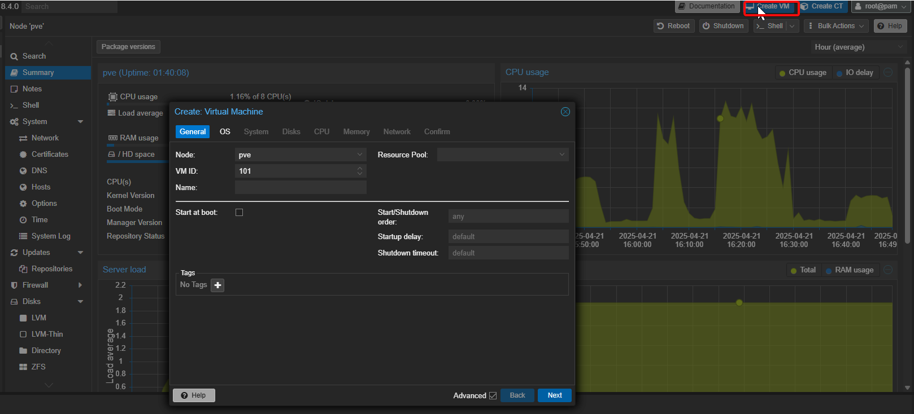
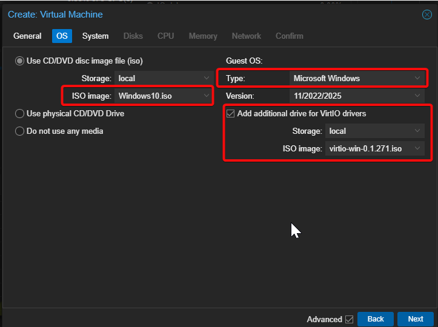
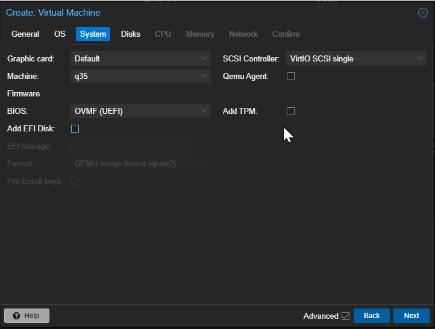
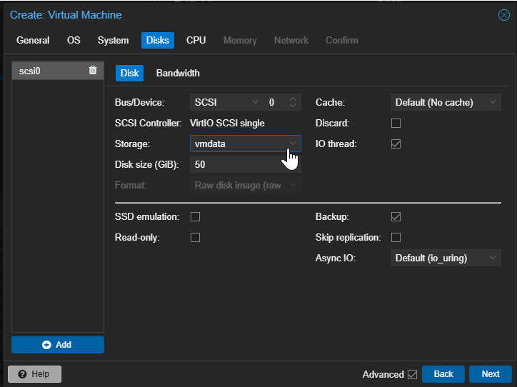
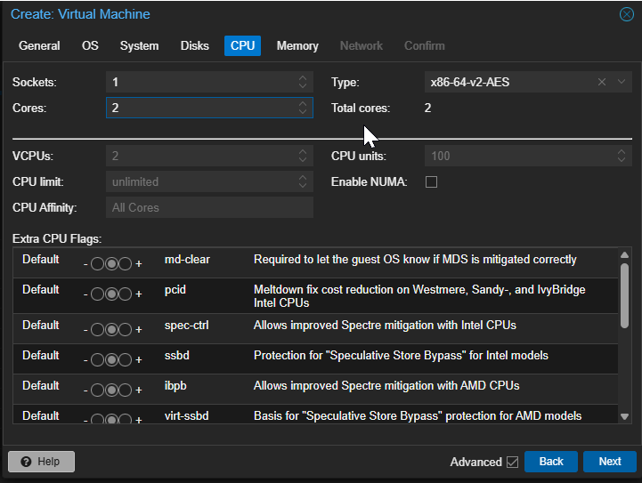
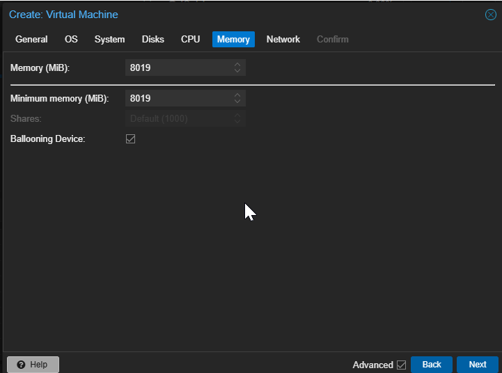
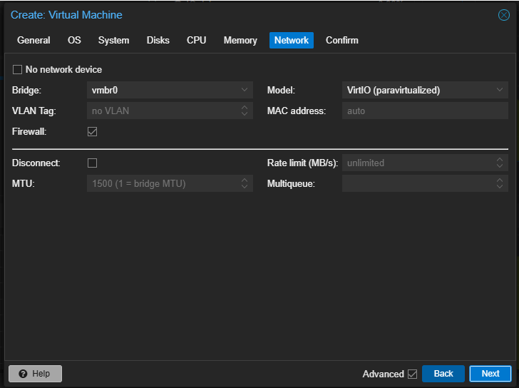
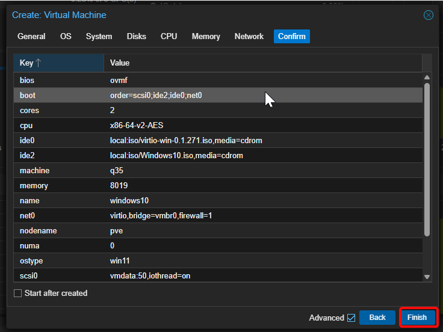
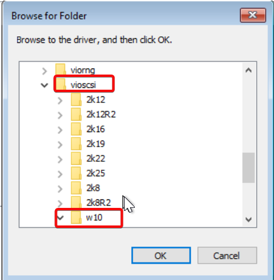

# How to Create a Windows Virtual Machine (VM) in Proxmox VE

Proxmox VE isn’t just for Linux — it’s great for running **Windows virtual machines** too. Whether you’re setting up a lab, testing environment, or lightweight Windows server, Proxmox makes it straightforward.

Here’s a detailed step-by-step guide to set up a Windows VM in Proxmox.

## Prerequisites

- Running **Proxmox VE** instance
- **Windows ISO image** (Windows 10/11/Server)
- **VirtIO Drivers ISO** (for disk, network, and ballooning drivers)
  - Download from: https://fedorapeople.org/groups/virt/virtio-win/direct-downloads/latest-virtio/

## Step 1: Upload ISOs to Proxmox

1.  In the **Proxmox Web GUI**:
    - Navigate to **Datacenter → (Your Node) → local (storage) → ISO Images**
    - Click **Upload**
    - Upload both the **Windows ISO** and **VirtIO Drivers ISO**

## Step 2: Create a New VM

1.  Click **Create VM** in the top-right.
2.  In the **General** tab:
    - **Node:** Select your Proxmox node
    - **VM ID:** Auto-generated or custom
    - **Name:** e.g., `windows-10-vm`

Click **Next**

## Step 3: Select Windows ISO

- **ISO Image:** Choose your Windows ISO
- **Guest OS Type:** Microsoft Windows
- **Version:** Select the appropriate version (if listed)

Click **Next**

## Step 4: Configure System

- **BIOS:** **OVMF (UEFI)** for modern Windows (Windows 10/11)
- **Machine:** Leave as **q35**
- **Graphic Card:** Default or `VMware compatible`
- **SCSI Controller:** **VirtIO SCSI**

Click **Next**

## Step 5: Set Hard Disk

- **Bus/Device:** **VirtIO Block (modern & fast)** or **SCSI**
- **Disk Size:** Example: 50 GiB
- **Cache:** Write back (for better performance)
- **Discard:** Checked (if storage supports)

Click **Next**

## Step 6: CPU Configuration

- **Sockets:** 1
- **Cores per Socket:** 2 (or more)
- **Type:** **host**

Click **Next**

## Step 7: Configure Memory

- **Memory (MB):** Example: 4096 MB (4GB)
- Optional: Set ballooning minimum memory

Click **Next**

------------------------------------------------------------------------

## 🌐 Step 8: Set Up Network

- **Bridge:** Select `vmbr0`
- **Model:** **VirtIO (paravirtualized)**

Click **Next**

------------------------------------------------------------------------

## 📊 Step 9: Finalize and Create VM

- Review your configuration
- Click **Finish**

## Step 10: Start and Install Windows

1.  Go to your VM → **Console**
2.  Click **Start**
3.  Begin Windows installation
4.  When asked for a storage driver:
    - Click **Load driver**
    - Browse the VirtIO ISO
    - Go to **vioscsi → w10 → amd64**
    - Load driver and continue

Also install:

- **Balloon driver** (memory ballooning)
- **NetKVM driver** (network)

These are in respective folders in the VirtIO ISO.

## Step 12: Post-Installation

Once Windows is installed:

- Install **QEMU Guest Agent** (optional but recommended)
- Install remaining VirtIO drivers via **Device Manager** if needed
- Optionally configure Windows Updates and remote desktop

## Done!

Now you have a fully functioning **Windows VM on Proxmox VE** with optimized performance using VirtIO drivers.
