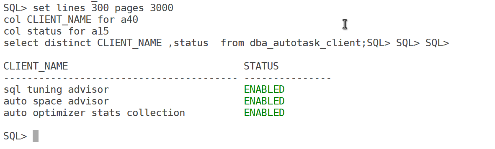
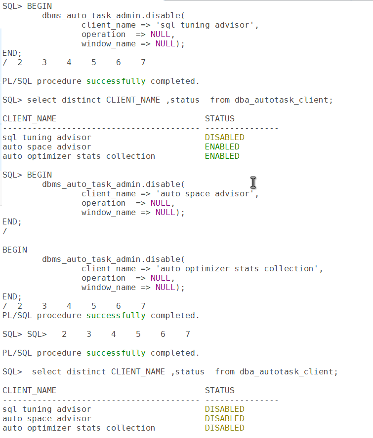
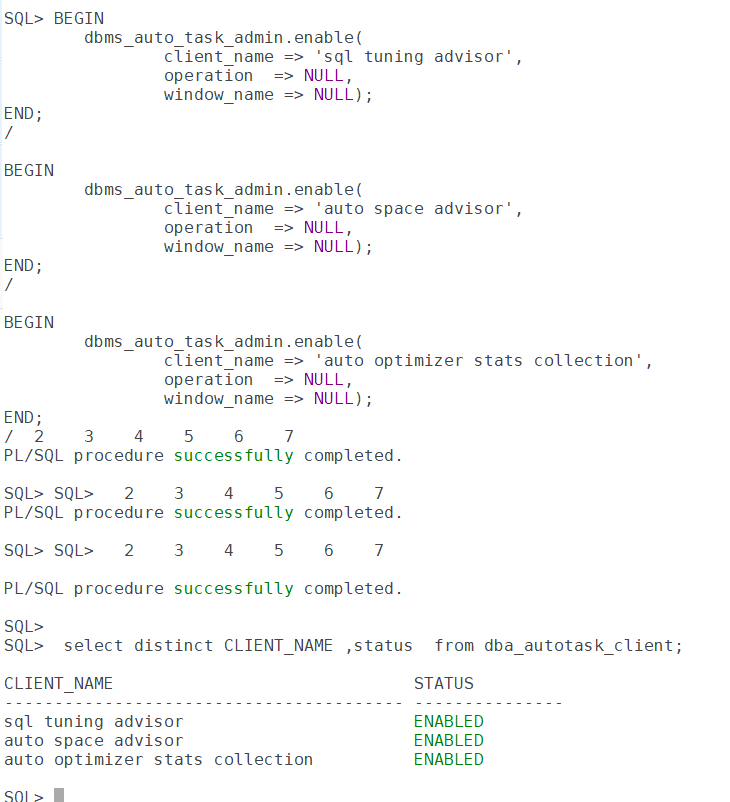

# How to Disable/Enable Default Maintenance Jobs in Oracle Database

Oracle Database comes with a set of **default automated maintenance tasks** that run in the background during predefined maintenance windows. These tasks include operations like **statistics gathering, space advisor runs, SQL tuning advisor, and segment advisor**.

While they help maintain database health, there might be situations — like during any maintenance activity like performance testing, migrations, or high-demand business hours — when you’d want to temporarily disable or manually control these jobs.

In this post, we’ll see how to **disable and enable these default maintenance jobs** safely using Oracle-supplied packages.

## 📌 What Are Oracle Maintenance Jobs?

Some of the default automated jobs in Oracle include:

- **auto optimizer stats collection**
- **auto space advisor**
- **auto SQL tuning advisor**

## 🔍 Check Existing Maintenance Jobs

First, let’s query the list of Oracle’s auto maintenance jobs:

``` wp-block-code
set lines 300 pages 3000
col CLIENT_NAME for a40
col status for a15
select distinct CLIENT_NAME ,status  from dba_autotask_client;
```



**To disable default maintenance tasks:**

``` wp-block-code
BEGIN
    dbms_auto_task_admin.disable(
        client_name => 'sql tuning advisor',
        operation  => NULL,
        window_name => NULL);
END;
/

BEGIN
    dbms_auto_task_admin.disable(
        client_name => 'auto space advisor',
        operation  => NULL,
        window_name => NULL);
END;
/

BEGIN
    dbms_auto_task_admin.disable(
        client_name => 'auto optimizer stats collection',
        operation  => NULL,
        window_name => NULL);
END;
/
```



**To enable default maintenance tasks:**

``` wp-block-code
BEGIN
    dbms_auto_task_admin.enable(
        client_name => 'sql tuning advisor',
        operation  => NULL,
        window_name => NULL);
END;
/

BEGIN
    dbms_auto_task_admin.enable(
        client_name => 'auto space advisor',
        operation  => NULL,
        window_name => NULL);
END;
/

BEGIN
    dbms_auto_task_admin.enable(
        client_name => 'auto optimizer stats collection',
        operation  => NULL,
        window_name => NULL);
END;
/
```



## 📌 Notes:

- Use these commands carefully on production systems.
- Disabling critical maintenance tasks might affect database performance over time.
- Best practice is to schedule or reschedule windows rather than disabling these jobs permanently.

## Conclusion

Automated maintenance jobs are a helpful Oracle feature, but knowing how to disable and enable them when needed gives you control over your database operations. This is especially useful during migrations, patching, or performance troubleshooting.
