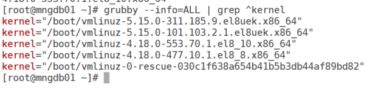
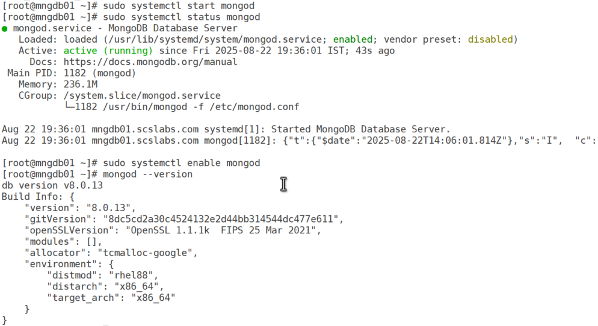
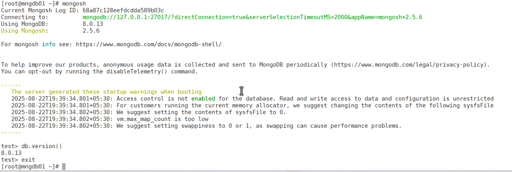
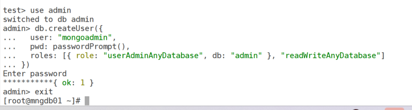
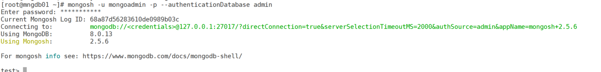

# How to Install MongoDB on Oracle Enterprise Linux 8 (OEL 8)

MongoDB is a powerful, open-source NoSQL database known for its flexibility and scalability. Installing MongoDB on Oracle Enterprise Linux 8 (OEL 8) requires careful steps, as MongoDB only supports the Red Hat Compatible Kernel (RHCK) and not the Unbreakable Enterprise Kernel (UEK). In this blog post, we’ll walk through the step-by-step process to install MongoDB Community Edition (version 8.0, the latest as of August 2025) on OEL 8, configure it, and secure it for production use.

## Prerequisites

- Oracle Linux 8 (64-bit) with RHCK.
- Administrative (root or sudo) privileges.
- Internet connection for downloading packages.
- Basic familiarity with Linux terminal commands.

## Step-by-Step Installation Guide

### Step 1: Verify the Kernel

MongoDB requires the Red Hat Compatible Kernel (RHCK) on Oracle Linux. Let’s verify and switch to RHCK if needed.

1.  **Check the current kernel**:

``` wp-block-code
uname -r
```

If the output contains el8 (e.g., 4.18.0-553.70.1.el8_10.x86_64), you’re using RHCK and can proceed. If it contains el8uek, you’re using UEK and need to switch.

2\. **List installed kernels**

``` wp-block-code
grubby --info=ALL | grep ^kernel
```



Identify a kernel with el8 (e.g., "/boot/vmlinuz-4.18.0-553.70.1.el8_10.x86_64").

**Switch to RHCK kernel** (if needed):

``` wp-block-code
sudo grubby --set-default /boot/vmlinuz-<RHCK_kernel_version>
```

Replace \<RHCK_kernel_version\> with the RHCK kernel version. Then, reboot:

``` wp-block-code
sudo reboot
```

### Step 2: Create the MongoDB Repository

MongoDB isn’t in the default OEL 8 repositories, so we need to add its official repository.

**Create the repository file**:

``` wp-block-code
 vi /etc/yum.repos.d/mongodb-org-8.0.repo
```

**Add the following content**:

``` wp-block-code
[mongodb-org-8.0]
name=MongoDB Repository
baseurl=https://repo.mongodb.org/yum/redhat/$releasever/mongodb-org/8.0/x86_64/
gpgcheck=1
enabled=1
gpgkey=https://pgp.mongodb.com/server-8.0.asc
```

**Save and exit**

### Step 3: Install MongoDB

Install MongoDB Community Edition using the yum package manager.

**Update the package list**:

``` wp-block-code
sudo yum update
```

**Install MongoDB**:

``` wp-block-code
sudo yum install -y mongodb-org
```

This installs the mongodb-org package, including the server (mongod), shell (mongosh), and tools (mongodump, mongorestore). Accept the GPG key if prompted.

### Step 4: Start and Enable MongoDB

MongoDB runs as a systemd service (mongod).

1.  **Start the service**:

``` wp-block-code
sudo systemctl start mongod
```

2\. **Verify the service**:

``` wp-block-code
sudo systemctl status mongod
```

Ensure it shows active (running).

3\. **Enable auto-start on boot**:

``` wp-block-code
sudo systemctl enable mongod
```

4\. **Check the MongoDB version**:

``` wp-block-code
mongod --version
```

Expect output like db version v8.0.x.



### Step 5: Configure MongoDB (Optional)

By default, MongoDB binds to 127.0.0.1 (localhost) and uses /var/lib/mongo for data and /var/log/mongodb/mongod.log for logs. You can customize settings if needed.

1.  **Edit the configuration file** (if required)

``` wp-block-code
sudo vi /etc/mongod.conf
```

Example changes:

- Change bindIp to 0.0.0.0 for remote access (ensure firewall rules allow port 27017).
- Modify dbPath or logPath for custom data/log directories.

2\. Restart MongoDB after changes

``` wp-block-code
sudo systemctl restart mongod
```

### Step 6: Disable SELinux (Optional, for Compatibility)

MongoDB recommends disabling SELinux or setting it to permissive to avoid issues.

1.  **Check SELinux status**:

``` wp-block-code
getenforce
```

Set SELinux to permissive (temporary)

``` wp-block-code
sudo setenforce 0
```

Set SELinux to permissive permanently

``` wp-block-code
sudo vi /etc/selinux/config
```

- Change SELINUX=enforcing to SELINUX=permissive.
- Save and exit.

#### Step 7: Verify Installation

Connect to the MongoDB shell to ensure it’s working.

1.  Access the MongoDB shell:

``` wp-block-code
mongosh
```

This opens the MongoDB shell (mongosh), and you should see a prompt like test\>.

2\. Run a basic command

``` wp-block-code
db.version()
```

- This confirms the MongoDB version.

3\. Exit the shell

``` wp-block-code
exit
```



### Step 8: Secure MongoDB (Recommended)

By default, MongoDB allows connections without authentication. Enable authentication for security.

1.  **Connect to the MongoDB shell**:

``` wp-block-code
mongosh
```

2\. Switch to the admin database:

``` wp-block-code
use admin
```

3\. Create an admin user

``` wp-block-code
db.createUser({
  user: "mongoadmin",
  pwd: passwordPrompt(),
  roles: [{ role: "userAdminAnyDatabase", db: "admin" }, "readWriteAnyDatabase"]
})
```

Enter a secure password when prompted



4\. Enable authentication

Edit /etc/mongod.conf

``` wp-block-code
sudo vi /etc/mongod.conf
```

Add or uncomment the security section

``` wp-block-code
security:
  authorization: enabled
```

Save and exit.

5\. Restart MongoDB

``` wp-block-code
sudo systemctl restart mongod
```

6\. Connect with authentication

``` wp-block-code
mongosh -u mongoadmin -p --authenticationDatabase admin
```



### Notes

- **Prerequisites**: Ensure your system is 64-bit, as MongoDB does not support 32-bit architectures.
- **Firewall**: If connecting remotely, open port 27017

``` wp-block-code
sudo firewall-cmd --add-port=27017/tcp --permanent
sudo firewall-cmd --reload
```

**Troubleshooting**:

- If sudo yum install -y mongodb-org fails with "No package mongodb-org available," verify the repository file and internet connection.
- If mongod.service fails to start, check logs at /var/log/mongodb/mongod.log or ensure the correct kernel (RHCK) is used.

**Uninstallation: To remove MongoDB**

``` wp-block-code
sudo yum erase $(rpm -qa | grep mongodb-org)
sudo rm -r /var/lib/mongo
sudo rm -r /var/log/mongodb
```

### Verification

After installation, MongoDB should be running on port 27017, and you can start creating databases and collections. For further configuration or advanced setups (e.g., replica sets, sharding), refer to the [MongoDB Documentation](https://www.mongodb.com/docs/manual/).
