# How to Install Proxmox VE on a Bare-Metal Server or Virtual Machine

Proxmox VE (Virtual Environment) is one of the most reliable, open-source server virtualization platforms out there — loved by homelabbers, system admins, and enterprise users alike. Whether you're setting it up on a physical server or as a nested VM for testing, this guide will take you through the full installation process.

------------------------------------------------------------------------

## 📦 What You’ll Need

- **Proxmox VE ISO installer** → Download it here
- A **bare-metal server** or a **virtual machine**
- USB drive (for physical server installation)
- A basic understanding of networking and storage devices

## 🔽 Step 1: Download Proxmox VE ISO

Head to the official Proxmox site and download the latest ISO:  
👉 https://www.proxmox.com/en/downloads

[in previous blog we see how to download iso file](https://nithinsunke.wordpress.com/2025/04/22/download-and-create-proxmox-ve-a-step-by-step-guide/)

## 🔥 Step 2: Create a Bootable USB (for Bare-Metal Install)

If you're installing on a physical server:

- Use **Rufus** (Windows) or **balenaEtcher** (Linux/macOS)
- Select your downloaded ISO and USB drive
- Create the bootable media

*If you're installing on a VM, skip this and mount the ISO directly.*

------------------------------------------------------------------------

## ⚙️ Step 3: Boot and Install Proxmox VE

- **Insert the USB / Mount the ISO** in your VM’s settings
- Reboot your server or start your VM
- Select **Install Proxmox VE** from the boot menu

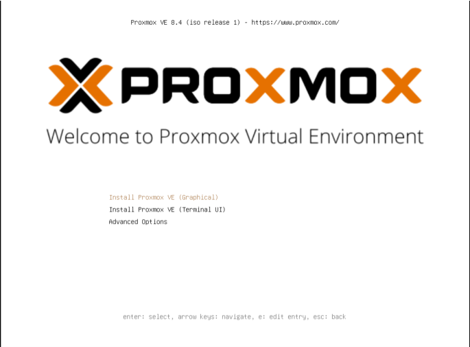

------------------------------------------------------------------------

## 📝 Step 4: Proxmox VE Installation Wizard

1️⃣ Accept the **EULA**

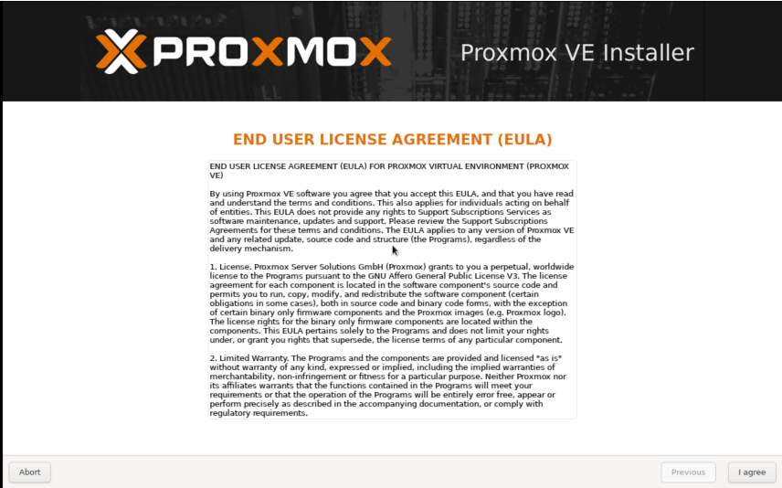

2️⃣ Select the **target disk** for installation

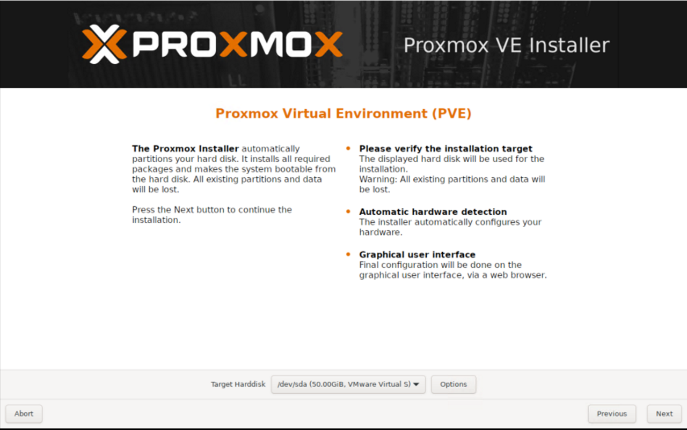

3️⃣ Configure:

- **Country, Timezone, and Keyboard Layout**

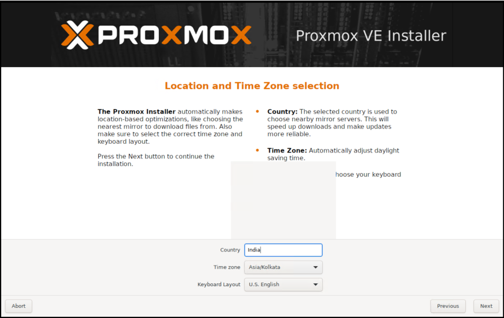

- **Root Password** and **Email Address**

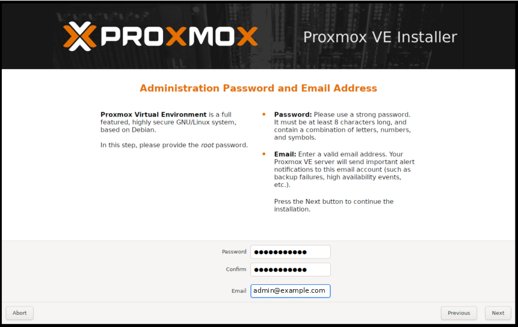

4️⃣ Set **hostname** and **management network IP address**

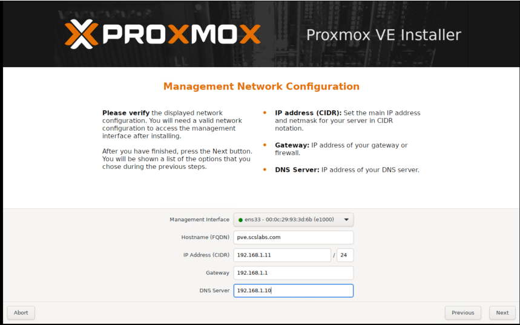

------------------------------------------------------------------------

## 💾 Step 5: Complete Installation & Reboot

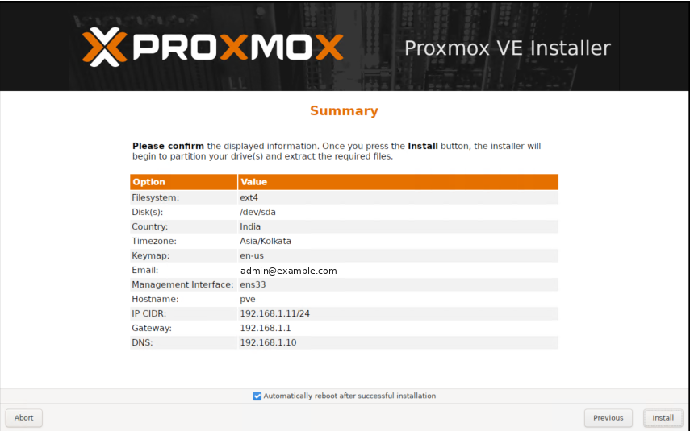

Once the installation is done:

- Remove the USB or unmount the ISO
- Reboot your machine

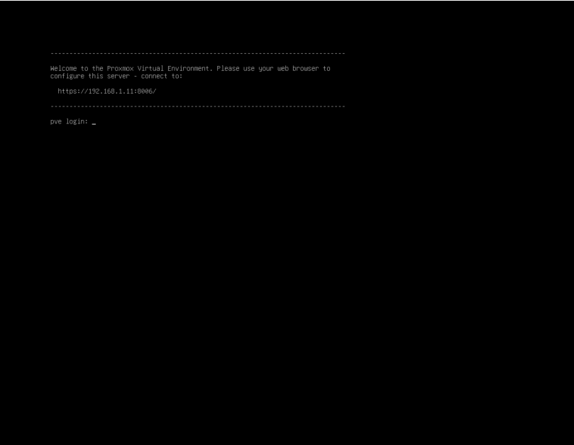

------------------------------------------------------------------------

## 🌐 Step 6: Access Proxmox VE Web Interface

Open your browser and navigate to:

``` wp-block-preformatted
https://<Proxmox-IP>:8006
in our case it is as below
https://192.168.1.11:8006/
```

Log in with:

- **Username:** `root`
- **Password:** the one you set earlier

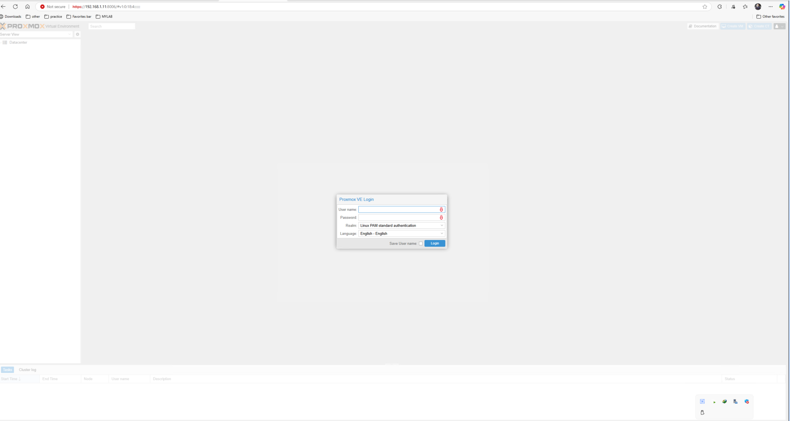

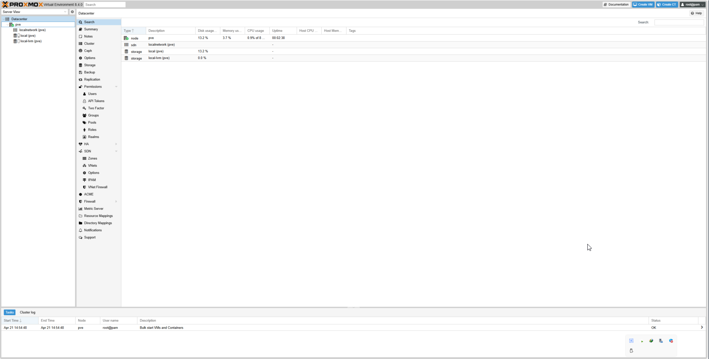

------------------------------------------------------------------------

## 🛠️ Step 7: Post-Installation Essentials

- **Update Proxmox packages** via GUI or CLI
- **Upload ISO images** for virtual machines
- **Configure storage pools**
- **Set up networking bridges** for your VMs
- Optionally, configure a **Proxmox cluster** if you have multiple nodes

**Disable enterprise repo and enable no-subscription repo:**

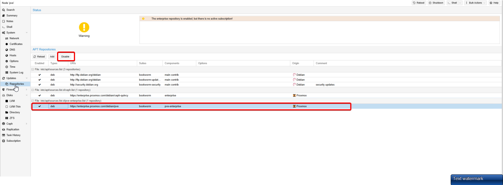

enable no-subscription repo

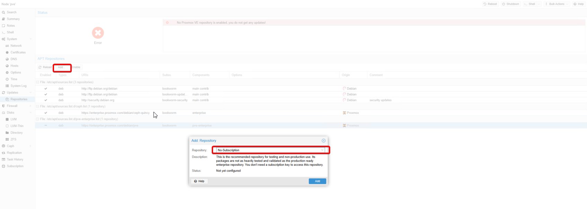

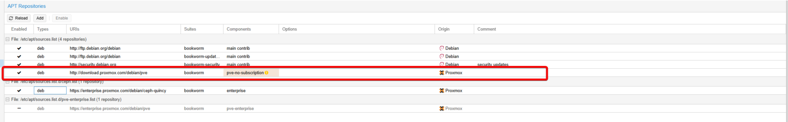

------------------------------------------------------------------------

## 🎉 Conclusion

You now have a fully functional **Proxmox VE installation** running on your hardware or virtual machine. It’s an excellent platform to host your homelab, database servers, test environments, and even production workloads.

------------------------------------------------------------------------

## 💡 Bonus Ideas:

- Install **pfSense firewall** as a VM on Proxmox
- Configure **Proxmox Backup Server** for automated backups
- Create **Proxmox High-Availability (HA) Cluster**
