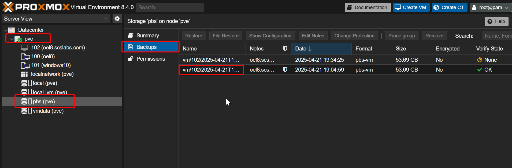
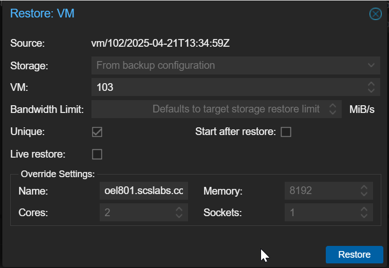
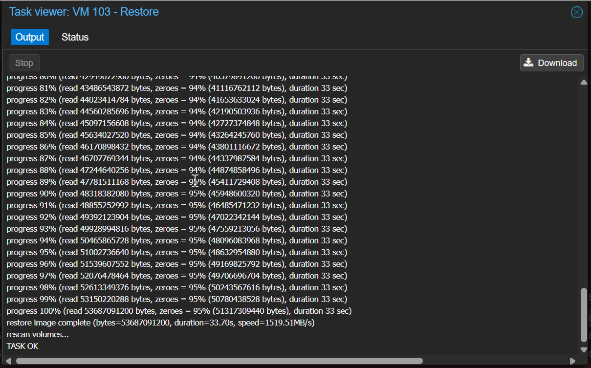

# How to Restore a VM from Proxmox Backup Server (PBS) Backup and Create a New VM

One of the best features of Proxmox Backup Server (PBS) is its seamless integration with Proxmox VE, making VM restores incredibly easy — whether you’re recovering a failed VM or cloning one from a backup to a new VM.

This post walks you through restoring a VM from a PBS backup into Proxmox VE.

### Prerequisites

Proxmox VE server connected to Proxmox Backup Server (PBS)

An existing VM backup in PBS

Adequate storage space for restore

## Browse Available Backups

In **Proxmox VE Web GUI**:

1.  Go to **Datacenter → Storage → (Your PBS Storage)**
2.  Select the **Backups** tab
3.  Browse and locate the VM backup you want to restore
    - You'll see backups listed by **VMID**, type (qemu, lxc), and date

## Step 2: Start the Restore Process

1.  Select the desired backup
2.  Click **Restore**

A restore dialog will appear.

## Step 3: Configure Restore Options

- **VM ID:**  
  You can restore to the same VM ID (overwrites existing VM) or assign a **new VM ID** to create a fresh VM from the backup  
  👉 Example: restoring backup of VM `103` to new VM `150`
- **Target Node:**  
  Select the Proxmox node where you want the new VM restored
- **Storage:**  
  Choose the storage location for the new VM’s virtual disk(s)
- **Restore Options:**
  - `Unique`: Creates a unique MAC address (to avoid network conflicts)
  - `Start after restore`: Auto-starts the VM after restore (optional)
  - `Verify Backup`: Checks integrity before restoring (recommended)

3.  Click **Restore**

## Step 4: Monitor the Restore Process

- Go to **Tasks** or check the **Restore log window**  
  You’ll see disk images being restored, configuration recreated, and the VM registration

## Step 5: Start and Test the Restored VM

1.  Go to **Datacenter → (Node) → (New VM ID)**
2.  Click **Start**
3.  Open **Console** to verify OS boot and functionality

------------------------------------------------------------------------

## 🎉 Done!

Your VM is now restored from backup and running as a new, independent virtual machine in Proxmox VE.

------------------------------------------------------------------------

## 💡 Bonus: Rename the New VM (Optional)

If you restored to a new VM ID and want to update the VM name:

- Go to **VM → Options**
- Change the **Name** field accordingly

------------------------------------------------------------------------

## 📌 Key Use Cases for Restoring from PBS:

- Recovering a failed or deleted VM
- Testing a backup restore (disaster recovery readiness)
- Creating a clone of an existing VM for staging, UAT, or lab

------------------------------------------------------------------------

## ✅ Conclusion

**Proxmox Backup Server + Proxmox VE** makes VM backups and restores incredibly efficient — with deduplication, fast incremental backups, and easy VM restore operations straight from the Web GUI.
