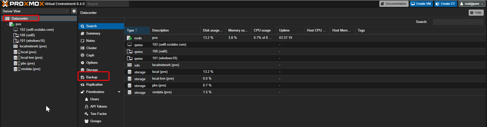
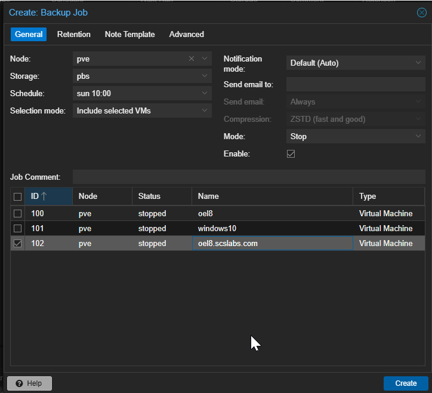
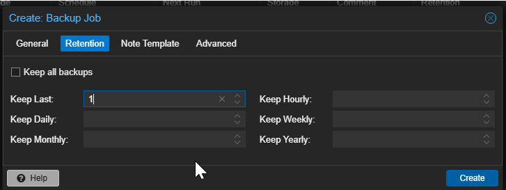
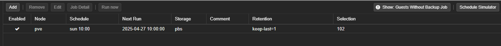

# How to Schedule Automatic Backups for VMs in Proxmox VE with Proxmox Backup Server (PBS)

Once your **Proxmox Backup Server** is up and integrated with **Proxmox VE**, you can easily automate backup jobs for your VMs and containers. This guide will walk you through creating, scheduling, and managing automatic backup jobs in Proxmox.

## Prerequisites

- **Proxmox VE** server with VMs/containers running
- **Proxmox Backup Server (PBS)** configured and connected as a storage target in Proxmox VE
- An existing **Datastore** in PBS for storing backups

## Create a Backup Job (Schedule)

1.  Go to **Datacenter → Backup**

1.  Click **Add**
2.  In the dialog:
    - **Node:** Select the Proxmox node
    - **Storage:** Select your **PBS datastore**
    - **Selection Mode:**
      - `All` – backs up all VMs/CTs
      - `Pool` – backups specific resource pools
      - `VMs` – manually select VMs/CTs
    - **Schedule:** Set your backup schedule using cron-like syntax  
      (e.g., `daily at 2:00 AM` → `02:00`)
    - **Compression:** e.g., `zstd` (fast and efficient)
    - **Mode:**
      - `Snapshot` (recommended — uses live snapshots)
      - `Stop` (VM is shut down before backup)
      - `Suspend` (VM is paused during backup)
    - **Send mail to:** (optional for notifications)
    - **Prune Options:** (optional for retention policy)
      - Keep last N backups, daily, weekly, monthly, etc.
3.  Click **Create**

## Verify the Backup Job

1.  Go to **Datacenter → Backup**
2.  You’ll see the newly created job listed
3.  Click **Run now** to test if needed

## Configure Backup Retention (Prune Job) on PBS

In **PBS Web UI**:

1.  Go to **Datastore → (Your Datastore) → Prune & GC**
2.  Click **Add Prune Job**
3.  Define retention policy:
    - Keep last 3
    - Keep daily for 7 days
    - Keep weekly for 4 weeks
    - Keep monthly for 6 months
4.  Save and schedule it

This helps to automatically clean old backups and save space.

------------------------------------------------------------------------

## 🎉 Done!

Now your **Proxmox VE VMs and containers will be automatically backed up to your PBS datastore** based on your defined schedule and retention policy.

## Bonus Tips:

- Enable **compression** and **deduplication** for storage efficiency
- Regularly run **verify jobs** in PBS to check for backup integrity
- Keep an off-site copy of PBS backups for disaster recovery
