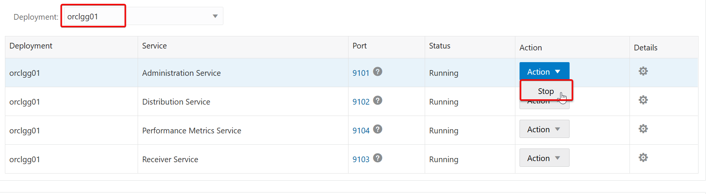
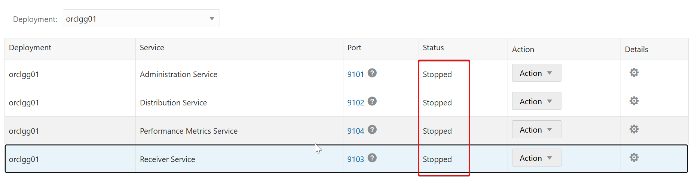
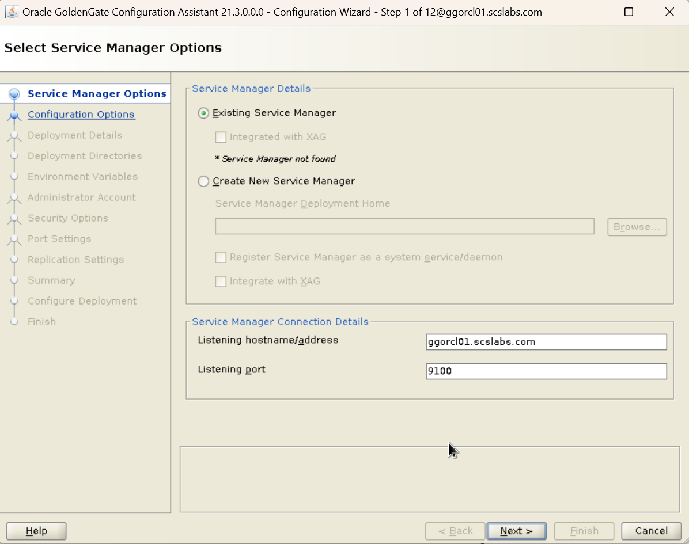
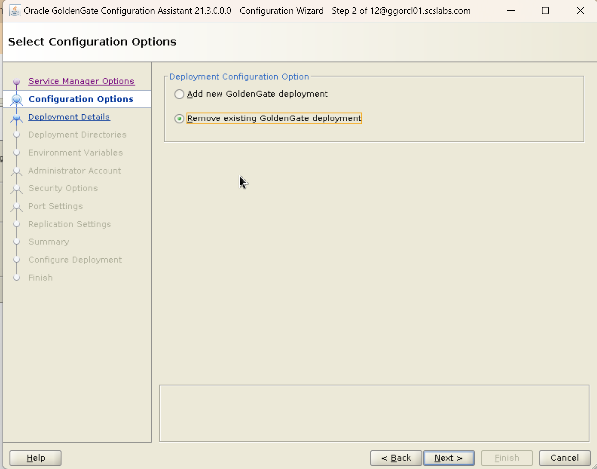
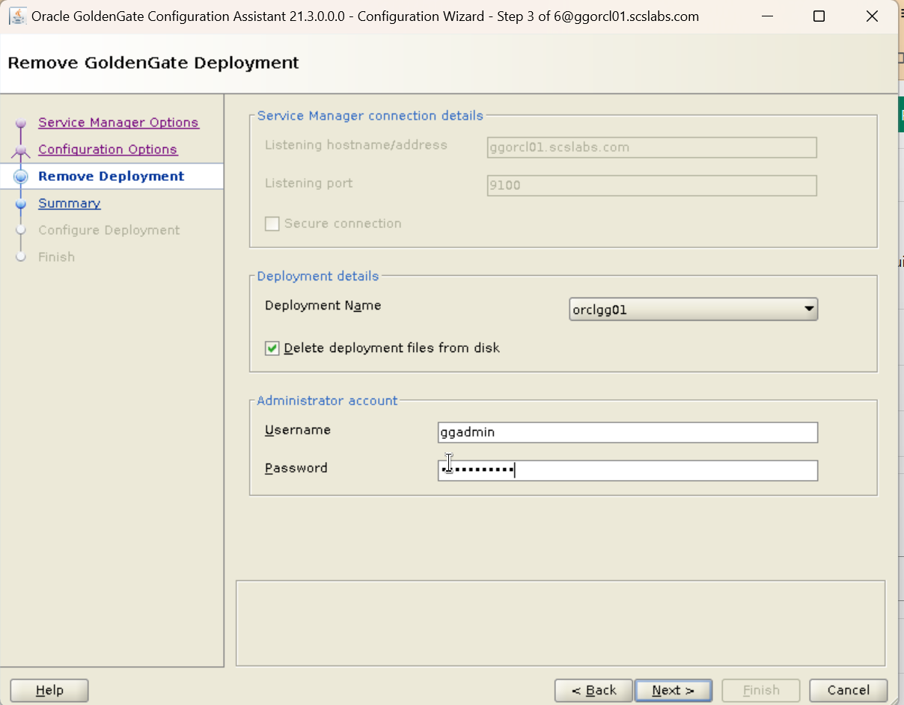
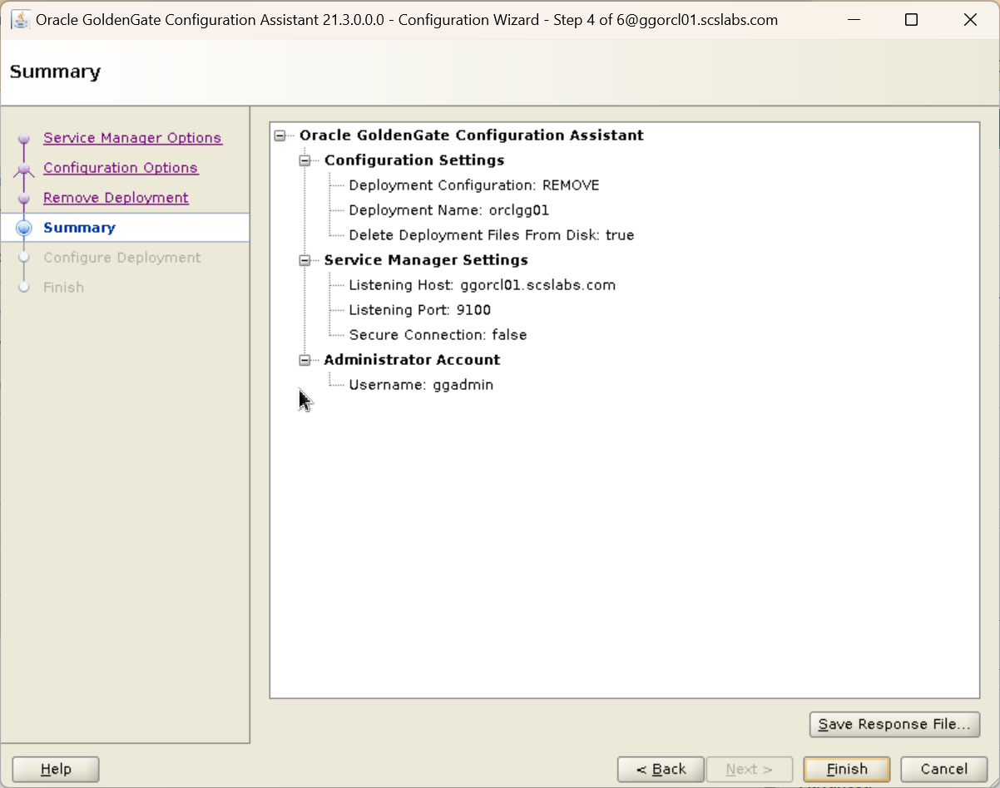
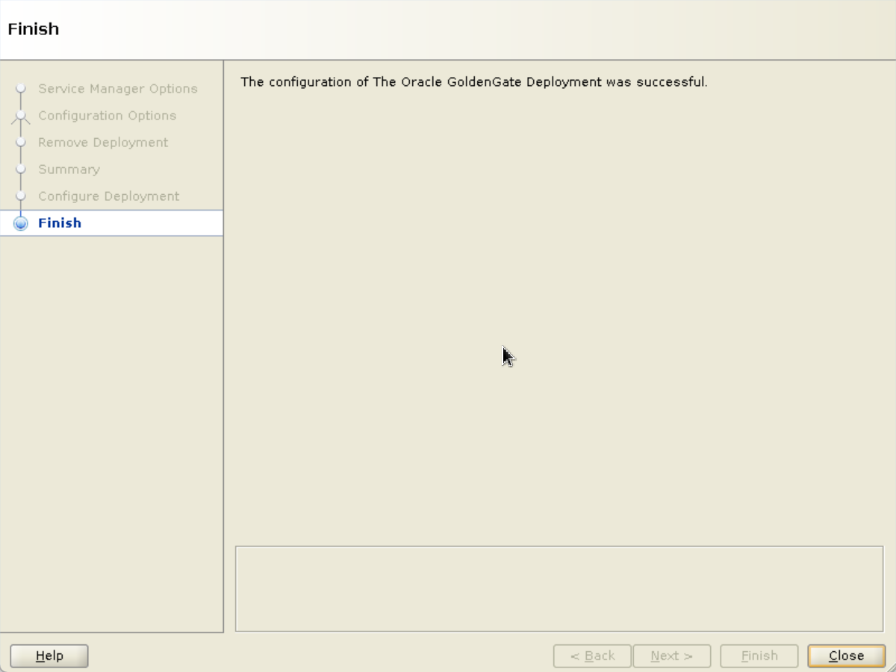

# How to Uninstall Oracle GoldenGate 21c Microservices (Step-by-Step)

Oracle GoldenGate 21c Microservices Architecture (MA) offers a modern, service-based interface for replication management.  
However, there might be times when you need to **uninstall** or **clean up** an existing deployment — maybe for a fresh installation, troubleshooting, or environment cleanup.

In this blog, we’ll walk through **detailed steps** to uninstall Oracle GoldenGate 21c Microservices cleanly.

## Pre-requisites:

- Access to the server where GoldenGate 21c is installed
- Sufficient privileges to stop processes and delete files (root or installation user)
- Backup any important GoldenGate data (trail files, parameter files, etc.) if needed
- Identify:
  - GoldenGate Home (OGG_HOME)
  - Deployment Home (DEPLOYMENT_HOME)

## Step 1: Stop GoldenGate Services

First, you must **gracefully stop** all running GoldenGate services.

Login to your GoldenGate server terminal and navigate to your deployment's AdminClient or use the ServiceManager web UI.

``` wp-block-code
cd $OGG_HOME/bin
[oracle@ggorcl01 bin]$ ./adminclient
Oracle GoldenGate Administration Client for Oracle
Version 21.3.0.0.0 OGGCORE_21.3.0.0.0_PLATFORMS_210728.1047

Copyright (C) 1995, 2021, Oracle and/or its affiliates. All rights reserved.

Oracle Linux 7, x64, 64bit (optimized) on Jul 28 2021 12:32:46
Operating system character set identified as UTF-8.

OGG (not connected) 1> connect http://ggorcl01.scslabs.com:9100 deployment orclgg01 as ggadmin
Password for 'ggadmin' at 'http://ggorcl01.scslabs.com:9100':

OGG (http://ggorcl01.scslabs.com:9100 orclgg01) 2>
```

Connect to your deployment and info all services:

``` wp-block-code
OGG (http://ggorcl01.scslabs.com:9100 orclgg01) 2> info all
Program     Status      Group       Type             Lag at Chkpt  Time Since Chkpt

ADMINSRVR   RUNNING
DISTSRVR    RUNNING
PMSRVR      RUNNING
RECVSRVR    RUNNING
```

 The first step is to stop all the OGG processes running in that deployment, like extracts, replicates, distribution path , receiver path

**Stop the services running for that deployment.**

login into service manager and select the deployment that you want to remove.



stop all the services



### Step 2: remove deployment

**Navigate to the OGG_HOME/bin and run the oggca.sh**

``` wp-block-code
$ $OGG_HOME/bin
$ ./oggca.sh
```





select the deployment and check the delete deployment files from disk.



The deployment will be removed. Click the “Finish” button.





by this we have deleted the deployment.

to completely uninstall goldengate

**Remove ServiceManager Auto-Start Configuration**

Check if ServiceManager is installed as a service:

``` wp-block-code
sudo systemctl list-units | grep -i ServiceManager
```

If present, disable and remove:

``` wp-block-code
# systemctl stop OracleGoldenGate
# systemctl disable OracleGoldenGate
# ls /etc/systemd/system/OracleGoldenGate.service
# rm /etc/systemd/system/OracleGoldenGate.service
```

run deinstall from \$OGG_HOME/deinstall location

``` wp-block-code
[oracle@ggorcl01 ogg21c_ma1]$ cd $OGG_HOME/deinstall/
[oracle@ggorcl01 deinstall]$ ls
deinstall.sh
[oracle@ggorcl01 deinstall]$ ./deinstall.sh

ALERT: Ensure all the processes running from the current Oracle Home are shutdown prior to running this software uninstallation script.

Proceed with removing Oracle GoldenGate home: /u01/app/oracle/ogg21c_ma1 (yes/no)? [no]
yes
Starting Oracle Universal Installer...

Checking swap space: must be greater than 500 MB.   Actual 5119 MB    Passed
Preparing to launch Oracle Universal Installer from /tmp/OraInstall2025-04-26_12-07-17PM. Please wait ...Oracle Universal Installer, Version 12.2.0.9.0 Production
Copyright (C) 1999, 2018, Oracle. All rights reserved.

Starting deinstall

Deinstall in progress (Saturday, April 26, 2025 12:07:22 PM IST)
............................................................... 100% Done.

Deinstall successful

End of install phases.(Saturday, April 26, 2025 12:07:25 PM IST)
End of deinstallations
Please check '/u01/app/oraInventory/logs/silentInstall2025-04-26_12-07-17PM.log' for more details.
[oracle@ggorcl01 deinstall]$
```

## Verify Uninstallation

You can quickly verify if GoldenGate has been removed:

``` wp-block-code
ps -ef | grep -i ogg
```

# Conclusion

That’s it!  
You have **successfully uninstalled Oracle GoldenGate 21c Microservices** from your server.  
Always make sure to stop services gracefully before deletion to avoid leftover artifacts or locked files.

**Tip**:  
Always backup your trail files, parameter files (`*.prm`), credential store (`cwallet.sso`), and configuration JSON files (`deployment/etc/*`) before uninstalling if you think you might need them late
