# Install and Configure Proxmox Backup Server (PBS) — Step-by-Step Guide

**Proxmox Backup Server (PBS)** is an enterprise-grade backup solution for Proxmox VE environments. It provides efficient, secure, and incremental backups for VMs, containers, and physical hosts.

This guide walks you through installing and configuring PBS as a VM on Proxmox VE.

## Prerequisites

- A running **Proxmox VE server**
- **Proxmox Backup Server ISO**  
  Download from: https://www.proxmox.com/en/downloads
- At least **2 vCPUs, 2 GB RAM, and 32 GB disk space** for the PBS VM

## Step 1: Welcome screen

install proxmox backup server (graphical)

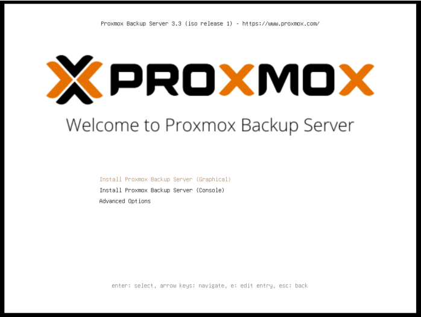

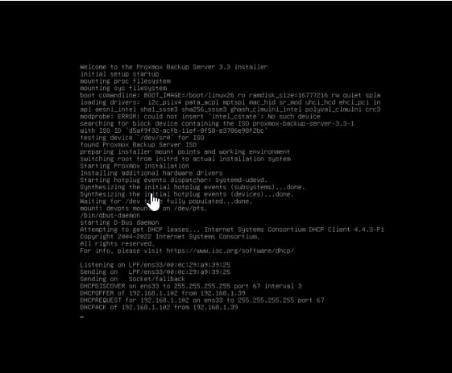

Follow the installation wizard:

- Agree to license

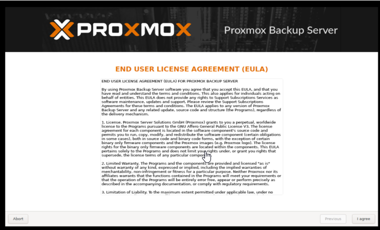

- Select target hard disk

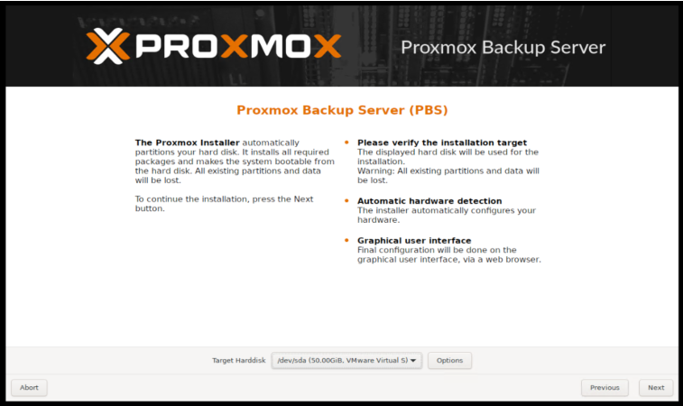

- Configure root password and management interface IP address

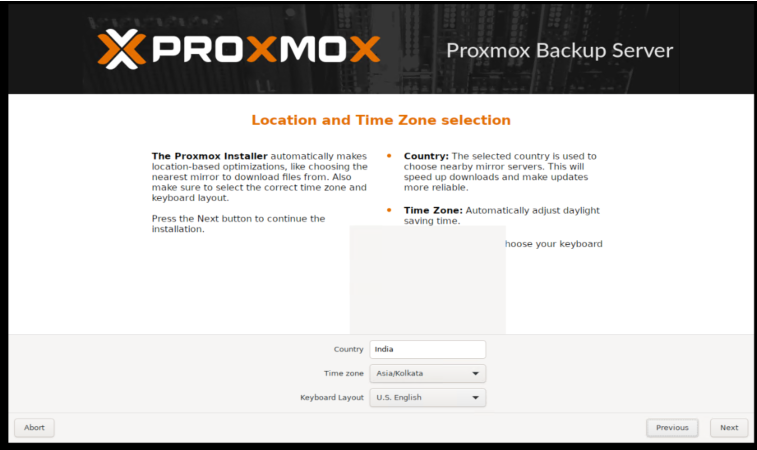

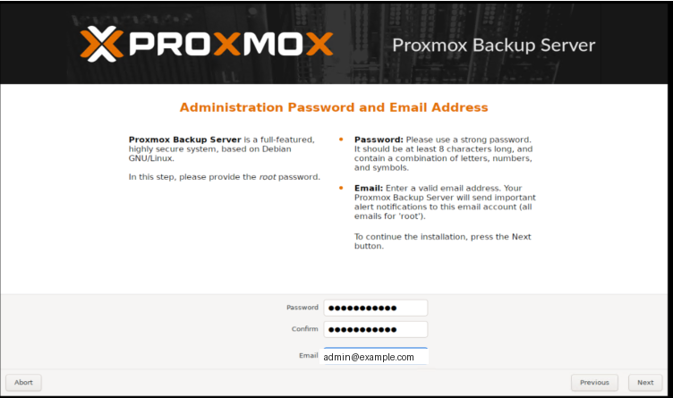

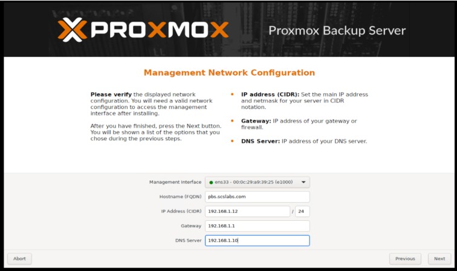

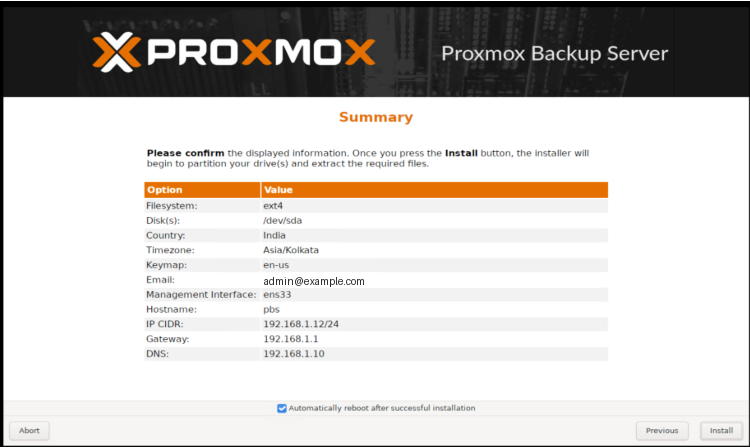

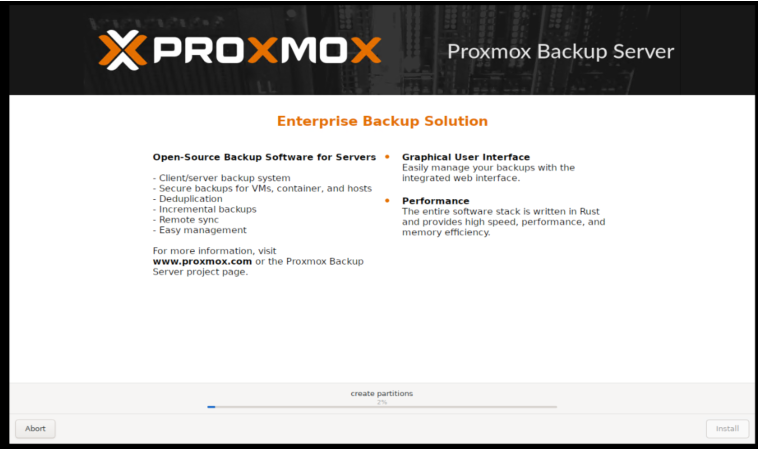

Finish installation and reboot the VM

## Step 2: Access Proxmox Backup Server Web UI

- Open your browser
- Go to:  
  `https://<PBS_VM_IP>:8007`
- Login with **root** and your configured password

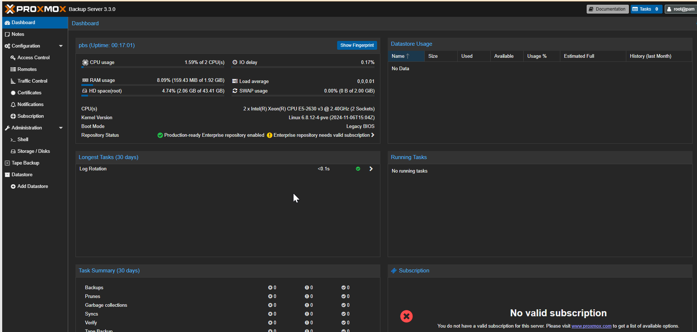

## Step 3: Configure Data Storage in PBS

1.  In the PBS Web UI:
    - Go to **Datastore**
    - Click **Create Datastore**
    - Name your datastore (e.g., `proxmox-backups`)
    - Select storage path (can be a mounted disk or directory)
    - Save

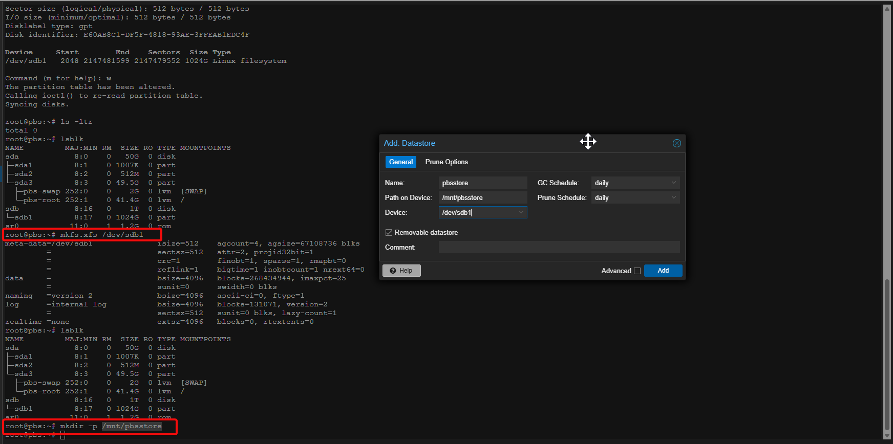

## Step 4: Add Proxmox VE to PBS

1.  In **Proxmox VE Web GUI**:
    - Go to **Datacenter → Storage → Add → Proxmox Backup Server**
    - Enter:
      - **ID**: pbs-backup
      - **Server**: PBS VM IP
      - **Username**: root@pam
      - **Password**: (PBS root password)
      - **Datastore**: Select the one you created
    - Save

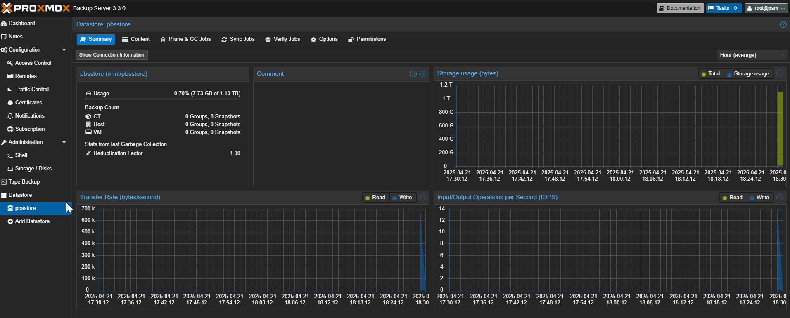

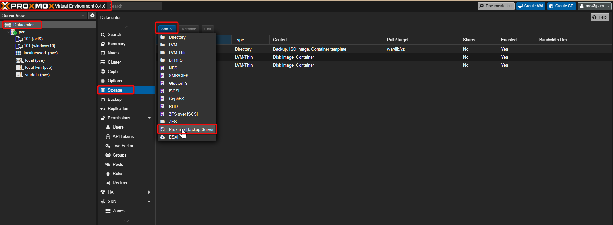

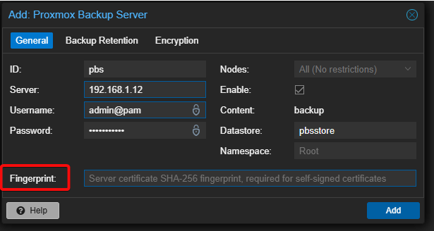

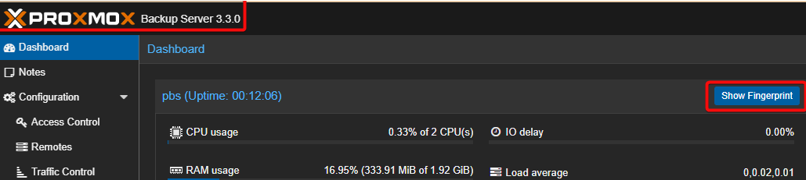

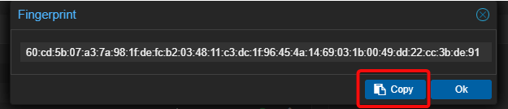

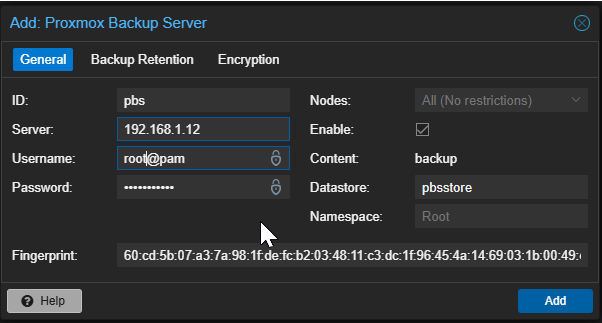

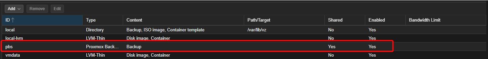

## 🎉 Done!

Now your **Proxmox VE** can back up VMs and containers to your **Proxmox Backup Server VM** efficiently, with incremental deduplicated backups, and fast restores.

## Bonus Tips:

- Schedule backups using **Proxmox VE Datacenter → Backup**
- Use **Prune & Verify Jobs** in PBS to manage storage usage
- Monitor backup performance via PBS dashboard
