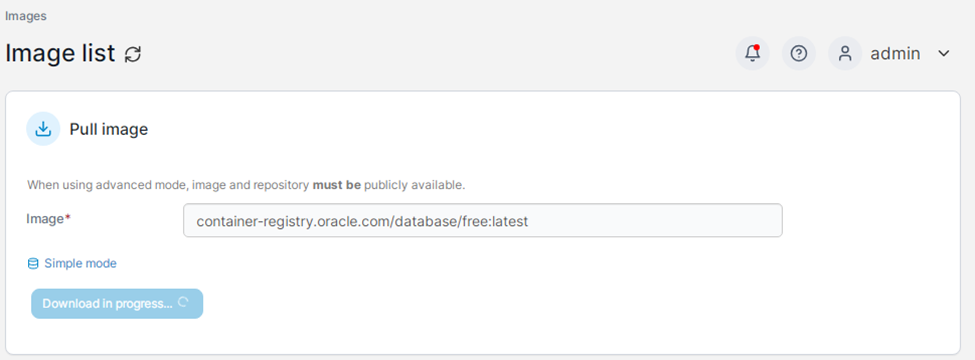
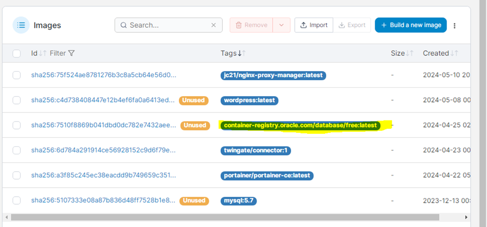
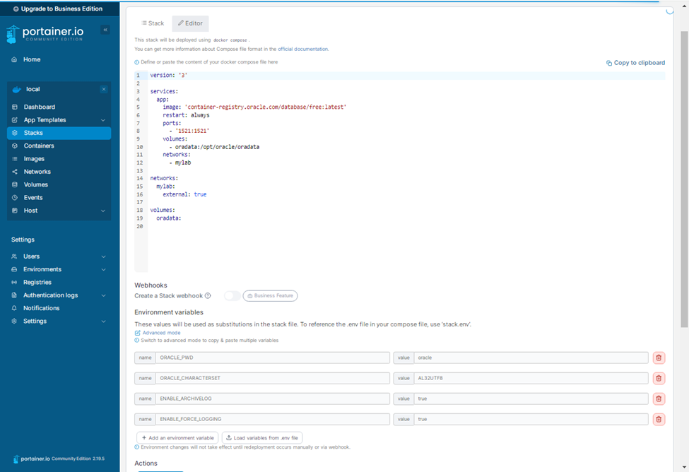
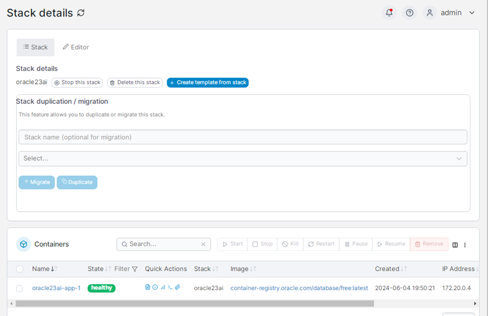
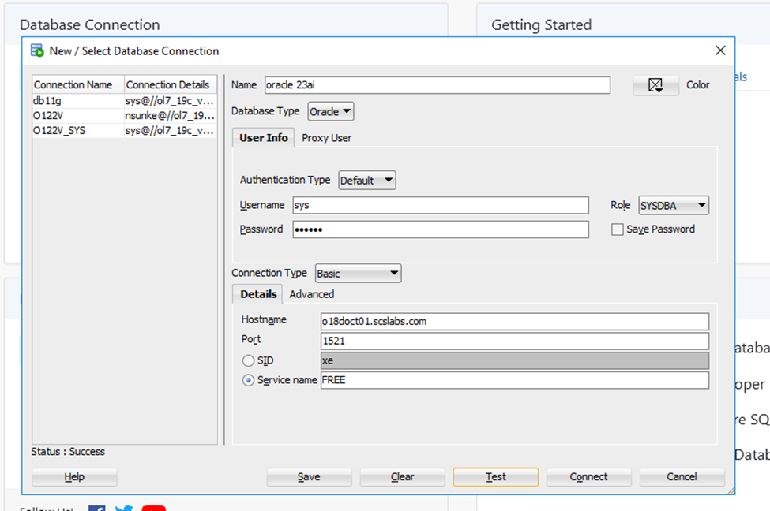
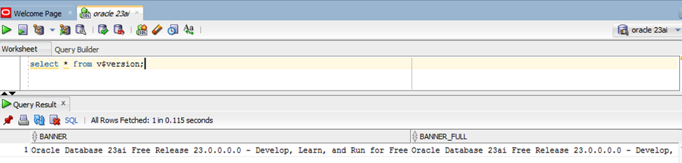

# INSTALLING ORACLE DATABASE 23AI ON DOCKER

In this blog post we will see how to deploy oracle database 23ai on docker

### Assumptions:

You have a ready server where docker is already installed.

Please refer to my previous post where I provided steps to install docker on oracle linux

Here am using Portainer for deploying database.

Portainer is docker container which provides UI for easily managing docker containers



'container-registry.oracle.com/database/free:latest'



Now we  will create a stack from the image



``` wp-block-code
Docker compose file:
version: '3'

services:
  app:
    image: 'container-registry.oracle.com/database/free:latest'
    restart: always
    ports:
      - '1521:1521'
    volumes:
      - oradata:/opt/oracle/oradata
    networks:
      - mylab

networks:
  mylab:
    external: true

volumes:
  oradata:
```

``` wp-block-code
provide environment variables:

ORACLE_PWD=<your database passwords> 
ORACLE_CHARACTERSET=<your character set> 
ENABLE_ARCHIVELOG=true 
ENABLE_FORCE_LOGGING=true 
```

Once database container deployed it will look as below



Now change the sys, system schema passwords

``` wp-block-code
[root@o18doct01 log]# docker exec oracle23ai-app-1 ./setPassword.sh '<password>'
The Oracle base remains unchanged with value /opt/oracle

SQL*Plus: Release 23.0.0.0.0 - Production on Tue Jun 4 14:26:39 2024
Version 23.4.0.24.05

Copyright (c) 1982, 2024, Oracle.  All rights reserved.

Connected to:
Oracle Database 23ai Free Release 23.0.0.0.0 - Develop, Learn, and Run for Free
Version 23.4.0.24.05

SQL>
User altered.

SQL>
User altered.

SQL>
Session altered.

SQL>
User altered.

SQL> Disconnected from Oracle Database 23ai Free Release 23.0.0.0.0 - Develop, Learn, and Run for Free
Version 23.4.0.24.05
```

Now we will connect to the container using sql developer




