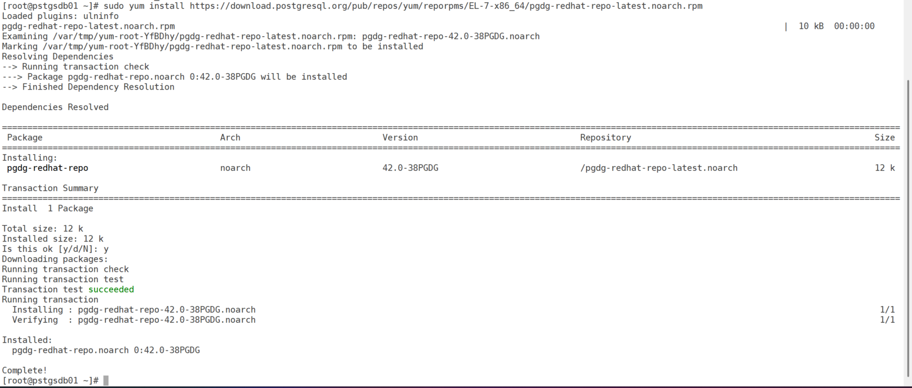
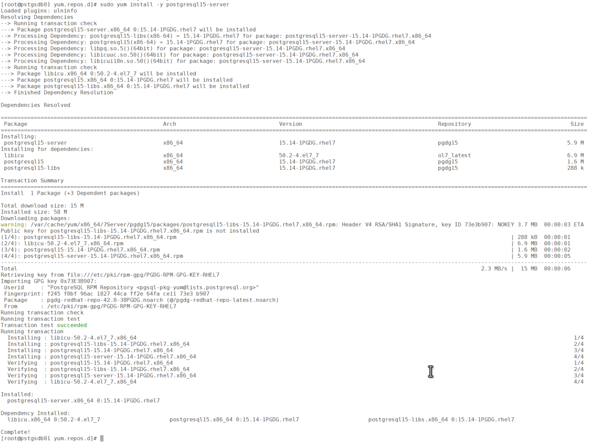
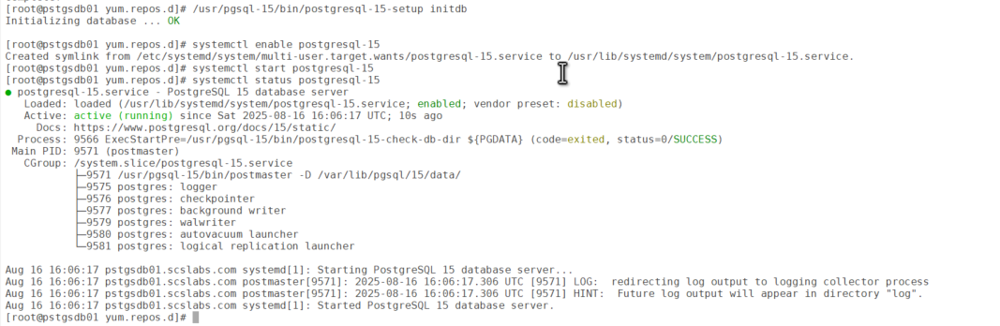

# Installing PostgreSQL 15 on Oracle Enterprise Linux 7 (OEL 7)

PostgreSQL has become one of the most popular open-source relational databases, widely used for transactional workloads, analytics, and even as a replacement for proprietary RDBMS. In this guide, we’ll walk through installing PostgreSQL on **Oracle Enterprise Linux 7 (OEL 7)** using the official PostgreSQL Yum repositories.

## Prerequisites

- Oracle Enterprise Linux 7 (minimal or server install).
- Root or sudo privileges.
- Internet access to fetch PostgreSQL packages.

Update system packages first:

``` wp-block-code
sudo yum update -y
```

### Step 1: Enable the PostgreSQL Yum Repository

- The PostgreSQL Global Development Group maintains official repos for RHEL/CentOS/OEL.
- Download the repo RPM (example: PostgreSQL 17 – latest stable release):

``` wp-block-code
sudo yum install https://download.postgresql.org/pub/repos/yum/reporpms/EL-7-x86_64/pgdg-redhat-repo-latest.noarch.rpm
```



### Step 2 Install PostgreSQL

``` wp-block-code
sudo yum install -y postgresql15-server
```



### Step 3 initialize the database and enable automatic start

``` wp-block-code
sudo /usr/pgsql-15/bin/postgresql-15-setup initdb
sudo systemctl enable postgresql-15
sudo systemctl start postgresql-15
```


