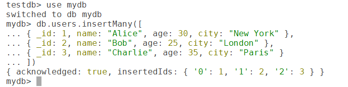
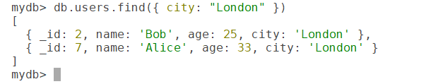
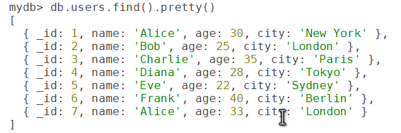
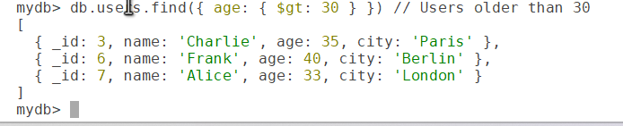
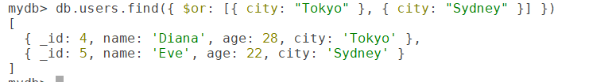
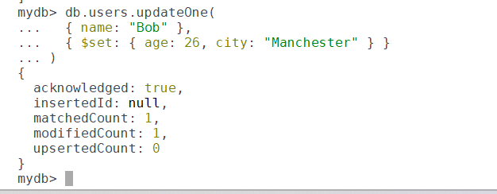

# Mastering CRUD Operations in MongoDB

MongoDB, a popular NoSQL database, is known for its flexibility in handling unstructured or semi-structured data. At the heart of interacting with MongoDB collections are **CRUD operations**: Create, Read, Update, and Delete. These operations allow developers to manage data efficiently in MongoDB. This blog post dives into each CRUD operation, providing examples and best practices to help you master data manipulation in MongoDB.

## What are CRUD Operations?

CRUD stands for:

- **Create**: Adding new documents to a collection.
- **Read**: Retrieving documents from a collection.
- **Update**: Modifying existing documents.
- **Delete**: Removing documents from a collection.

These operations are fundamental to any database system, and MongoDB provides a straightforward and powerful syntax to perform them. Let’s explore each operation with examples using the MongoDB shell.

## Setting Up a Sample Collection

For demonstration, we’ll use a users collection in a database named mydb. If you’re following along, you can create a sample collection with a few documents:

``` wp-block-code
use mydb
db.users.insertMany([
  { _id: 1, name: "Alice", age: 30, city: "New York" },
  { _id: 2, name: "Bob", age: 25, city: "London" },
  { _id: 3, name: "Charlie", age: 35, city: "Paris" }
])
```



## 1. Create Operations

Create operations add new documents to a collection. MongoDB provides methods like insertOne() and insertMany() for this purpose.

### Inserting a Single Document

To add one document to the users collection:

``` wp-block-code
db.users.insertOne({
  _id: 4,
  name: "Diana",
  age: 28,
  city: "Tokyo"
})
```

**Output**: Confirms the insertion with the document’s \_id.

### Inserting Multiple Documents

To add multiple documents at once:

``` wp-block-code
db.users.insertMany([
  { _id: 5, name: "Eve", age: 22, city: "Sydney" },
  { _id: 6, name: "Frank", age: 40, city: "Berlin" }
])
```

**Output**: Returns the inserted \_id values for the documents.

### Notes

- If you don’t specify an \_id, MongoDB generates a unique ObjectId automatically.
- Use insertOne() for single insertions and insertMany() for bulk operations to optimize performance.

## 2. Read Operations

Read operations retrieve documents from a collection using methods like findOne() and find().

### Finding a Single Document

To retrieve one document matching a query:

``` wp-block-code
db.users.findOne({ name: "Alice" })
```


**Output**: Returns the first matching document, e.g., { \_id: 1, name: "Alice", age: 30, city: "New York" }.

### Finding Multiple Documents

To retrieve all documents or those matching a query:

``` wp-block-code
db.users.find({ city: "London" })
```



**Output**: Returns a cursor with matching documents,

To make the output more readable, use pretty():

``` wp-block-code
db.users.find().pretty()
```



### Query Operators

MongoDB supports operators for complex queries:

- **Comparison**: \$eq, \$gt, \$lt, etc.

``` wp-block-code
db.users.find({ age: { $gt: 30 } }) // Users older than 30
```



- **Logical**: \$and, \$or, \$not

``` wp-block-code
db.users.find({ $or: [{ city: "Tokyo" }, { city: "Sydney" }] })
```



### Notes

- Use findOne() for single-document retrieval and find() for multiple documents.
- Indexes on frequently queried fields (e.g., name or city) can improve read performance.

## 3. Update Operations

Update operations modify existing documents using updateOne(), updateMany(), or replaceOne().

### Updating a Single Document

To update the first matching document:

``` wp-block-code
db.users.updateOne(
  { name: "Bob" },
  { $set: { age: 26, city: "Manchester" } }
)
```



**Output**: Confirms the number of documents matched and modified.

### Updating Multiple Documents

To update all matching documents:

``` wp-block-code
db.users.updateMany(
  { city: "New York" },
  { $set: { country: "USA" } }
)
```

### Replacing a Document

To replace an entire document (except \_id):

``` wp-block-code
db.users.replaceOne(
  { name: "Diana" },
  { name: "Diana", age: 29, city: "Osaka", country: "Japan" }
)
```

### Update Operators

Common operators include:

- \$set: Updates specific fields.
- \$inc: Increments a numeric field, e.g., { \$inc: { age: 1 } }.
- \$push: Adds an element to an array, e.g., { \$push: { hobbies: "reading" } }.

### Notes

- Use \$set to avoid overwriting unintended fields.
- Ensure indexes exist for fields used in update queries to optimize performance.

## 4. Delete Operations

Delete operations remove documents using deleteOne() or deleteMany().

### Deleting a Single Document

To remove the first matching document:

``` wp-block-code
db.users.deleteOne({ name: "Frank" })
```

**Output**: Confirms the number of documents deleted.

### Deleting Multiple Documents

To remove all matching documents:

``` wp-block-code
db.users.deleteMany({ city: "Paris" })
```

### Notes

- Be cautious with deleteMany(), as it can remove large numbers of documents.
- Deleted documents cannot be recovered unless you have a backup or use transactions.

## Best Practices for CRUD Operations

- **Use Indexes**: Create indexes on fields used in queries to optimize find(), update(), and delete() operations.

``` wp-block-code
db.users.createIndex({ name: 1 })
```

- **Validate Data**: Use MongoDB’s schema validation to enforce data integrity during insert and update operations.
- **Batch Operations**: For bulk inserts or updates, use insertMany() or updateMany() to reduce network overhead.
- **Error Handling**: Check the output of operations (e.g., matchedCount, modifiedCount) to confirm success.
- **Use Transactions**: For multi-document operations requiring consistency, use transactions.
- **Test Queries**: Use explain() to analyze query performance and ensure indexes are utilized:  

``` wp-block-code
db.users.find({ city: "Tokyo" }).explain("executionStats")
```

## Common Use Cases

- **User Management**: Inserting user profiles, updating preferences, or deleting inactive accounts.
- **E-commerce**: Adding products, querying inventory, updating prices, or removing discontinued items.
- **Real-Time Analytics**: Storing and retrieving event data, updating counters, or deleting expired logs.
- **Content Management**: Managing blog posts or comments with flexible schemas.

## Conclusion

CRUD operations are the backbone of interacting with MongoDB, enabling developers to create, read, update, and delete data efficiently. By mastering these operations and following best practices, you can build robust and performant applications. Experiment with the examples above in a MongoDB shell or Atlas cluster, and refer to the MongoDB documentation for advanced features like aggregation pipelines or change streams.
