# Migrate non-cdb database from windows to linux machine cdb database using remote clone via db_link

## Introduction

Migrating an Oracle Non-CDB database from a Windows environment to a Linux-based CDB can be streamlined using the remote clone feature via a database link. This method allows for a direct, minimal-downtime migration while ensuring data integrity and compatibility.

## Prerequisites

Before starting the migration, ensure the following:

- Source database is running on Windows (Non-CDB)
- Target database is a Container Database (CDB) on Linux
- Both databases are on compatible Oracle versions (19c+ recommended)
- Database link is created between source and target
- Sufficient storage and resources are available on the target server
- Archive log mode is enabled on both databases

Step-by-Step Migration Process:

Source oracle noncdb database installed on windows 10

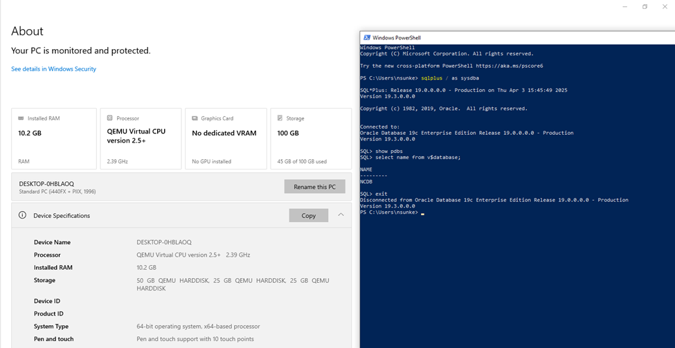

target cdb oracle database installed on ole8

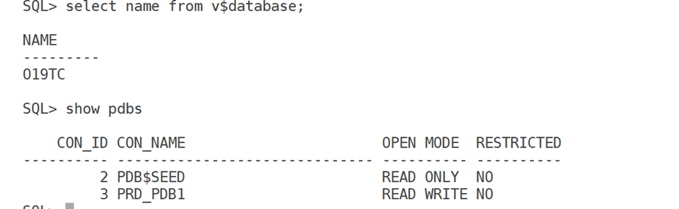

On source database describe the database to xml file

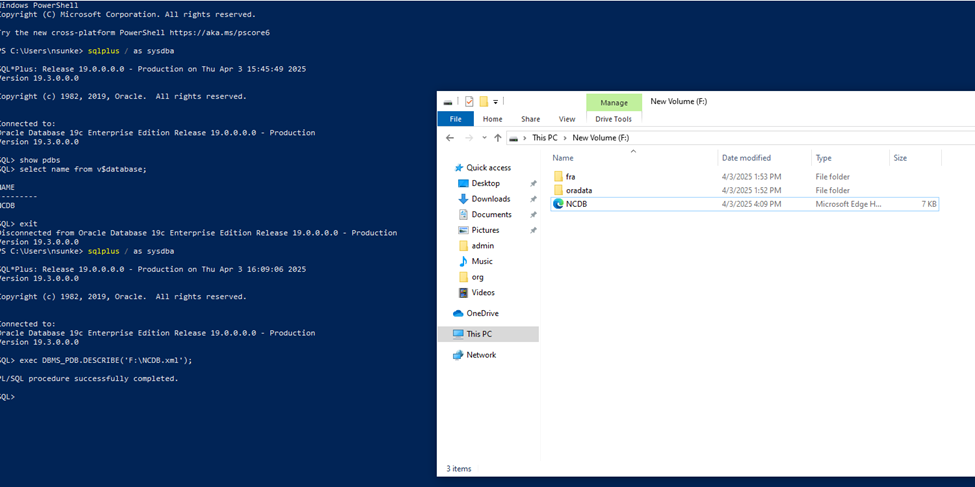

Copy NCDB.xml file to target database node and validate the compatibility.

``` wp-block-code
set serveroutput on
DECLARE
compatible CONSTANT VARCHAR2(3) := CASE DBMS_PDB.CHECK_PLUG_COMPATIBILITY( pdb_descr_file => '/home/oracle/NCDB.xml', pdb_name => 'NCDB') WHEN TRUE THEN 'YES' ELSE 'NO'
END;
BEGIN
DBMS_OUTPUT.PUT_LINE('Is the future PDB compatible?  ==>  ' || compatible);
END;
/
```

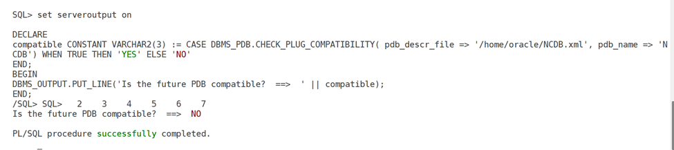

check for pdb plugin violations:

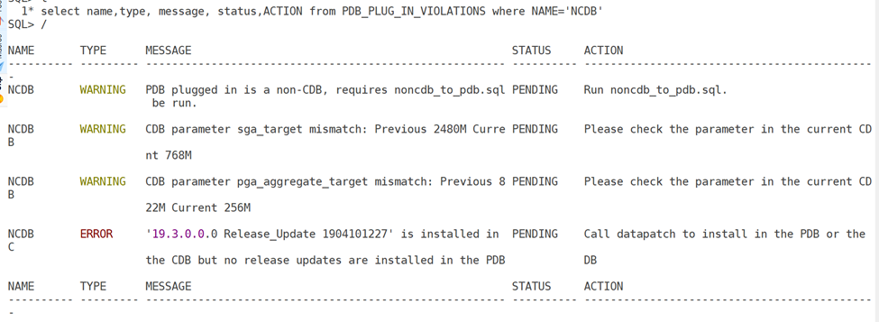

we can ignore above error as source and target databases are at different patch level that can be solved by running datapatch.

add tns entry of window db in target server (linux):

``` wp-block-code
ncdb =
  (DESCRIPTION =
    (ADDRESS = (PROTOCOL = TCP)(HOST = wo19cdb01.scslabs.com)(PORT = 1521))
    (CONNECT_DATA =
      (SERVER = DEDICATED)
      (SERVICE_NAME = NCDB)
    )
  )
```

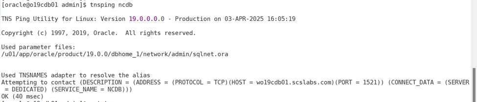

``` wp-block-code
[oracle@o19cdb01 admin]$ sqlplus sys/xxxxx @ncdb as sysdba
SQL*Plus: Release 19.0.0.0.0 - Production on Thu Apr 3 16:06:07 2025
Version 19.3.0.0.0
Copyright (c) 1982, 2019, Oracle.  All rights reserved.
Connected to:
Oracle Database 19c Enterprise Edition Release 19.0.0.0.0 - Production
Version 19.3.0.0.0
SQL> select name from v$database;
NAME
---------
NCDB
```

**create migration user and grant privileges on source**

``` wp-block-code
SQL> create user migusr identified by xxxx;
User created.

SQL> grant create session, sysoper to migusr;
Grant succeeded.

SQL> GRANT CREATE PLUGGABLE DATABASE TO migusr;
Grant succeeded.
```

**at target side create database link poining to source database:**

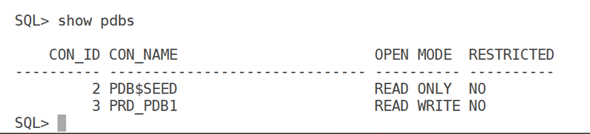

``` wp-block-code
SQL> create database link MIGDBLINK connect to  migusr identified by xxxxxx  using 'NCDB';
Database link created.

SQL> select * from dual@MIGDBLINK;
D
-
X
```

**create a pluggable database using db_link and auto refresh for every 1min.**

``` wp-block-code
SQL> create pluggable database NCDB from NCDB@MIGDBLINK refresh mode every 1 minutes parallel 2;
Pluggable database created.

SQL> show pdbs
    CON_ID CON_NAME                       OPEN MODE  RESTRICTED
---------- ------------------------------ ---------- ----------
         2 PDB$SEED                       READ ONLY  NO
         3 PRD_PDB1                       READ WRITE NO
         5 NCDB                           MOUNTED

SQL> set lines 300
col pdb_name for a15
col open_mode for a15
col restricted for a15
col status for a15
col refresh_mode for a15
col refresh_interval for 999
select p.pdb_name, v.open_mode, v.restricted, p.status, p.refresh_mode, p.refresh_interval
from v$pdbs v join dba_pdbs p on (v.con_id =p.pdb_id)
where p.pdb_name='NCDB' order by v.con_id
;

PDB_NAME        OPEN_MODE       RESTRICTED      STATUS          REFRESH_MODE    REFRESH_INTERVAL
--------------- --------------- --------------- --------------- --------------- ----------------
NCDB            MOUNTED                         REFRESHING      AUTO                           1
SQL> exit
```

**as a final cutover shut down the applications  and make sure no connections from application servers and do a final refresh(downtime start):**

``` wp-block-code
select sid,username,status, MACHINE from v$session where username is not null;
```

the above query should not return any rows from application machine.

**at target do a final manual refresh to sync with source db:**

``` wp-block-code
SQL>  alter pluggable database  NCDB refresh;
Pluggable database altered.

SQL> show pdbs

    CON_ID CON_NAME                       OPEN MODE  RESTRICTED
---------- ------------------------------ ---------- ----------
         2 PDB$SEED                       READ ONLY  NO
         3 PRD_PDB1                       READ WRITE NO
         4 NCDB                           MOUNTED
SQL>

SQL> alter pluggable database  NCDB refresh mode none;
Pluggable database altered.

SQL> alter pluggable database NCDB open upgrade
Pluggable database altered.

SQL> select name, open_mode, restricted from v$pdbs where name='NCDB';
NAME       OPEN_MODE       RESTRICTED
---------- --------------- ---------------
NCDB       MIGRATE         YES
SQL> exit
Disconnected from Oracle Database 19c Enterprise Edition Release 19.0.0.0.0 - Production
Version 19.25.0.0.0
```

**Note: i have observed issue with java component where the executable version is mismatch.**

``` wp-block-code
SQL> alter session set container=NCDB;
Session altered.

SQL> select dbms_java.get_jdk_version() from dual;
select dbms_java.get_jdk_version() from dual
                                        *
ERROR at line 1:
ORA-29548: Java system class reported: release of Java system classes in the
database (19.3.0.0.0 1.8) does not match that of the oracle executable
(19.0.0.0.0 1.8)
```

fix from oracle support doc: **ORA-29548: Java system class reported (Doc ID 2905337.1)**

from oracle note to run update_javavm_db.sql to resolve the issue. without the fix datapatch will fail as shown below issues section

``` wp-block-code
SQL>  @?/javSQL>  @?/javavm/install/update_javavm_db.sql
SQL> SET FEEDBACK 1
SQL> SET NUMWIDTH 10
SQL> SET LINESIZE 80
SQL> SET TRIMSPOOL ON
SQL> SET TAB OFF
SQL> SET PAGESIZE 100
SQL>
SQL> alter session set "_ORACLE_SCRIPT"=true;

Session altered.

SQL>
SQL> -- If Java is installed, do CJS.
SQL>
SQL> -- If CJS can deal with the SROs inconsistent with the new JDK,
SQL> -- the drop_sros() call here can be removed.
SQL> call initjvmaux.drop_sros();

Call completed.

SQL>
SQL> create or replace java system;
  2  /

Java created.

SQL>
SQL> update dependency$
  2    set p_timestamp=(select stime from obj$ where obj#=p_obj#)
  3    where (select stime from obj$ where obj#=p_obj#)!=p_timestamp and
  4          (select type# from obj$ where obj#=p_obj#)=29  and
  5          (select owner# from obj$ where obj#=p_obj#)=0;

0 rows updated.

SQL>
SQL> commit;

Commit complete.

SQL>
SQL> alter session set "_ORACLE_SCRIPT"=false;

Session altered.

avm/install/update_javavm_db.sql
SQL> SET FEEDBACK 1
SQL> SET NUMWIDTH 10
SQL> SET LINESIZE 80
SQL> SET TRIMSPOOL ON
SQL> SET TAB OFF
SQL> SET PAGESIZE 100
SQL>
SQL> alter session set "_ORACLE_SCRIPT"=true;

Session altered.

SQL>
SQL> -- If Java is installed, do CJS.
SQL>
SQL> -- If CJS can deal with the SROs inconsistent with the new JDK,
SQL> -- the drop_sros() call here can be removed.
SQL> call initjvmaux.drop_sros();

Call completed.

SQL>
SQL> create or replace java system;
  2  /

Java created.

SQL>
SQL> update dependency$
  2    set p_timestamp=(select stime from obj$ where obj#=p_obj#)
  3    where (select stime from obj$ where obj#=p_obj#)!=p_timestamp and
  4          (select type# from obj$ where obj#=p_obj#)=29  and
  5          (select owner# from obj$ where obj#=p_obj#)=0;

0 rows updated.

SQL>
SQL> commit;

Commit complete.

SQL>
SQL> alter session set "_ORACLE_SCRIPT"=false;

Session altered.
```

``` wp-block-code
SQL> SQL> select dbms_java.get_jdk_version() from dual; 

DBMS_JAVA.GET_JDK_VERSION()
 -------------------------------------------------------------------------------- 
1.8.0_201 
1 row selected. 
```

now run the datapatch

``` wp-block-code
[oracle@oa19cdb01 OPatch]$ ./datapatch -verbose -pdbs NCDB
SQL Patching tool version 19.3.0.0.0 Production on Thu Apr  3 17:14:17 2025
Copyright (c) 2012, 2019, Oracle.  All rights reserved.

Log file for this invocation: /u01/app/oracle/cfgtoollogs/sqlpatch/sqlpatch_4403_2025_04_03_17_14_17/sqlpatch_invocation.log

Connecting to database...OK
Gathering database info...done

Note:  Datapatch will only apply or rollback SQL fixes for PDBs
       that are in an open state, no patches will be applied to closed PDBs.
       Please refer to Note: Datapatch: Database 12c Post Patch SQL Automation
       (Doc ID 1585822.1)

Bootstrapping registry and package to current versions...done
Determining current state...done

Current state of interim SQL patches:
  No interim patches found

Current state of release update SQL patches:
  Binary registry:
    19.3.0.0.0 Release_Update 190410122720: Installed
  PDB NCDB:
    No release update patches installed

Adding patches to installation queue and performing prereq checks...done
Installation queue:
  For the following PDBs: NCDB
    No interim patches need to be rolled back
    Patch 29517242 (Database Release Update : 19.3.0.0.190416 (29517242)):
      Apply from 19.1.0.0.0 Feature Release to 19.3.0.0.0 Release_Update 190410122720
    No interim patches need to be applied

Installing patches...
Patch installation complete.  Total patches installed: 1

Validating logfiles...done
Patch 29517242 apply (pdb NCDB): SUCCESS
  logfile: /u01/app/oracle/cfgtoollogs/sqlpatch/29517242/22862832/29517242_apply_O19TC_NCDB_2025Apr03_17_15_00.log (no errors)
SQL Patching tool complete on Thu Apr  3 17:20:24 2025
[oracle@oa19cdb01 OPatch]$
```

Check the PDB_PLUG_IN_VIOLATIONS

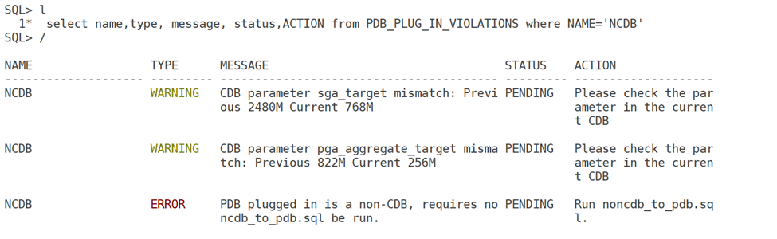

### **Run noncdb_to_pdb.sql:**

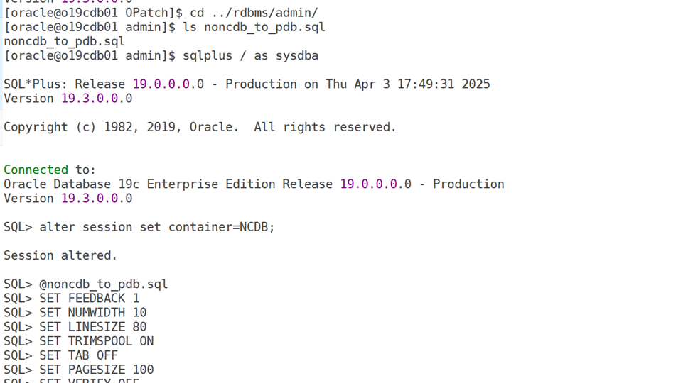

.

.

.

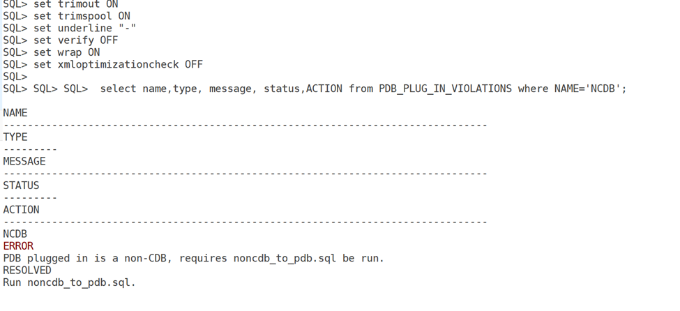

Open the pdb in normal mode.

``` wp-block-code
[oracle@oa19cdb01 OPatch]$ sqlplus / as sysdba

SQL*Plus: Release 19.0.0.0.0 - Production on Wed Mar 26 13:52:10 2025
Version 19.25.0.0.0

Copyright (c) 1982, 2024, Oracle.  All rights reserved.

Connected to:
Oracle Database 19c Enterprise Edition Release 19.0.0.0.0 - Production
Version 19.25.0.0.0

SQL> show pdbs

    CON_ID CON_NAME                       OPEN MODE  RESTRICTED
---------- ------------------------------ ---------- ----------
         2 PDB$SEED                       READ ONLY  NO
         3 PRD_PDB1                       READ WRITE NO
         4 NCDB                           MIGRATE    YES
SQL> alter pluggable database NCDB close immediate;

Pluggable database altered.

SQL> alter pluggable database NCDB  open;

Pluggable database altered.

SQL> show pdbs

    CON_ID CON_NAME                       OPEN MODE  RESTRICTED
---------- ------------------------------ ---------- ----------
         2 PDB$SEED                       READ ONLY  NO
         3 PRD_PDB1                       READ WRITE NO
         4 NCDB                           READ WRITE NO
SQL>
```

Enable TDE for NCDB pdb.


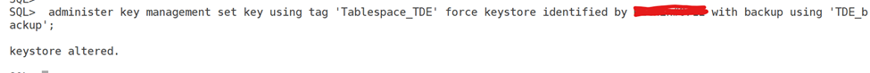

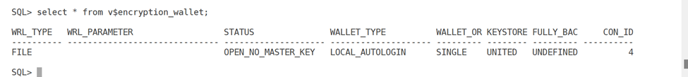

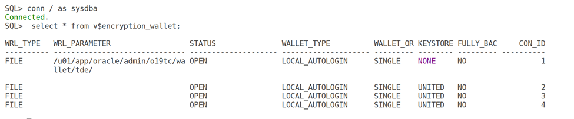

**Encrypt tablespaces:**

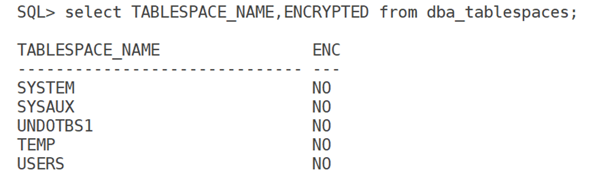

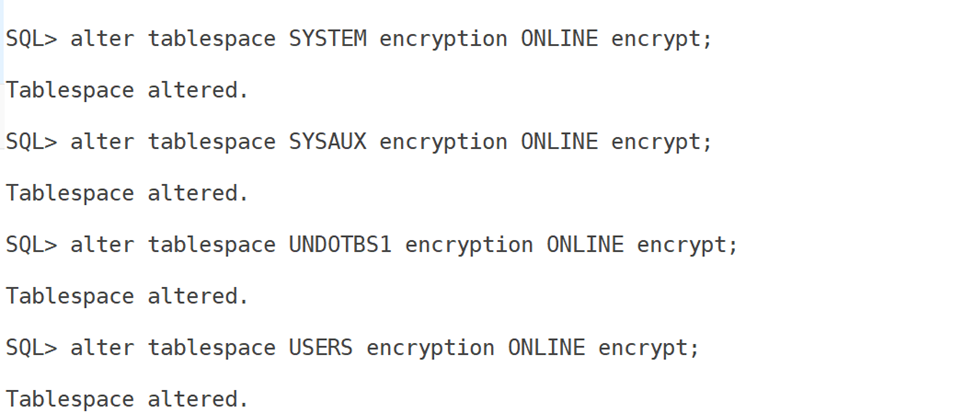

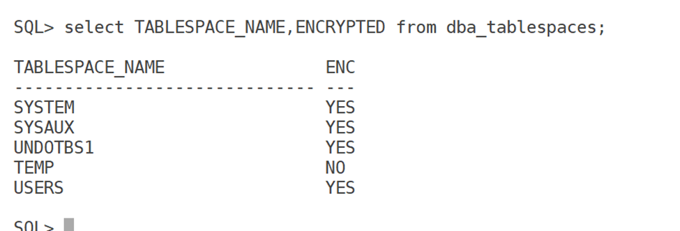

there is no option to directly encrypt the temp tablespace. you need to create new encrypted temp tablespace make it default and drop old temp tablespace.

### **Perform Post-Migration Steps**

- Verify objects, schemas, and users.
- Update database services and configurations.
- Enable application connectivity to the new PDB.
- Gather optimizer statistics:

``` wp-block-code
        EXEC DBMS_STATS.GATHER_DATABASE_STATS;
```

**Issues:**

**During the datapatch due to java component version mismatch.**

``` wp-block-code
[oracle@oa19cdb01 OPatch]$ ./datapatch -verbose
SQL Patching tool version 19.25.0.0.0 Production on Wed Mar 26 10:10:50 2025
Copyright (c) 2012, 2024, Oracle.  All rights reserved.

Log file for this invocation: /u01/app/oracle/cfgtoollogs/sqlpatch/sqlpatch_14115_2025_03_26_10_10_51/sqlpatc                                                           h_invocation.log

Connecting to database...OK
Gathering database info...done

Note:  Datapatch will only apply or rollback SQL fixes for PDBs
       that are in an open state, no patches will be applied to closed PDBs.
       Please refer to Note: Datapatch: Database 12c Post Patch SQL Automation
       (Doc ID 1585822.1)

Bootstrapping registry and package to current versions...done
Determining current state...
done

Current state of interim SQL patches:
  No interim patches found

Current state of release update SQL patches:
  Binary registry:
    19.25.0.0.0 Release_Update 241010184253: Installed
  PDB CASM_PDB1:
    Applied 19.25.0.0.0 Release_Update 241010184253 successfully on 17-MAR-25 09.41.04.714725 PM
  PDB CDB$ROOT:
    Applied 19.25.0.0.0 Release_Update 241010184253 successfully on 17-MAR-25 10.04.44.746048 PM
  PDB ORCL_PDB1:
    No release update patches installed
  PDB PDB$SEED:
    Applied 19.25.0.0.0 Release_Update 241010184253 successfully on 17-MAR-25 09.40.33.832389 PM

Adding patches to installation queue and performing prereq checks...done
Installation queue:
  For the following PDBs: CDB$ROOT PDB$SEED CASM_PDB1
    No interim patches need to be rolled back
    No release update patches need to be installed
    No interim patches need to be applied
  For the following PDBs: ORCL_PDB1
    No interim patches need to be rolled back
    Patch 36912597 (Database Release Update : 19.25.0.0.241015 (36912597)):
      Apply from 19.1.0.0.0 Feature Release to 19.25.0.0.0 Release_Update 241010184253
    No interim patches need to be applied

Installing patches...
SQL> alter pluggable database ORCL_PDB1 close immediate;

Pluggable database altered.

SQL> exit
Patch installation complete.  Total patches installed: 1

Validating logfiles...done
Patch 36912597 apply (pdb ORCL_PDB1): WITH ERRORS
  logfile: /u01/app/oracle/cfgtoollogs/sqlpatch/36912597/25871884/36912597_apply_CASMDB_ORCL_PDB1_2025Mar26_1                                                           0_13_48.log (errors)
  -> Error at line 347959: script md/admin/bug32425205_apply.sql
      - ORA-29548: Java system class reported: release of Java system classes in the
      - database (19.3.0.0.0 1.8) does not match that of the oracle executable
      - (19.0.0.0.0 1.8)
      - ORA-06512: at "SYS.DBMS_JAVA", line 587
      - ORA-06512: at line 1
      - ORA-06512: at line 8
  -> Error at line 399851: script md/admin/catmdloc.sql
      - ORA-29548: Java system class reported: release of Java system classes in the
      - database (19.3.0.0.0 1.8) does not match that of the oracle executable
      - (19.0.0.0.0 1.8)
  -> Error at line 399861: script md/admin/catmdloc.sql
      - ORA-29548: Java system class reported: release of Java system classes in the
      - database (19.3.0.0.0 1.8) does not match that of the oracle executable
      - (19.0.0.0.0 1.8)
  -> Error at line 399871: script md/admin/catmdloc.sql
      - ORA-29548: Java system class reported: release of Java system classes in the
      - database (19.3.0.0.0 1.8) does not match that of the oracle executable
      - (19.0.0.0.0 1.8)
  -> Error at line 399885: script md/admin/catmdloc.sql
      - ORA-29548: Java system class reported: release of Java system classes in the
      - database (19.3.0.0.0 1.8) does not match that of the oracle executable
      - (19.0.0.0.0 1.8)
  -> Error at line 399895: script md/admin/catmdloc.sql
      - ORA-29548: Java system class reported: release of Java system classes in the
      - database (19.3.0.0.0 1.8) does not match that of the oracle executable
      - (19.0.0.0.0 1.8)
  -> Error at line 399908: script md/admin/catmdloc.sql
      - ORA-29548: Java system class reported: release of Java system classes in the
      - database (19.3.0.0.0 1.8) does not match that of the oracle executable
      - (19.0.0.0.0 1.8)
  -> Error at line 399918: script md/admin/catmdloc.sql
      - ORA-29548: Java system class reported: release of Java system classes in the
      - database (19.3.0.0.0 1.8) does not match that of the oracle executable
      - (19.0.0.0.0 1.8)
  -> Error at line 399927: script md/admin/catmdloc.sql
      - ORA-29548: Java system class reported: release of Java system classes in the
      - database (19.3.0.0.0 1.8) does not match that of the oracle executable
      - (19.0.0.0.0 1.8)
  -> Error at line 399936: script md/admin/catmdloc.sql
      - ORA-29548: Java system class reported: release of Java system classes in the
      - database (19.3.0.0.0 1.8) does not match that of the oracle executable
      - (19.0.0.0.0 1.8)
  -> Error at line 399945: script md/admin/catmdloc.sql
      - ORA-29548: Java system class reported: release of Java system classes in the
      - database (19.3.0.0.0 1.8) does not match that of the oracle executable
      - (19.0.0.0.0 1.8)
  -> Error at line 399954: script md/admin/catmdloc.sql
      - ORA-29548: Java system class reported: release of Java system classes in the
      - database (19.3.0.0.0 1.8) does not match that of the oracle executable
      - (19.0.0.0.0 1.8)
  -> Error at line 399968: script md/admin/catmdloc.sql
      - ORA-29548: Java system class reported: release of Java system classes in the
      - database (19.3.0.0.0 1.8) does not match that of the oracle executable
      - (19.0.0.0.0 1.8)
  -> Error at line 399978: script md/admin/catmdloc.sql
      - ORA-29548: Java system class reported: release of Java system classes in the
      - database (19.3.0.0.0 1.8) does not match that of the oracle executable
      - (19.0.0.0.0 1.8)
  -> Error at line 399988: script md/admin/catmdloc.sql
      - ORA-29548: Java system class reported: release of Java system classes in the
      - database (19.3.0.0.0 1.8) does not match that of the oracle executable
      - (19.0.0.0.0 1.8)
  -> Error at line 399998: script md/admin/catmdloc.sql
      - ORA-29548: Java system class reported: release of Java system classes in the
      - database (19.3.0.0.0 1.8) does not match that of the oracle executable
      - (19.0.0.0.0 1.8)
  -> Error at line 400008: script md/admin/catmdloc.sql
      - ORA-29548: Java system class reported: release of Java system classes in the
      - database (19.3.0.0.0 1.8) does not match that of the oracle executable
      - (19.0.0.0.0 1.8)
  -> Error at line 400019: script md/admin/catmdloc.sql
      - ORA-29548: Java system class reported: release of Java system classes in the
      - database (19.3.0.0.0 1.8) does not match that of the oracle executable
      - (19.0.0.0.0 1.8)
  -> Error at line 400031: script md/admin/catmdloc.sql
      - ORA-29548: Java system class reported: release of Java system classes in the
      - database (19.3.0.0.0 1.8) does not match that of the oracle executable
      - (19.0.0.0.0 1.8)
  -> Error at line 400045: script md/admin/catmdloc.sql
      - ORA-29548: Java system class reported: release of Java system classes in the
      - database (19.3.0.0.0 1.8) does not match that of the oracle executable
      - (19.0.0.0.0 1.8)
  -> Error at line 400063: script md/admin/catmdloc.sql
      - ORA-29548: Java system class reported: release of Java system classes in the
      - database (19.3.0.0.0 1.8) does not match that of the oracle executable
      - (19.0.0.0.0 1.8)
  -> Error at line 400078: script md/admin/catmdloc.sql
      - ORA-29548: Java system class reported: release of Java system classes in the
      - database (19.3.0.0.0 1.8) does not match that of the oracle executable
      - (19.0.0.0.0 1.8)
  -> Error at line 400088: script md/admin/catmdloc.sql
      - ORA-29548: Java system class reported: release of Java system classes in the
      - database (19.3.0.0.0 1.8) does not match that of the oracle executable
      - (19.0.0.0.0 1.8)
  -> Error at line 400167: script md/admin/catmdloc.sql
      - ORA-29548: Java system class reported: release of Java system classes in the
      - database (19.3.0.0.0 1.8) does not match that of the oracle executable
      - (19.0.0.0.0 1.8)
      - ORA-06512: at line 24
      - ORA-06512: at "SYS.DBMS_JAVA", line 705
      - ORA-06512: at line 2
      - ORA-06512: at line 4
  -> Error at line 435263: script md/admin/catmdlocj.sql
      - ORA-29548: Java system class reported: release of Java system classes in the
      - database (19.3.0.0.0 1.8) does not match that of the oracle executable
      - (19.0.0.0.0 1.8)
  -> Error at line 435273: script md/admin/catmdlocj.sql
      - ORA-29548: Java system class reported: release of Java system classes in the
      - database (19.3.0.0.0 1.8) does not match that of the oracle executable
      - (19.0.0.0.0 1.8)
  -> Error at line 435283: script md/admin/catmdlocj.sql
      - ORA-29548: Java system class reported: release of Java system classes in the
      - database (19.3.0.0.0 1.8) does not match that of the oracle executable
      - (19.0.0.0.0 1.8)
  -> Error at line 435297: script md/admin/catmdlocj.sql
      - ORA-29548: Java system class reported: release of Java system classes in the
      - database (19.3.0.0.0 1.8) does not match that of the oracle executable
      - (19.0.0.0.0 1.8)
  -> Error at line 435307: script md/admin/catmdlocj.sql
      - ORA-29548: Java system class reported: release of Java system classes in the
      - database (19.3.0.0.0 1.8) does not match that of the oracle executable
      - (19.0.0.0.0 1.8)
  -> Error at line 435320: script md/admin/catmdlocj.sql
      - ORA-29548: Java system class reported: release of Java system classes in the
      - database (19.3.0.0.0 1.8) does not match that of the oracle executable
      - (19.0.0.0.0 1.8)
  -> Error at line 435330: script md/admin/catmdlocj.sql
      - ORA-29548: Java system class reported: release of Java system classes in the
      - database (19.3.0.0.0 1.8) does not match that of the oracle executable
      - (19.0.0.0.0 1.8)
  -> Error at line 435339: script md/admin/catmdlocj.sql
      - ORA-29548: Java system class reported: release of Java system classes in the
      - database (19.3.0.0.0 1.8) does not match that of the oracle executable
      - (19.0.0.0.0 1.8)
  -> Error at line 435348: script md/admin/catmdlocj.sql
      - ORA-29548: Java system class reported: release of Java system classes in the
      - database (19.3.0.0.0 1.8) does not match that of the oracle executable
      - (19.0.0.0.0 1.8)
  -> Error at line 435357: script md/admin/catmdlocj.sql
      - ORA-29548: Java system class reported: release of Java system classes in the
      - database (19.3.0.0.0 1.8) does not match that of the oracle executable
      - (19.0.0.0.0 1.8)
  -> Error at line 435366: script md/admin/catmdlocj.sql
      - ORA-29548: Java system class reported: release of Java system classes in the
      - database (19.3.0.0.0 1.8) does not match that of the oracle executable
      - (19.0.0.0.0 1.8)
  -> Error at line 435380: script md/admin/catmdlocj.sql
      - ORA-29548: Java system class reported: release of Java system classes in the
      - database (19.3.0.0.0 1.8) does not match that of the oracle executable
      - (19.0.0.0.0 1.8)
  -> Error at line 435390: script md/admin/catmdlocj.sql
      - ORA-29548: Java system class reported: release of Java system classes in the
      - database (19.3.0.0.0 1.8) does not match that of the oracle executable
      - (19.0.0.0.0 1.8)
  -> Error at line 435400: script md/admin/catmdlocj.sql
      - ORA-29548: Java system class reported: release of Java system classes in the
      - database (19.3.0.0.0 1.8) does not match that of the oracle executable
      - (19.0.0.0.0 1.8)
  -> Error at line 435410: script md/admin/catmdlocj.sql
      - ORA-29548: Java system class reported: release of Java system classes in the
      - database (19.3.0.0.0 1.8) does not match that of the oracle executable
      - (19.0.0.0.0 1.8)
  -> Error at line 435420: script md/admin/catmdlocj.sql
      - ORA-29548: Java system class reported: release of Java system classes in the
      - database (19.3.0.0.0 1.8) does not match that of the oracle executable
      - (19.0.0.0.0 1.8)
  -> Error at line 435431: script md/admin/catmdlocj.sql
      - ORA-29548: Java system class reported: release of Java system classes in the
      - database (19.3.0.0.0 1.8) does not match that of the oracle executable
      - (19.0.0.0.0 1.8)
  -> Error at line 435443: script md/admin/catmdlocj.sql
      - ORA-29548: Java system class reported: release of Java system classes in the
      - database (19.3.0.0.0 1.8) does not match that of the oracle executable
      - (19.0.0.0.0 1.8)
  -> Error at line 435457: script md/admin/catmdlocj.sql
      - ORA-29548: Java system class reported: release of Java system classes in the
      - database (19.3.0.0.0 1.8) does not match that of the oracle executable
      - (19.0.0.0.0 1.8)
  -> Error at line 435475: script md/admin/catmdlocj.sql
      - ORA-29548: Java system class reported: release of Java system classes in the
      - database (19.3.0.0.0 1.8) does not match that of the oracle executable
      - (19.0.0.0.0 1.8)
  -> Error at line 435490: script md/admin/catmdlocj.sql
      - ORA-29548: Java system class reported: release of Java system classes in the
      - database (19.3.0.0.0 1.8) does not match that of the oracle executable
      - (19.0.0.0.0 1.8)
  -> Error at line 435500: script md/admin/catmdlocj.sql
      - ORA-29548: Java system class reported: release of Java system classes in the
      - database (19.3.0.0.0 1.8) does not match that of the oracle executable
      - (19.0.0.0.0 1.8)
  -> Error at line 435579: script md/admin/catmdlocj.sql
      - ORA-29548: Java system class reported: release of Java system classes in the
      - database (19.3.0.0.0 1.8) does not match that of the oracle executable
      - (19.0.0.0.0 1.8)
      - ORA-06512: at line 24
      - ORA-06512: at "SYS.DBMS_JAVA", line 705
      - ORA-06512: at line 2
      - ORA-06512: at line 4
  -> Error at line 503573: script md/admin/catmdsdop2.sql
      - ORA-29548: Java system class reported: release of Java system classes in the
      - database (19.3.0.0.0 1.8) does not match that of the oracle executable
      - (19.0.0.0.0 1.8)
  -> Error at line 503583: script md/admin/catmdsdop2.sql
      - ORA-29548: Java system class reported: release of Java system classes in the
      - database (19.3.0.0.0 1.8) does not match that of the oracle executable
      - (19.0.0.0.0 1.8)
  -> Error at line 503597: script md/admin/catmdsdop2.sql
      - ORA-29548: Java system class reported: release of Java system classes in the
      - database (19.3.0.0.0 1.8) does not match that of the oracle executable
      - (19.0.0.0.0 1.8)
  -> Error at line 503608: script md/admin/catmdsdop2.sql
      - ORA-29548: Java system class reported: release of Java system classes in the
      - database (19.3.0.0.0 1.8) does not match that of the oracle executable
      - (19.0.0.0.0 1.8)
  -> Error at line 503742: script md/admin/catmdsdop2.sql
      - ORA-29548: Java system class reported: release of Java system classes in the
      - database (19.3.0.0.0 1.8) does not match that of the oracle executable
      - (19.0.0.0.0 1.8)
      - ORA-06512: at "SYS.DBMS_JAVA", line 587
      - ORA-06512: at line 1
  -> Error at line 503754: script md/admin/catmdsdop2.sql
      - ORA-29548: Java system class reported: release of Java system classes in the
      - database (19.3.0.0.0 1.8) does not match that of the oracle executable
      - (19.0.0.0.0 1.8)
      - ORA-06512: at "SYS.DBMS_JAVA", line 587
      - ORA-06512: at line 1
  -> Error at line 503766: script md/admin/catmdsdop2.sql
      - ORA-29548: Java system class reported: release of Java system classes in the
      - database (19.3.0.0.0 1.8) does not match that of the oracle executable
      - (19.0.0.0.0 1.8)
      - ORA-06512: at "SYS.DBMS_JAVA", line 587
      - ORA-06512: at line 1
  -> Error at line 503778: script md/admin/catmdsdop2.sql
      - ORA-29548: Java system class reported: release of Java system classes in the
      - database (19.3.0.0.0 1.8) does not match that of the oracle executable
      - (19.0.0.0.0 1.8)
      - ORA-06512: at "SYS.DBMS_JAVA", line 587
      - ORA-06512: at line 1
  -> Error at line 503791: script md/admin/catmdsdop2.sql
      - ORA-29548: Java system class reported: release of Java system classes in the
      - database (19.3.0.0.0 1.8) does not match that of the oracle executable
      - (19.0.0.0.0 1.8)
      - ORA-06512: at "SYS.DBMS_JAVA", line 587
      - ORA-06512: at line 1
  -> Error at line 503805: script md/admin/catmdsdop2.sql
      - ORA-29548: Java system class reported: release of Java system classes in the
      - database (19.3.0.0.0 1.8) does not match that of the oracle executable
      - (19.0.0.0.0 1.8)
      - ORA-06512: at "SYS.DBMS_JAVA", line 587
      - ORA-06512: at line 1
  -> Error at line 503817: script md/admin/catmdsdop2.sql
      - ORA-29548: Java system class reported: release of Java system classes in the
      - database (19.3.0.0.0 1.8) does not match that of the oracle executable
      - (19.0.0.0.0 1.8)
      - ORA-06512: at "SYS.DBMS_JAVA", line 587
      - ORA-06512: at line 1
  -> Error at line 504206: script md/admin/catmdsdop2.sql
      - ORA-29548: Java system class reported: release of Java system classes in the
      - database (19.3.0.0.0 1.8) does not match that of the oracle executable
      - (19.0.0.0.0 1.8)
      - ORA-06512: at "SYS.DBMS_JAVA", line 715
      - ORA-06512: at line 1
  -> Error at line 504237: script md/admin/catmdsdop2.sql
      - ORA-29548: Java system class reported: release of Java system classes in the
      - database (19.3.0.0.0 1.8) does not match that of the oracle executable
      - (19.0.0.0.0 1.8)
  -> Error at line 504246: script md/admin/catmdsdop2.sql
      - ORA-29548: Java system class reported: release of Java system classes in the
      - database (19.3.0.0.0 1.8) does not match that of the oracle executable
      - (19.0.0.0.0 1.8)
  -> Error at line 504297: script md/admin/catmdsdop2.sql
      - ORA-29548: Java system class reported: release of Java system classes in the
      - database (19.3.0.0.0 1.8) does not match that of the oracle executable
      - (19.0.0.0.0 1.8)
  -> Error at line 504308: script md/admin/catmdsdop2.sql
      - ORA-29548: Java system class reported: release of Java system classes in the
      - database (19.3.0.0.0 1.8) does not match that of the oracle executable
      - (19.0.0.0.0 1.8)
  -> Error at line 568612: script md/admin/catsem.sql
      - ORA-29548: Java system class reported: release of Java system classes in the
      - database (19.3.0.0.0 1.8) does not match that of the oracle executable
      - (19.0.0.0.0 1.8)
      - ORA-06512: at "SYS.DBMS_JAVA", line 587
      - ORA-06512: at line 1
  -> Error at line 592557: script olap/admin/catxoq.sql
      - ORA-29548: Java system class reported: release of Java system classes in the
      - database (19.3.0.0.0 1.8) does not match that of the oracle executable
      - (19.0.0.0.0 1.8)
  -> Error at line 592566: script olap/admin/catxoq.sql
      - ORA-29548: Java system class reported: release of Java system classes in the
      - database (19.3.0.0.0 1.8) does not match that of the oracle executable
      - (19.0.0.0.0 1.8)
  -> Error at line 641358: script md/admin/sdosempatch.sql
      - ORA-29548: Java system class reported: release of Java system classes in the
      - database (19.3.0.0.0 1.8) does not match that of the oracle executable
      - (19.0.0.0.0 1.8)
      - ORA-06512: at "SYS.DBMS_JAVA", line 587
      - ORA-06512: at line 1

Adding patches to retry installation queue...done
Retry installation queue:
  For the following PDBs: ORCL_PDB1
    No interim patches need to be rolled back
    Patch 36912597 (Database Release Update : 19.25.0.0.241015 (36912597)):
      Apply from 19.1.0.0.0 Feature Release to 19.25.0.0.0 Release_Update 241010184253
    No interim patches need to be applied

Installing patches...
Patch installation complete.  Total patches installed: 1

Validating logfiles...done
Patch 36912597 apply (pdb ORCL_PDB1): WITH ERRORS
  logfile: /u01/app/oracle/cfgtoollogs/sqlpatch/36912597/25871884/36912597_apply_CASMDB_ORCL_PDB1_2025Mar26_1                                                           0_35_19.log (errors)
  -> Error at line 347959: script md/admin/bug32425205_apply.sql
      - ORA-29548: Java system class reported: release of Java system classes in the
      - database (19.3.0.0.0 1.8) does not match that of the oracle executable
      - (19.0.0.0.0 1.8)
      - ORA-06512: at "SYS.DBMS_JAVA", line 587
      - ORA-06512: at line 1
      - ORA-06512: at line 8
  -> Error at line 399851: script md/admin/catmdloc.sql
      - ORA-29548: Java system class reported: release of Java system classes in the
      - database (19.3.0.0.0 1.8) does not match that of the oracle executable
      - (19.0.0.0.0 1.8)
  -> Error at line 399861: script md/admin/catmdloc.sql
      - ORA-29548: Java system class reported: release of Java system classes in the
      - database (19.3.0.0.0 1.8) does not match that of the oracle executable
      - (19.0.0.0.0 1.8)
  -> Error at line 399871: script md/admin/catmdloc.sql
      - ORA-29548: Java system class reported: release of Java system classes in the
      - database (19.3.0.0.0 1.8) does not match that of the oracle executable
      - (19.0.0.0.0 1.8)
  -> Error at line 399885: script md/admin/catmdloc.sql
      - ORA-29548: Java system class reported: release of Java system classes in the
      - database (19.3.0.0.0 1.8) does not match that of the oracle executable
      - (19.0.0.0.0 1.8)
  -> Error at line 399895: script md/admin/catmdloc.sql
      - ORA-29548: Java system class reported: release of Java system classes in the
      - database (19.3.0.0.0 1.8) does not match that of the oracle executable
      - (19.0.0.0.0 1.8)
  -> Error at line 399908: script md/admin/catmdloc.sql
      - ORA-29548: Java system class reported: release of Java system classes in the
      - database (19.3.0.0.0 1.8) does not match that of the oracle executable
      - (19.0.0.0.0 1.8)
  -> Error at line 399918: script md/admin/catmdloc.sql
      - ORA-29548: Java system class reported: release of Java system classes in the
      - database (19.3.0.0.0 1.8) does not match that of the oracle executable
      - (19.0.0.0.0 1.8)
  -> Error at line 399927: script md/admin/catmdloc.sql
      - ORA-29548: Java system class reported: release of Java system classes in the
      - database (19.3.0.0.0 1.8) does not match that of the oracle executable
      - (19.0.0.0.0 1.8)
  -> Error at line 399936: script md/admin/catmdloc.sql
      - ORA-29548: Java system class reported: release of Java system classes in the
      - database (19.3.0.0.0 1.8) does not match that of the oracle executable
      - (19.0.0.0.0 1.8)
  -> Error at line 399945: script md/admin/catmdloc.sql
      - ORA-29548: Java system class reported: release of Java system classes in the
      - database (19.3.0.0.0 1.8) does not match that of the oracle executable
      - (19.0.0.0.0 1.8)
  -> Error at line 399954: script md/admin/catmdloc.sql
      - ORA-29548: Java system class reported: release of Java system classes in the
      - database (19.3.0.0.0 1.8) does not match that of the oracle executable
      - (19.0.0.0.0 1.8)
  -> Error at line 399968: script md/admin/catmdloc.sql
      - ORA-29548: Java system class reported: release of Java system classes in the
      - database (19.3.0.0.0 1.8) does not match that of the oracle executable
      - (19.0.0.0.0 1.8)
  -> Error at line 399978: script md/admin/catmdloc.sql
      - ORA-29548: Java system class reported: release of Java system classes in the
      - database (19.3.0.0.0 1.8) does not match that of the oracle executable
      - (19.0.0.0.0 1.8)
  -> Error at line 399988: script md/admin/catmdloc.sql
      - ORA-29548: Java system class reported: release of Java system classes in the
      - database (19.3.0.0.0 1.8) does not match that of the oracle executable
      - (19.0.0.0.0 1.8)
  -> Error at line 399998: script md/admin/catmdloc.sql
      - ORA-29548: Java system class reported: release of Java system classes in the
      - database (19.3.0.0.0 1.8) does not match that of the oracle executable
      - (19.0.0.0.0 1.8)
  -> Error at line 400008: script md/admin/catmdloc.sql
      - ORA-29548: Java system class reported: release of Java system classes in the
      - database (19.3.0.0.0 1.8) does not match that of the oracle executable
      - (19.0.0.0.0 1.8)
  -> Error at line 400019: script md/admin/catmdloc.sql
      - ORA-29548: Java system class reported: release of Java system classes in the
      - database (19.3.0.0.0 1.8) does not match that of the oracle executable
      - (19.0.0.0.0 1.8)
  -> Error at line 400031: script md/admin/catmdloc.sql
      - ORA-29548: Java system class reported: release of Java system classes in the
      - database (19.3.0.0.0 1.8) does not match that of the oracle executable
      - (19.0.0.0.0 1.8)
  -> Error at line 400045: script md/admin/catmdloc.sql
      - ORA-29548: Java system class reported: release of Java system classes in the
      - database (19.3.0.0.0 1.8) does not match that of the oracle executable
      - (19.0.0.0.0 1.8)
  -> Error at line 400063: script md/admin/catmdloc.sql
      - ORA-29548: Java system class reported: release of Java system classes in the
      - database (19.3.0.0.0 1.8) does not match that of the oracle executable
      - (19.0.0.0.0 1.8)
  -> Error at line 400078: script md/admin/catmdloc.sql
      - ORA-29548: Java system class reported: release of Java system classes in the
      - database (19.3.0.0.0 1.8) does not match that of the oracle executable
      - (19.0.0.0.0 1.8)
  -> Error at line 400088: script md/admin/catmdloc.sql
      - ORA-29548: Java system class reported: release of Java system classes in the
      - database (19.3.0.0.0 1.8) does not match that of the oracle executable
      - (19.0.0.0.0 1.8)
  -> Error at line 400135: script md/admin/catmdloc.sql
      - ORA-29548: Java system class reported: release of Java system classes in the
      - database (19.3.0.0.0 1.8) does not match that of the oracle executable
      - (19.0.0.0.0 1.8)
      - ORA-06512: at "SYS.DBMS_JAVA", line 587
      - ORA-06512: at line 9
  -> Error at line 400174: script md/admin/catmdloc.sql
      - ORA-29548: Java system class reported: release of Java system classes in the
      - database (19.3.0.0.0 1.8) does not match that of the oracle executable
      - (19.0.0.0.0 1.8)
      - ORA-06512: at line 24
      - ORA-06512: at "SYS.DBMS_JAVA", line 705
      - ORA-06512: at line 2
      - ORA-06512: at line 4
  -> Error at line 435270: script md/admin/catmdlocj.sql
      - ORA-29548: Java system class reported: release of Java system classes in the
      - database (19.3.0.0.0 1.8) does not match that of the oracle executable
      - (19.0.0.0.0 1.8)
  -> Error at line 435280: script md/admin/catmdlocj.sql
      - ORA-29548: Java system class reported: release of Java system classes in the
      - database (19.3.0.0.0 1.8) does not match that of the oracle executable
      - (19.0.0.0.0 1.8)
  -> Error at line 435290: script md/admin/catmdlocj.sql
      - ORA-29548: Java system class reported: release of Java system classes in the
      - database (19.3.0.0.0 1.8) does not match that of the oracle executable
      - (19.0.0.0.0 1.8)
  -> Error at line 435304: script md/admin/catmdlocj.sql
      - ORA-29548: Java system class reported: release of Java system classes in the
      - database (19.3.0.0.0 1.8) does not match that of the oracle executable
      - (19.0.0.0.0 1.8)
  -> Error at line 435314: script md/admin/catmdlocj.sql
      - ORA-29548: Java system class reported: release of Java system classes in the
      - database (19.3.0.0.0 1.8) does not match that of the oracle executable
      - (19.0.0.0.0 1.8)
  -> Error at line 435327: script md/admin/catmdlocj.sql
      - ORA-29548: Java system class reported: release of Java system classes in the
      - database (19.3.0.0.0 1.8) does not match that of the oracle executable
      - (19.0.0.0.0 1.8)
  -> Error at line 435337: script md/admin/catmdlocj.sql
      - ORA-29548: Java system class reported: release of Java system classes in the
      - database (19.3.0.0.0 1.8) does not match that of the oracle executable
      - (19.0.0.0.0 1.8)
  -> Error at line 435346: script md/admin/catmdlocj.sql
      - ORA-29548: Java system class reported: release of Java system classes in the
      - database (19.3.0.0.0 1.8) does not match that of the oracle executable
      - (19.0.0.0.0 1.8)
  -> Error at line 435355: script md/admin/catmdlocj.sql
      - ORA-29548: Java system class reported: release of Java system classes in the
      - database (19.3.0.0.0 1.8) does not match that of the oracle executable
      - (19.0.0.0.0 1.8)
  -> Error at line 435364: script md/admin/catmdlocj.sql
      - ORA-29548: Java system class reported: release of Java system classes in the
      - database (19.3.0.0.0 1.8) does not match that of the oracle executable
      - (19.0.0.0.0 1.8)
  -> Error at line 435373: script md/admin/catmdlocj.sql
      - ORA-29548: Java system class reported: release of Java system classes in the
      - database (19.3.0.0.0 1.8) does not match that of the oracle executable
      - (19.0.0.0.0 1.8)
  -> Error at line 435387: script md/admin/catmdlocj.sql
      - ORA-29548: Java system class reported: release of Java system classes in the
      - database (19.3.0.0.0 1.8) does not match that of the oracle executable
      - (19.0.0.0.0 1.8)
  -> Error at line 435397: script md/admin/catmdlocj.sql
      - ORA-29548: Java system class reported: release of Java system classes in the
      - database (19.3.0.0.0 1.8) does not match that of the oracle executable
      - (19.0.0.0.0 1.8)
  -> Error at line 435407: script md/admin/catmdlocj.sql
      - ORA-29548: Java system class reported: release of Java system classes in the
      - database (19.3.0.0.0 1.8) does not match that of the oracle executable
      - (19.0.0.0.0 1.8)
  -> Error at line 435417: script md/admin/catmdlocj.sql
      - ORA-29548: Java system class reported: release of Java system classes in the
      - database (19.3.0.0.0 1.8) does not match that of the oracle executable
      - (19.0.0.0.0 1.8)
  -> Error at line 435427: script md/admin/catmdlocj.sql
      - ORA-29548: Java system class reported: release of Java system classes in the
      - database (19.3.0.0.0 1.8) does not match that of the oracle executable
      - (19.0.0.0.0 1.8)
  -> Error at line 435438: script md/admin/catmdlocj.sql
      - ORA-29548: Java system class reported: release of Java system classes in the
      - database (19.3.0.0.0 1.8) does not match that of the oracle executable
      - (19.0.0.0.0 1.8)
  -> Error at line 435450: script md/admin/catmdlocj.sql
      - ORA-29548: Java system class reported: release of Java system classes in the
      - database (19.3.0.0.0 1.8) does not match that of the oracle executable
      - (19.0.0.0.0 1.8)
  -> Error at line 435464: script md/admin/catmdlocj.sql
      - ORA-29548: Java system class reported: release of Java system classes in the
      - database (19.3.0.0.0 1.8) does not match that of the oracle executable
      - (19.0.0.0.0 1.8)
  -> Error at line 435482: script md/admin/catmdlocj.sql
      - ORA-29548: Java system class reported: release of Java system classes in the
      - database (19.3.0.0.0 1.8) does not match that of the oracle executable
      - (19.0.0.0.0 1.8)
  -> Error at line 435497: script md/admin/catmdlocj.sql
      - ORA-29548: Java system class reported: release of Java system classes in the
      - database (19.3.0.0.0 1.8) does not match that of the oracle executable
      - (19.0.0.0.0 1.8)
  -> Error at line 435507: script md/admin/catmdlocj.sql
      - ORA-29548: Java system class reported: release of Java system classes in the
      - database (19.3.0.0.0 1.8) does not match that of the oracle executable
      - (19.0.0.0.0 1.8)
  -> Error at line 435554: script md/admin/catmdlocj.sql
      - ORA-29548: Java system class reported: release of Java system classes in the
      - database (19.3.0.0.0 1.8) does not match that of the oracle executable
      - (19.0.0.0.0 1.8)
      - ORA-06512: at "SYS.DBMS_JAVA", line 587
      - ORA-06512: at line 9
  -> Error at line 435593: script md/admin/catmdlocj.sql
      - ORA-29548: Java system class reported: release of Java system classes in the
      - database (19.3.0.0.0 1.8) does not match that of the oracle executable
      - (19.0.0.0.0 1.8)
      - ORA-06512: at line 24
      - ORA-06512: at "SYS.DBMS_JAVA", line 705
      - ORA-06512: at line 2
      - ORA-06512: at line 4
  -> Error at line 503587: script md/admin/catmdsdop2.sql
      - ORA-29548: Java system class reported: release of Java system classes in the
      - database (19.3.0.0.0 1.8) does not match that of the oracle executable
      - (19.0.0.0.0 1.8)
  -> Error at line 503597: script md/admin/catmdsdop2.sql
      - ORA-29548: Java system class reported: release of Java system classes in the
      - database (19.3.0.0.0 1.8) does not match that of the oracle executable
      - (19.0.0.0.0 1.8)
  -> Error at line 503611: script md/admin/catmdsdop2.sql
      - ORA-29548: Java system class reported: release of Java system classes in the
      - database (19.3.0.0.0 1.8) does not match that of the oracle executable
      - (19.0.0.0.0 1.8)
  -> Error at line 503622: script md/admin/catmdsdop2.sql
      - ORA-29548: Java system class reported: release of Java system classes in the
      - database (19.3.0.0.0 1.8) does not match that of the oracle executable
      - (19.0.0.0.0 1.8)
  -> Error at line 503756: script md/admin/catmdsdop2.sql
      - ORA-29548: Java system class reported: release of Java system classes in the
      - database (19.3.0.0.0 1.8) does not match that of the oracle executable
      - (19.0.0.0.0 1.8)
      - ORA-06512: at "SYS.DBMS_JAVA", line 587
      - ORA-06512: at line 1
  -> Error at line 503768: script md/admin/catmdsdop2.sql
      - ORA-29548: Java system class reported: release of Java system classes in the
      - database (19.3.0.0.0 1.8) does not match that of the oracle executable
      - (19.0.0.0.0 1.8)
      - ORA-06512: at "SYS.DBMS_JAVA", line 587
      - ORA-06512: at line 1
  -> Error at line 503780: script md/admin/catmdsdop2.sql
      - ORA-29548: Java system class reported: release of Java system classes in the
      - database (19.3.0.0.0 1.8) does not match that of the oracle executable
      - (19.0.0.0.0 1.8)
      - ORA-06512: at "SYS.DBMS_JAVA", line 587
      - ORA-06512: at line 1
  -> Error at line 503792: script md/admin/catmdsdop2.sql
      - ORA-29548: Java system class reported: release of Java system classes in the
      - database (19.3.0.0.0 1.8) does not match that of the oracle executable
      - (19.0.0.0.0 1.8)
      - ORA-06512: at "SYS.DBMS_JAVA", line 587
      - ORA-06512: at line 1
  -> Error at line 503805: script md/admin/catmdsdop2.sql
      - ORA-29548: Java system class reported: release of Java system classes in the
      - database (19.3.0.0.0 1.8) does not match that of the oracle executable
      - (19.0.0.0.0 1.8)
      - ORA-06512: at "SYS.DBMS_JAVA", line 587
      - ORA-06512: at line 1
  -> Error at line 503819: script md/admin/catmdsdop2.sql
      - ORA-29548: Java system class reported: release of Java system classes in the
      - database (19.3.0.0.0 1.8) does not match that of the oracle executable
      - (19.0.0.0.0 1.8)
      - ORA-06512: at "SYS.DBMS_JAVA", line 587
      - ORA-06512: at line 1
  -> Error at line 503831: script md/admin/catmdsdop2.sql
      - ORA-29548: Java system class reported: release of Java system classes in the
      - database (19.3.0.0.0 1.8) does not match that of the oracle executable
      - (19.0.0.0.0 1.8)
      - ORA-06512: at "SYS.DBMS_JAVA", line 587
      - ORA-06512: at line 1
  -> Error at line 504220: script md/admin/catmdsdop2.sql
      - ORA-29548: Java system class reported: release of Java system classes in the
      - database (19.3.0.0.0 1.8) does not match that of the oracle executable
      - (19.0.0.0.0 1.8)
      - ORA-06512: at "SYS.DBMS_JAVA", line 715
      - ORA-06512: at line 1
  -> Error at line 504251: script md/admin/catmdsdop2.sql
      - ORA-29548: Java system class reported: release of Java system classes in the
      - database (19.3.0.0.0 1.8) does not match that of the oracle executable
      - (19.0.0.0.0 1.8)
  -> Error at line 504260: script md/admin/catmdsdop2.sql
      - ORA-29548: Java system class reported: release of Java system classes in the
      - database (19.3.0.0.0 1.8) does not match that of the oracle executable
      - (19.0.0.0.0 1.8)
  -> Error at line 504311: script md/admin/catmdsdop2.sql
      - ORA-29548: Java system class reported: release of Java system classes in the
      - database (19.3.0.0.0 1.8) does not match that of the oracle executable
      - (19.0.0.0.0 1.8)
  -> Error at line 504322: script md/admin/catmdsdop2.sql
      - ORA-29548: Java system class reported: release of Java system classes in the
      - database (19.3.0.0.0 1.8) does not match that of the oracle executable
      - (19.0.0.0.0 1.8)
  -> Error at line 568626: script md/admin/catsem.sql
      - ORA-29548: Java system class reported: release of Java system classes in the
      - database (19.3.0.0.0 1.8) does not match that of the oracle executable
      - (19.0.0.0.0 1.8)
      - ORA-06512: at "SYS.DBMS_JAVA", line 587
      - ORA-06512: at line 1
  -> Error at line 592571: script olap/admin/catxoq.sql
      - ORA-29548: Java system class reported: release of Java system classes in the
      - database (19.3.0.0.0 1.8) does not match that of the oracle executable
      - (19.0.0.0.0 1.8)
  -> Error at line 592580: script olap/admin/catxoq.sql
      - ORA-29548: Java system class reported: release of Java system classes in the
      - database (19.3.0.0.0 1.8) does not match that of the oracle executable
      - (19.0.0.0.0 1.8)
  -> Error at line 641374: script md/admin/sdosempatch.sql
      - ORA-29548: Java system class reported: release of Java system classes in the
      - database (19.3.0.0.0 1.8) does not match that of the oracle executable
      - (19.0.0.0.0 1.8)
      - ORA-06512: at "SYS.DBMS_JAVA", line 587
      - ORA-06512: at line 1

Automatic recompilation incomplete; run utlrp.sql to revalidate.
  PDBs: ORCL_PDB1

Please refer to MOS Note 1609718.1 and/or the invocation log
/u01/app/oracle/cfgtoollogs/sqlpatch/sqlpatch_14115_2025_03_26_10_10_51/sqlpatch_invocation.log
for information on how to resolve the above errors.

SQL Patching tool complete on Wed Mar 26 10:52:04 2025
```

## Conclusion

Using remote cloning via a database link provides a seamless method to migrate a Non-CDB database from Windows to Linux while converting it into a PDB. This approach minimizes downtime and ensures efficient transition to a multitenant architecture.

By following these steps, you can successfully migrate your database with minimal disruption to business operations.

**Disclaimer**: The views expressed are my own and do not necessarily reflect the views of Oracle. Test thoroughly in a lower environment before implementing in production.
