# Migrating a Table from SQL Server to Oracle Using SQL Developer

Moving from Microsoft SQL Server to Oracle? Oracle SQL Developer provides a built-in migration tool that helps you migrate your tables, data, and even PL/SQL code with ease.

In this blog post, we’ll walk through **how to migrate a table from SQL Server to Oracle** using SQL Developer — step-by-step, with screenshots

**🧰** **Prerequisites**

Before we get started, make sure you have:

- ✅ Oracle SQL Developer installed ([Download here](https://www.oracle.com/tools/downloads/sqldev-downloads.html))
- ✅ Microsoft SQL Server running with a database you want to migrate
- ✅ Oracle Database installed and accessible
- ✅ SQL Server JDBC driver (e.g., sqljdbc.jar)

I Have download and installed latest sql developer in windows pc.

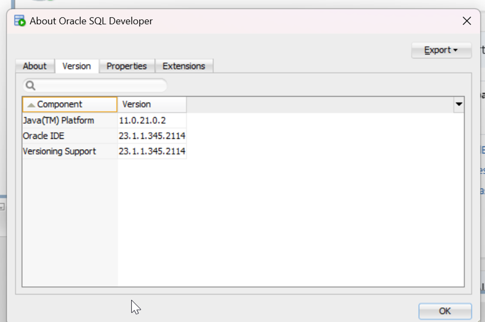

source Microsoft SQL Server 2016 is running with a database that want to migrate

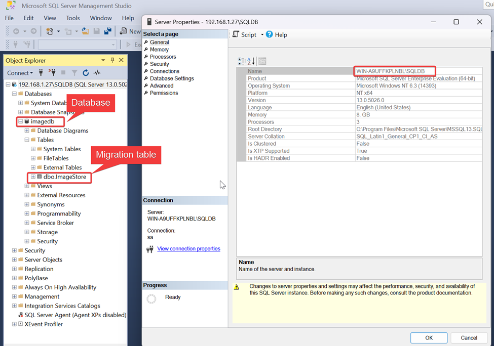

Oracle Database 19c installed and accessible

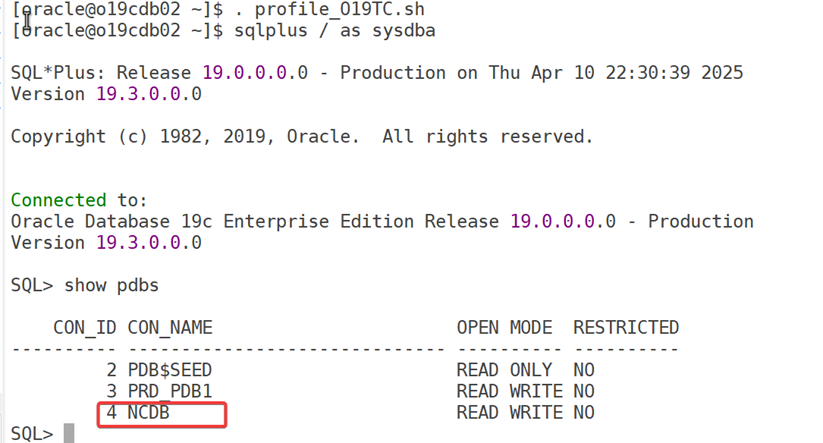

NCDB is the pluggable database and imadm is the schema in oracle database where we are going to migrate the table.

At **source database** ms sqlserver database I have create a database and table that hold images and binary object

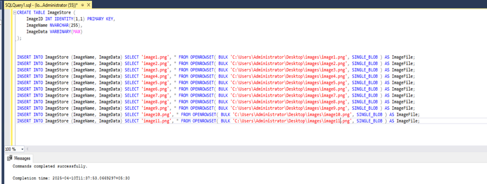

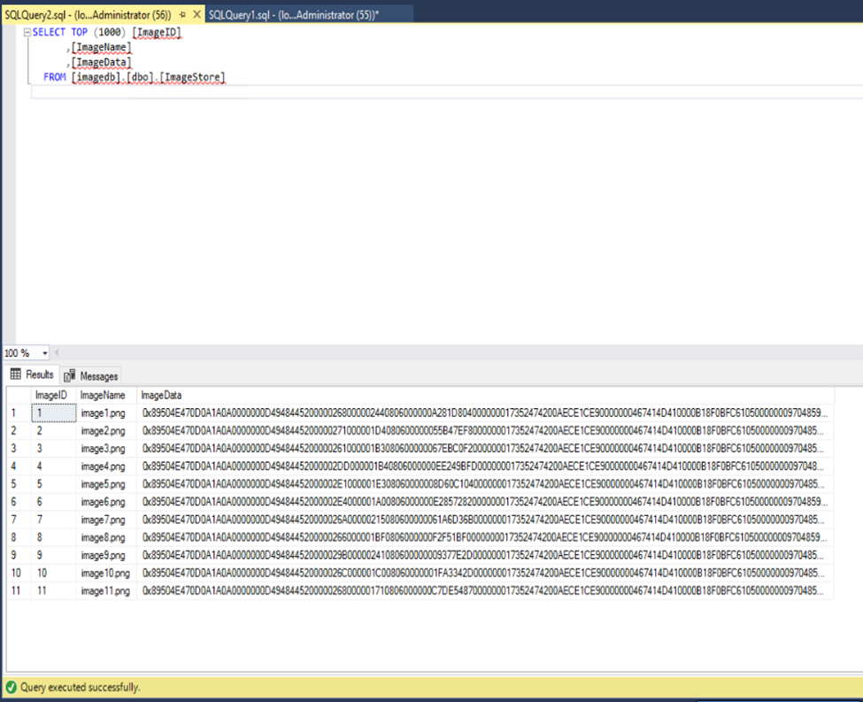

**Add SQL Server JDBC Driver to SQL Developer**

1.  `Download jtds sql server jdbc driver`

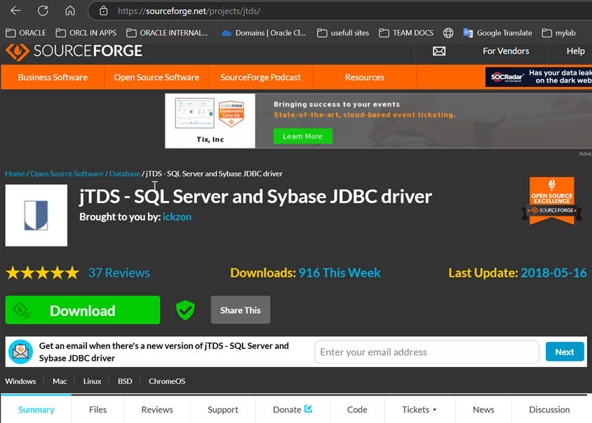

2\. Open **SQL Developer**

3\. Navigate to `Tools > Preferences`

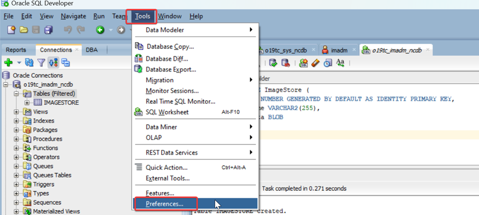

4\. Go to `Database > Third Party JDBC Drivers`

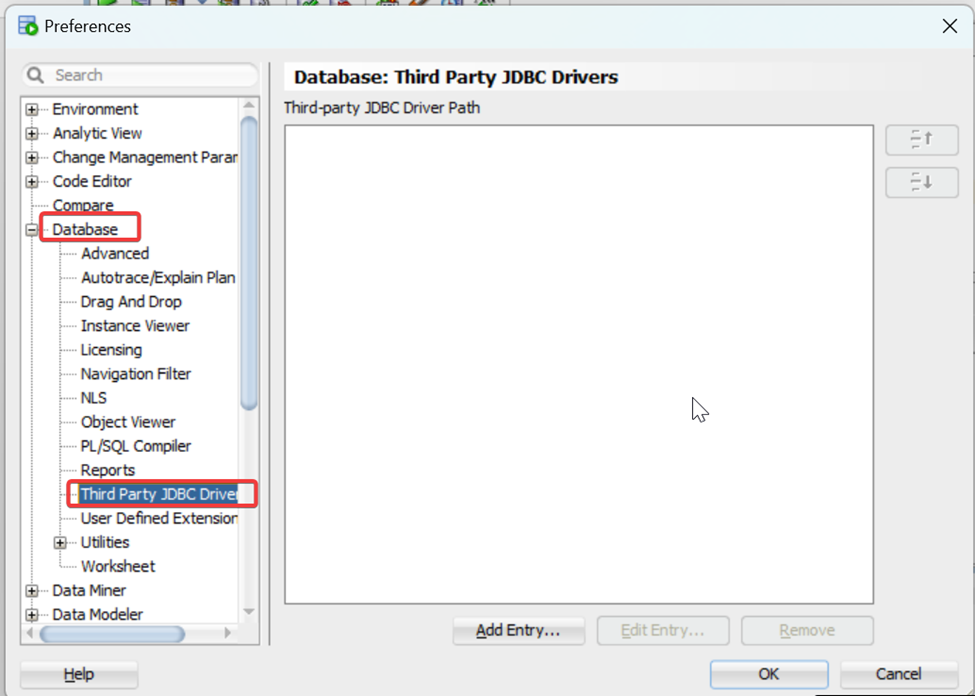

5\. Click **Add Entry** and select the `sqljdbc.jar` file you downloaded

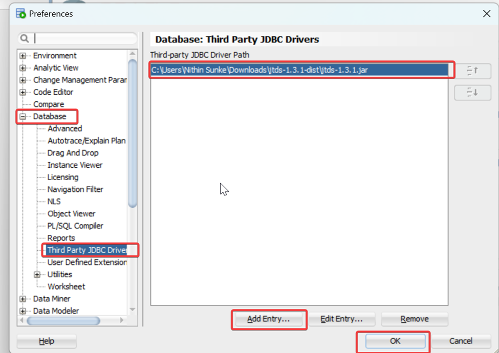

6\. Click **OK** and restart SQL Developer

Once the sql developer is restarted you will see the ms sqlserver database connection type

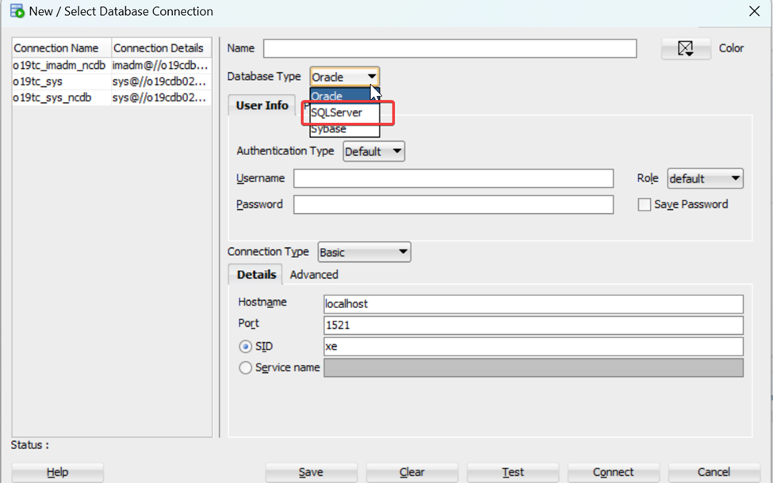

Creating sql server database connection on sql developer

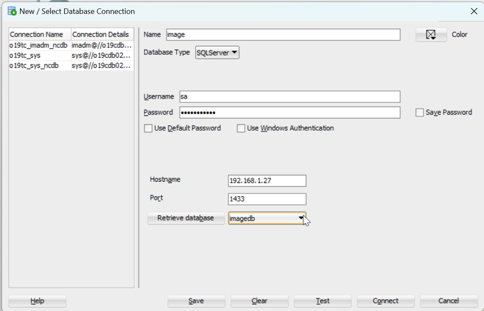

hostname of ms sqlserver and tcp/ip port 1433

**Note: Pre-reqs for the connection to get success**

1.  In sql server configuration manager under sql server network configuration protocols for sqldb tcp/ip status should be enable and make note of port number it is configured.


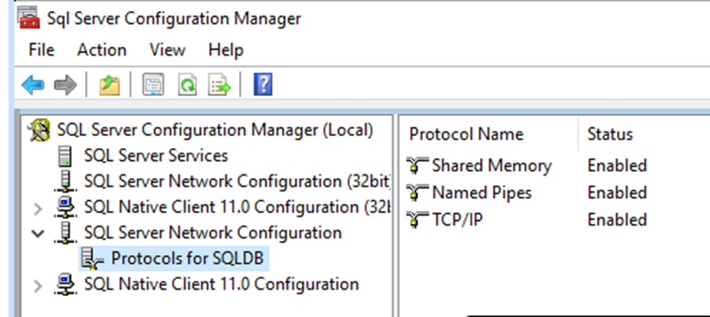

**Create a SQL Server Connection:**

In sqldeveloper update the details as below and test connection


**Create a Migration Repository:**

In oracle database create a migration schema

Schema name: mig_repo_schema

Privileges: CONNECT,RESOURCE,CREATE SESSION,CREATE VIEW,CREATE              MATERIALIZED VIEW

``` wp-block-code
GRANT CONNECT, RESOURCE, CREATE SESSION, CREATE VIEW, CREATE MATERIALIZED VIEW TO mig_repo_schema;
```

SQL Developer stores migration metadata in a repository.

1.  Go to `Tools > Migration > Repository Management > `Select `Create Repository`

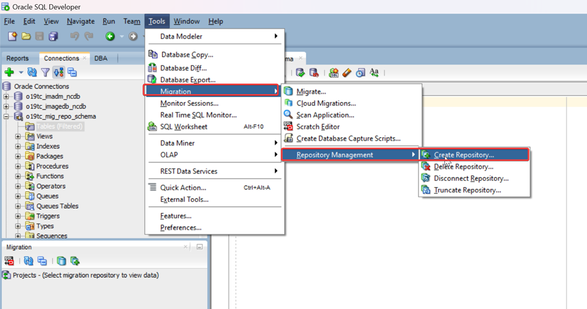

2\. Choose your Oracle connection and follow the wizard to create the repository

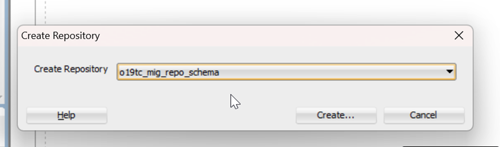

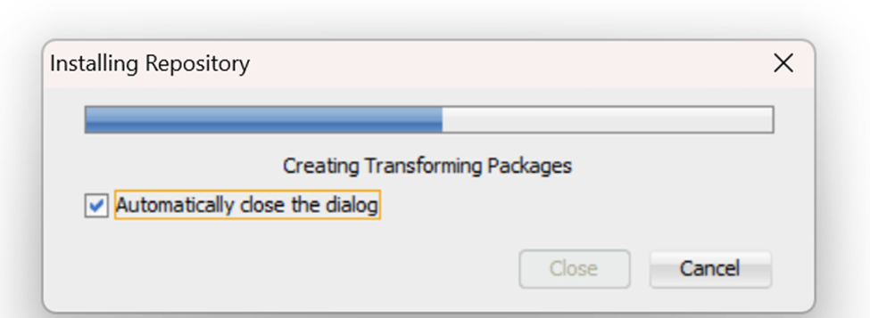

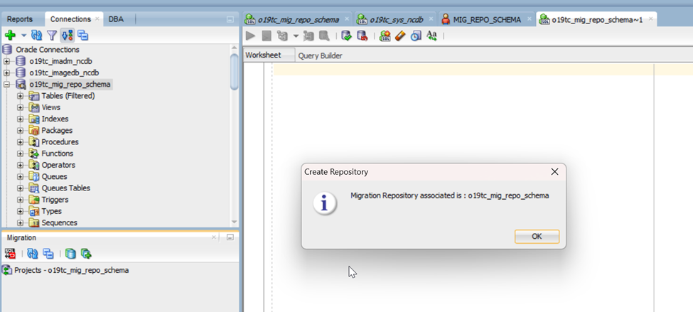

**Start the Migration Wizard:**

From sql server connection select the database and select the table that you want to migrate

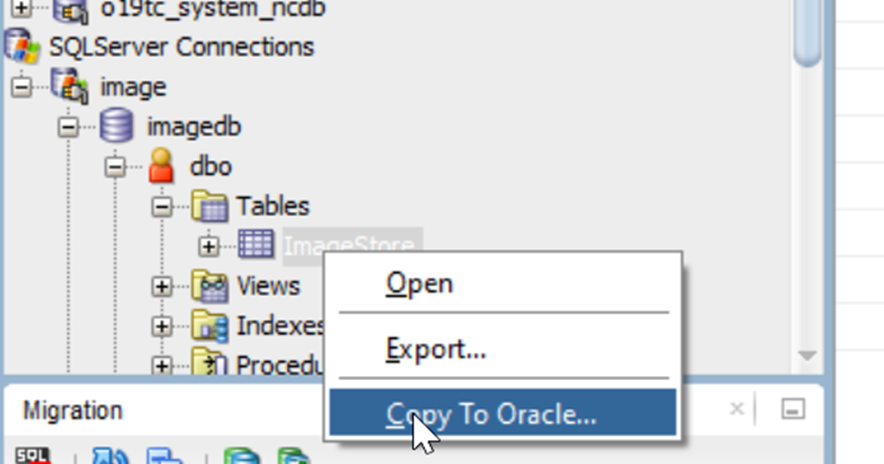

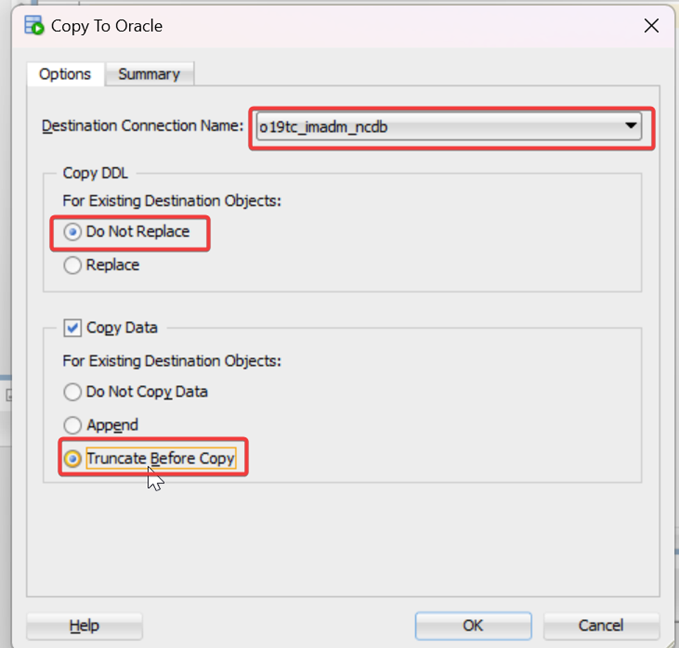

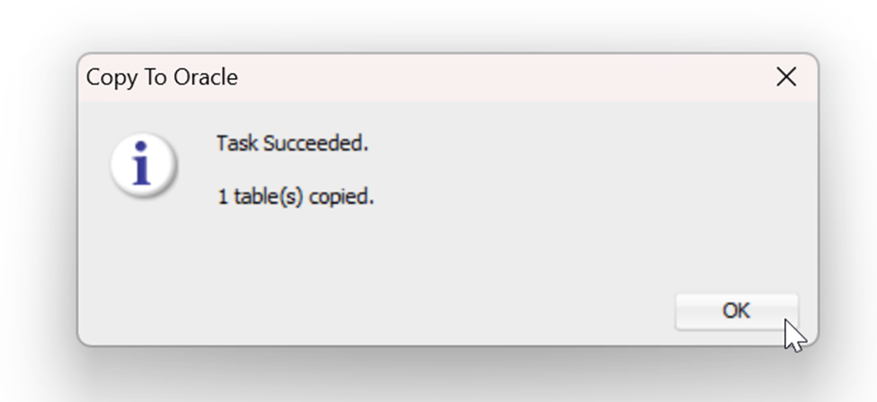

Migration is completed login into target schema in oracle database and validate:

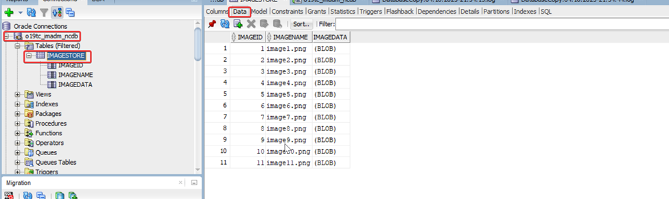

Source and target have same number of rows.

## Tips

-  Always take a backup before migration
-  Migrate smaller tables first to validate the process
-  Use staging schemas to test before moving to production

## Conclusion

Migrating from SQL Server to Oracle might sound intimidating, but with Oracle SQL Developer’s powerful migration wizard, it becomes a manageable and guided process.

This tool not only helps convert the structure but also handles data migration with minimal hassle — making it a great option for DBAs and developers alike.

## 📜 Disclaimer

This guide is intended for educational and lab purposes. Always validate configurations in a test environment before deploying in production. The author is not responsible for any data loss or system misconfiguration.
