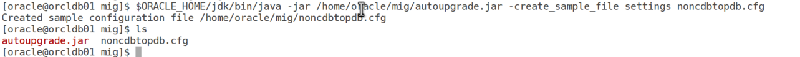
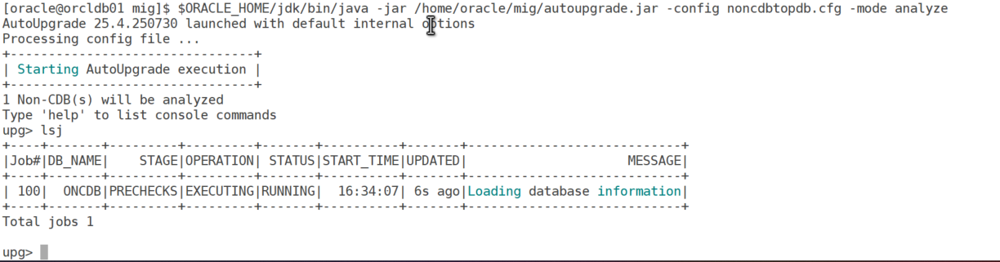
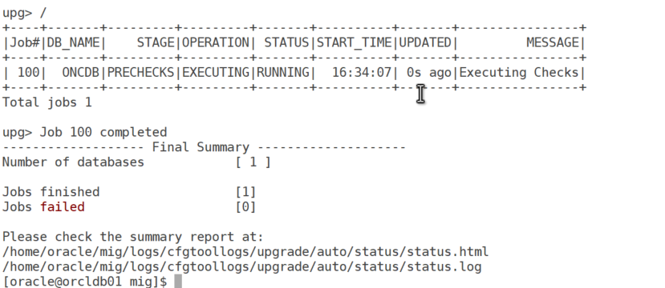
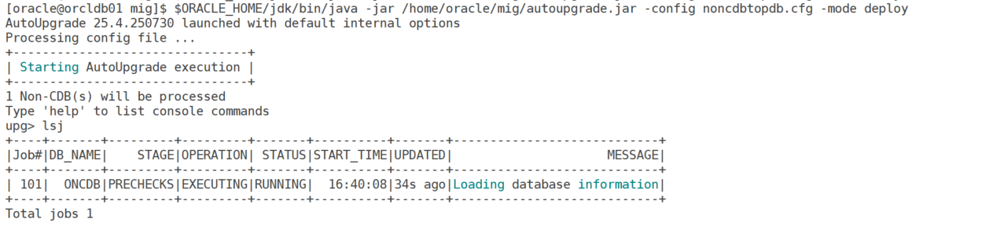
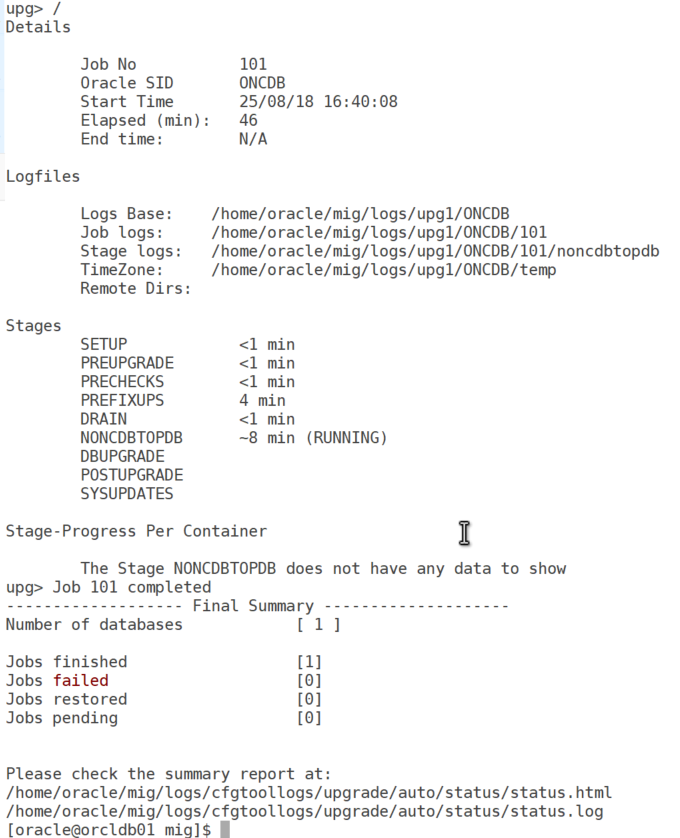
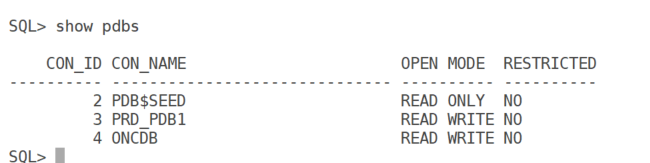

# Migrating Oracle 19c Non-CDB to PDB Using AutoUpgrade

## Introduction

The AutoUpgrade utility simplifies the complex process of converting a non-CDB to a PDB by automating key tasks such as metadata generation, PDB creation, and post-conversion adjustments. This blog outlines the detailed steps to perform this migration, ensuring a smooth transition with minimal manual intervention. The process assumes Oracle 19c is installed with the necessary prerequisites met.

### Step-by-Step Process

#### Step 1: Install and Prepare the AutoUpgrade Utility

Download autoupgrade.jar from My Oracle Support (Note 2485457.1).

#### Step 2: Create the AutoUpgrade Configuration File

Generate a sample configuration file

``` wp-block-code
$ORACLE_HOME/jdk/bin/java -jar /home/oracle/mig/autoupgrade.jar -create_sample_file settings noncdbtopdb.cfg
```



Edit the file with parameters like:

``` wp-block-code
global.autoupg_log_dir=/home/oracle/mig/logs
upg1.log_dir=/home/oracle/mig/logs/upg1
upg1.source_home=/u01/app/oracle/product/19.0.0/dbhome_2
upg1.target_home=/u01/app/oracle/product/19.0.0/dbhome_1
upg1.sid=ONCDB
upg1.target_cdb=O19TC
upg1.target_pdb_name=ONCDB
upg1.start_time=NOW
upg1.run_utlrp=yes
upg1.target_pdb_copy_option=file_name_convert=('/u02/oradata/ONCDB/', '/u02/oradata/O19TC/ONCDB/')
```

Customize paths, SIDs, and PDB names to match your environment.

#### Step 3: Run AutoUpgrade in Analyze Mode

``` wp-block-code
$ORACLE_HOME/jdk/bin/java -jar /home/oracle/mig/autoupgrade.jar -config noncdbtopdb.cfg -mode analyze
```





**Review the summary report**

/home/oracle/mig/logs/cfgtoollogs/upgrade/auto/status/status.html

#### Step 4: Run AutoUpgrade in Deploy Mode

``` wp-block-code
$ORACLE_HOME/jdk/bin/java -jar /home/oracle/mig/autoupgrade.jar -config noncdbtopdb.cfg -mode deploy 
```





``` wp-block-code
Please check the summary report at:
/home/oracle/mig/logs/cfgtoollogs/upgrade/auto/status/status.html
/home/oracle/mig/logs/cfgtoollogs/upgrade/auto/status/status.log
```

#### Step 5: Verify the Migration

Confirm the PDB is operational.



**Step 6: Post-Migration Tasks**

Secure and configure the new setup.

``` wp-block-code
rman target /
BACKUP DATABASE PLUS ARCHIVELOG;
```

Update tnsnames.ora:

``` wp-block-code
noncdb_pdb =
  (DESCRIPTION =
    (ADDRESS = (PROTOCOL = TCP)(HOST = localhost)(PORT = 1521))
    (CONNECT_DATA =
      (SERVER = DEDICATED)
      (SERVICE_NAME = noncdb_pdb)
    )
  )
```

Optionally drop the non-CDB:

``` wp-block-code
SHUTDOWN IMMEDIATE;
STARTUP MOUNT;
DROP DATABASE;
```

## Conclusion

The AutoUpgrade utility offers a robust solution for migrating a non-CDB to a PDB in Oracle 19c. By following these detailed steps, you can automate the process and ensure a successful transition. Always test in a non-production environment and consult the AutoUpgrade logs or Oracle Support (Note 2485457.1) for further assistance.
