# Migrating Oracle 19c Non-CDB to PDB Using the M5 Transportable Tablespaces Method

Oracle’s multitenant architecture enhances database management by consolidating multiple Pluggable Databases (PDBs) within a Container Database (CDB). With the non-CDB architecture deprecated since Oracle 12c and unsupported from 21c, migration to a PDB is essential. The M5 method, a next-generation cross-platform transportable tablespace procedure, combines RMAN backups, incremental recovery, and Full Transportable Export/Import (FTEX) to migrate a 19c non-CDB to a PDB efficiently, even across different platforms or endian formats. This blog post, inspired by insights from the "Cross Platform Migration – Transportable Tablespaces to the Extreme" presentation (<https://dohdatabase.com/wp-content/uploads/2024/02/vc18_crossplatform_xtts_to_the_extreme.pdf>), provides a comprehensive guide.

### Introduction

The M5 method leverages transportable tablespaces to move data files directly, minimizing downtime with incremental backups and supporting features like encrypted tablespaces and multisection backups. It’s ideal for large databases and cross-endian migrations (e.g., SPARC to Exadata). This guide walks through the M5 workflow, detailing configuration, backup, restore, and import phases, based on Oracle’s official documentation (Doc ID 2999157.1) and the referenced presentation.

### Step-by-Step Process

- Download the latest M5 script from My Oracle Support (Doc ID 2999157.1) and extract it to a shared NFS mount

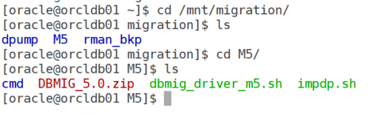

Configure the dbmig_driver.properties

``` wp-block-code
############################################################
#Source database properties
############################################################
export ORACLE_HOME=/u01/app/oracle/product/19.0.0.0/dbhome_2
export PATH=$PATH:$ORACLE_HOME/bin
export ORACLE_SID=ONCDB
export SRC_SCAN='orcldb01.scslabs.com:1521/ONCDB'
export PDB_NAME=
export BKP_FROM_STDBY=0
export REMOVE_TS_QUOTE=1
export RMAN_SCAN=''
############################################################
#Source Data Pump settings
############################################################
export SOURCE_DPDMP=/mnt/migration/dpump
export SOURCE_DPDIR=DPUMP_DIR
export SYSTEM_USR=SYSTEM
export DP_TRACE=0
export DP_PARALLEL=2
export DP_ENC_PROMPT=N
############################################################
#Source RMAN settings
############################################################
export BKP_DEST_TYPE=DISK
export BKP_DEST_PARM=/mnt/migration/rman_bkp
export CAT_CRED=
export SECTION_SIZE=64G
export CHN=4
export RMAN_DEBUG=N
############################################################
#Destination host settings
############################################################
export DEST_SERVER=
export DEST_USER=
export DEST_WORKDIR=
export DEST_DPDMP=

############################################################
#Advanced settings
#Normally, you don't need to edit this section
############################################################
export WORKDIR=$PWD
export LOG_DIR=${WORKDIR}/log
export CMD_DIR=${WORKDIR}/cmd
export PATH=$PATH:$ORACLE_HOME/bin
export DT=`date +%y%m%d%H%M%S`
export CMD_MKDIR=`which mkdir`
export CMD_TOUCH=`which touch`
export CMD_CAT=`which cat`
export CMD_RM=`which rm`
export CMD_AWK=`which awk`
export CMD_SCP=`which scp`
export CMD_CUT=`which cut`
export CMD_PLATFORM=`uname`
if [[ "$CMD_PLATFORM" = "Linux" ]]; then
    export CMD_GREP="/usr/bin/grep"
else
    if [[ "$CMD_PLATFORM" = "AIX" ]]; then
      export CMD_GREP="/usr/bin/grep"
    else
      if [[ "$CMD_PLATFORM" = "HPUX" ]]; then
        export CMD_GREP="/usr/bin/grep"
      else
        export CMD_GREP=`which ggrep`
      fi
    fi
fi
export my_M5_prop_version=5
```

At source database (non-cdb) list the tablespaces that are required for migration.

``` wp-block-code
SELECT LISTAGG(TABLESPACE_NAME, ',') WITHIN GROUP (ORDER BY TABLESPACE_NAME) AS tablespaces FROM   DBA_TABLESPACES where TABLESPACE_NAME NOT in('SYSTEM','SYSAUX','TEMP','UNDOTBS1');
```

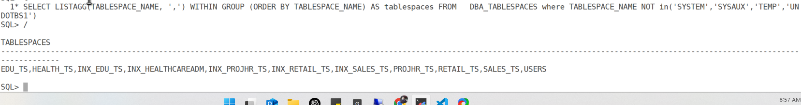

create dbmig_ts_list.txt file under cmd directory with list of all tablespaces

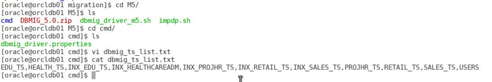

### Create an empty target PDB in the CDB(target)

``` wp-block-code
sqlplus / as sysdba
    CREATE PLUGGABLE DATABASE ONCDB ADMIN USER pdb_admin IDENTIFIED BY xxxxxx;
    ALTER PLUGGABLE DATABASE ONCDB OPEN READ WRITE;
```

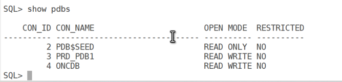

#### Perform Level 0 Backup

``` wp-block-code
cd /mnt/migration/M5
./dbmig_driver_m5.sh L0
```

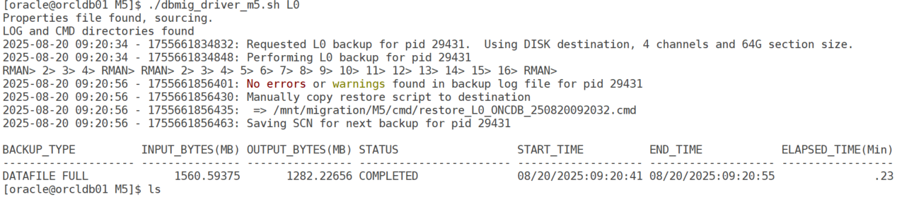

This executes an RMAN level 0 backup

The script generates a restore script which we need to execute on target database

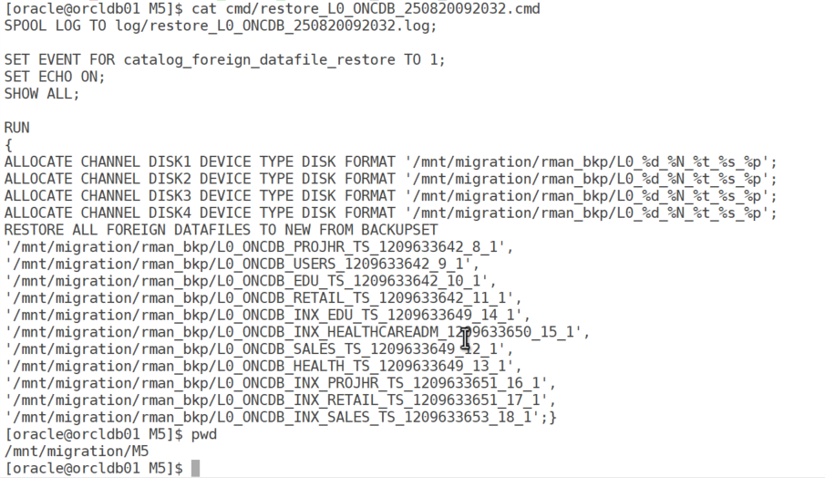

now connect to target database server make sure NFS is mounted and run restore

``` wp-block-code
rman target sys@ONCDB cmdfile=cmd/restore_L0_ONCDB_250820092032.cmd
```

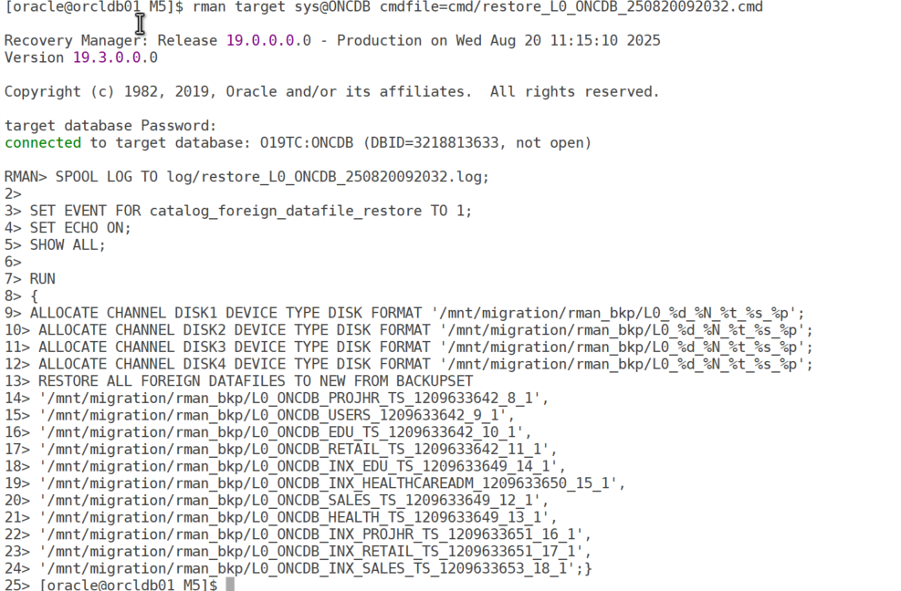

restore log

### Perform Level 1 Incremental Backups

Run incremental backups as needed:

``` wp-block-code
./dbmig_driver_m5.sh L1
```

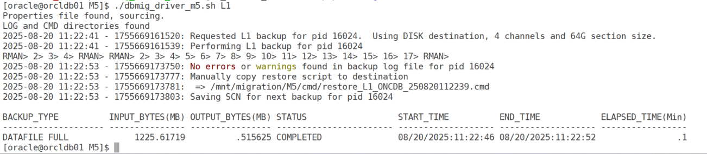

This generates a new restore script

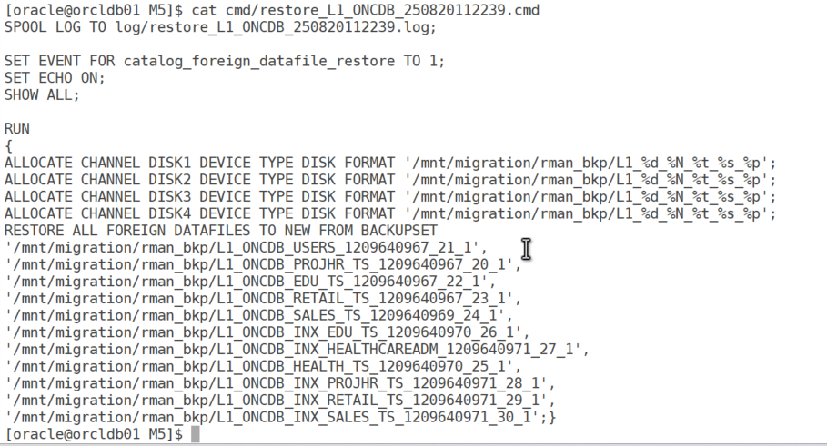

Restore on the target

``` wp-block-code
rman target sys@ONCDB cmdfile=cmd/restore_L1_ONCDB_250820112239.cmd
```

view the log for any errors

Repeat the above steps incremental backup and restore to minimize final downtime, checking logs each time.

### Enter Outage Phase (Maintenance Window)

Prepare for the final cutover

Schedule downtime, the tablespace will be in the read only during this phase.

Run the final backup:.

``` wp-block-code
./dbmig_driver_m5.sh L1F
```

This sets tablespaces to read-only, performs a final level 1 backup, and initiates a Full Transportable Export (`expdp FULL=Y TRANSPORTABLE=ALWAYS`).

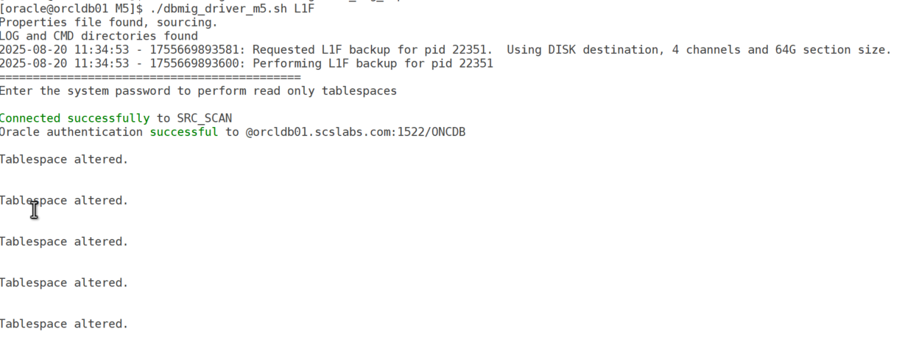

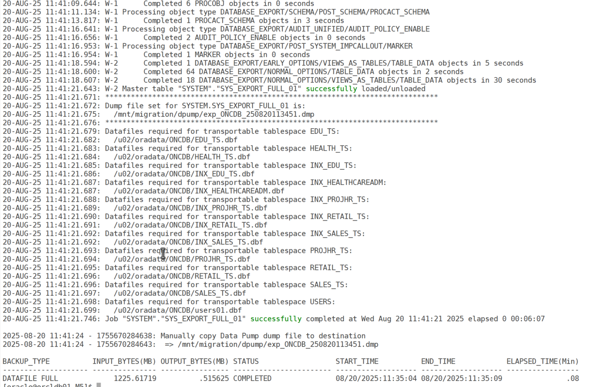

Optionally shut down the source:

``` wp-block-code
SHUTDOWN IMMEDIATE;
```

A restore script is created

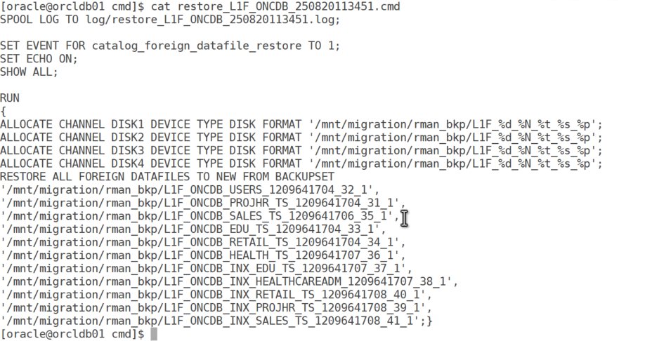

### Perform Final Restore on Target

run at target

``` wp-block-code
rman target sys@ONCDB cmdfile=cmd/restore_L1F_ONCDB_250820113451.cmd
```

### Import Metadata into Target PDB

Plug the tablespaces into the PDB

update the impdp.sh script

update below details:

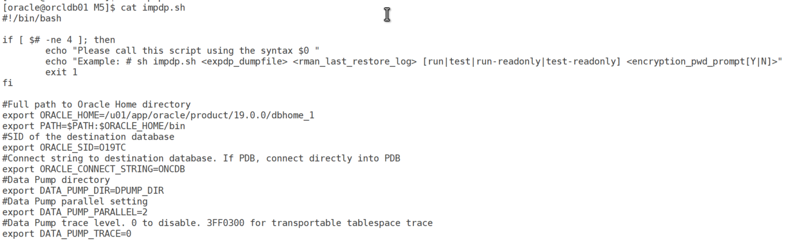

if you run impdp.sh with not input parameters it will show the syntax and what the input it requires.

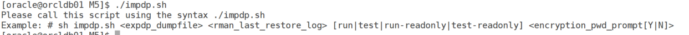

Test the import:

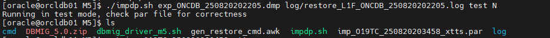

Review the generated parameter file.

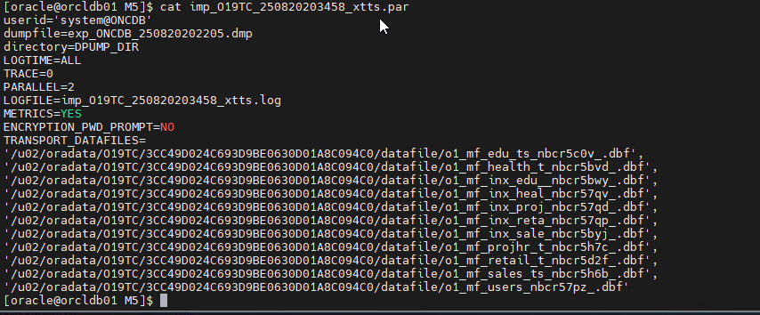

Run the import:

``` wp-block-code
./impdp.sh exp_ONCDB_250820202205.dmp log/restore_L1F_ONCDB_250820202205.log run N
```

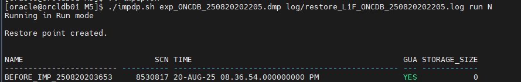

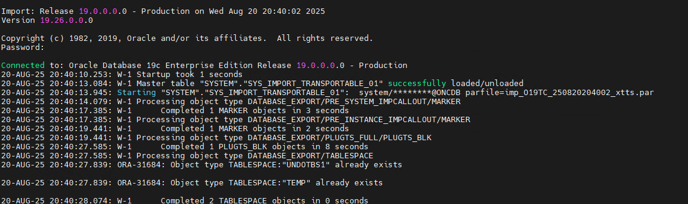

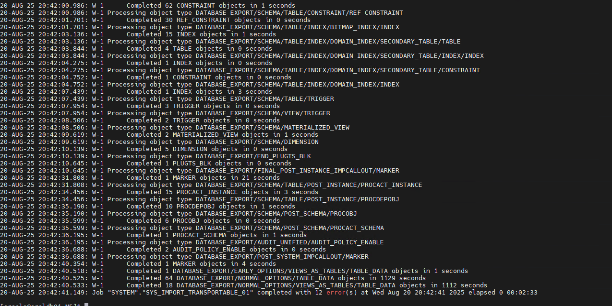

This performs Full Transportable Import (`impdp` with `TRANSPORT_DATAFILES`).  
Recompile objects:

``` wp-block-code
@?/rdbms/admin/utlrp.sql
```

Validate the Database

``` wp-block-code
select tablespace_name from dba_tablespaces;
```

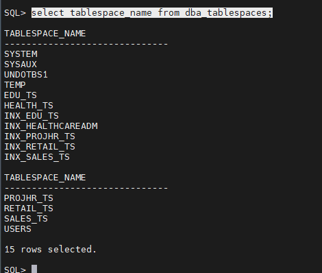

validate the object count etc.

####  Post-Migration Tasks

Backup the database.

and connection string of the PDB.

Cleanup: Drop restore points and remove backups with RMAN.

Optionally drop the non-CDB:

## Pros and Cons

### Pros

- **Minimal Downtime**: Incremental backups reduce outage to the final phase.
- **Efficiency**: Moves data files directly, avoiding re-export for large databases.
- **Cross-Platform Support**: Handles cross-endian migrations with RMAN CONVERT.
- **Advanced Features**: Supports encrypted tablespaces, multisection backups, and parallelism.

### Cons

- **Complexity**: Requires NFS or manual file transfers and detailed configuration.
- **Prerequisites**: Needs 19.18.0+, Data Pump Bundle Patch, and OMF.
- **Irreversible**: Tablespace plugging is permanent; keep source for fallback.
- **Time Zone Issues**: Mismatches in TSTZ or TSLTZ can complicate imports.

## Use Cases

- **Large Database Migration**: Efficient for 100TB+ databases.
- **Cross-Endian Migration**: SPARC to Exadata transitions.
- **Encrypted Data**: Handles encrypted tablespaces seamlessly.
- **Testing**: Incremental backups allow pre-migration validation.

## Best Practices

- **Test Extensively**: Use `TTS_CLOSURE_CHECK=TEST_MODE` and `TRANSPORTABLE=KEEP_READ_ONLY`.
- **Monitor Performance**: Use AWR snapshots and `V$SESSION_LONGOPS`.
- **NFS Usage**: Leverage shared storage for efficiency.
- **Resolve Issues**: Fix evolved types, time zone mismatches, and invalid objects pre-migration.
- **Backup Retention**: Keep source backups until post-migration stability.

## Troubleshooting Common Issues

- **ORA-39001/ORA-31640**: Verify directory paths and permissions.
- **Missing Archivelogs**: Restore from backup and retry.
- **Time Zone Mismatch**: Update `DBTIMEZONE` or use conventional import for TSLTZ tables.
- **Evolved Types**: Recreate types manually or use conventional export.
- **Network Issues**: Ensure NFS stability or use manual file copy.

## Conclusion

The M5 method with transportable tablespaces offers a robust solution for migrating a 19c non-CDB to a PDB, as demonstrated . By following these steps, you can minimize downtime, handle large-scale migrations, and leverage advanced features. Always test in a non-production environment and consult the M5 script documentation (Doc ID 2999157.1).
