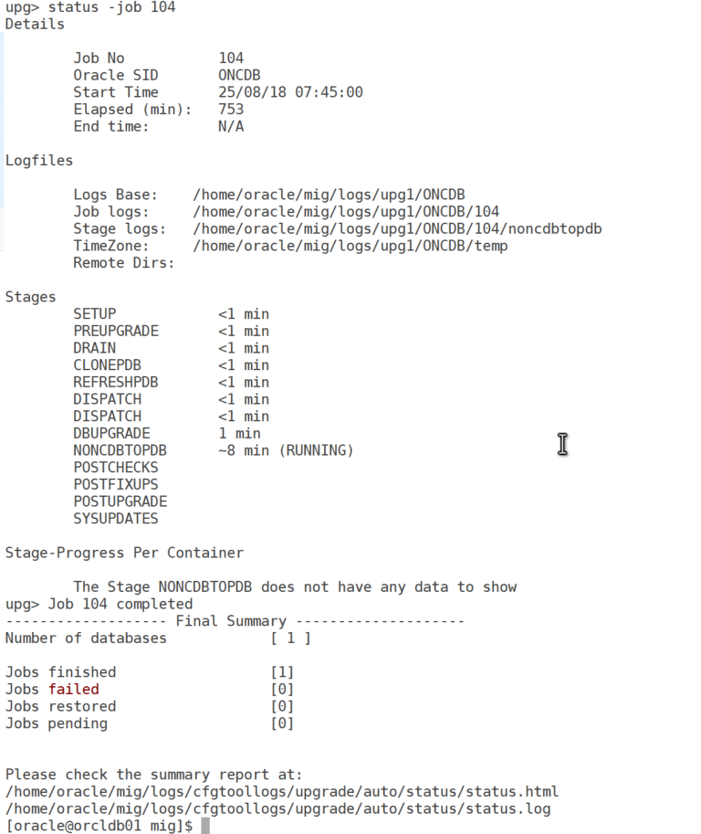
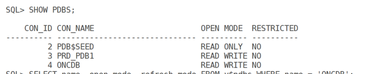

# Migrating Oracle Non-CDB to PDB with AutoUpgrade Using Refreshable Clones

Oracle’s multitenant architecture revolutionizes database management by allowing multiple Pluggable Databases (PDBs) within a single Container Database (CDB), enhancing scalability and resource efficiency. Starting with Oracle Database 21c, the non-CDB architecture is no longer supported, making migration to a multitenant setup essential. This blog post, inspired by Daniel Overby Hansen’s presentation at OUGN 2023 (available at https://dohdatabase.com/wp-content/uploads/2023/04/migrate_to_multitenant_with_refreshable_clones_using_autoupgrade.pdf), provides a detailed guide to migrating a non-CDB to a PDB using the AutoUpgrade utility with refreshable clone PDBs. This method minimizes downtime by maintaining a synchronized clone until the final cutover.

## Introduction

The AutoUpgrade utility, a powerful tool from Oracle, automates the conversion of non-CDBs to PDBs, with the refreshable clone option offering a low-downtime solution. This approach creates a PDB clone that stays in sync with the source non-CDB via redo apply, allowing testing and validation while the source remains operational. The final conversion occurs during a brief outage, making it ideal for production environments.

### Step-by-Step Process

#### Step 1: Install and Prepare the AutoUpgrade Utility

Download the latest autoupgrade.jar from My Oracle Support (Note 2485457.1).

#### Step 2: Create the Database Link User and Connection

On the source non-CDB, create a user for the database link:

``` wp-block-code
CREATE USER dblinkuser IDENTIFIED BY xxxxxxxx;
GRANT CONNECT, RESOURCE, CREATE PLUGGABLE DATABASE, SELECT_CATALOG_ROLE TO dblinkuser;
GRANT READ ON sys.enc$ TO dblinkuser;
```

On the target CDB, create the database link:

``` wp-block-code
CREATE DATABASE LINK CLONEPDB CONNECT TO dblinkuser IDENTIFIED BY xxxx USING 'noncdb-alias';
```

validate db link using below command

``` wp-block-code
select sysdate from dual@CLONEPDB;
```

Ensure the source non-CDB is in ARCHIVELOG mode:

### Step 3: Create the AutoUpgrade Configuration File with Refreshable Clone

create autoupgrade_refresh.cfg file

``` wp-block-code
global.autoupg_log_dir=/home/oracle/mig/logs
upg1.log_dir=/home/oracle/mig/logs/upg1
upg1.source_home=/u01/app/oracle/product/19.0.0/dbhome_2
upg1.target_home=/u01/app/oracle/product/19.0.0/dbhome_1
upg1.sid=ONCDB
upg1.target_cdb=O19TC
upg1.source_dblink.ONCDB=CLONEPDB
upg1.target_pdb_name.ONCDB=O19TC
upg1.start_time=18/08/2025 07:45:00
upg1.refreshable_pdb=yes
upg1.run_utlrp=yes
upg1.target_pdb_copy_option=file_name_convert=('/u02/oradata/ONCDB/', '/u02/oradata/O19TC/ONCDB/')
```

Adjust paths, SIDs, PDB names, and start time as needed. The refreshable_pdb=yes enables the clone feature.

Step 4: Run AutoUpgrade in Analyze Mode

``` wp-block-code
$ORACLE_HOME/jdk/bin/java -jar /home/oracle/mig/autoupgrade.jar -config /home/oracle/mig/autoupgrade_refresh.cfg -mode analyze
```

``` wp-block-code
Please check the summary report at:
/home/oracle/mig/logs/cfgtoollogs/upgrade/auto/status/status.html
/home/oracle/mig/logs/cfgtoollogs/upgrade/auto/status/status.log
```

### Step 5: Run AutoUpgrade in Deploy Mode for Initial Clone

``` wp-block-code
$ORACLE_HOME/jdk/bin/java -jar /home/oracle/mig/autoupgrade.jar -config /home/oracle/mig/autoupgrade_refresh.cfg -mode deploy
```



#### Step 6: Test and Validate the Refreshable Clone PDB

Check PDB status:



#### Step 7: Post-Migration Tasks

- Backup the CDB:
- Update tnsnames.ora file with the pdb entry
- Optionally drop the non-CDB

## Pros and Cons

### Pros

- **Minimal Downtime**: Synchronization allows testing while the source remains online.
- **Automation**: AutoUpgrade handles cloning, refresh, and conversion.
- **Fallback Option**: The source non-CDB remains intact for rollback.
- **Parallel Processing**: Uses parallel cloning for faster data transfer.

### Cons

- **Resource Intensive**: Needs significant disk space and network bandwidth.
- **Potential Errors**: Missing archivelogs or idle session timeouts can interrupt the process.

## Use Cases

- **Production Migration**: Minimize downtime for critical databases.
- **Testing Environments**: Validate PDB functionality before cutover.
- **Large Databases**: Leverage parallel cloning for efficient migration.
- **Data Guard Environments**: Manage standby databases with careful configuration.

## Best Practices

- **Backup**: Maintain recent backups of both databases.
- **Test First**: Run in analyze mode and test in a non-production setup.
- **Network Management**: Use traffic control tools to avoid saturation.
- **Data Guard**: Configure manage_standbys_clause appropriately (e.g., standbys=none).
- **Compatibility**: Keep COMPATIBLE at the default (e.g., 19.0.0) to avoid issues.

## Troubleshooting Common Issues

- **Idle Session Killed**: Use a profile without idle_time for the database link user.
- **ORA-600 \[4293\]**: Investigate with Oracle Support if encountered.

## Conclusion

Migrating a non-CDB to a PDB using AutoUpgrade with refreshable clones offers a robust, low-downtime solution, as highlighted in Daniel Overby Hansen’s OUGN 2023 presentation (https://dohdatabase.com/wp-content/uploads/2023/04/migrate_to_multitenant_with_refreshable_clones_using_autoupgrade.pdf). By following these steps, you can automate the process, validate the clone, and perform a seamless cutover. Always test in a non-production environment and consult the AutoUpgrade logs or Oracle Support for assistance.
