# OCI – Patching a DB System (VM/Bare Metal) Made Simple

Keeping your database systems updated is a **core part of DBA responsibilities** — especially in the cloud. In **Oracle Cloud Infrastructure (OCI)**, patching a **DB System** (VM or Bare Metal) is easier, safer, and can even be **automated**.

In this post, we’ll walk through:

✅ Types of patches  
✅ Pre-requisites  
✅ How to patch from the OCI Console  
✅ Best practices

## What is a DB System in OCI?

A **DB System** is a **non-autonomous Oracle Database** hosted on a virtual machine (VM) or bare metal (BM) server in OCI. You manage the OS, database patching, and backups — unlike Autonomous Database.

## Types of Patches for a DB System

Oracle provides different patch types:

| Patch Type               | Description                                             |
|--------------------------|---------------------------------------------------------|
| **DB System Patch**      | OS and grid infrastructure updates                      |
| **Database Patch**       | Updates to the Oracle RDBMS binaries                    |
| **Quarterly RU Patches** | Recommended patches with bug fixes and security updates |
| **One-off Patches**      | Fixes for specific issues (via MOS)                     |

## ✅ Pre-Patching Checklist

Before patching, ensure the following:

- ✅ **Backups are recent** (use OCI or RMAN)
- ✅ **Enough free disk space** on `/u01`, `/tmp`
- ✅ **No active Data Guard failovers/switchover** in progress
- ✅ **No scheduled maintenance or conflicting jobs**
- ✅ **Review patch notes** for known issues
- ✅ All DB system nodes running

### Steps to Patch using Dbcli

**Non Prod first**

Test this patch on non prod (or test) server first

Update the CLI

``` wp-block-code
 cliadm update-dbcli
```

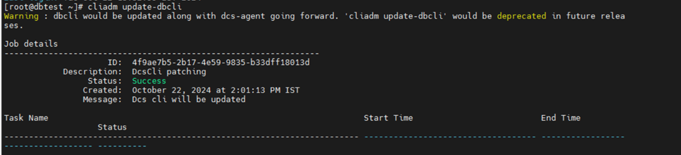

Wait the job to complete

``` wp-block-code
dbcli list-jobs
```

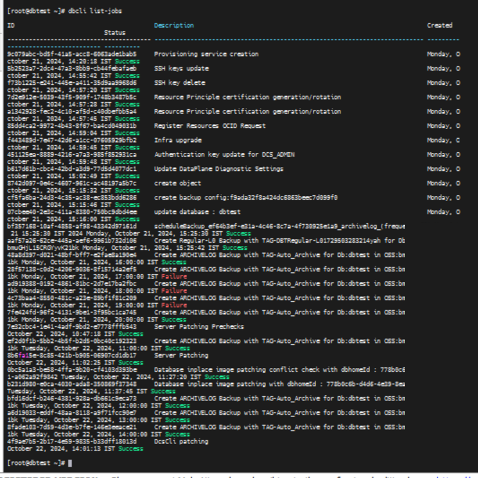

Check for installed and available patches

``` wp-block-code
dbcli describe-component
```

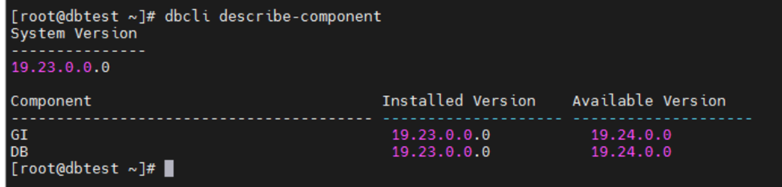

Display the latest patch versions available

``` wp-block-code
dbcli describe-latestpatch
```

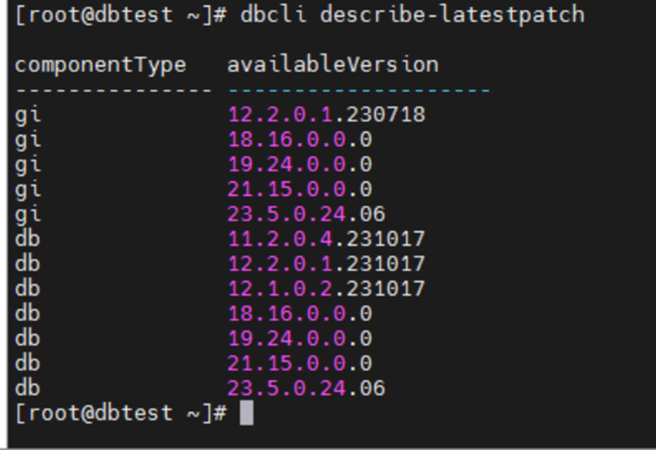

#### Run pre check

``` wp-block-code
dbcli update-server --precheck
```

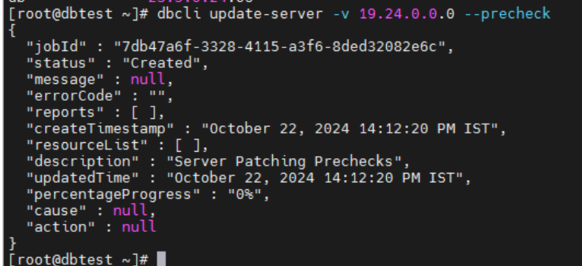

describe job

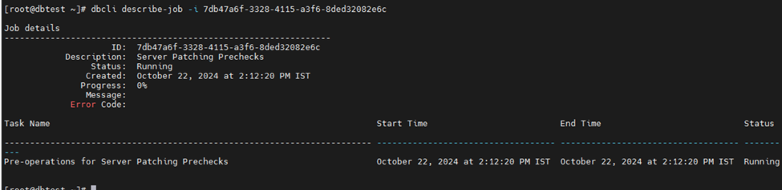

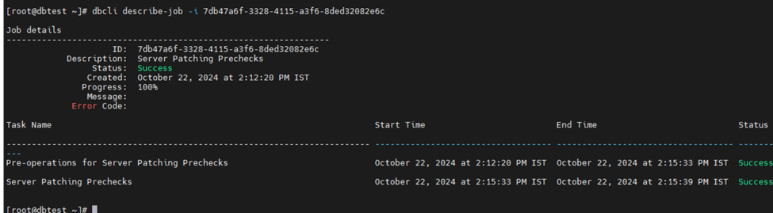

#### Apply the patch:

Update the server components. This step will patch GI.

``` wp-block-code
dbcli update-server
```

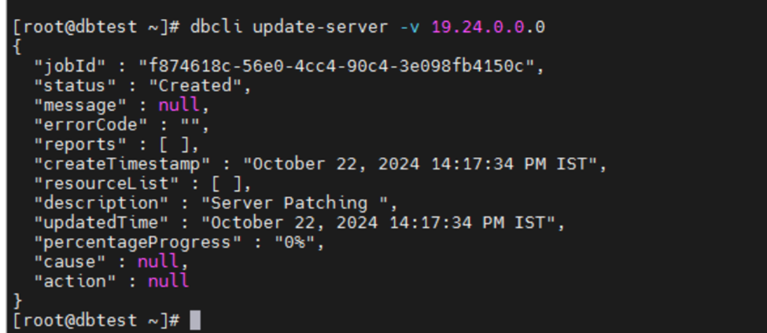

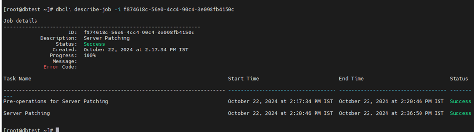

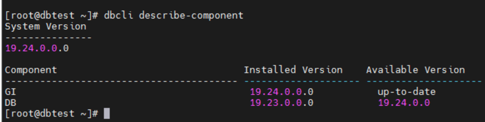

**List db homes**

``` wp-block-code
dbcli list-dbhomes
```

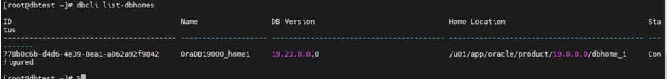

Run update home on select OH

``` wp-block-code
dbcli update-dbhome -i <Id>
```

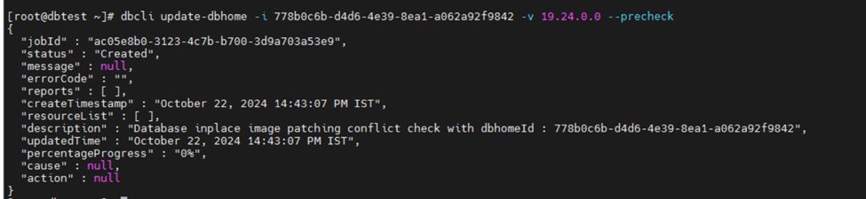

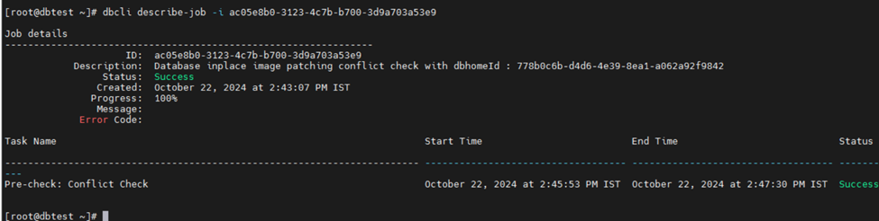

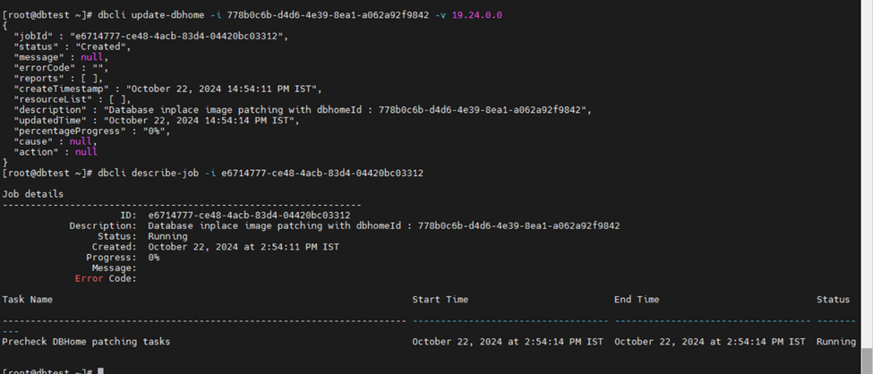

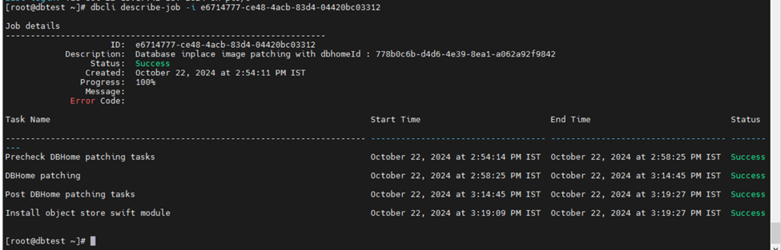

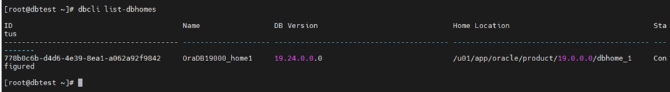

## 📝 Post-Patching Verification

After patching:

- ✅ Verify database version using `sqlplus` or `opatch lsinventory`
- ✅ Check listener status and services
