# Oracle Autonomous Database: Disaster Recovery

When it comes to mission-critical applications, **downtime is not an option**. That’s why **Disaster Recovery (DR)** plays a vital role in your Oracle Autonomous Database (ADB) strategy. OCI makes it easier than ever to build a robust DR plan — with automation, scalability, and high availability built in.

In this blog post, we'll explore **how Oracle ADB handles disaster recovery**, the options available, and best practices to ensure your data is always safe.

## 🧠 What is Disaster Recovery?

Disaster Recovery (DR) refers to **replicating and restoring data and services** in case of an unexpected event — such as:

- Hardware failure
- Region-level outage
- Cyberattack
- Natural disaster

The goal? Minimize downtime and data loss.

### 🌍 1. **Cross-Region Autonomous Data Guard (X-Region ADG)**

**Primary Feature**: Enables automated data replication to a standby ADB in another OCI region.

| Feature                 | Details                                                        |
|-------------------------|----------------------------------------------------------------|
| **Type**                | Synchronous or Asynchronous Redo Transport                     |
| **Switchover/Failover** | Manual or automatic failover supported                         |
| **Use Case**            | Critical applications needing high availability across regions |
| **Cost**                | Additional cost for standby instance                           |

🔄 **Failover**: If the primary region fails, you can **manually initiate failover** to the standby region with **minimal data loss**.

✅ Benefits:

- Regional redundancy
- No manual backups or scripting
- Seamless switchover testing

### 🛡️ 2. **Autonomous Data Guard (Intra-Region)**

- Replicates data to a standby ADB **within the same OCI region**.
- Useful for protecting against **zonal outages or hardware failures**.

💡 Tip: Not as robust as cross-region, but good for quick, same-region recovery.

### 💾 3. **Automatic Backups**

Even without ADG, Oracle ADB includes **automatic daily backups**:

- Retained for **60 days**
- Stored in **Oracle Object Storage**
- Can be used to restore the DB to **any point-in-time** in the last 60 days

### ⚙️ How to Enable Cross-Region DR for ADB

## 💾 1. **Backup-Based Disaster Recovery**

### 🔹 Description:

Uses **daily automatic backups** (retained for 60 days) to restore or clone the database during a disaster or logical failure.

## 🧠 Use Case Scenarios

| Use Case                        | Backup-Based DR Action |
|---------------------------------|------------------------|
| Accidental table drop           | PITR restore to clone  |
| Region-level DR test            | Cross-region clone     |
| Monthly DR drill                | Create temporary clone |
| Cost-optimized standby strategy | Use backup + clone     |

### 🔹 Pros:

- Built-in and free
- Flexible point-in-time restore
- No extra resources needed

### 🔹 Cons:

- Manual recovery steps
- Not real-time (higher RTO/RPO)
- Delays in failover

## 🔐 Key Features of ADW Backup-Based DR

| Feature                     | Description                                         |
|-----------------------------|-----------------------------------------------------|
| **Daily Automatic Backups** | Retained for 60 days, no setup needed               |
| **Manual Backup Clones**    | Create full clones in **same or different regions** |
| **Backup Storage**          | Stored securely in Oracle Object Storage            |
| **No Downtime for Backup**  | Backups are online and non-disruptive               |

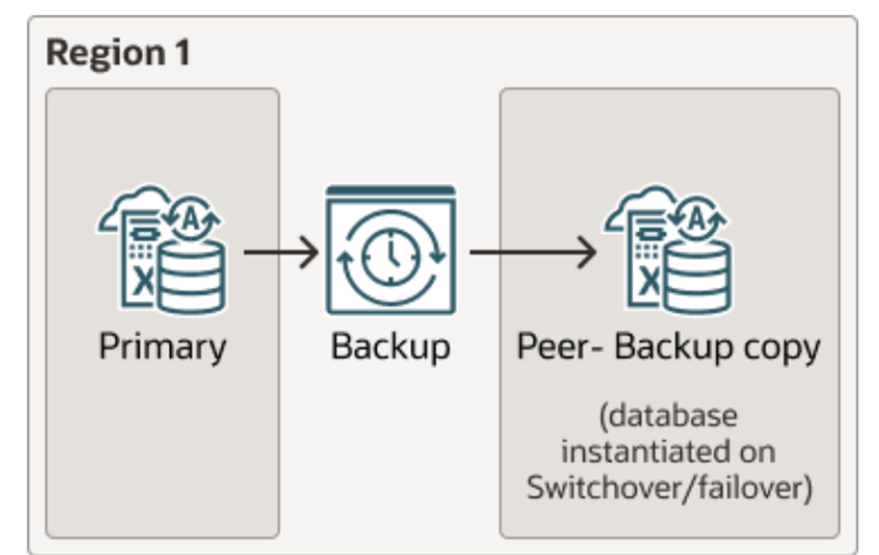

##### cross region DR

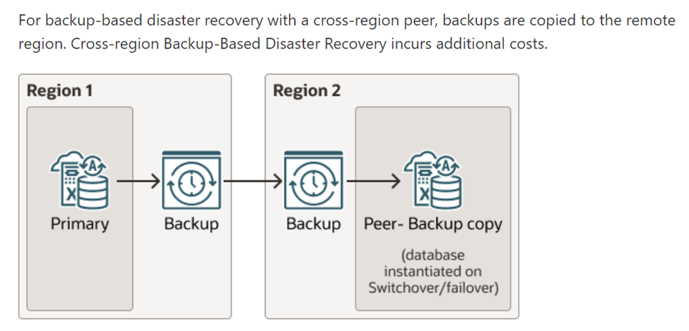

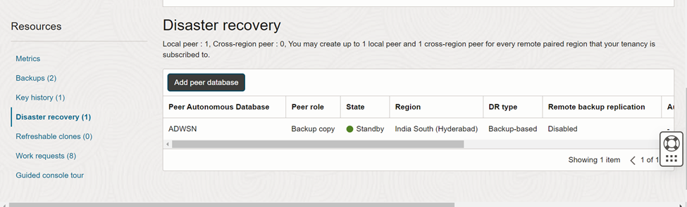

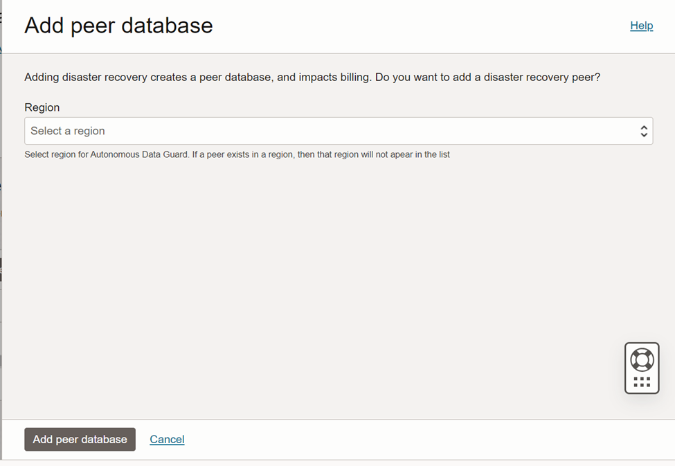

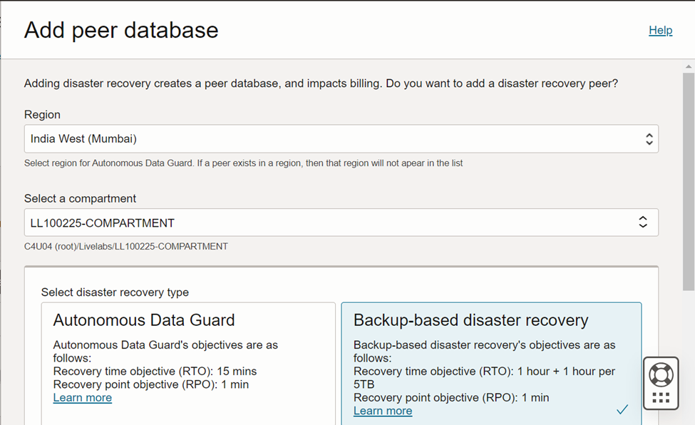

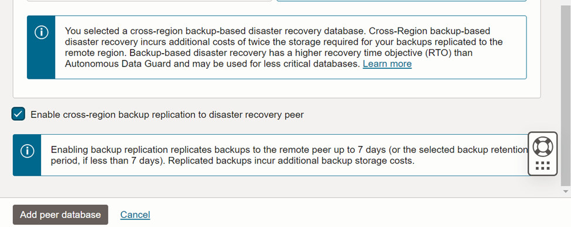

it will create a backup based cross region DR.

### **Steps to upgrade the backup base dataguard to autonomus dataguard**

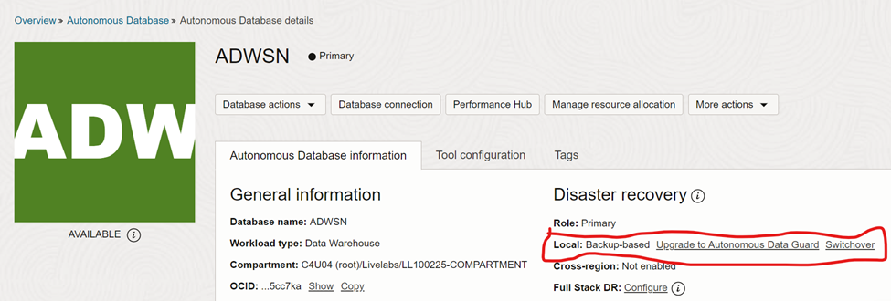

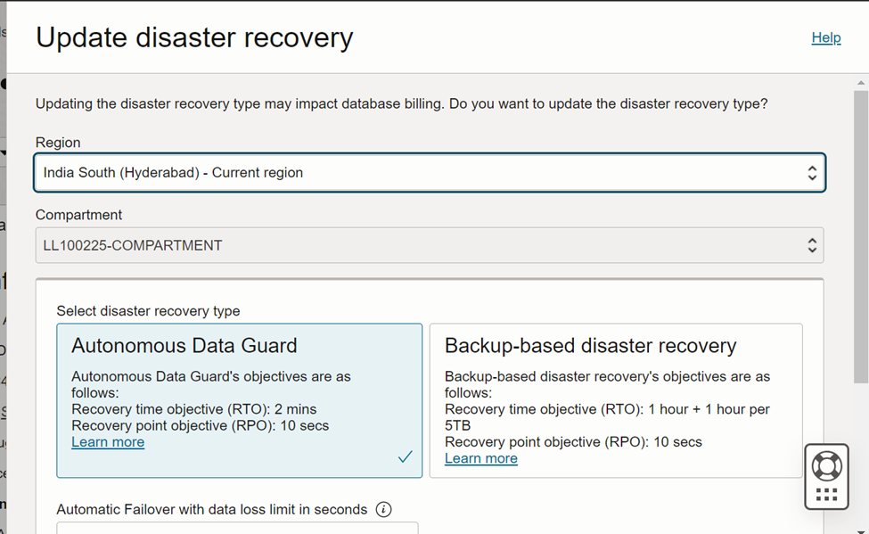

click on submit

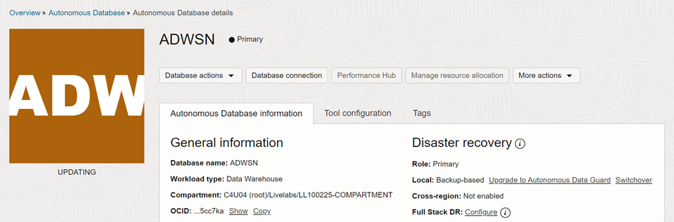

you can monitor the work request

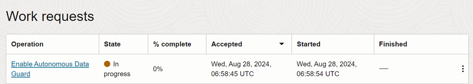

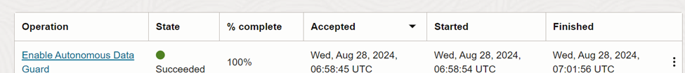

now the peer role will change from backup copy to standby.

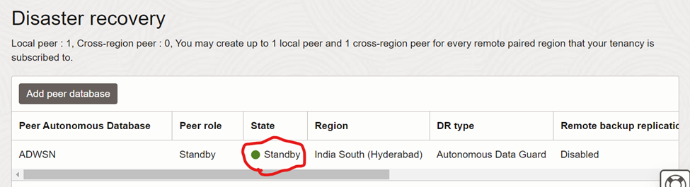

## 🧭 Final Thoughts

Oracle Autonomous Database provides **a powerful, integrated disaster recovery architecture** that’s easy to configure and scale — whether you're a DBA, developer, or IT leader.
