# Oracle Schema Migration Using OCI GoldenGate: Online Move of INSURANCE_DB from PROD to UAT

This post moves the **INSURANCE_DB** schema from the production database **ORDPROD** to the UAT database **ORDUAT** with very little downtime, using the managed **OCI GoldenGate** service (Microservices, 23ai console). The target schema is pre-created empty, an integrated extract starts capturing, the existing rows are copied at a known SCN with Data Pump, and a parallel replicat applies every change made after that SCN. At cut-over you only wait for lag to reach zero.


## Environment

|  | Source | Target |
|---|---|---|
| Host | `dbhostprod` | `dbhostuat` |
| Database / PDB | ORDPROD / `ORDPROD_PDB1` (19c) | ORDUAT / `ORDUAT_PDB1` (19c) |
| Schema | INSURANCE_DB | INSURANCE_DB |
| GoldenGate user | `ggadmin` (PDB), `C##GGADMIN` (CDB) | `ggadmin` (PDB) |
| GoldenGate connection | `oraprod_pdb`, `oraprod_cdb` | `orauat_pdb` |

GoldenGate deployment: **gg-ora2ora** (Oracle Database technology, one deployment that both captures and applies). Console reached at `https://localhost:2443` through an OCI Bastion session. Processes: extract **EXTMIG**, trail **EA**, replicat **REPMG**.

**Order:** Deployment → Prepare source → Prepare target → Connections → Pre-create schema → Trandata → Extract → Initial load → Replicat → Monitor → Switchover → Validate

> Everything about GoldenGate is done in the web console. SQL and the shell are only used to prepare the databases, copy the data and check the results.


## 1. Create the GoldenGate Deployment

On OCI the managed service is the simplest choice: no install, patching or backups to look after. A self-managed Microservices install gives the same console if you prefer that.

*OCI CONSOLE*

```text
Oracle Database → GoldenGate → Deployments → Create deployment
  Name:        gg-ora2ora
  Technology:  Oracle Database
  Subnet:      private subnet that reaches dbhostprod and dbhostuat
  OCPU:        1–2, auto scaling as needed
  Admin user:  ggadmin / <password>
```

When the deployment is **Active**: open it → **Launch console** → sign in with the admin user.

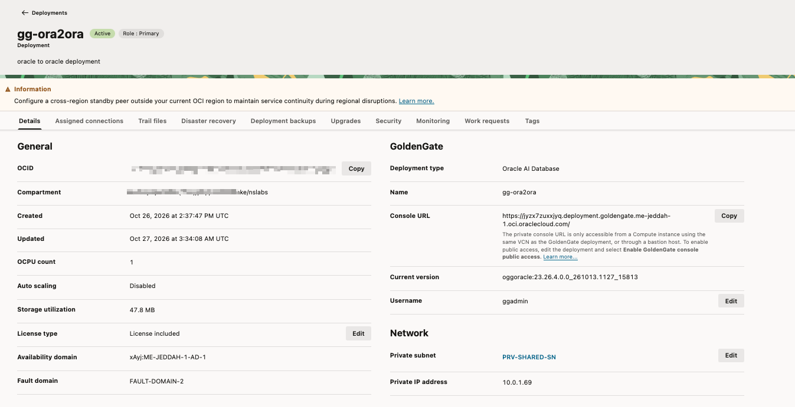


## 2. Prepare the Source Database


### Enable GoldenGate, force logging and supplemental logging

*SOURCE SQL*

```sql
ALTER SYSTEM SET enable_goldengate_replication = TRUE SCOPE = BOTH;
ALTER SYSTEM SET streams_pool_size = 2G SCOPE = BOTH;
ALTER DATABASE FORCE LOGGING;
ALTER DATABASE ADD SUPPLEMENTAL LOG DATA;
ALTER SYSTEM SWITCH LOGFILE;
```


### Create the GoldenGate capture user

On a **19c or earlier** CDB also create a common user `C##GGADMIN` in the root container for capture. From 21c a separate CDB user isn't needed.

*SOURCE SQL (PDB)*

```sql
CREATE USER ggadmin IDENTIFIED BY "<pwd>" DEFAULT TABLESPACE users QUOTA UNLIMITED ON users;
GRANT CREATE SESSION, CONNECT, RESOURCE, SELECT ANY DICTIONARY, SELECT ANY TRANSACTION TO ggadmin;
EXEC DBMS_GOLDENGATE_AUTH.GRANT_ADMIN_PRIVILEGE('GGADMIN');
```

> These grants are the minimum. The console's heartbeat and Trandata screens need a few more (CREATE VIEW, CREATE JOB …) — see **Troubleshooting** at the end for the full list if you hit ORA-01031.


### Find data types and tables that need attention

LONG, ANYDATA, XMLTYPE, SDO_GEOMETRY and user-defined types need checking, and every table should have a primary or unique key so the replicat can find rows.

*SOURCE SQL*

```sql
SELECT owner, table_name, column_name, data_type FROM dba_tab_columns
WHERE  owner IN ('INSURANCE_DB') AND data_type IN ('LONG','LONG RAW','ANYDATA','XMLTYPE','SDO_GEOMETRY','BFILE')
   OR (owner IN ('INSURANCE_DB') AND data_type_owner NOT IN ('SYS','PUBLIC') AND data_type_owner IS NOT NULL);

-- tables without a primary or unique key
SELECT owner, table_name FROM dba_tables t WHERE owner IN ('INSURANCE_DB')
AND NOT EXISTS (SELECT 1 FROM dba_constraints c WHERE c.owner = t.owner AND c.table_name = t.table_name
                AND c.constraint_type IN ('P','U'));
```


## 3. Prepare the Target Database

Only the apply user is created here; the application schema itself is created in step 5.

*TARGET SQL (PDB)*

```sql
ALTER SYSTEM SET enable_goldengate_replication = TRUE SCOPE = BOTH;
CREATE USER ggadmin IDENTIFIED BY "<pwd>" DEFAULT TABLESPACE users QUOTA UNLIMITED ON users;
GRANT CREATE SESSION, CONNECT, RESOURCE, DBA TO ggadmin;
EXEC DBMS_GOLDENGATE_AUTH.GRANT_ADMIN_PRIVILEGE('GGADMIN');
```


## 4. Database Connections


### Create the connections in OCI

*OCI CONSOLE*

```text
GoldenGate → Connections → Create connection
  oraprod_cdb : Oracle AI Database, ORDPROD (root), user C##GGADMIN
  oraprod_pdb : Oracle AI Database, ORDPROD_pdb1.prvsharedsn.hubssvcn.oraclevcn.com, user ggadmin
  orauat_pdb  : Oracle AI Database, ORDUAT_pdb1.prvsharedsn.hubssvcn.oraclevcn.com,  user ggadmin
```

Choose **Select database** and pick the DB system, DB home and database from the lists; the connection string is filled in for you. On the target only the PDB connection with `ggadmin` is needed.

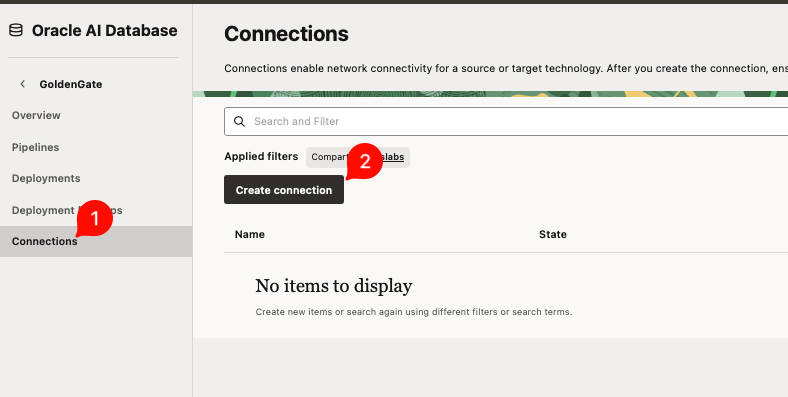

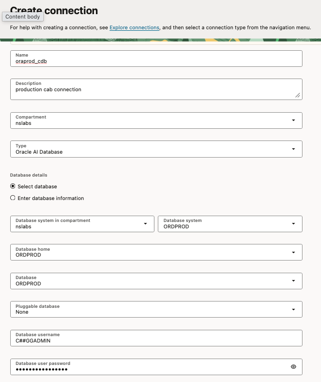

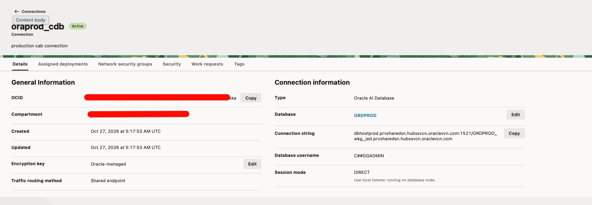

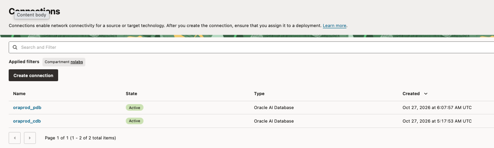

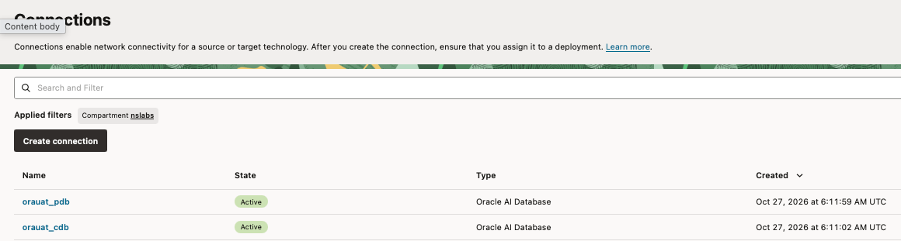


### Assign the connections to the deployment

Deployment **gg-ora2ora** → **Assigned connections** → **Assign connection**, add the source and target connections, then use **Test connection** on each.

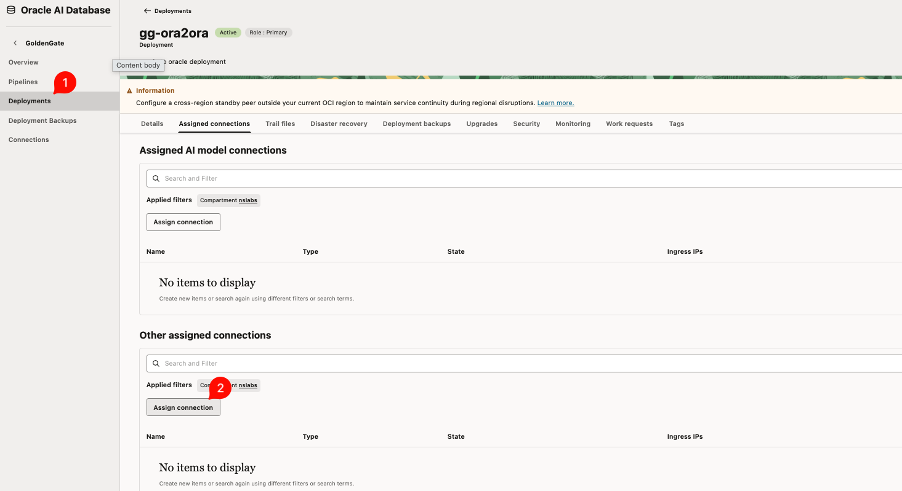

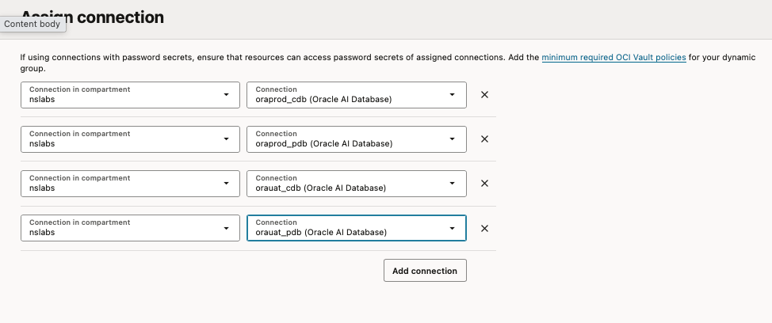

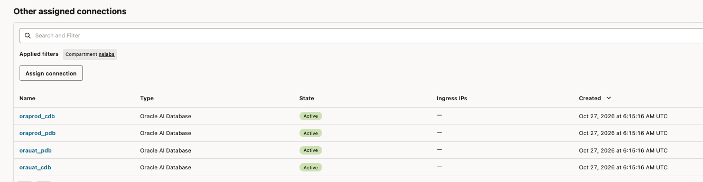

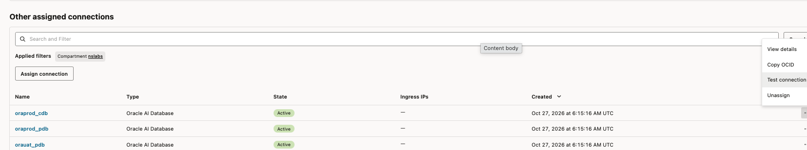

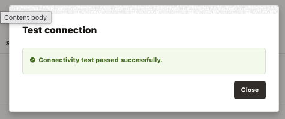


### Check the credentials in the GoldenGate console

Each assigned connection appears in the deployment console under **DB Connections** as a credential in domain **OracleGoldenGate**. On a self-managed hub you add them yourself:

*CONSOLE*

```text
Administration Service → DB Connections → +
  Domain: OracleGoldenGate  Alias: oraprod_pdb  User ID: ggadmin@dbhostprod:1521/ORDPROD_pdb1.prvsharedsn.hubssvcn.oraclevcn.com
  Domain: OracleGoldenGate  Alias: orauat_pdb   User ID: ggadmin@dbhostuat:1521/ORDUAT_pdb1.prvsharedsn.hubssvcn.oraclevcn.com
```

Click **Connect to database** on each; if the Trandata / Checkpoint / Heartbeat panels open, the login works.

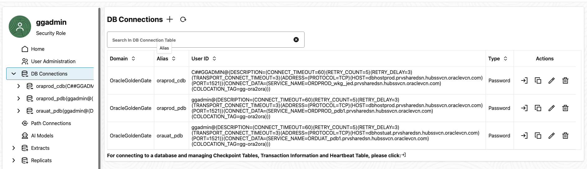

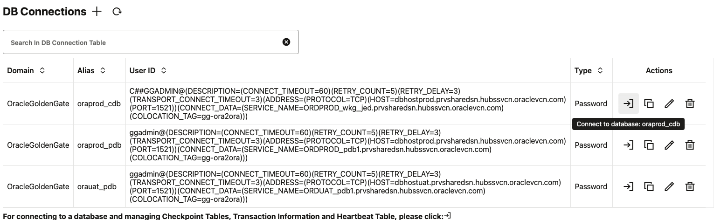

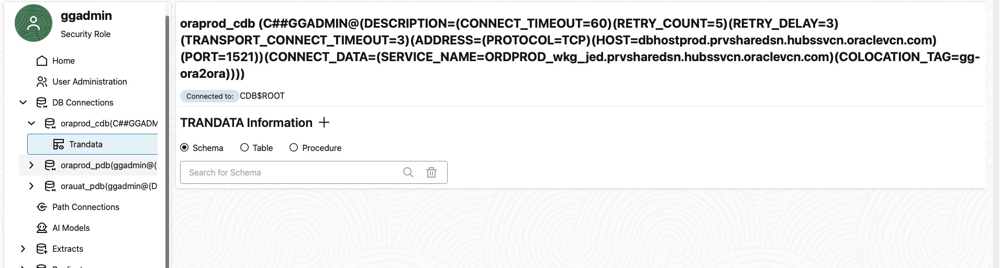


## 5. Pre-create the Target Schema

Create tablespaces, the user, roles and every object on the target **before** replication starts, so the replicat only applies rows.


### Tablespaces the schema uses

*SOURCE SQL*

```sql
SELECT tablespace_name, ROUND(SUM(bytes)/1024/1024/1024,2) gb
FROM   dba_segments WHERE owner IN ('INSURANCE_DB') GROUP BY tablespace_name ORDER BY 1;
```

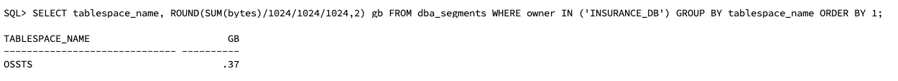

*TARGET SQL*

```sql
CREATE TABLESPACE OSSTS DATAFILE SIZE 1G AUTOEXTEND ON;   -- one per tablespace above
```

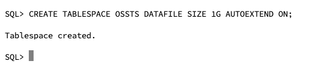


### Database link to the source

Used for the network-mode import below and for all the validation queries later.

*TARGET SQL*

```sql
CREATE DATABASE LINK SRC_VAL_LINK CONNECT TO system IDENTIFIED BY "<password>"
  USING '//dbhostprod:1521/ORDPROD_pdb1.prvsharedsn.hubssvcn.oraclevcn.com';
ALTER SYSTEM SET global_names = FALSE SCOPE = BOTH;
SELECT * FROM dual@SRC_VAL_LINK;
```


### Create users, roles and all objects (no data)

**Option A — network import** straight over the link:

*SHELL (TARGET)*

```bash
impdp system NETWORK_LINK=SRC_VAL_LINK DIRECTORY=DATA_PUMP_DIR LOGFILE=gg_roles.log FULL=Y CONTENT=METADATA_ONLY INCLUDE=ROLE,PROFILE
impdp system NETWORK_LINK=SRC_VAL_LINK DIRECTORY=DATA_PUMP_DIR LOGFILE=gg_ddl.log SCHEMAS=INSURANCE_DB CONTENT=METADATA_ONLY EXCLUDE=STATISTICS PARALLEL=4
```

**Option B — export and import a metadata-only dump** (what I used):

*exp_insurance.par*

```text
directory=MIGDP
dumpfile=insurance_%U.dmp
logfile=exp_insurance.log
schemas=INSURANCE_DB
parallel=4
filesize=10G
exclude=STATISTICS
CONTENT=METADATA_ONLY
logtime=all
```

*SHELL*

```bash
[oracle@dbhostprod dpump]$ expdp system@ORDPROD_PDB1 parfile=exp_insurance.par
# copy the dump files to dbhostuat, then
[oracle@dbhostuat dpump]$ impdp system@ORDUAT_PDB1 parfile=imp_insurance.par
```

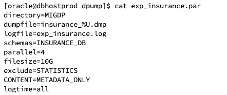

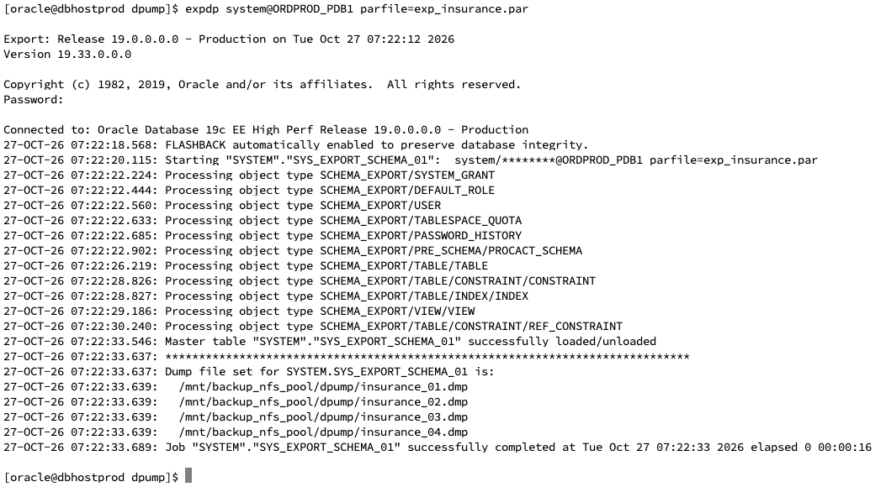

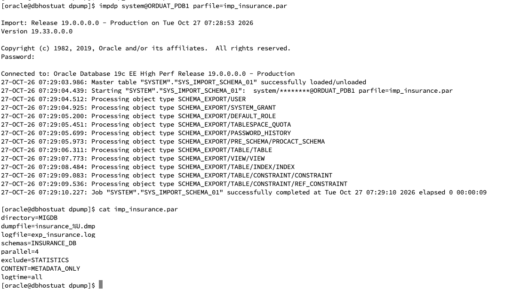

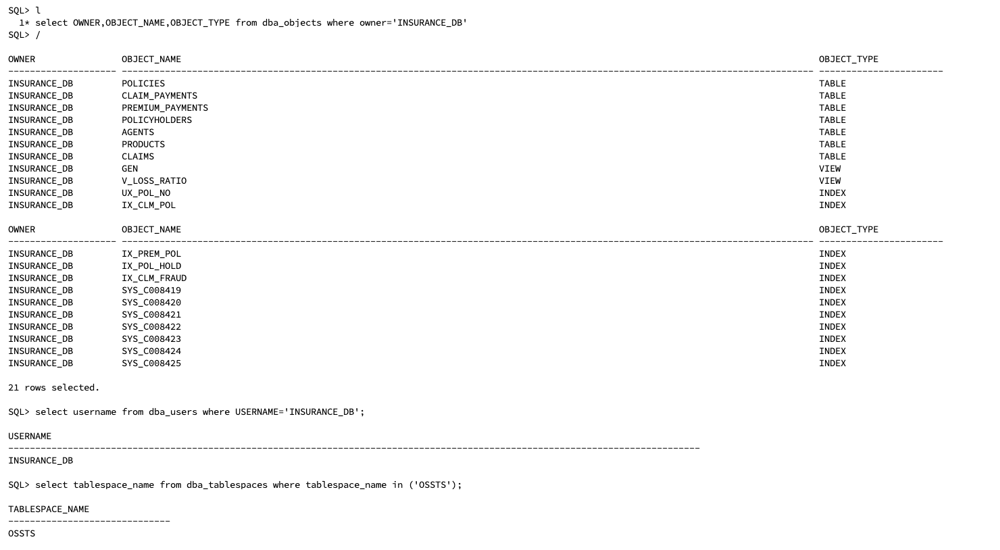


### Disable triggers, foreign keys and jobs until cut-over

Primary and unique keys stay **enabled** — the replicat uses them to locate rows. Run the generated statements:

*TARGET SQL*

```sql
SELECT 'ALTER TRIGGER "' || owner || '"."' || trigger_name || '" DISABLE;'
FROM dba_triggers WHERE owner IN ('INSURANCE_DB') AND status = 'ENABLED';

SELECT 'ALTER TABLE "' || owner || '"."' || table_name || '" DISABLE CONSTRAINT "' || constraint_name || '";'
FROM dba_constraints WHERE owner IN ('INSURANCE_DB') AND constraint_type = 'R' AND status = 'ENABLED';

SELECT 'EXEC DBMS_SCHEDULER.DISABLE(''"' || owner || '"."' || job_name || '"'');'
FROM dba_scheduler_jobs WHERE owner IN ('INSURANCE_DB') AND enabled = 'TRUE';
```

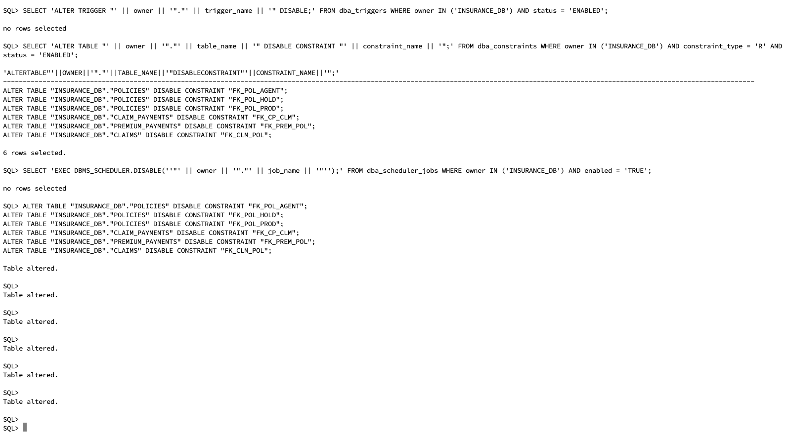

**Check:** every table has a key and all objects exist.

*OUTPUT*

```text
SQL> SELECT t.owner, t.table_name FROM dba_tables t WHERE t.owner IN ('INSURANCE_DB')
     AND NOT EXISTS (SELECT 1 FROM dba_constraints c WHERE c.owner = t.owner
                     AND c.table_name = t.table_name AND c.constraint_type IN ('P','U'));
no rows selected

SQL> SELECT owner, object_type, COUNT(*) c FROM dba_objects WHERE owner IN ('INSURANCE_DB') GROUP BY owner, object_type;
OWNER                OBJECT_TYPE                      C
-------------------- ----------------------- ----------
INSURANCE_DB         TABLE                            7
INSURANCE_DB         INDEX                           12
INSURANCE_DB         VIEW                             2
```


## 6. Trandata, Heartbeat and Checkpoint


### Schema-level supplemental logging (source)

Logs the key columns GoldenGate needs for every table in the schema, including tables created later.

*CONSOLE*

```text
DB Connections → oraprod_pdb → connect → Trandata → +
  Type: Schema   Schema name: INSURANCE_DB   All columns: on   → Submit
```

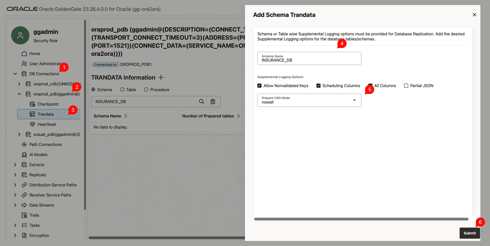

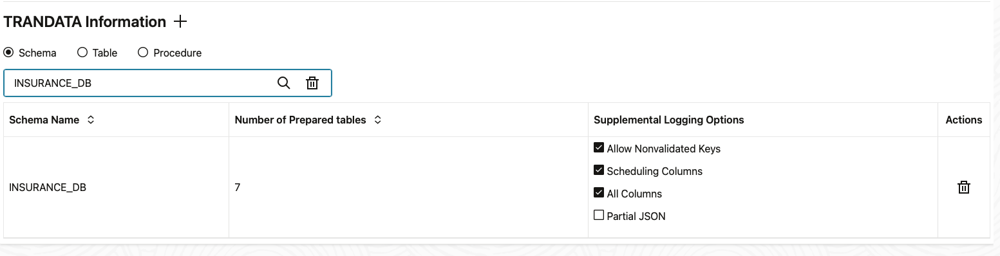


### Heartbeat table (source)

Lets the console show true end-to-end lag. The defaults are fine (60 s frequency, 30 days retention).

*CONSOLE*

```text
DB Connections → oraprod_pdb → connect → Heartbeat → +  → Submit
```

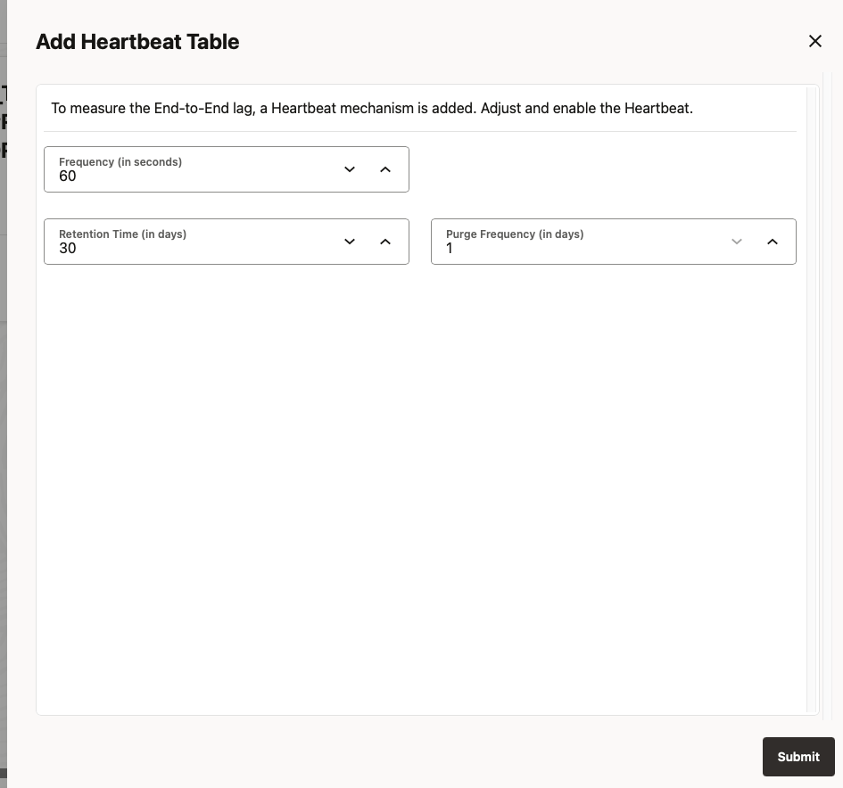

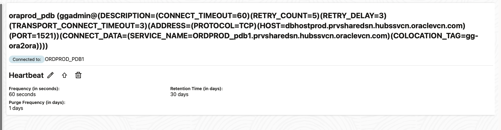


### Checkpoint table (target)

The replicat records its progress here, so it restarts exactly where it stopped.

*CONSOLE*

```text
DB Connections → orauat_pdb → connect → Checkpoint → +
  Table: ggadmin.ggs_checkpoint → Submit
```

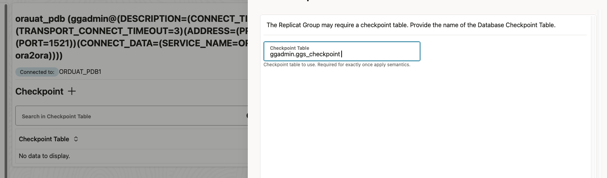

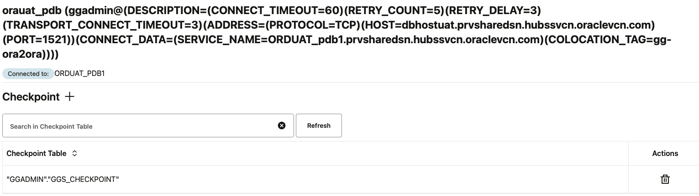


## 7. Create the Extract EXTMIG

Start capture **before** the initial load so no change is missed.

*CONSOLE*

```text
Extracts → +
  Type:        Integrated Extract
  Name:        EXTMIG
  Credentials: OracleGoldenGate / oraprod_pdb
  Trail:       EA
  Begin:       Now
  → Next → parameter file → Create and Run
```

*EXTRACT PARAMS*

```text
EXTRACT EXTMIG
USERIDALIAS oraprod_pdb DOMAIN OracleGoldenGate
EXTTRAIL EA
TABLE INSURANCE_DB.*;
```

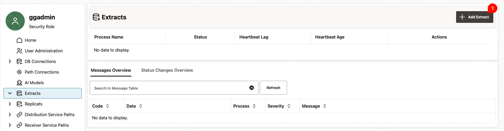

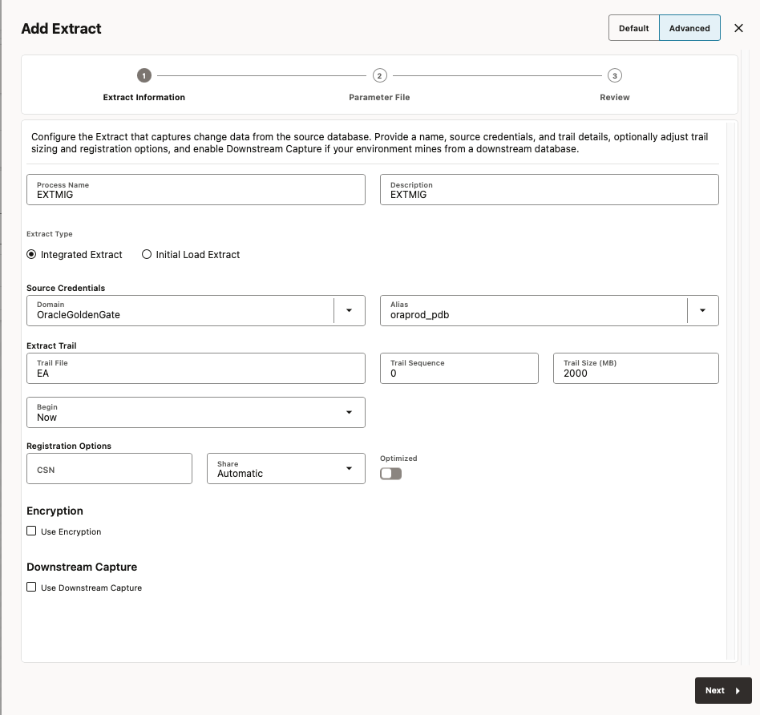

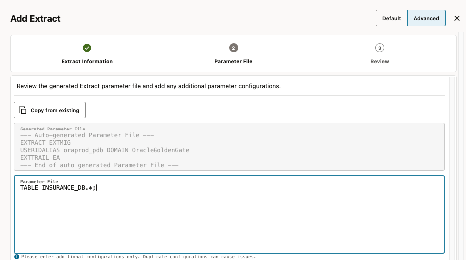

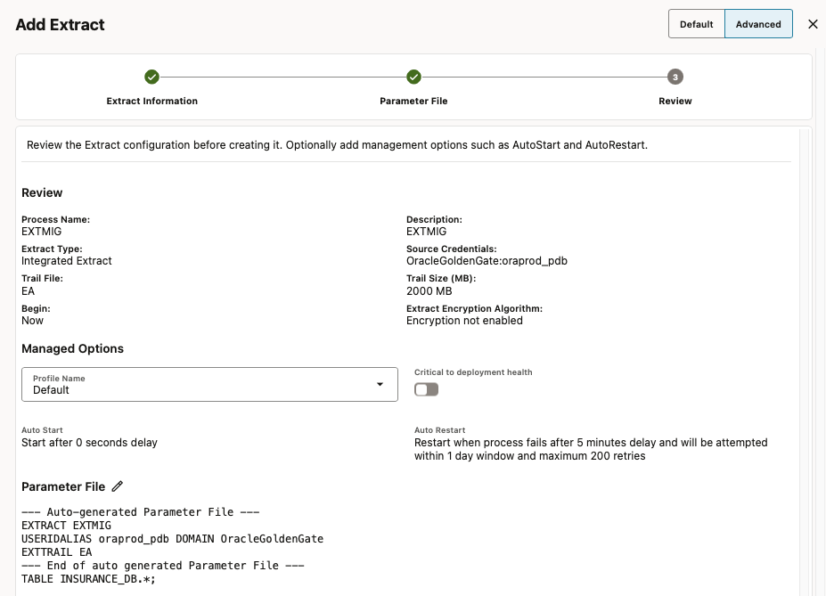

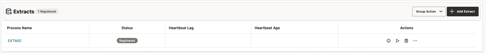

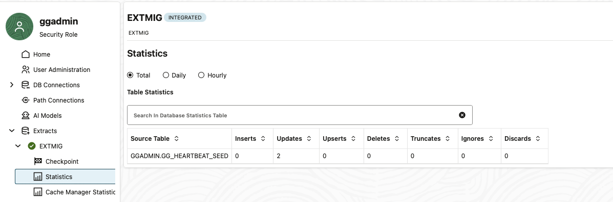


## 8. Initial Load at a Known SCN


### Wait for open transactions, then note the SCN

*SOURCE SQL*

```sql
SELECT s.sid, s.username, t.start_time
FROM v$transaction t JOIN v$session s ON s.saddr = t.ses_addr ORDER BY t.start_time;   -- wait for no rows

SELECT current_scn AS instantiation_scn FROM v$database;
```

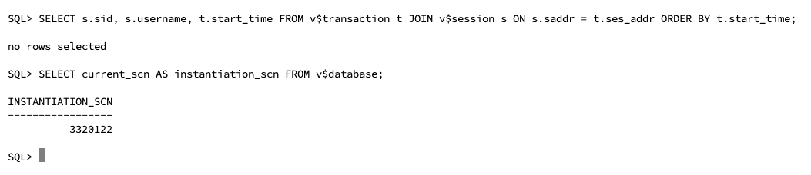

Any transaction still open at that SCN would be missing from both the dump and the trail, which is why you wait for none. Here the SCN was **3320122**.


### Export the rows at that SCN and import them

*export_insurance_data.par*

```text
directory=MIGDB
dumpfile=insurance_data_%U.dmp
logfile=exp_insurance.log
schemas=INSURANCE_DB
FLASHBACK_SCN=3320122
parallel=4
filesize=1G
exclude=STATISTICS
CONTENT=DATA_ONLY
logtime=all
```

*SHELL*

```bash
[oracle@dbhostprod dpump]$ expdp system@ORDPROD_PDB1 parfile=export_insurance_data.par
# copy the dumps to dbhostuat; tables already exist, so rows only
[oracle@dbhostuat dpump]$ impdp system@ORDUAT_PDB1 parfile=import_insurance_data.par
#   (directory, dumpfile, schemas, CONTENT=DATA_ONLY - add TABLE_EXISTS_ACTION=TRUNCATE if re-running)
```

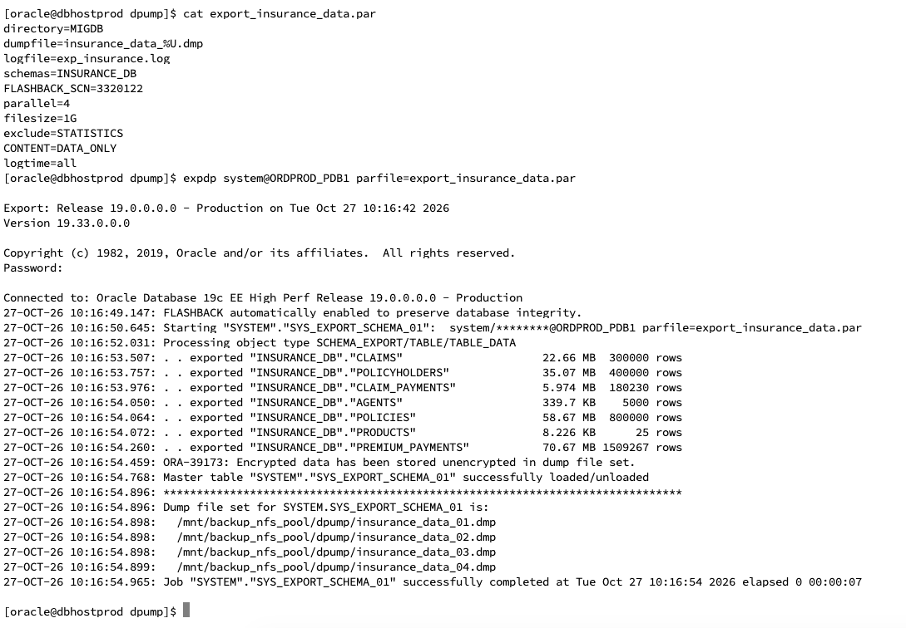

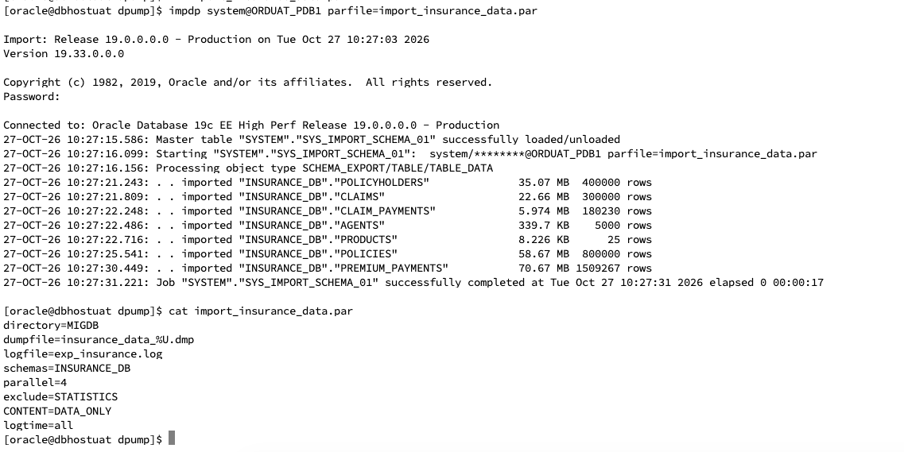

> ORA-39173 (encrypted data stored unencrypted in the dump) is a warning about TDE columns, not a failure. Protect or delete the dump files once the load is done.


## 9. Create the Replicat REPMG

*CONSOLE*

```text
Replicats → +
  Type:        Parallel Replicat, Integrated
  Name:        REPMG
  Credentials: OracleGoldenGate / orauat_pdb
  Checkpoint:  "GGADMIN"."GGS_CHECKPOINT"
  Trail:       EA
  → Next → parameter file → Create (do not run yet)
```

*REPLICAT PARAMS*

```text
REPLICAT REPMG
USERIDALIAS orauat_pdb DOMAIN OracleGoldenGate
REPERROR (DEFAULT, DISCARD)
MAP INSURANCE_DB.*, TARGET INSURANCE_DB.*;
```

Start it from the SCN of the load: **Actions → Start with Options → Start point: After CSN = 3320122**. Changes up to that SCN are already in the dump; only later ones are applied.

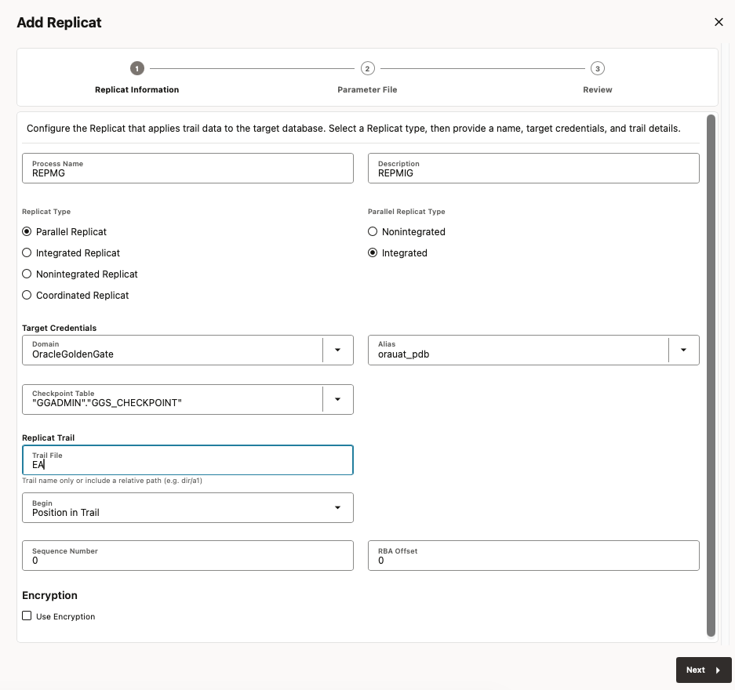

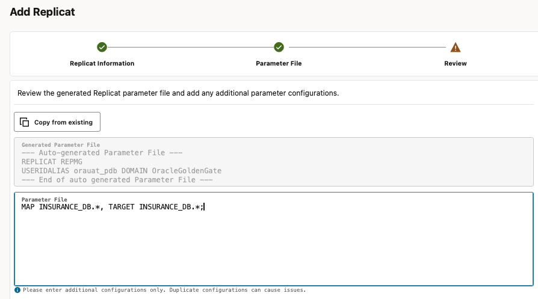

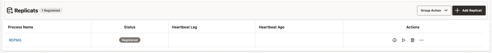

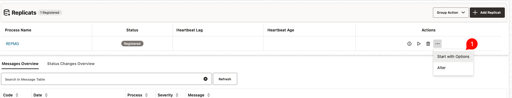

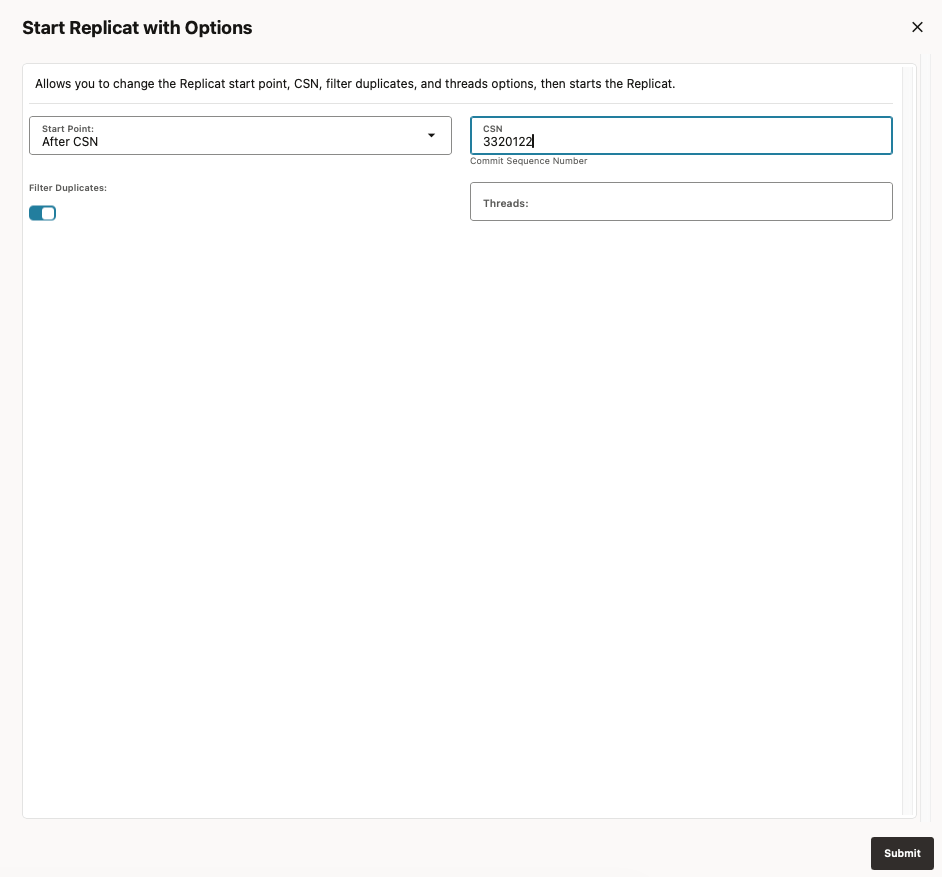

> `REPERROR (DEFAULT, DISCARD)` keeps the replicat running and writes failing rows to the discard file. Check that file before cut-over — a non-empty discard file means the target is not identical.


## 10. Monitor

Leave both processes running until lag stays at a few seconds. Overview should show EXTMIG and REPMG **Running**; click REPMG → **Statistics** for rows applied and lag.

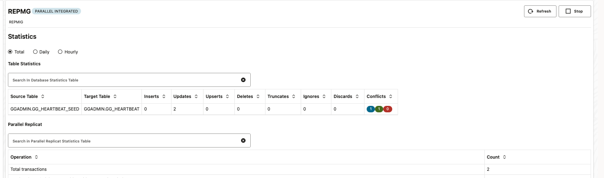


## 11. Switchover


### Stop application writes — downtime starts

*SOURCE SQL*

```sql
SELECT username, machine, status, COUNT(*) AS sessions
FROM   v$session WHERE type = 'USER' AND username NOT IN ('SYS','SYSTEM','DBSNMP')
GROUP  BY username, machine, status;
```

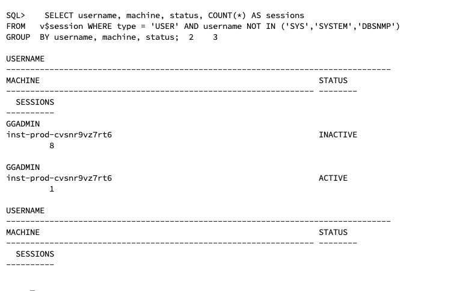


### Drain and stop

1. Extracts → EXTMIG: heartbeat lag 0 → **Actions → Stop**.
2. Replicats → REPMG: lag 0, at end of trail → **Actions → Stop**.


### Reset sequences, re-enable triggers, foreign keys and jobs

*TARGET SQL*

```sql
SELECT 'ALTER SEQUENCE "' || sequence_owner || '"."' || sequence_name || '" RESTART START WITH ' || (last_number + 1000) || ';'
FROM dba_sequences@SRC_VAL_LINK WHERE sequence_owner IN ('INSURANCE_DB');

SELECT 'ALTER TRIGGER "' || owner || '"."' || trigger_name || '" ENABLE;'
FROM dba_triggers WHERE owner IN ('INSURANCE_DB');

SELECT 'ALTER TABLE "' || owner || '"."' || table_name || '" ENABLE NOVALIDATE CONSTRAINT "' || constraint_name || '";'
FROM dba_constraints WHERE owner IN ('INSURANCE_DB') AND constraint_type = 'R' AND status = 'DISABLED';

SELECT 'EXEC DBMS_SCHEDULER.ENABLE(''"' || owner || '"."' || job_name || '"'');'
FROM dba_scheduler_jobs WHERE owner IN ('INSURANCE_DB') AND enabled = 'FALSE';
```

> Sequences are not replicated by these parameters, so they're moved past the source values (+1000 gives headroom). `ALTER SEQUENCE … RESTART` needs 18c or later.


### Point the application at the target — downtime ends

Update the TNS entry, JDBC URL or DNS name to `ORDUAT_PDB1` on `dbhostuat`.


## 12. Validation


### Object counts, source vs target

*TARGET SQL*

```sql
WITH s AS (SELECT owner, object_type, COUNT(*) c FROM dba_objects@SRC_VAL_LINK
           WHERE owner IN ('INSURANCE_DB') AND object_name NOT LIKE 'BIN$%' GROUP BY owner, object_type),
     t AS (SELECT owner, object_type, COUNT(*) c FROM dba_objects
           WHERE owner IN ('INSURANCE_DB') AND object_name NOT LIKE 'BIN$%' GROUP BY owner, object_type)
SELECT NVL(s.owner,t.owner) AS owner, NVL(s.object_type,t.object_type) AS object_type,
       NVL(s.c,0) AS src_cnt, NVL(t.c,0) AS tgt_cnt,
       CASE WHEN NVL(s.c,0) = NVL(t.c,0) THEN 'OK' ELSE 'MISMATCH' END AS status
FROM   s FULL OUTER JOIN t ON s.owner = t.owner AND s.object_type = t.object_type
ORDER  BY status, 1, 2;
```

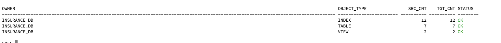


### Invalid objects, source vs target

*TARGET SQL*

```sql
SELECT t.owner, t.object_type, t.object_name
FROM   dba_objects t
WHERE  t.status = 'INVALID' AND t.owner IN ('INSURANCE_DB')
AND    NOT EXISTS (SELECT 1 FROM dba_objects@SRC_VAL_LINK x WHERE x.owner = t.owner AND x.object_name = t.object_name
                   AND x.object_type = t.object_type AND x.status = 'INVALID')
ORDER  BY 1, 2, 3;

SELECT 'SOURCE' side, COUNT(*) invalid_cnt FROM dba_objects@SRC_VAL_LINK WHERE status = 'INVALID' AND owner IN ('INSURANCE_DB')
UNION ALL
SELECT 'TARGET', COUNT(*) FROM dba_objects WHERE status = 'INVALID' AND owner IN ('INSURANCE_DB');
```

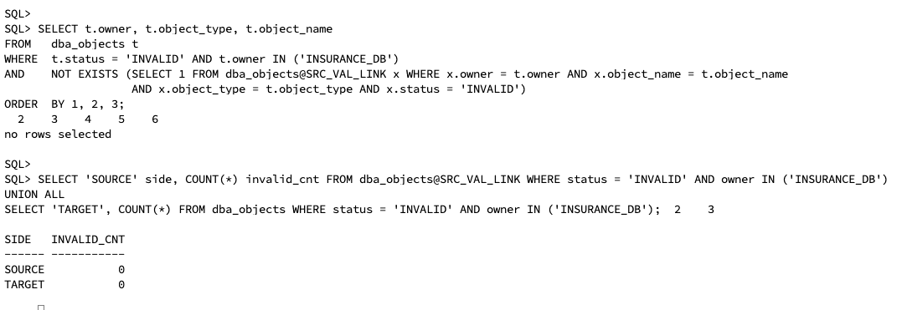


### Row counts for every table

*TARGET SQL*

```sql
-- One row per table: source rows, target rows, difference, status.
-- Mismatched and missing tables sort first. target_rows = -1 means the table is missing.
SET LINESIZE 200 PAGESIZE 1000
COLUMN owner FORMAT A25
COLUMN table_name FORMAT A40
COLUMN status FORMAT A10
WITH src AS (
  SELECT owner AS src_owner, owner AS tgt_owner, table_name
  FROM   dba_tables@SRC_VAL_LINK
  WHERE  owner IN ('INSURANCE_DB')
  AND    nested = 'NO' AND secondary = 'N' AND temporary = 'N'
  AND    (iot_type IS NULL OR iot_type = 'IOT')
  AND    (owner, table_name) NOT IN (SELECT owner, table_name FROM dba_external_tables@SRC_VAL_LINK)
),
cnt AS (
  SELECT s.tgt_owner AS owner, s.table_name,
         TO_NUMBER(EXTRACTVALUE(XMLTYPE(DBMS_XMLGEN.GETXML('SELECT COUNT(*) c FROM "' || s.src_owner || '"."' || s.table_name || '"@SRC_VAL_LINK')),'/ROWSET/ROW/C')) AS source_rows,
         (SELECT TO_NUMBER(EXTRACTVALUE(XMLTYPE(DBMS_XMLGEN.GETXML('SELECT COUNT(*) c FROM "' || t.owner || '"."' || t.table_name || '"')),'/ROWSET/ROW/C'))
          FROM dba_tables t WHERE t.owner = s.tgt_owner AND t.table_name = s.table_name) AS target_rows
  FROM   src s
)
SELECT owner, table_name, source_rows,
       NVL(target_rows, -1)              AS target_rows,
       NVL(target_rows, 0) - source_rows AS difference,
       CASE WHEN target_rows IS NULL       THEN 'MISSING'
            WHEN target_rows = source_rows THEN 'MATCH'
            ELSE 'MISMATCH' END            AS status
FROM   cnt
ORDER  BY CASE WHEN target_rows = source_rows THEN 1 ELSE 0 END, owner, table_name;
```

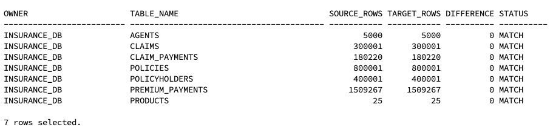


## 13. Fallback and Cleanup

Keep the source untouched until sign-off. To fall back, point the application back to `ORDPROD_PDB1` on `dbhostprod`. If users will write to the target before sign-off and you still want a way back, build a reverse extract and replicat (target → source) **before** switching.

After sign-off:

- Replicats → REPMG → **Actions → Delete**.
- Extracts → EXTMIG → **Actions → Delete** (this also unregisters it from the database).
- DB Connections → oraprod_pdb → remove the Trandata and Heartbeat entries.
- Drop the `SRC_VAL_LINK` database link on the target.
- OCI: delete the deployment and connections if they're no longer needed.


## Troubleshooting: ORA-01031 when adding the Heartbeat table

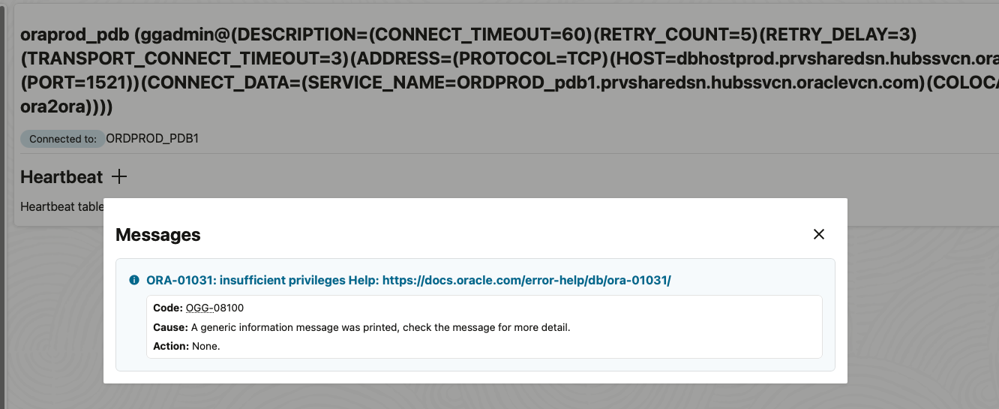

The connection itself is fine — the panel says **Connected to: ORDPROD_PDB1**. The error comes from what runs next: the heartbeat setup creates tables, views and a scheduler job, and `ggadmin` in the PDB lacks some of those privileges. Usual causes:

- `DBMS_GOLDENGATE_AUTH.GRANT_ADMIN_PRIVILEGE` was never run in **this PDB**, or only in CDB$ROOT.
- `RESOURCE` was granted but `CREATE VIEW` / `CREATE JOB` were not — RESOURCE doesn't include them.

**Fix** — as SYS, in the PDB:

*SQL*

```sql
ALTER SESSION SET CONTAINER = ORDPROD_PDB1;

GRANT CREATE SESSION, ALTER SESSION, CREATE TABLE, CREATE VIEW,
      CREATE SEQUENCE, CREATE PROCEDURE, CREATE JOB, CREATE SYNONYM TO ggadmin;
GRANT SELECT ANY DICTIONARY, SELECT ANY TABLE, FLASHBACK ANY TABLE,
      SELECT ANY TRANSACTION TO ggadmin;
GRANT EXECUTE ON dbms_lock TO ggadmin;
GRANT EXECUTE ON dbms_scheduler TO ggadmin;
ALTER USER ggadmin QUOTA UNLIMITED ON users;   -- or its default tablespace

EXEC DBMS_GOLDENGATE_AUTH.GRANT_ADMIN_PRIVILEGE('GGADMIN', container => 'CURRENT');
```

For the **target** PDB, also add the apply-side DML privileges. On 23ai you can grant the `OGG_CAPTURE` and `OGG_APPLY` roles instead.

*SQL*

```sql
GRANT INSERT ANY TABLE, UPDATE ANY TABLE, DELETE ANY TABLE, LOCK ANY TABLE TO ggadmin;
```

**Verify** in the PDB — `DBA_GOLDENGATE_PRIVILEGES` must return rows:

*SQL*

```sql
SELECT * FROM dba_goldengate_privileges WHERE username = 'GGADMIN';
SELECT privilege FROM dba_sys_privs WHERE grantee = 'GGADMIN' ORDER BY 1;
SELECT default_tablespace FROM dba_users WHERE username = 'GGADMIN';
```

Then disconnect and reconnect the `oraprod_pdb` connection in the console (or refresh the page) and add the heartbeat again.

