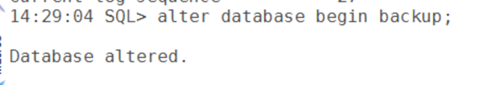
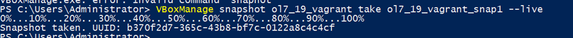
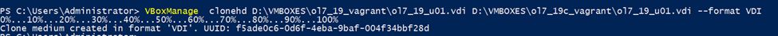
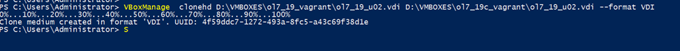
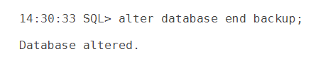
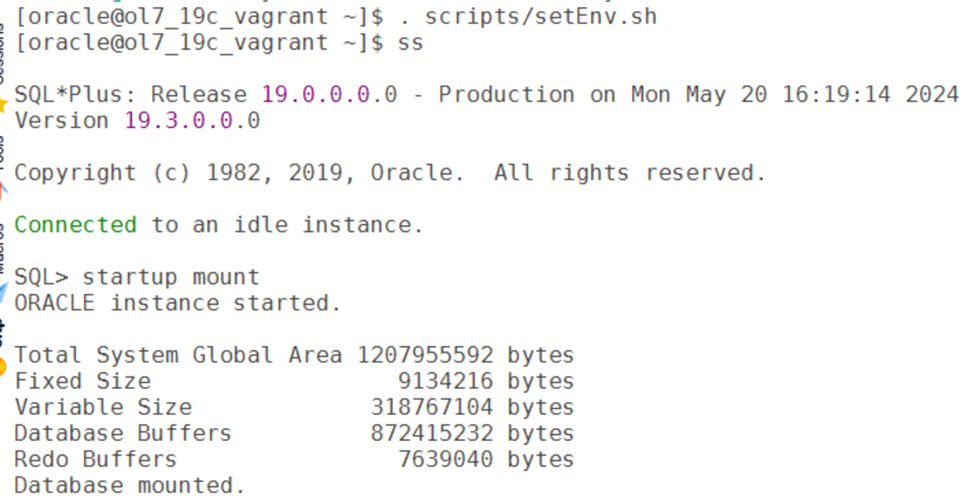
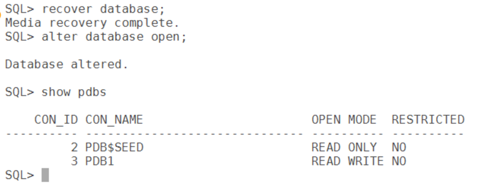
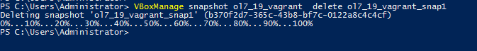

# Refresh Oracle Database using storage snapshots

In this blog i want to show how fast we can clone the database using storage snapshots.

**Note**: I dont have a san storage to show the exact step involved so i have utilized the oracle virtualbox clone hd utility to provied the steps. other then storage snapshot steps the other steps are same.

## Assumptions

- A fresh vm is already installed
- all oracle database pre-rpms are already installed.

## steps:

1.  Built new vm for refresh/clone
2.  Keep the source database in begin backup mode

3\. Take snapshot of vm

4\. Clone the hard disks(lun) of database home and datafile locations

5\. end the backup mode on source database

6\. Set the env variables and start the database in mount

7\. Now recovery the database and open the database.

if the simple recover database doent worked we can use point it time rman command.

8\. if every thing went good we can drop the vm snapshot take before.

