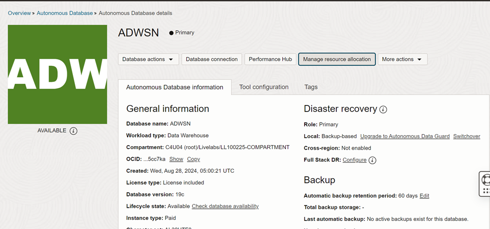
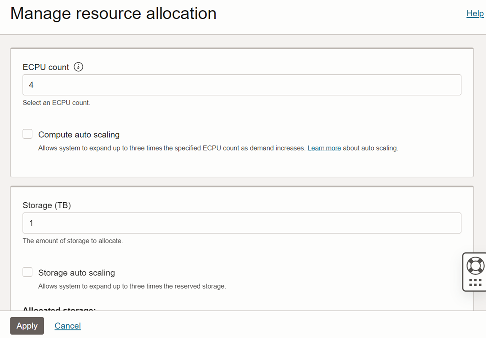
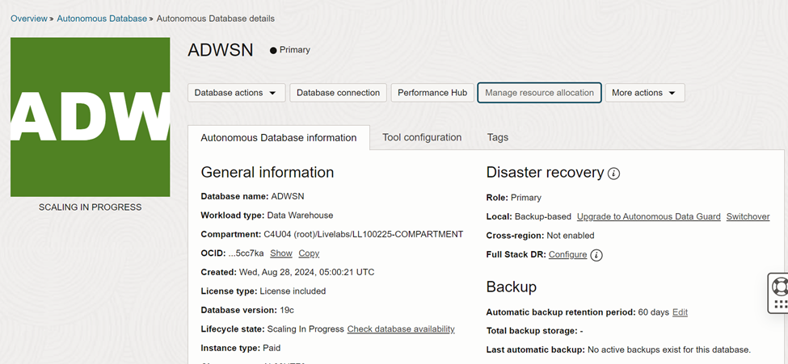

# Scale Up or Down Your Oracle Autonomous Database: CPU & Storage Made Simple!

In today's cloud-first world, flexibility and scalability are key to keeping your applications running efficiently. Oracle Autonomous Database (ADB) provides seamless scaling options that help you adapt your resources to match your workload—**without downtime!**

Whether you’re on **Autonomous Data Warehouse (ADW)**, **Autonomous Transaction Processing (ATP)**, or **Autonomous APEX**, here’s how you can scale your database resources

## 🔄 Why Scale?

Your workload might vary:

- 📈 Monthly financial reports?
- 🎯 End-of-year analytics?
- 🧪 Application testing?

Instead of over-provisioning all year, Oracle lets you **dynamically scale** compute (CPU/Memory) and **storage** whenever needed.

## 🚀 What Can You Scale in ADB?

| Resource      | Description                        | Scalable? | Downtime? |
|---------------|------------------------------------|-----------|-----------|
| **CPU Count** | Number of OCPUs assigned to the DB | ✅ Yes    | ❌ No     |
| **Storage**   | Storage space allocated to the DB  | ✅ Yes    | ❌ No     |

How to Scale:

Go to your Autonomous Database in the OCI Console.

Click **“Manage Resource allocation”**.



Adjust the **OCPU count** and/or **storage (in TB)** .



Click **Apply** – changes take effect **immediately**, without restarting the DB.



## 🔐 Security & Permissions

To scale, your OCI user must have policies like:

``` wp-block-code
Allow group DBAdmins to manage autonomous-database in compartment MyCompartment
```

## ✅ Use Cases

| Scenario                         | Scaling Action       |
|----------------------------------|----------------------|
| Quarterly report processing      | Scale **up CPU**     |
| Weekend or holiday off-peak      | Scale **down CPU**   |
| Large data ingestion             | Scale **up storage** |
| Cost-saving in test environments | Scale **down CPU**   |

## 💡 Best Practices

- Monitor usage with **OCI Metrics** and **ADB Performance Hub**.
- Use **Auto Scaling** (if enabled) to allow Oracle to auto-scale CPU within a defined range.
- Schedule CPU scale-down during known idle times for cost savings.

## 🧠 Final Thoughts

Oracle Autonomous Database makes it easy to optimize performance and cost by scaling compute and storage resources **without downtime**. It’s one of the top reasons why DBAs and developers alike love working with ADB on OCI!
