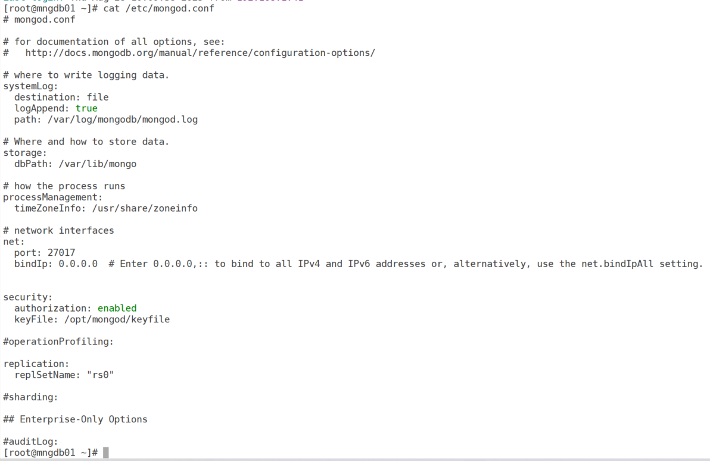
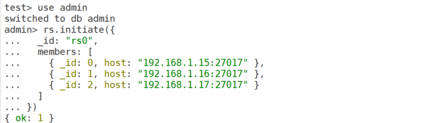
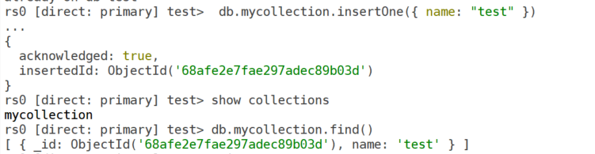
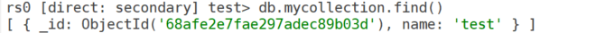
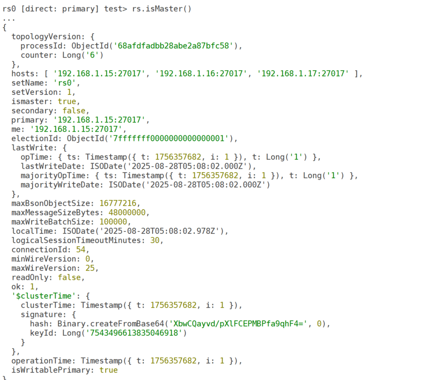
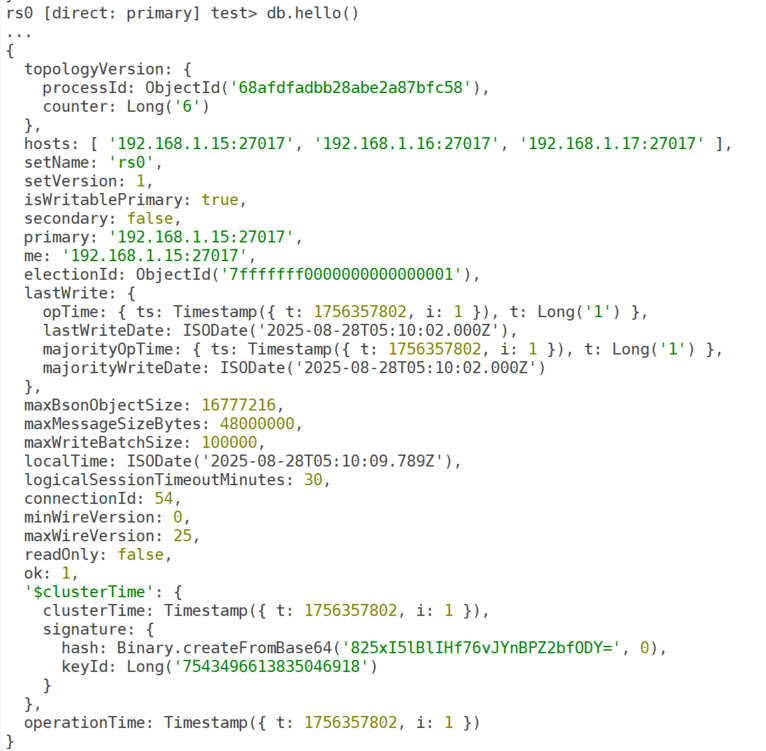
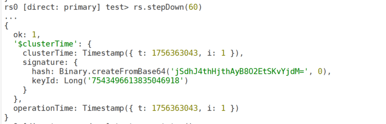
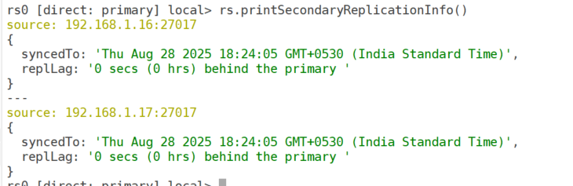

# Setting Up MongoDB Replication: A Step-by-Step Guide

MongoDB replication is a powerful feature that ensures high availability and data redundancy by maintaining multiple copies of your data across different servers. By configuring a **replica set**, you can achieve fault tolerance, enable read scaling, and simplify disaster recovery. In this blog post, we’ll walk you through the process of setting up MongoDB replication with clear, actionable steps.

## What is MongoDB Replication?

MongoDB replication involves creating a **replica set**, a group of MongoDB instances that store the same data. One node acts as the **primary**, handling all write operations, while **secondaries** replicate the data and can serve read operations. An optional **arbiter** can participate in elections without storing data. Replication ensures that if the primary node fails, a secondary can take over, minimizing downtime.

Let’s dive into the steps to set up a MongoDB replica set.

### Step 1: Plan Your Replica Set

Before you begin, plan your replica set architecture:

- **Number of Nodes**: A typical replica set has at least three nodes (one primary, two secondaries). You can use an arbiter for voting if you need an odd number of members.
- **Hardware**: Ensure each node has adequate CPU, memory, and disk space (SSDs are recommended for performance).
- **Network**: Verify low-latency connectivity between nodes and open the default MongoDB port (27017) in your firewall.
- **Roles**: Decide which nodes will be primary, secondary, or arbiter.

**Pro Tip**: Use separate servers or VMs or docker containers for nodes to ensure fault tolerance.

### Step 2: Install MongoDB on All Nodes

Ensure Installed the same version of MongoDB on each server. validate the installed version

``` wp-block-code
mongod --version
```

### Step 3: Configure MongoDB Instances

Edit the MongoDB configuration file (usually /etc/mongod.conf) on each node to enable replication and define the replica set name.

``` wp-block-code
replication:
  replSetName: "rs0"  # Use the same name for all nodes
net:
  bindIp: 0.0.0.0    # Allow connections from other nodes
  port: 27017        # Default port
```

**Create a Keyfile** for replica set communication:

``` wp-block-code
openssl rand -base64 756 > /opt/mongod/keyfile
sudo chmod 400 /opt/mongod/keyfile
sudo chown mongod:mongod /opt/mongod/keyfile
```

Add the keyfile to the configuration:

``` wp-block-code
security:
  keyFile: /path/to/keyfile
```



## Step 4: Restart mongodb on all nodes:

``` wp-block-code
sudo systemctl restart mongod
sudo systemctl status mongod
```

### Step 5: Initialize the Replica Set

Connect to one node using the MongoDB shell (mongosh):

``` wp-block-code
mongosh -u mongoadm -p --authenticationDatabase admin
```

Initialize the replica set with all nodes:

``` wp-block-code
admin> rs.initiate({
...   _id: "rs0",
...   members: [
...     { _id: 0, host: "192.168.1.15:27017" },
...     { _id: 1, host: "192.168.1.16:27017" },
...     { _id: 2, host: "192.168.1.17:27017" }
...   ]
... })
{ ok: 1 }
```



Replace the host IPs with your node addresses. After initialization, one node becomes the primary, and others become secondaries. Check the status:

``` wp-block-code
rs.status()
```

**output:**

``` wp-block-code
rs0 [direct: primary] test> rs.status()
{
  set: 'rs0',
  date: ISODate('2025-08-28T05:00:52.678Z'),
  myState: 1,
  term: Long('1'),
  syncSourceHost: '',
  syncSourceId: -1,
  heartbeatIntervalMillis: Long('2000'),
  majorityVoteCount: 2,
  writeMajorityCount: 2,
  votingMembersCount: 3,
  writableVotingMembersCount: 3,
  optimes: {
    lastCommittedOpTime: { ts: Timestamp({ t: 1756357252, i: 1 }), t: Long('1') },
    lastCommittedWallTime: ISODate('2025-08-28T05:00:52.535Z'),
    readConcernMajorityOpTime: { ts: Timestamp({ t: 1756357252, i: 1 }), t: Long('1') },
    appliedOpTime: { ts: Timestamp({ t: 1756357252, i: 1 }), t: Long('1') },
    durableOpTime: { ts: Timestamp({ t: 1756357252, i: 1 }), t: Long('1') },
    writtenOpTime: { ts: Timestamp({ t: 1756357252, i: 1 }), t: Long('1') },
    lastAppliedWallTime: ISODate('2025-08-28T05:00:52.535Z'),
    lastDurableWallTime: ISODate('2025-08-28T05:00:52.535Z'),
    lastWrittenWallTime: ISODate('2025-08-28T05:00:52.535Z')
  },
  lastStableRecoveryTimestamp: Timestamp({ t: 1756357212, i: 1 }),
  electionCandidateMetrics: {
    lastElectionReason: 'electionTimeout',
    lastElectionDate: ISODate('2025-08-28T04:59:32.082Z'),
    electionTerm: Long('1'),
    lastCommittedOpTimeAtElection: { ts: Timestamp({ t: 1756357161, i: 1 }), t: Long('-1') },
    lastSeenWrittenOpTimeAtElection: { ts: Timestamp({ t: 1756357161, i: 1 }), t: Long('-1') },
    lastSeenOpTimeAtElection: { ts: Timestamp({ t: 1756357161, i: 1 }), t: Long('-1') },
    numVotesNeeded: 2,
    priorityAtElection: 1,
    electionTimeoutMillis: Long('10000'),
    numCatchUpOps: Long('0'),
    newTermStartDate: ISODate('2025-08-28T04:59:32.483Z'),
    wMajorityWriteAvailabilityDate: ISODate('2025-08-28T04:59:46.127Z')
  },
  members: [
    {
      _id: 0,
      name: '192.168.1.15:27017',
      health: 1,
      state: 1,
      stateStr: 'PRIMARY',
      uptime: 727,
      optime: { ts: Timestamp({ t: 1756357252, i: 1 }), t: Long('1') },
      optimeDate: ISODate('2025-08-28T05:00:52.000Z'),
      optimeWritten: { ts: Timestamp({ t: 1756357252, i: 1 }), t: Long('1') },
      optimeWrittenDate: ISODate('2025-08-28T05:00:52.000Z'),
      lastAppliedWallTime: ISODate('2025-08-28T05:00:52.535Z'),
      lastDurableWallTime: ISODate('2025-08-28T05:00:52.535Z'),
      lastWrittenWallTime: ISODate('2025-08-28T05:00:52.535Z'),
      syncSourceHost: '',
      syncSourceId: -1,
      infoMessage: 'Could not find member to sync from',
      electionTime: Timestamp({ t: 1756357172, i: 1 }),
      electionDate: ISODate('2025-08-28T04:59:32.000Z'),
      configVersion: 1,
      configTerm: 1,
      self: true,
      lastHeartbeatMessage: ''
    },
    {
      _id: 1,
      name: '192.168.1.16:27017',
      health: 1,
      state: 2,
      stateStr: 'SECONDARY',
      uptime: 90,
      optime: { ts: Timestamp({ t: 1756357242, i: 1 }), t: Long('1') },
      optimeDurable: { ts: Timestamp({ t: 1756357242, i: 1 }), t: Long('1') },
      optimeWritten: { ts: Timestamp({ t: 1756357242, i: 1 }), t: Long('1') },
      optimeDate: ISODate('2025-08-28T05:00:42.000Z'),
      optimeDurableDate: ISODate('2025-08-28T05:00:42.000Z'),
      optimeWrittenDate: ISODate('2025-08-28T05:00:42.000Z'),
      lastAppliedWallTime: ISODate('2025-08-28T05:00:52.535Z'),
      lastDurableWallTime: ISODate('2025-08-28T05:00:52.535Z'),
      lastWrittenWallTime: ISODate('2025-08-28T05:00:52.535Z'),
      lastHeartbeat: ISODate('2025-08-28T05:00:52.242Z'),
      lastHeartbeatRecv: ISODate('2025-08-28T05:00:51.343Z'),
      pingMs: Long('0'),
      lastHeartbeatMessage: '',
      syncSourceHost: '192.168.1.15:27017',
      syncSourceId: 0,
      infoMessage: '',
      configVersion: 1,
      configTerm: 1
    },
    {
      _id: 2,
      name: '192.168.1.17:27017',
      health: 1,
      state: 2,
      stateStr: 'SECONDARY',
      uptime: 90,
      optime: { ts: Timestamp({ t: 1756357242, i: 1 }), t: Long('1') },
      optimeDurable: { ts: Timestamp({ t: 1756357242, i: 1 }), t: Long('1') },
      optimeWritten: { ts: Timestamp({ t: 1756357242, i: 1 }), t: Long('1') },
      optimeDate: ISODate('2025-08-28T05:00:42.000Z'),
      optimeDurableDate: ISODate('2025-08-28T05:00:42.000Z'),
      optimeWrittenDate: ISODate('2025-08-28T05:00:42.000Z'),
      lastAppliedWallTime: ISODate('2025-08-28T05:00:52.535Z'),
      lastDurableWallTime: ISODate('2025-08-28T05:00:52.535Z'),
      lastWrittenWallTime: ISODate('2025-08-28T05:00:52.535Z'),
      lastHeartbeat: ISODate('2025-08-28T05:00:52.242Z'),
      lastHeartbeatRecv: ISODate('2025-08-28T05:00:51.342Z'),
      pingMs: Long('1'),
      lastHeartbeatMessage: '',
      syncSourceHost: '192.168.1.15:27017',
      syncSourceId: 0,
      infoMessage: '',
      configVersion: 1,
      configTerm: 1
    }
  ],
  ok: 1,
  '$clusterTime': {
    clusterTime: Timestamp({ t: 1756357252, i: 1 }),
    signature: {
      hash: Binary.createFromBase64('p8FQ9Wv+szpdzjl9nxWBWak53k0=', 0),
      keyId: Long('7543496613835046918')
    }
  },
  operationTime: Timestamp({ t: 1756357252, i: 1 })
}
```

## Step 7: Verify Replication

Test replication by inserting data on the primary and checking the secondaries:

on primary replica

``` wp-block-code
db.mycollection.insertOne({ name: "test" })
```



**connect to secondary replica**

``` wp-block-code
mongosh --host mngdb02 --port 27017 -u mongoadm -p --authenticationDatabase admin
```



### Step 8: Configure Optional Settings

**Add an Arbiter** (if needed):

``` wp-block-code
rs.addArbiter("192.168.1.18:27017")
```

- **Set Read Preferences**: Configure your application to read from secondaries for load balancing (e.g., readPreference=secondaryPreferred).
- **Adjust Write Concern**: Ensure writes are replicated to a majority of nodes:

``` wp-block-code
db.mycollection.insertOne({ name: "test" }, { writeConcern: { w: "majority" } })
```

## Step 9: Monitor and Maintain the Replica Set

- **Monitor Health**: Use rs.status() or tools like MongoDB Atlas or Prometheus.
- **Check Replication Lag**: Monitor optimeDate in rs.status() to ensure secondaries are up-to-date.
- **Backups**: Schedule regular backups with mongodump.
- **Failover Testing**: Simulate primary node failure to verify automatic failover.

### Step 10: Ways to check **which node is PRIMARY** in a MongoDB replica set

**Method 1: Using `rs.status()`**

``` wp-block-code
rs.status()
```

**Method 2: Using `rs.isMaster()` (deprecated in new versions, use `hello`)**

``` wp-block-code
rs.isMaster()
```



**Using `db.hello()` (MongoDB 5.0+ recommended)**

``` wp-block-code
db.hello()
```



### Ways to Switch Roles (Force Primary to Change)

### **1. Step Down the Current Primary**

Connect to the current **PRIMARY** and run:

``` wp-block-code
rs.stepDown(60)
```

- This forces the primary to step down for **60 seconds**.
- An election happens, and one of the **SECONDARIES** is elected as new **PRIMARY**.
- Old primary rejoins as **SECONDARY** after it can sync again.

👉 Useful when you want to test failover or move writes to another node.



``` wp-block-code
rs.status()
```

other options are

- shutdown node where db is in primary

**Monitor the Lag:**

``` wp-block-code
rs.printSecondaryReplicationInfo()
```



------------------------------------------------------------------------

## Best Practices

- **Use DNS Names**: Use hostnames instead of IPs for easier reconfiguration.
- **Enable SSL/TLS**: Secure data in transit with SSL in the configuration.
- **Restrict Access**: Use firewall rules to limit MongoDB port access.
- **Document Everything**: Maintain records of your configuration and credentials (stored securely).
- **Test Failovers**: Periodically test failover to ensure high availability.
- Use `rs.stepDown()` for controlled role switch.
- Use **priority settings** to influence *long-term preferred primary*.
- Avoid frequent manual switching — let MongoDB handle elections automatically.

------------------------------------------------------------------------

## Common Issues and Fixes

- **Node Not Reachable**: Check network connectivity and bindIp settings.
- **Authentication Errors**: Ensure the keyfile is identical across nodes and has chmod 400 permissions.
- **Replication Lag**: Optimize queries or increase hardware resources.

------------------------------------------------------------------------

## Conclusion

Setting up MongoDB replication is straightforward with proper planning. By following these steps, you can create a robust replica set that ensures data availability and resilience. Whether you’re running a small application or a large-scale system, MongoDB replication is a critical feature for production environments.

Happy replicating!
