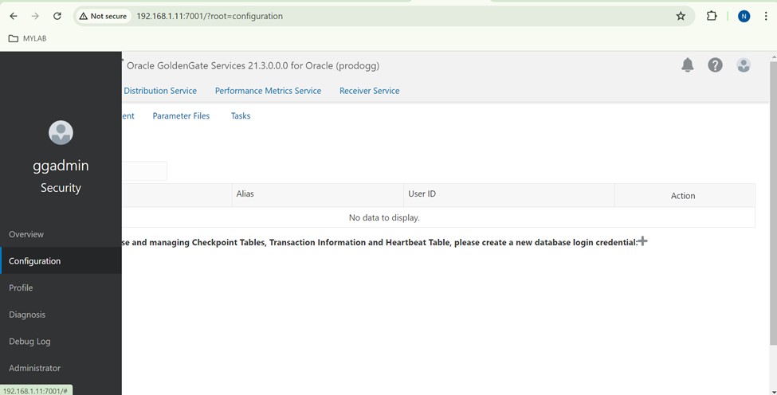
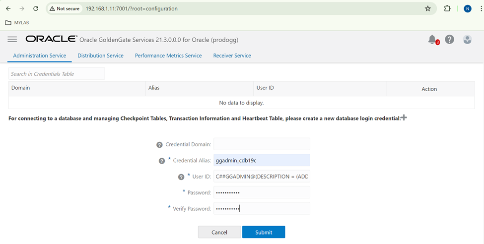
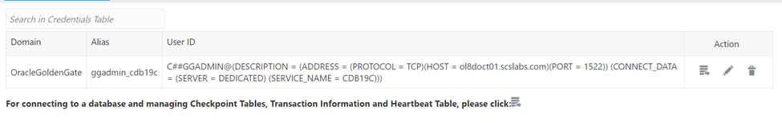
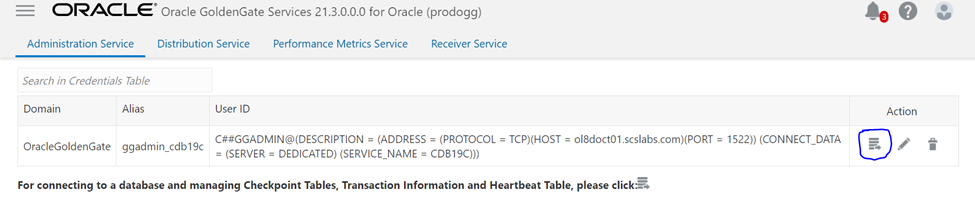
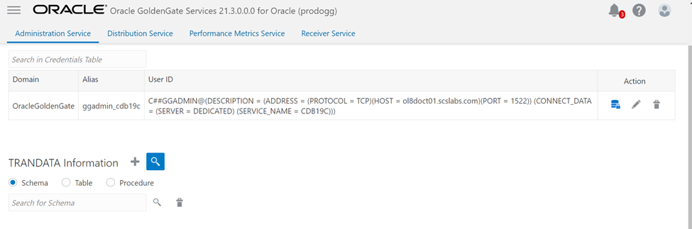
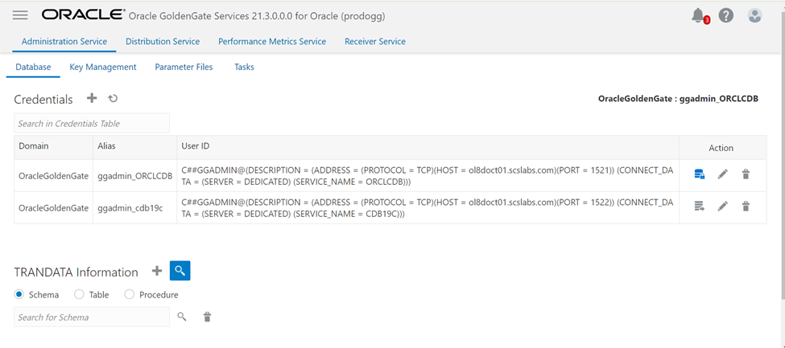

# Setup for oracle databases involved in Goldengate configuration

In this blog we will see the steps to make database ready for replication using oracle goldengate 21c.

We need to enable supplemental logging. It can be  at entire database level or at schema level. Here for now am enabling at database level at both source and target database.

``` wp-block-code
alter database force logging;
select force_logging from v$database;
alter database add supplemental log data;

set parameter enable_goldengate_replication to true:
show parameter enable_goldengate_replication;
alter system set enable_goldengate_replication=true scope=both;

set the stream_pool_size to atleast 1g this is used by Goldengate:
show parameter stream
alter system set streams_pool_size=1024m scope=both;
```

create c##ggadmin user in oracle database on source and target

``` wp-block-code
create user C##GGADMIN identified by xxxxx container=all;
```

grant the privilleges to c##ggadmin user

``` wp-block-code
 EXEC DBMS_GOLDENGATE_AUTH.GRANT_ADMIN_PRIVILEGE(grantee => 'C##GGADMIN', container => 'ALL');
-- For all containers manually, run in CDB$ROOT and PDBs if needed
EXEC DBMS_STREAMS_AUTH.GRANT_ADMIN_PRIVILEGE('C##GGADMIN');

grant insert on system.logmnr_restart_ckpt$ to C##GGADMIN container=all;
grant update on streams$_capture_process to C##GGADMIN container=all;
grant become user to C##GGADMIN container=all;
grant select any table to C##GGADMIN container=all;
GRANT CONNECT, RESOURCE TO C##GGADMIN container=all;
GRANT SELECT ANY DICTIONARY, SELECT ANY TABLE TO C##GGADMIN container=all;
GRANT CREATE TABLE TO C##GGADMIN container=all;
GRANT FLASHBACK ANY TABLE TO C##GGADMIN container=all;
GRANT EXECUTE ON dbms_flashback TO C##GGADMIN container=all;
GRANT EXECUTE ON utl_file TO C##GGADMIN container=all;
GRANT CREATE ANY TABLE TO C##GGADMIN container=all;
GRANT INSERT ANY TABLE TO C##GGADMIN container=all;
GRANT UPDATE ANY TABLE TO C##GGADMIN container=all;
GRANT DELETE ANY TABLE TO C##GGADMIN container=all;
GRANT DROP ANY TABLE TO C##GGADMIN container=all;
GRANT ALTER ANY TABLE TO C##GGADMIN container=all;
GRANT ALTER SYSTEM TO C##GGADMIN container=all;
GRANT LOCK ANY TABLE TO C##GGADMIN container=all;
GRANT SELECT ANY TRANSACTION to C##GGADMIN container=all;
ALTER USER C##GGADMIN QUOTA UNLIMITED ON users container=all;
alter user C##GGADMIN quota unlimited on users container=all;
exec dbms_goldengate_auth.grant_admin_privilege('C##GGADMIN','*', grant_optional_privileges=>'*');
```

Below grants run on each pdb invloved in gg configuration

``` wp-block-code
exec dbms_goldengate_auth.grant_admin_privilege('C##GGADMIN');
exec dbms_streams_auth.grant_admin_privilege('C##GGADMIN') ;
exec dbms_goldengate_auth.grant_admin_privilege('C##GGADMIN','*', grant_optional_privileges=>'*');
```

next step is to create credential alias

from admin console of gg navigate to configuration



Select add credentials



Userid should be in below format if you are not using tnsnames

``` wp-block-code
C##GGADMIN@(DESCRIPTION = (ADDRESS = (PROTOCOL = TCP)(HOST = ol8doct01.scslabs.com)(PORT = 1522)) (CONNECT_DATA = (SERVER = DEDICATED) (SERVICE_NAME = CDB19C)))
```



Connect to the database



In action click on database icon to connect to database.

If successfully connected you will see as below



Follow same steps to add target database also



on target add PDB also
